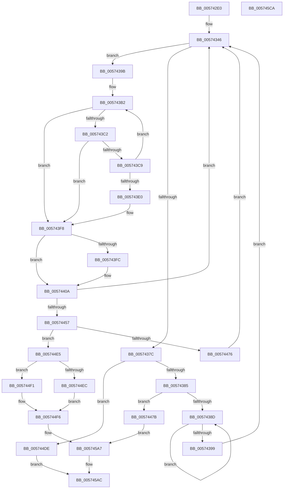

# HsaGetPageFault

- RVA: `0x005742E0`–`0x005745CB` (길이 `747` bytes)
- VA: `0x00000001405742E0`
- 실행 섹션: `.text`
- PDB 이름 있음: `예`; PDB Function 태그: `아니요`
- unwind 정보 RVA: `0x000C5478`
- 디코드: `192`개 명령, `747/747` bytes 표시
- 미해석 바이트: `0` (있으면 어셈블리에 `.byte`로 보존)

> 이 문서는 커널 이미지의 기계어와 PDB 기호를 분석해 생성했습니다. 4번과 5번은 함수 원형과 자료형을 바이너리 사용 방식에서 추정한 C 해석이며 원본 소스 복구 결과는 아닙니다.

## 1. Dependencies

- 직접 호출 지점: **3**; 고유 호출 대상: **3**
- 직접 호출자로 확인된 함수: **0**
- RIP 상대 이미지 참조: **3**

### Outgoing calls
- `0x005743CE` → [KeStallExecutionProcessor](../44/KeStallExecutionProcessor_function_0044F620.md) (function, `0x0044F620`)
- `0x005743F2` → [KeBugCheckEx](../4F/KeBugCheckEx_function_004FD660.md) (function, `0x004FD660`)
- `0x005745B4` → [_security_check_cookie](../6A/_security_check_cookie_function_006AC640.md) (function, `0x006AC640`)

### Direct callers
- 이 함수 시작 RVA로 연결되는 직접 call은 확인되지 않았습니다. 간접 호출은 완전히 역산할 수 없습니다.

### Static image references
- `0x005742F1` → RVA `0x00E0A740` (`.data`; read)
- `0x005743FC` → RVA `0x00F8F68C` (`.data`; read)
- `0x00574404` → RVA `0x00F8F68C` (`.data`; write)

## 2. Other-region calls and transfers

- 다른 실행 섹션으로 향하는 call: **0**
- 별도 외부 분기/꼬리 이동을 확인하지 못했습니다.

## 3. Assembly (complete function range)

```asm
005742E0  40 53                           push rbx
005742E2  55                              push rbp
005742E3  56                              push rsi
005742E4  57                              push rdi
005742E5  41 54                           push r12
005742E7  41 55                           push r13
005742E9  41 56                           push r14
005742EB  41 57                           push r15
005742ED  48 83 EC 78                     sub rsp, 0x78
005742F1  48 8B 05 48 64 89 00            mov rax, qword ptr [rip + 0x896448]
005742F8  48 33 C4                        xor rax, rsp
005742FB  48 89 44 24 68                  mov qword ptr [rsp + 0x68], rax
00574300  4C 8B 79 70                     mov r15, qword ptr [rcx + 0x70]
00574304  4C 8B EA                        mov r13, rdx
00574307  48 8B 94 24 E0 00 00 00         mov rdx, qword ptr [rsp + 0xe0]
0057430F  0F 57 C0                        xorps xmm0, xmm0
00574312  48 8B 39                        mov rdi, qword ptr [rcx]
00574315  4C 89 4C 24 38                  mov qword ptr [rsp + 0x38], r9
0057431A  4C 8B 8C 24 E8 00 00 00         mov r9, qword ptr [rsp + 0xe8]
00574322  48 89 54 24 40                  mov qword ptr [rsp + 0x40], rdx
00574327  48 8B 51 60                     mov rdx, qword ptr [rcx + 0x60]
0057432B  49 C1 EF 04                     shr r15, 4
0057432F  4C 89 4C 24 50                  mov qword ptr [rsp + 0x50], r9
00574334  45 33 C9                        xor r9d, r9d
00574337  48 89 54 24 30                  mov qword ptr [rsp + 0x30], rdx
0057433C  4C 89 44 24 48                  mov qword ptr [rsp + 0x48], r8
00574341  0F 11 44 24 58                  movups xmmword ptr [rsp + 0x58], xmm0
00574346  90                              nop
00574347  48 8B 8F 20 20 00 00            mov rcx, qword ptr [rdi + 0x2020]
0057434E  90                              nop
0057434F  48 8B 9F 30 20 00 00            mov rbx, qword ptr [rdi + 0x2030]
00574356  4C 8B F3                        mov r14, rbx
00574359  90                              nop
0057435A  48 8B 87 38 20 00 00            mov rax, qword ptr [rdi + 0x2038]
00574361  49 C1 EE 04                     shr r14, 4
00574365  49 8B F6                        mov rsi, r14
00574368  48 C1 E8 04                     shr rax, 4
0057436C  81 E6 FF 7F 00 00               and esi, 0x7fff
00574372  25 FF 7F 00 00                  and eax, 0x7fff
00574377  48 3B F0                        cmp rsi, rax
0057437A  75 1F                           jne 0x14057439b
0057437C  F6 C1 20                        test cl, 0x20
0057437F  0F 84 59 01 00 00               je 0x1405744de
00574385  84 C9                           test cl, cl
00574387  0F 89 EE 00 00 00               jns 0x14057447b
0057438D  90                              nop
0057438E  48 8B 87 20 20 00 00            mov rax, qword ptr [rdi + 0x2020]
00574395  84 C0                           test al, al
00574397  78 F4                           js 0x14057438d
00574399  EB AB                           jmp 0x140574346
0057439B  45 8B E6                        mov r12d, r14d
0057439E  48 C1 E6 04                     shl rsi, 4
005743A2  41 81 E4 FF 7F 00 00            and r12d, 0x7fff
005743A9  41 8B E9                        mov ebp, r9d
005743AC  41 FF C4                        inc r12d
005743AF  48 03 F2                        add rsi, rdx
005743B2  0F 10 06                        movups xmm0, xmmword ptr [rsi]
005743B5  F3 0F 7F 44 24 58               movdqu xmmword ptr [rsp + 0x58], xmm0
005743BB  4C 39 4C 24 58                  cmp qword ptr [rsp + 0x58], r9
005743C0  75 36                           jne 0x1405743f8
005743C2  4C 39 4C 24 60                  cmp qword ptr [rsp + 0x60], r9
005743C7  75 2F                           jne 0x1405743f8
005743C9  B9 0A 00 00 00                  mov ecx, 0xa
005743CE  E8 4D B2 ED FF                  call 0x14044f620
005743D3  45 33 C9                        xor r9d, r9d
005743D6  FF C5                           inc ebp
005743D8  81 FD A0 86 01 00               cmp ebp, 0x186a0
005743DE  76 D2                           jbe 0x1405743b2
005743E0  4C 21 4C 24 20                  and qword ptr [rsp + 0x20], r9
005743E5  45 33 C0                        xor r8d, r8d
005743E8  BA 00 20 00 00                  mov edx, 0x2000
005743ED  B9 59 01 00 00                  mov ecx, 0x159
005743F2  E8 69 92 F8 FF                  call 0x1404fd660
005743F7  CC                              int3
005743F8  85 ED                           test ebp, ebp
005743FA  74 0E                           je 0x14057440a
005743FC  8B 05 8A B2 A1 00               mov eax, dword ptr [rip + 0xa1b28a]
00574402  FF C0                           inc eax
00574404  89 05 82 B2 A1 00               mov dword ptr [rip + 0xa1b282], eax
0057440A  45 3B E7                        cmp r12d, r15d
0057440D  49 8D 46 01                     lea rax, [r14 + 1]
00574411  49 8B C9                        mov rcx, r9
00574414  0F 57 C0                        xorps xmm0, xmm0
00574417  48 0F 45 C8                     cmovne rcx, rax
0057441B  48 C1 E1 04                     shl rcx, 4
0057441F  0F 11 06                        movups xmmword ptr [rsi], xmm0
00574422  48 8B C1                        mov rax, rcx
00574425  90                              nop
00574426  48 33 C3                        xor rax, rbx
00574429  48 25 0F 00 F8 FF               and rax, 0xfffffffffff8000f
0057442F  48 33 C1                        xor rax, rcx
00574432  48 89 87 30 20 00 00            mov qword ptr [rdi + 0x2030], rax
00574439  F0 44 09 0C 24                  lock or dword ptr [rsp], r9d
0057443E  4C 8B 44 24 58                  mov r8, qword ptr [rsp + 0x58]
00574443  48 8B 54 24 30                  mov rdx, qword ptr [rsp + 0x30]
00574448  49 8B C0                        mov rax, r8
0057444B  48 C1 E8 3C                     shr rax, 0x3c
0057444F  3C 01                           cmp al, 1
00574451  0F 85 EF FE FF FF               jne 0x140574346
00574457  49 8B C0                        mov rax, r8
0057445A  48 B9 00 00 00 00 00 02 24 00   movabs rcx, 0x24020000000000
00574464  48 23 C1                        and rax, rcx
00574467  49 BA 00 00 00 00 00 02 00 00   movabs r10, 0x20000000000
00574471  49 3B C2                        cmp rax, r10
00574474  75 6F                           jne 0x1405744e5
00574476  E9 CB FE FF FF                  jmp 0x140574346
0057447B  90                              nop
0057447C  48 8B 4F 18                     mov rcx, qword ptr [rdi + 0x18]
00574480  48 0F BA F1 0D                  btr rcx, 0xd
00574485  48 89 4F 18                     mov qword ptr [rdi + 0x18], rcx
00574489  F0 44 09 0C 24                  lock or dword ptr [rsp], r9d
0057448E  48 C7 87 20 20 00 00 20 00 00 00  mov qword ptr [rdi + 0x2020], 0x20
00574499  F0 44 09 0C 24                  lock or dword ptr [rsp], r9d
0057449E  48 81 C9 00 60 00 00            or rcx, 0x6000
005744A5  48 89 4F 18                     mov qword ptr [rdi + 0x18], rcx
005744A9  F0 44 09 0C 24                  lock or dword ptr [rsp], r9d
005744AE  41 83 4D 00 FF                  or dword ptr [r13], 0xffffffff
005744B3  48 8B 4C 24 38                  mov rcx, qword ptr [rsp + 0x38]
005744B8  66 81 09 FF FF                  or word ptr [rcx], 0xffff
005744BD  48 8B 4C 24 40                  mov rcx, qword ptr [rsp + 0x40]
005744C2  4C 89 09                        mov qword ptr [rcx], r9
005744C5  48 8B 4C 24 50                  mov rcx, qword ptr [rsp + 0x50]
005744CA  48 C7 01 20 00 00 00            mov qword ptr [rcx], 0x20
005744D1  48 8B 4C 24 48                  mov rcx, qword ptr [rsp + 0x48]
005744D6  4C 89 09                        mov qword ptr [rcx], r9
005744D9  E9 C9 00 00 00                  jmp 0x1405745a7
005744DE  33 C0                           xor eax, eax
005744E0  E9 C7 00 00 00                  jmp 0x1405745ac
005744E5  49 0F BA E0 38                  bt r8, 0x38
005744EA  72 05                           jb 0x1405744f1
005744EC  83 C9 FF                        or ecx, 0xffffffff
005744EF  EB 05                           jmp 0x1405744f6
005744F1  0F B7 4C 24 5A                  movzx ecx, word ptr [rsp + 0x5a]
005744F6  41 89 4D 00                     mov dword ptr [r13], ecx
005744FA  48 BA 00 00 00 00 00 00 04 00   movabs rdx, 0x4000000000000
00574504  B9 FF 01 00 00                  mov ecx, 0x1ff
00574509  49 8B C0                        mov rax, r8
0057450C  48 C1 E8 20                     shr rax, 0x20
00574510  66 23 C1                        and ax, cx
00574513  48 8B 4C 24 38                  mov rcx, qword ptr [rsp + 0x38]
00574518  66 89 01                        mov word ptr [rcx], ax
0057451B  48 8B 4C 24 40                  mov rcx, qword ptr [rsp + 0x40]
00574520  48 8B 44 24 60                  mov rax, qword ptr [rsp + 0x60]
00574525  48 89 01                        mov qword ptr [rcx], rax
00574528  48 8B 4C 24 48                  mov rcx, qword ptr [rsp + 0x48]
0057452D  41 0F B7 C0                     movzx eax, r8w
00574531  48 89 01                        mov qword ptr [rcx], rax
00574534  49 8B C8                        mov rcx, r8
00574537  48 C1 E9 35                     shr rcx, 0x35
0057453B  49 8B C0                        mov rax, r8
0057453E  48 23 C2                        and rax, rdx
00574541  83 E1 01                        and ecx, 1
00574544  48 03 C9                        add rcx, rcx
00574547  48 8B D1                        mov rdx, rcx
0057454A  48 83 CA 01                     or rdx, 1
0057454E  48 85 C0                        test rax, rax
00574551  49 8B C0                        mov rax, r8
00574554  48 0F 44 D1                     cmove rdx, rcx
00574558  48 B9 00 00 00 00 00 00 02 00   movabs rcx, 0x2000000000000
00574562  48 23 C1                        and rax, rcx
00574565  48 8B CA                        mov rcx, rdx
00574568  48 83 C9 04                     or rcx, 4
0057456C  48 85 C0                        test rax, rax
0057456F  49 8B C0                        mov rax, r8
00574572  48 0F 44 CA                     cmove rcx, rdx
00574576  48 BA 00 00 00 00 00 00 40 00   movabs rdx, 0x40000000000000
00574580  48 23 C2                        and rax, rdx
00574583  48 8B D1                        mov rdx, rcx
00574586  48 83 CA 08                     or rdx, 8
0057458A  48 85 C0                        test rax, rax
0057458D  48 0F 45 D1                     cmovne rdx, rcx
00574591  48 8B 4C 24 50                  mov rcx, qword ptr [rsp + 0x50]
00574596  48 8B C2                        mov rax, rdx
00574599  48 83 C8 10                     or rax, 0x10
0057459D  4D 85 C2                        test r10, r8
005745A0  48 0F 44 C2                     cmove rax, rdx
005745A4  48 89 01                        mov qword ptr [rcx], rax
005745A7  B8 01 00 00 00                  mov eax, 1
005745AC  48 8B 4C 24 68                  mov rcx, qword ptr [rsp + 0x68]
005745B1  48 33 CC                        xor rcx, rsp
005745B4  E8 87 80 13 00                  call 0x1406ac640
005745B9  48 83 C4 78                     add rsp, 0x78
005745BD  41 5F                           pop r15
005745BF  41 5E                           pop r14
005745C1  41 5D                           pop r13
005745C3  41 5C                           pop r12
005745C5  5F                              pop rdi
005745C6  5E                              pop rsi
005745C7  5D                              pop rbp
005745C8  5B                              pop rbx
005745C9  C3                              ret
005745CA  CC                              int3
```

## 4. C-style interpretation (structured pseudocode)

```c
__int64 __fastcall HsaGetPageFault(__int64 a1, __int64 a2, __int64 a3, __int64 a4, __int64 a5, __int64 a6)
{
    __int64 result;
    __int64 v_r12;
    __int64 v_r14;
    __int64 v_r15;
    __int64 v_rbp;
    __int64 v_rsi;
    __int64 v_rsp;
    unsigned __int64 v_stack_m50;
    unsigned __int64 v_stack_m58;
    unsigned __int16 v_stack_m5E;
    unsigned __int64 v_stack_m60;
    unsigned __int64 v_stack_m68;
    unsigned __int64 v_stack_m70;
    unsigned __int64 v_stack_m78;
    unsigned __int64 v_stack_m80;
    unsigned __int64 v_stack_m88;
    unsigned __int64 v_stack_m98;
    unsigned int v_stack_mB8;

    v_rsp = (v_rsp) - (120);
    result = (*(unsigned __int64 *)(v_rip + 9004104)) ^ (v_rsp);
    v_stack_m50 = result;
    v_stack_m80 = a4;
    v_stack_m78 = a5;
    v_r15 = (*(unsigned __int64 *)(a1 + 112)) >> (4);
    v_stack_m68 = a6;
    a4 = 0;
    v_stack_m88 = *(unsigned __int64 *)(a1 + 96);
    v_stack_m70 = a3;
    v_stack_m60 = v_xmm0;
loc_00574346:
    v_r14 = (*(unsigned __int64 *)(*(unsigned __int64 *)(a1) + 8240)) >> (4);
    result = (*(unsigned __int64 *)(*(unsigned __int64 *)(a1) + 8248)) >> (4);
    v_rsi = (unsigned int)((v_r14) & (0x7FFFULL));
    result = (unsigned int)((result) & (0x7FFFULL));
    if (v_rsi != result) goto loc_0057439B;
    if ((((unsigned __int8)(*(unsigned __int64 *)(*(unsigned __int64 *)(a1) + 8224))) & (32)) == 0) goto loc_005744DE;
    if (!sign_flag) goto loc_0057447B;
loc_0057438D:
    if (sign_flag) goto loc_0057438D;
    goto loc_00574346;
loc_0057439B:
    v_rsi = (v_rsi) << (4);
    v_r12 = (unsigned int)(((unsigned int)((unsigned int)(v_r14))) & (0x7FFFULL));
    v_r12 = (unsigned int)((v_r12) + 1);
    v_rsi = (v_rsi) + (*(unsigned __int64 *)(a1 + 96));
loc_005743B2:
    v_stack_m60 = v_xmm0;
    if (v_stack_m60 != 0) goto loc_005743F8;
    if (v_stack_m58 != 0) goto loc_005743F8;
    result = KeStallExecutionProcessor(10, *(unsigned __int64 *)(a1 + 96), a3, a4);
    a4 = 0;
    v_rbp = (unsigned int)((0) + 1);
    if (((unsigned int)(v_rbp)) <= 0x186A0ULL) goto loc_005743B2;
    a3 = 0;
    result = KeBugCheckEx(345, (unsigned int)(0x2000ULL), a3, a4);
loc_005743F8:
    if ((unsigned int)(v_rbp) != 0) {
        result = *(unsigned int *)(v_rip + 10597002);
        result = (unsigned int)((result) + 1);
        *(unsigned int *)(v_rip + 10596994) = (unsigned int)(result);
    }
    a1 = 0;
    if (((unsigned int)(v_r12)) != ((unsigned int)(v_r15))) { a1 = v_r14 + 1; }
    a1 = (a1) << (4);
    *(unsigned __int64 *)(v_rsi) = v_xmm0;
    result = (a1) ^ (*(unsigned __int64 *)(*(unsigned __int64 *)(a1) + 8240));
    result = (result) & (0xFFFFFFFFFFF8000FULL);
    result = (result) ^ (a1);
    *(unsigned __int64 *)(*(unsigned __int64 *)(a1) + 8240) = result;
    result = (v_stack_m60) >> (60);
    if (((unsigned __int8)(result)) != 1) goto loc_00574346;
    result = (v_stack_m60) & (a1);
    if (result != v_r10) goto loc_005744E5;
    goto loc_00574346;
loc_0057447B:
    *(unsigned __int64 *)(*(unsigned __int64 *)(a1) + 24) = *(unsigned __int64 *)(*(unsigned __int64 *)(a1) + 24);
    *(unsigned __int64 *)(*(unsigned __int64 *)(a1) + 8224) = 32;
    a1 = (*(unsigned __int64 *)(*(unsigned __int64 *)(a1) + 24)) | (0x6000ULL);
    *(unsigned __int64 *)(*(unsigned __int64 *)(a1) + 24) = a1;
    *(unsigned __int64 *)(v_stack_m78) = 0;
    *(unsigned __int64 *)(v_stack_m68) = 32;
    *(unsigned __int64 *)(v_stack_m70) = 0;
    goto loc_005745A7;
loc_005744DE:
    result = 0;
    goto loc_005745AC;
loc_005744E5:
    if (condition_is_below) goto loc_005744F1;
    a1 = (unsigned int)((v_stack_m70) | (0xFFFFFFFFULL));
    goto loc_005744F6;
loc_005744F1:
loc_005744F6:
    *(unsigned int *)(a2) = (unsigned int)(v_stack_m5E);
    result = (v_stack_m60) >> (32);
    result = (unsigned __int16)((result) & (511));
    *(unsigned __int16 *)(v_stack_m80) = (unsigned __int16)(result);
    *(unsigned __int64 *)(v_stack_m78) = v_stack_m58;
    *(unsigned __int64 *)(v_stack_m70) = (unsigned __int16)(v_stack_m60);
    a1 = (v_stack_m60) >> (53);
    result = (v_stack_m60) & (v_stack_m88);
    a1 = (unsigned int)((a1) & (1));
    a1 = (a1) + (a1);
    a2 = (a1) | (1);
    if (result == 0) { a2 = a1; }
    result = (v_stack_m60) & (a1);
    a1 = (a2) | (4);
    if (result == 0) { a1 = a2; }
    result = (v_stack_m60) & (a2);
    a2 = (a1) | (8);
    if (result != 0) { a2 = a1; }
    result = (a2) | (16);
    if (((v_r10) & (v_stack_m60)) == 0) { result = a2; }
    *(unsigned __int64 *)(v_stack_m68) = result;
loc_005745A7:
loc_005745AC:
    a1 = (v_stack_m50) ^ (v_rsp);
    result = _security_check_cookie(a1, a2, v_stack_m60, a4);
    v_rsp = (v_rsp) + (120);
    return result;
}
```

## 5. (Beta) C Style

```c
int64_t HsaGetPageFault(void *Arg1, void *Arg2, int64_t Arg3, int64_t Arg4, int64_t Arg5, int64_t Arg6)
{
    uint8_t *arg1 = (uint8_t *)Arg1;
    uint8_t *arg2 = (uint8_t *)Arg2;

    int64_t result;
    int64_t local_r12;
    int64_t local_r14;
    int64_t local_r15;
    int64_t local_rbp;
    int64_t local_rsi;
    int64_t local_rsp;
    uint64_t v_stack_m50;
    uint64_t v_stack_m58;
    uint16_t v_stack_m5E;
    uint64_t v_stack_m60;
    uint64_t v_stack_m68;
    uint64_t v_stack_m70;
    uint64_t v_stack_m78;
    uint64_t v_stack_m80;
    uint64_t v_stack_m88;
    uint64_t v_stack_m98;
    uint32_t v_stack_mB8;

    local_rsp = (local_rsp) - (120);
    result = (*(uint64_t *)(v_rip + 0x896448)) ^ (local_rsp);
    v_stack_m50 = result;
    v_stack_m80 = Arg4;
    v_stack_m78 = Arg5;
    local_r15 = (*(uint64_t *)(arg1 + 0x70)) >> (4);
    v_stack_m68 = Arg6;
    Arg4 = 0;
    v_stack_m88 = *(uint64_t *)(arg1 + 0x60);
    v_stack_m70 = Arg3;
    v_stack_m60 = v_xmm0;
loc_00574346:
    local_r14 = (*(uint64_t *)(*(uint64_t *)(arg1) + 0x2030)) >> (4);
    result = (*(uint64_t *)(*(uint64_t *)(arg1) + 0x2038)) >> (4);
    local_rsi = (uint32_t)((local_r14) & (0x7FFFULL));
    result = (uint32_t)((result) & (0x7FFFULL));
    if (local_rsi != result) goto loc_0057439B;
    if ((((uint8_t)(*(uint64_t *)(*(uint64_t *)(arg1) + 0x2020))) & (32)) == 0) goto loc_005744DE;
    if (!sign_flag) goto loc_0057447B;
loc_0057438D:
    if (sign_flag) goto loc_0057438D;
    goto loc_00574346;
loc_0057439B:
    local_rsi = (local_rsi) << (4);
    local_r12 = (uint32_t)(((uint32_t)((uint32_t)(local_r14))) & (0x7FFFULL));
    local_r12 = (uint32_t)((local_r12) + 1);
    local_rsi = (local_rsi) + (*(uint64_t *)(arg1 + 0x60));
loc_005743B2:
    v_stack_m60 = v_xmm0;
    if (v_stack_m60 != 0) goto loc_005743F8;
    if (v_stack_m58 != 0) goto loc_005743F8;
    result = KeStallExecutionProcessor(10, *(uint64_t *)(arg1 + 0x60), Arg3, Arg4);
    Arg4 = 0;
    local_rbp = (uint32_t)((0) + 1);
    if (((uint32_t)(local_rbp)) <= 0x186A0ULL) goto loc_005743B2;
    Arg3 = 0;
    result = KeBugCheckEx(345, (uint32_t)(0x2000ULL), Arg3, Arg4);
loc_005743F8:
    if ((uint32_t)(local_rbp) != 0) {
        result = *(uint32_t *)(v_rip + 0xA1B28A);
        result = (uint32_t)((result) + 1);
        *(uint32_t *)(v_rip + 0xA1B282) = (uint32_t)(result);
    }
    Arg1 = 0;
    if (((uint32_t)(local_r12)) != ((uint32_t)(local_r15))) { Arg1 = local_r14 + 1; }
    Arg1 = (Arg1) << (4);
    *(uint64_t *)(local_rsi) = v_xmm0;
    result = (Arg1) ^ (*(uint64_t *)(*(uint64_t *)(arg1) + 0x2030));
    result = (result) & (0xFFFFFFFFFFF8000FULL);
    result = (result) ^ (Arg1);
    *(uint64_t *)(*(uint64_t *)(arg1) + 0x2030) = result;
    result = (v_stack_m60) >> (60);
    if (((uint8_t)(result)) != 1) goto loc_00574346;
    result = (v_stack_m60) & (Arg1);
    if (result != local_r10) goto loc_005744E5;
    goto loc_00574346;
loc_0057447B:
    *(uint64_t *)(*(uint64_t *)(arg1) + 0x18) = *(uint64_t *)(*(uint64_t *)(arg1) + 0x18);
    *(uint64_t *)(*(uint64_t *)(arg1) + 0x2020) = 32;
    Arg1 = (*(uint64_t *)(*(uint64_t *)(arg1) + 0x18)) | (0x6000ULL);
    *(void **)(*(uint64_t *)(arg1) + 0x18) = Arg1;
    *(uint64_t *)(v_stack_m78) = 0;
    *(uint64_t *)(v_stack_m68) = 32;
    *(uint64_t *)(v_stack_m70) = 0;
    goto loc_005745A7;
loc_005744DE:
    result = 0;
    goto loc_005745AC;
loc_005744E5:
    if (condition_is_below) goto loc_005744F1;
    Arg1 = (uint32_t)((v_stack_m70) | (0xFFFFFFFFULL));
    goto loc_005744F6;
loc_005744F1:
loc_005744F6:
    *(uint32_t *)(arg2) = (uint32_t)(v_stack_m5E);
    result = (v_stack_m60) >> (32);
    result = (uint16_t)((result) & (511));
    *(uint16_t *)(v_stack_m80) = (uint16_t)(result);
    *(uint64_t *)(v_stack_m78) = v_stack_m58;
    *(uint64_t *)(v_stack_m70) = (uint16_t)(v_stack_m60);
    Arg1 = (v_stack_m60) >> (53);
    result = (v_stack_m60) & (v_stack_m88);
    Arg1 = (uint32_t)((Arg1) & (1));
    Arg1 = (Arg1) + (Arg1);
    Arg2 = (Arg1) | (1);
    if (result == 0) { Arg2 = Arg1; }
    result = (v_stack_m60) & (Arg1);
    Arg1 = (Arg2) | (4);
    if (result == 0) { Arg1 = Arg2; }
    result = (v_stack_m60) & (Arg2);
    Arg2 = (Arg1) | (8);
    if (result != 0) { Arg2 = Arg1; }
    result = (Arg2) | (16);
    if (((local_r10) & (v_stack_m60)) == 0) { result = Arg2; }
    *(uint64_t *)(v_stack_m68) = result;
loc_005745A7:
loc_005745AC:
    Arg1 = (v_stack_m50) ^ (local_rsp);
    result = _security_check_cookie(Arg1, Arg2, v_stack_m60, Arg4);
    local_rsp = (local_rsp) + (120);
    return result;
}
```

### 관측된 메모리 오프셋

구조체 형식이 확인되지 않은 접근은 인자 기준의 오프셋으로만 기록했습니다.

| 기준 인자 | 오프셋 표현 | 폭 (bit) | 접근 |
|---|---:|---:|---|
| `Arg1` | `+ 0x0` | `64` | `R` |
| `Arg1` | `+ 0x60` | `64` | `R` |
| `Arg1` | `+ 0x70` | `64` | `R` |
| `Arg2` | `+ 0x0` | `32` | `R/W` |
| `Arg2` | `+ 0x0` | `32` | `W` |

## 6. Execution-region graph

[열기: 2D/3D 그래프와 함수 탐색 컨트롤 패널](../../../control-panel.html?section=text&rva=0x005742E0&view=graph)

- 2D 그래프는 위에서 아래로 흐르고, 3D 그래프는 빈 공간을 드래그해 회전합니다. Shift+드래그는 이동, 휠은 확대·축소, 함수 노드 선택은 대상 보고서 이동입니다.

### Static fallback


