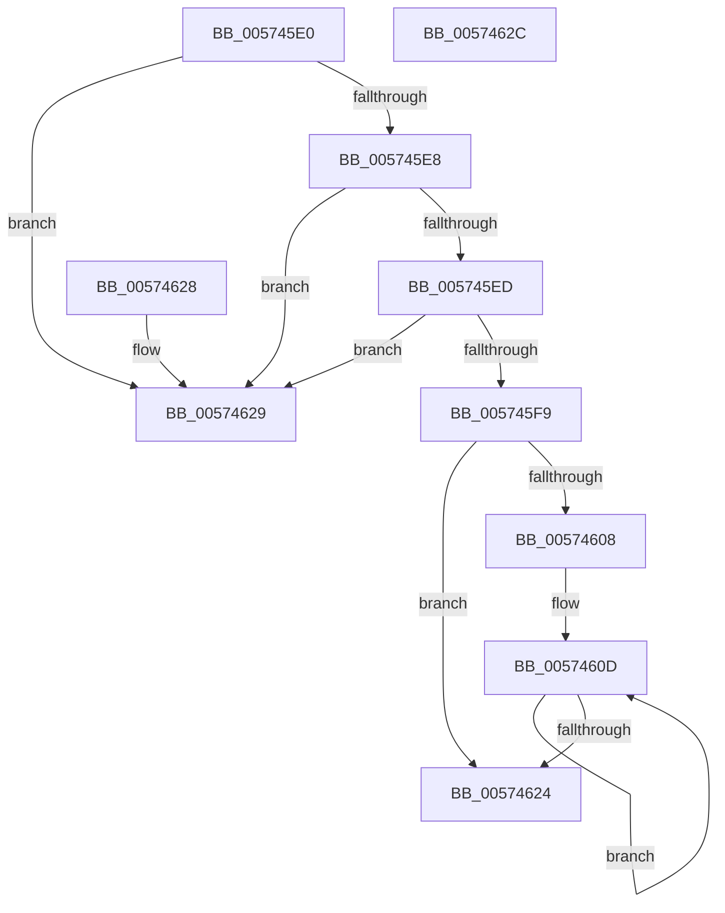

# HsaGetRidAcpiMapCount

- RVA: `0x005745E0`–`0x0057462D` (길이 `77` bytes)
- VA: `0x00000001405745E0`
- 실행 섹션: `.text`
- PDB 이름 있음: `예`; PDB Function 태그: `아니요`
- unwind 정보 RVA: `0x000DB714`
- 디코드: `26`개 명령, `77/77` bytes 표시
- 미해석 바이트: `0` (있으면 어셈블리에 `.byte`로 보존)

> 이 문서는 커널 이미지의 기계어와 PDB 기호를 분석해 생성했습니다. 4번과 5번은 함수 원형과 자료형을 바이너리 사용 방식에서 추정한 C 해석이며 원본 소스 복구 결과는 아닙니다.

## 1. Dependencies

- 직접 호출 지점: **0**; 고유 호출 대상: **0**
- 직접 호출자로 확인된 함수: **0**
- RIP 상대 이미지 참조: **0**

### Outgoing calls
- 직접 디코드된 call 명령이 없습니다.

### Direct callers
- 이 함수 시작 RVA로 연결되는 직접 call은 확인되지 않았습니다. 간접 호출은 완전히 역산할 수 없습니다.

### Static image references
- 디코드된 RIP-relative 메모리 참조가 없습니다.

## 2. Other-region calls and transfers

- 다른 실행 섹션으로 향하는 call: **0**
- 별도 외부 분기/꼬리 이동을 확인하지 못했습니다.

## 3. Assembly (complete function range)

```asm
005745E0  45 33 C0                        xor r8d, r8d
005745E3  48 85 D2                        test rdx, rdx
005745E6  74 41                           je 0x140574629
005745E8  83 3A 01                        cmp dword ptr [rdx], 1
005745EB  75 3C                           jne 0x140574629
005745ED  0F B7 42 08                     movzx eax, word ptr [rdx + 8]
005745F1  39 81 A0 00 00 00               cmp dword ptr [rcx + 0xa0], eax
005745F7  75 30                           jne 0x140574629
005745F9  4C 8D 89 E0 00 00 00            lea r9, [rcx + 0xe0]
00574600  49 8B 09                        mov rcx, qword ptr [r9]
00574603  49 3B C9                        cmp rcx, r9
00574606  74 1C                           je 0x140574624
00574608  44 0F B7 52 0C                  movzx r10d, word ptr [rdx + 0xc]
0057460D  44 39 51 18                     cmp dword ptr [rcx + 0x18], r10d
00574611  41 8D 50 01                     lea edx, [r8 + 1]
00574615  48 8B 09                        mov rcx, qword ptr [rcx]
00574618  41 0F 45 D0                     cmovne edx, r8d
0057461C  44 8B C2                        mov r8d, edx
0057461F  49 3B C9                        cmp rcx, r9
00574622  75 E9                           jne 0x14057460d
00574624  41 8B C0                        mov eax, r8d
00574627  C3                              ret
00574628  CC                              int3
00574629  33 C0                           xor eax, eax
0057462B  C3                              ret
0057462C  CC                              int3
```

## 4. C-style interpretation (structured pseudocode)

```c
__int64 __fastcall HsaGetRidAcpiMapCount(__int64 a1, __int64 a2, int a3)
{
    __int64 result;

    a3 = 0;
    if (a2 == 0) goto loc_00574629;
    if ((*(unsigned int *)(a2)) != 1) goto loc_00574629;
    if ((*(unsigned int *)(a1 + 160)) != ((unsigned int)(*(unsigned __int16 *)(a2 + 8)))) goto loc_00574629;
    if ((*(unsigned __int64 *)(a1 + 224)) == (a1 + 224)) goto loc_00574624;
loc_0057460D:
    a2 = a3 + 1;
    if ((*(unsigned int *)(*(unsigned __int64 *)(a1 + 224) + 24)) != ((unsigned int)(*(unsigned __int16 *)(a2 + 12)))) { a2 = 0; }
    if ((*(unsigned __int64 *)(*(unsigned __int64 *)(a1 + 224))) != (a1 + 224)) goto loc_0057460D;
loc_00574624:
    return (unsigned int)((unsigned int)((unsigned int)((unsigned int)(a2))));
loc_00574629:
    result = 0;
    return result;
}
```

## 5. (Beta) C Style

```c
int64_t HsaGetRidAcpiMapCount(void *Arg1, int64_t Arg2, int32_t Arg3)
{
    uint8_t *arg1 = (uint8_t *)Arg1;

    int64_t result;

    Arg3 = 0;
    if (Arg2 == 0) goto loc_00574629;
    if ((*(uint32_t *)(Arg2)) != 1) goto loc_00574629;
    if ((*(uint32_t *)(arg1 + 0xA0)) != ((uint32_t)(*(uint16_t *)(Arg2 + 0x8)))) goto loc_00574629;
    if ((*(uint64_t *)(arg1 + 0xE0)) == (Arg1 + 224)) goto loc_00574624;
loc_0057460D:
    Arg2 = Arg3 + 1;
    if ((*(uint32_t *)(*(uint64_t *)(arg1 + 0xE0) + 0x18)) != ((uint32_t)(*(uint16_t *)(Arg2 + 0xC)))) { Arg2 = 0; }
    if ((*(uint64_t *)(*(uint64_t *)(arg1 + 0xE0))) != (Arg1 + 224)) goto loc_0057460D;
loc_00574624:
    return (uint32_t)((uint32_t)((uint32_t)((uint32_t)(Arg2))));
loc_00574629:
    result = 0;
    return result;
}
```

### 관측된 메모리 오프셋

구조체 형식이 확인되지 않은 접근은 인자 기준의 오프셋으로만 기록했습니다.

| 기준 인자 | 오프셋 표현 | 폭 (bit) | 접근 |
|---|---:|---:|---|
| `Arg1` | `+ 0x0` | `64` | `R` |
| `Arg1` | `+ 0xA0` | `32` | `R` |
| `Arg1` | `+ 0xE0` | `64` | `R` |

## 6. Execution-region graph

[열기: 2D/3D 그래프와 함수 탐색 컨트롤 패널](../../../control-panel.html?section=text&rva=0x005745E0&view=graph)

- 2D 그래프는 위에서 아래로 흐르고, 3D 그래프는 빈 공간을 드래그해 회전합니다. Shift+드래그는 이동, 휠은 확대·축소, 함수 노드 선택은 대상 보고서 이동입니다.

### Static fallback


