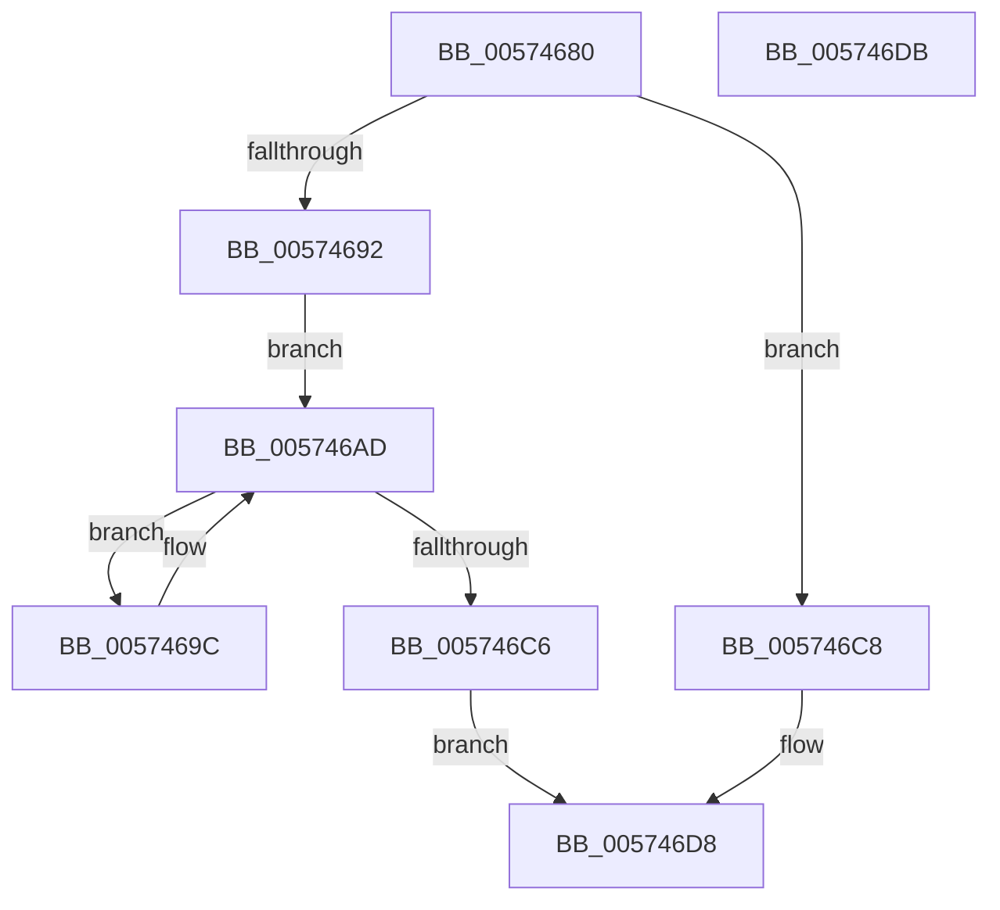

# HsaHandleInterrupt

- RVA: `0x00574680`–`0x005746DC` (길이 `92` bytes)
- VA: `0x0000000140574680`
- 실행 섹션: `.text`
- PDB 이름 있음: `예`; PDB Function 태그: `아니요`
- unwind 정보 RVA: `0x000DB714`
- 디코드: `28`개 명령, `92/92` bytes 표시
- 미해석 바이트: `0` (있으면 어셈블리에 `.byte`로 보존)

> 이 문서는 커널 이미지의 기계어와 PDB 기호를 분석해 생성했습니다. 4번과 5번은 함수 원형과 자료형을 바이너리 사용 방식에서 추정한 C 해석이며 원본 소스 복구 결과는 아닙니다.

## 1. Dependencies

- 직접 호출 지점: **0**; 고유 호출 대상: **0**
- 직접 호출자로 확인된 함수: **0**
- RIP 상대 이미지 참조: **4**

### Outgoing calls
- 직접 디코드된 call 명령이 없습니다.

### Direct callers
- 이 함수 시작 RVA로 연결되는 직접 call은 확인되지 않았습니다. 간접 호출은 완전히 역산할 수 없습니다.

### Static image references
- `0x0057469C` → RVA `0x00F8F640` (`.data`; read)
- `0x005746A4` → RVA `0x00F8F640` (`.data`; write)
- `0x005746C8` → RVA `0x00F8F698` (`.data`; read)
- `0x005746D2` → RVA `0x00F8F698` (`.data`; write)

## 2. Other-region calls and transfers

- 다른 실행 섹션으로 향하는 call: **0**
- 별도 외부 분기/꼬리 이동을 확인하지 못했습니다.

## 3. Assembly (complete function range)

```asm
00574680  4C 8B 09                        mov r9, qword ptr [rcx]
00574683  4C 8B C1                        mov r8, rcx
00574686  90                              nop
00574687  49 8B 81 20 20 00 00            mov rax, qword ptr [r9 + 0x2020]
0057468E  A8 67                           test al, 0x67
00574690  74 36                           je 0x1405746c8
00574692  48 8B 09                        mov rcx, qword ptr [rcx]
00574695  B2 01                           mov dl, 1
00574697  83 E0 47                        and eax, 0x47
0057469A  EB 11                           jmp 0x1405746ad
0057469C  8B 0D 9E AF A1 00               mov ecx, dword ptr [rip + 0xa1af9e]
005746A2  FF C1                           inc ecx
005746A4  89 0D 96 AF A1 00               mov dword ptr [rip + 0xa1af96], ecx
005746AA  49 8B 08                        mov rcx, qword ptr [r8]
005746AD  48 89 81 20 20 00 00            mov qword ptr [rcx + 0x2020], rax
005746B4  F0 83 0C 24 00                  lock or dword ptr [rsp], 0
005746B9  90                              nop
005746BA  49 8B 81 20 20 00 00            mov rax, qword ptr [r9 + 0x2020]
005746C1  83 E0 67                        and eax, 0x67
005746C4  75 D6                           jne 0x14057469c
005746C6  EB 10                           jmp 0x1405746d8
005746C8  8B 0D CA AF A1 00               mov ecx, dword ptr [rip + 0xa1afca]
005746CE  32 D2                           xor dl, dl
005746D0  FF C1                           inc ecx
005746D2  89 0D C0 AF A1 00               mov dword ptr [rip + 0xa1afc0], ecx
005746D8  8A C2                           mov al, dl
005746DA  C3                              ret
005746DB  CC                              int3
```

## 4. C-style interpretation (structured pseudocode)

```c
__int64 __fastcall HsaHandleInterrupt(__int64 a1)
{
    __int64 result;
    unsigned int v_stack_p0;

    if ((((unsigned __int8)(*(unsigned __int64 *)(*(unsigned __int64 *)(a1) + 8224))) & (103)) == 0) goto loc_005746C8;
    result = (unsigned int)((*(unsigned __int64 *)(*(unsigned __int64 *)(a1) + 8224)) & (71));
    goto loc_005746AD;
loc_0057469C:
    a1 = (unsigned int)(((unsigned int)(*(unsigned int *)(v_rip + 10596254))) + 1);
    *(unsigned int *)(v_rip + 10596246) = (unsigned int)(a1);
loc_005746AD:
    *(unsigned __int64 *)(*(unsigned __int64 *)(a1) + 8224) = result;
    result = (unsigned int)((*(unsigned __int64 *)(*(unsigned __int64 *)(a1) + 8224)) & (103));
    if (condition_is_not_equal) goto loc_0057469C;
    goto loc_005746D8;
loc_005746C8:
    a2 = 0;
    a1 = (unsigned int)(((unsigned int)(*(unsigned int *)(v_rip + 10596298))) + 1);
    *(unsigned int *)(v_rip + 10596288) = (unsigned int)(a1);
loc_005746D8:
    return 0;
}
```

## 5. (Beta) C Style

```c
int64_t HsaHandleInterrupt(void *Arg1)
{
    uint8_t *arg1 = (uint8_t *)Arg1;

    int64_t result;
    uint32_t v_stack_p0;

    if ((((uint8_t)(*(uint64_t *)(*(uint64_t *)(arg1) + 0x2020))) & (103)) == 0) goto loc_005746C8;
    result = (uint32_t)((*(uint64_t *)(*(uint64_t *)(arg1) + 0x2020)) & (71));
    goto loc_005746AD;
loc_0057469C:
    Arg1 = (uint32_t)(((uint32_t)(*(uint32_t *)(v_rip + 0xA1AF9E))) + 1);
    *(uint32_t *)(v_rip + 0xA1AF96) = (uint32_t)(Arg1);
loc_005746AD:
    *(uint64_t *)(*(uint64_t *)(arg1) + 0x2020) = result;
    result = (uint32_t)((*(uint64_t *)(*(uint64_t *)(arg1) + 0x2020)) & (103));
    if (condition_is_not_equal) goto loc_0057469C;
    goto loc_005746D8;
loc_005746C8:
    a2 = 0;
    Arg1 = (uint32_t)(((uint32_t)(*(uint32_t *)(v_rip + 0xA1AFCA))) + 1);
    *(uint32_t *)(v_rip + 0xA1AFC0) = (uint32_t)(Arg1);
loc_005746D8:
    return 0;
}
```

### 관측된 메모리 오프셋

구조체 형식이 확인되지 않은 접근은 인자 기준의 오프셋으로만 기록했습니다.

| 기준 인자 | 오프셋 표현 | 폭 (bit) | 접근 |
|---|---:|---:|---|
| `Arg1` | `+ 0x0` | `64` | `R` |

## 6. Execution-region graph

[열기: 2D/3D 그래프와 함수 탐색 컨트롤 패널](../../../control-panel.html?section=text&rva=0x00574680&view=graph)

- 2D 그래프는 위에서 아래로 흐르고, 3D 그래프는 빈 공간을 드래그해 회전합니다. Shift+드래그는 이동, 휠은 확대·축소, 함수 노드 선택은 대상 보고서 이동입니다.

### Static fallback


