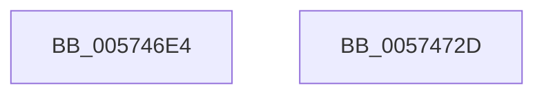

# HsaInvalidateDTE

- RVA: `0x005746E4`–`0x0057472E` (길이 `74` bytes)
- VA: `0x00000001405746E4`
- 실행 섹션: `.text`
- PDB 이름 있음: `예`; PDB Function 태그: `아니요`
- unwind 정보 RVA: `0x00084AC0`
- 디코드: `21`개 명령, `74/74` bytes 표시
- 미해석 바이트: `0` (있으면 어셈블리에 `.byte`로 보존)

> 이 문서는 커널 이미지의 기계어와 PDB 기호를 분석해 생성했습니다. 4번과 5번은 함수 원형과 자료형을 바이너리 사용 방식에서 추정한 C 해석이며 원본 소스 복구 결과는 아닙니다.

## 1. Dependencies

- 직접 호출 지점: **2**; 고유 호출 대상: **2**
- 직접 호출자로 확인된 함수: **1**
- RIP 상대 이미지 참조: **0**

### Outgoing calls
- `0x00574713` → [HsaIommuSendCommand](../44/HsaIommuSendCommand_function_0044E1DC.md) (function, `0x0044E1DC`)
- `0x0057471D` → [HsaIommuWaitCommand](../44/HsaIommuWaitCommand_function_0044E1A8.md) (function, `0x0044E1A8`)

### Direct callers
- [HsaUpdateDeviceTableEntry](../44/HsaUpdateDeviceTableEntry_function_0044E404.md) at `0x0044E666`

### Static image references
- 디코드된 RIP-relative 메모리 참조가 없습니다.

## 2. Other-region calls and transfers

- 다른 실행 섹션으로 향하는 call: **0**
- 별도 외부 분기/꼬리 이동을 확인하지 못했습니다.

## 3. Assembly (complete function range)

```asm
005746E4  4C 8B DC                        mov r11, rsp
005746E7  49 89 5B 08                     mov qword ptr [r11 + 8], rbx
005746EB  57                              push rdi
005746EC  48 83 EC 30                     sub rsp, 0x30
005746F0  49 83 63 F0 00                  and qword ptr [r11 - 0x10], 0
005746F5  48 B8 00 00 00 00 00 00 00 20   movabs rax, 0x2000000000000000
005746FF  0F B7 D2                        movzx edx, dx
00574702  41 8B F8                        mov edi, r8d
00574705  48 0B D0                        or rdx, rax
00574708  48 8B D9                        mov rbx, rcx
0057470B  49 89 53 E8                     mov qword ptr [r11 - 0x18], rdx
0057470F  49 8D 53 E8                     lea rdx, [r11 - 0x18]
00574713  E8 C4 9A ED FF                  call 0x14044e1dc
00574718  8B D7                           mov edx, edi
0057471A  48 8B CB                        mov rcx, rbx
0057471D  E8 86 9A ED FF                  call 0x14044e1a8
00574722  48 8B 5C 24 40                  mov rbx, qword ptr [rsp + 0x40]
00574727  48 83 C4 30                     add rsp, 0x30
0057472B  5F                              pop rdi
0057472C  C3                              ret
0057472D  CC                              int3
```

## 4. C-style interpretation (structured pseudocode)

```c
__int64 __fastcall HsaInvalidateDTE(__int64 a1, unsigned __int16 a2, int a3)
{
    __int64 result;
    __int64 v_rsp;
    unsigned __int64 v_stack_p8;

    *(unsigned __int64 *)(v_rsp + 8) = v_rbx;
    v_rsp = (v_rsp) - (48);
    a2 = (a2) | (result);
    *(unsigned __int64 *)(v_rsp - 24) = a2;
    result = HsaIommuSendCommand(a1, v_rsp - 24, a3, a4);
    result = HsaIommuWaitCommand(a1, (unsigned int)((unsigned int)((unsigned int)(a3))), a3, a4);
    v_rsp = (v_rsp) + (48);
    return result;
}
```

## 5. (Beta) C Style

```c
int64_t HsaInvalidateDTE(int64_t Arg1, uint16_t Arg2, int32_t Arg3)
{
    int64_t result;
    int64_t local_rsp;
    uint64_t v_stack_p8;

    *(uint64_t *)(local_rsp + 0x8) = local_rbx;
    local_rsp = (local_rsp) - (48);
    Arg2 = (Arg2) | (result);
    *(uint64_t *)(local_rsp - 0x18) = Arg2;
    result = HsaIommuSendCommand(Arg1, local_rsp - 24, Arg3, a4);
    result = HsaIommuWaitCommand(Arg1, (uint32_t)((uint32_t)((uint32_t)(Arg3))), Arg3, a4);
    local_rsp = (local_rsp) + (48);
    return result;
}
```

## 6. Execution-region graph

[열기: 2D/3D 그래프와 함수 탐색 컨트롤 패널](../../../control-panel.html?section=text&rva=0x005746E4&view=graph)

- 2D 그래프는 위에서 아래로 흐르고, 3D 그래프는 빈 공간을 드래그해 회전합니다. Shift+드래그는 이동, 휠은 확대·축소, 함수 노드 선택은 대상 보고서 이동입니다.

### Static fallback


