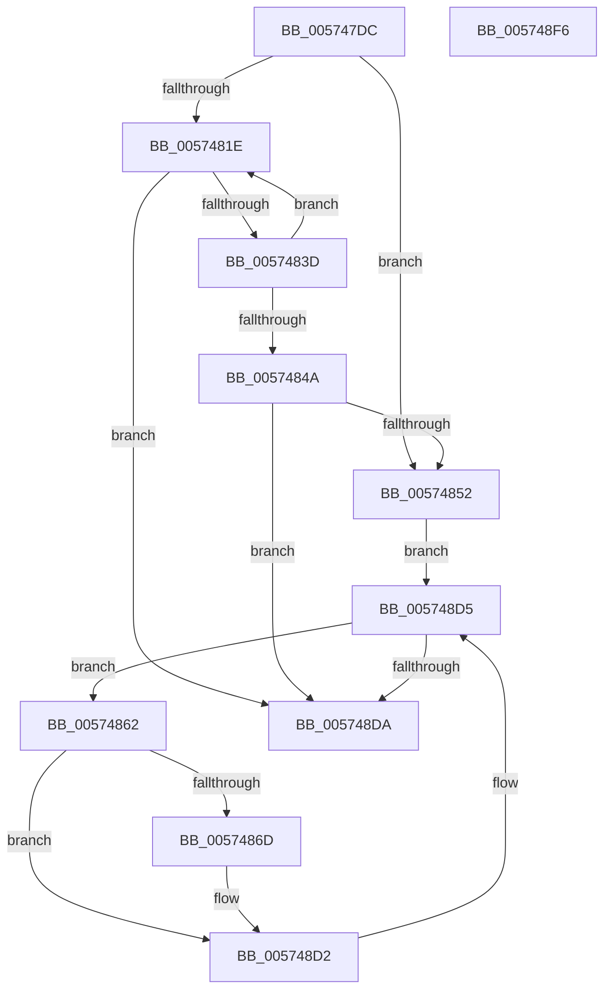

# HsaProcessDeviceExceptions

- RVA: `0x005747DC`–`0x005748F7` (길이 `283` bytes)
- VA: `0x00000001405747DC`
- 실행 섹션: `.text`
- PDB 이름 있음: `예`; PDB Function 태그: `아니요`
- unwind 정보 RVA: `0x000C54C8`
- 디코드: `69`개 명령, `283/283` bytes 표시
- 미해석 바이트: `0` (있으면 어셈블리에 `.byte`로 보존)

> 이 문서는 커널 이미지의 기계어와 PDB 기호를 분석해 생성했습니다. 4번과 5번은 함수 원형과 자료형을 바이너리 사용 방식에서 추정한 C 해석이며 원본 소스 복구 결과는 아닙니다.

## 1. Dependencies

- 직접 호출 지점: **4**; 고유 호출 대상: **3**
- 직접 호출자로 확인된 함수: **1**
- RIP 상대 이미지 참조: **1**

### Outgoing calls
- `0x00574801` → [memset](../6C/memset_function_006C6C40.md) (function, `0x006C6C40`)
- `0x0057482E` → [HalpHsapInitializeReservedDomain](HalpHsapInitializeReservedDomain_function_00572B7C.md) (function, `0x00572B7C`)
- `0x00574878` → [memset](../6C/memset_function_006C6C40.md) (function, `0x006C6C40`)
- `0x005748CD` → [HsaUpdateDeviceTableEntry](../44/HsaUpdateDeviceTableEntry_function_0044E404.md) (function, `0x0044E404`)

### Direct callers
- [HsaInitializeIommu](../../pagelk/B6/HsaInitializeIommu_function_00B63140.md) at `0x00B63421`

### Static image references
- `0x00574852` → RVA `0x00FC1720` (`.data`; read)

## 2. Other-region calls and transfers

- 다른 실행 섹션으로 향하는 call: **0**
- 별도 외부 분기/꼬리 이동을 확인하지 못했습니다.

## 3. Assembly (complete function range)

```asm
005747DC  48 8B C4                        mov rax, rsp
005747DF  48 89 58 10                     mov qword ptr [rax + 0x10], rbx
005747E3  48 89 70 18                     mov qword ptr [rax + 0x18], rsi
005747E7  48 89 78 20                     mov qword ptr [rax + 0x20], rdi
005747EB  41 56                           push r14
005747ED  48 81 EC C0 00 00 00            sub rsp, 0xc0
005747F4  33 D2                           xor edx, edx
005747F6  48 8B F1                        mov rsi, rcx
005747F9  48 8D 48 88                     lea rcx, [rax - 0x78]
005747FD  44 8D 42 70                     lea r8d, [rdx + 0x70]
00574801  E8 3A 24 15 00                  call 0x1406c6c40
00574806  48 8B 96 D8 00 00 00            mov rdx, qword ptr [rsi + 0xd8]
0057480D  33 FF                           xor edi, edi
0057480F  48 83 A4 24 D0 00 00 00 00      and qword ptr [rsp + 0xd0], 0
00574818  33 DB                           xor ebx, ebx
0057481A  39 1A                           cmp dword ptr [rdx], ebx
0057481C  76 34                           jbe 0x140574852
0057481E  8B C3                           mov eax, ebx
00574820  48 8B CE                        mov rcx, rsi
00574823  48 C1 E0 04                     shl rax, 4
00574827  48 83 C0 08                     add rax, 8
0057482B  48 03 D0                        add rdx, rax
0057482E  E8 49 E3 FF FF                  call 0x140572b7c
00574833  8B F8                           mov edi, eax
00574835  85 C0                           test eax, eax
00574837  0F 88 9D 00 00 00               js 0x1405748da
0057483D  48 8B 96 D8 00 00 00            mov rdx, qword ptr [rsi + 0xd8]
00574844  FF C3                           inc ebx
00574846  3B 1A                           cmp ebx, dword ptr [rdx]
00574848  72 D4                           jb 0x14057481e
0057484A  85 C0                           test eax, eax
0057484C  0F 88 88 00 00 00               js 0x1405748da
00574852  48 8B 1D C7 CE A4 00            mov rbx, qword ptr [rip + 0xa4cec7]
00574859  4C 8D 35 C0 CE A4 00            lea r14, [rip + 0xa4cec0]
00574860  EB 73                           jmp 0x1405748d5
00574862  8B 86 A0 00 00 00               mov eax, dword ptr [rsi + 0xa0]
00574868  39 43 10                        cmp dword ptr [rbx + 0x10], eax
0057486B  75 65                           jne 0x1405748d2
0057486D  33 D2                           xor edx, edx
0057486F  48 8D 4C 24 58                  lea rcx, [rsp + 0x58]
00574874  44 8D 42 68                     lea r8d, [rdx + 0x68]
00574878  E8 C3 23 15 00                  call 0x1406c6c40
0057487D  48 83 64 24 48 00               and qword ptr [rsp + 0x48], 0
00574883  48 8D 94 24 D0 00 00 00         lea rdx, [rsp + 0xd0]
0057488B  8B 43 18                        mov eax, dword ptr [rbx + 0x18]
0057488E  41 B1 01                        mov r9b, 1
00574891  83 64 24 54 00                  and dword ptr [rsp + 0x54], 0
00574896  45 33 C0                        xor r8d, r8d
00574899  83 A4 24 D4 00 00 00 00         and dword ptr [rsp + 0xd4], 0
005748A1  48 8B CE                        mov rcx, rsi
005748A4  89 84 24 D0 00 00 00            mov dword ptr [rsp + 0xd0], eax
005748AB  48 8D 44 24 50                  lea rax, [rsp + 0x50]
005748B0  C7 44 24 30 01 00 00 00         mov dword ptr [rsp + 0x30], 1
005748B8  C7 44 24 28 01 00 00 00         mov dword ptr [rsp + 0x28], 1
005748C0  48 89 44 24 20                  mov qword ptr [rsp + 0x20], rax
005748C5  C7 44 24 50 01 00 00 00         mov dword ptr [rsp + 0x50], 1
005748CD  E8 32 9B ED FF                  call 0x14044e404
005748D2  48 8B 1B                        mov rbx, qword ptr [rbx]
005748D5  49 3B DE                        cmp rbx, r14
005748D8  75 88                           jne 0x140574862
005748DA  4C 8D 9C 24 C0 00 00 00         lea r11, [rsp + 0xc0]
005748E2  8B C7                           mov eax, edi
005748E4  49 8B 5B 18                     mov rbx, qword ptr [r11 + 0x18]
005748E8  49 8B 73 20                     mov rsi, qword ptr [r11 + 0x20]
005748EC  49 8B 7B 28                     mov rdi, qword ptr [r11 + 0x28]
005748F0  49 8B E3                        mov rsp, r11
005748F3  41 5E                           pop r14
005748F5  C3                              ret
005748F6  CC                              int3
```

## 4. C-style interpretation (structured pseudocode)

```c
__int64 __fastcall HsaProcessDeviceExceptions(__int64 a1, int a2)
{
    __int64 result;
    __int64 v_rbx;
    __int64 v_rdi;
    __int64 v_rsp;
    unsigned __int64 v_stack_m70;
    unsigned int v_stack_m74;
    unsigned __int64 v_stack_m78;
    unsigned __int64 v_stack_m8;
    unsigned __int64 v_stack_m80;
    unsigned int v_stack_m98;
    unsigned int v_stack_mA0;
    unsigned __int64 v_stack_mA8;
    unsigned __int64 v_stack_p8;
    unsigned int v_stack_pC;

    *(unsigned __int64 *)(v_rsp + 16) = v_rbx;
    *(unsigned __int64 *)(v_rsp + 24) = v_rsi;
    *(unsigned __int64 *)(v_rsp + 32) = v_rdi;
    v_rsp = (v_rsp) - (192);
    a2 = 0;
    result = memset(v_rsp - 120, a2, a2 + 112, a4);
    v_rdi = 0;
    v_rbx = 0;
    if ((*(unsigned int *)(*(unsigned __int64 *)(a1 + 216))) <= 0) goto loc_00574852;
loc_0057481E:
    result = (0) << (4);
    result = (result) + (8);
    a2 = (*(unsigned __int64 *)(a1 + 216)) + (result);
    result = HalpHsapInitializeReservedDomain(a1, a2, a2 + 112, a4);
    if (sign_flag) goto loc_005748DA;
    v_rbx = (unsigned int)((v_rbx) + 1);
    if (((unsigned int)(v_rbx)) < (*(unsigned int *)(*(unsigned __int64 *)(a1 + 216)))) goto loc_0057481E;
    if (sign_flag) goto loc_005748DA;
loc_00574852:
    goto loc_005748D5;
loc_00574862:
    result = (unsigned int)(*(unsigned int *)(a1 + 160));
    if ((*(unsigned int *)(*(unsigned __int64 *)(v_rip + 10800839) + 16)) == ((unsigned int)((unsigned int)(*(unsigned int *)(a1 + 160))))) {
        a2 = 0;
        a1 = v_stack_m70;
        a3 = a2 + 104;
        result = memset(a1, a2, a3, a4);
        a2 = v_stack_p8;
        result = *(unsigned int *)(*(unsigned __int64 *)(v_rip + 10800839) + 24);
        a4 = 1;
        a3 = 0;
        a1 = a1;
        v_stack_p8 = (unsigned int)(result);
        result = v_stack_m78;
        v_stack_m98 = 1;
        v_stack_mA0 = 1;
        v_stack_mA8 = result;
        v_stack_m78 = 1;
        result = HsaUpdateDeviceTableEntry(a1, a2, a3, a4);
    }
loc_005748D5:
    if ((*(unsigned __int64 *)(*(unsigned __int64 *)(v_rip + 10800839))) != (v_rip + 10800832)) goto loc_00574862;
loc_005748DA:
    return (unsigned int)((unsigned int)((unsigned int)((unsigned int)(result))));
}
```

## 5. (Beta) C Style

```c
int64_t HsaProcessDeviceExceptions(void *Arg1, int32_t Arg2)
{
    uint8_t *arg1 = (uint8_t *)Arg1;

    int64_t result;
    int64_t local_rbx;
    int64_t local_rdi;
    int64_t local_rsp;
    uint64_t v_stack_m70;
    uint32_t v_stack_m74;
    uint64_t v_stack_m78;
    uint64_t v_stack_m8;
    uint64_t v_stack_m80;
    uint32_t v_stack_m98;
    uint32_t v_stack_mA0;
    uint64_t v_stack_mA8;
    uint64_t v_stack_p8;
    uint32_t v_stack_pC;

    *(uint64_t *)(local_rsp + 0x10) = local_rbx;
    *(uint64_t *)(local_rsp + 0x18) = local_rsi;
    *(uint64_t *)(local_rsp + 0x20) = local_rdi;
    local_rsp = (local_rsp) - (192);
    Arg2 = 0;
    result = memset(local_rsp - 120, Arg2, Arg2 + 112, a4);
    local_rdi = 0;
    local_rbx = 0;
    if ((*(uint32_t *)(*(uint64_t *)(arg1 + 0xD8))) <= 0) goto loc_00574852;
loc_0057481E:
    result = (0) << (4);
    result = (result) + (8);
    Arg2 = (*(uint64_t *)(arg1 + 0xD8)) + (result);
    result = HalpHsapInitializeReservedDomain(Arg1, Arg2, Arg2 + 112, a4);
    if (sign_flag) goto loc_005748DA;
    local_rbx = (uint32_t)((local_rbx) + 1);
    if (((uint32_t)(local_rbx)) < (*(uint32_t *)(*(uint64_t *)(arg1 + 0xD8)))) goto loc_0057481E;
    if (sign_flag) goto loc_005748DA;
loc_00574852:
    goto loc_005748D5;
loc_00574862:
    result = (uint32_t)(*(uint32_t *)(arg1 + 0xA0));
    if ((*(uint32_t *)(*(uint64_t *)(v_rip + 0xA4CEC7) + 0x10)) == ((uint32_t)((uint32_t)(*(uint32_t *)(arg1 + 0xA0))))) {
        Arg2 = 0;
        Arg1 = v_stack_m70;
        a3 = Arg2 + 104;
        result = memset(Arg1, Arg2, a3, a4);
        Arg2 = v_stack_p8;
        result = *(uint32_t *)(*(uint64_t *)(v_rip + 0xA4CEC7) + 0x18);
        a4 = 1;
        a3 = 0;
        Arg1 = Arg1;
        v_stack_p8 = (uint32_t)(result);
        result = v_stack_m78;
        v_stack_m98 = 1;
        v_stack_mA0 = 1;
        v_stack_mA8 = result;
        v_stack_m78 = 1;
        result = HsaUpdateDeviceTableEntry(Arg1, Arg2, a3, a4);
    }
loc_005748D5:
    if ((*(uint64_t *)(*(uint64_t *)(v_rip + 0xA4CEC7))) != (v_rip + 10800832)) goto loc_00574862;
loc_005748DA:
    return (uint32_t)((uint32_t)((uint32_t)((uint32_t)(result))));
}
```

### 관측된 메모리 오프셋

구조체 형식이 확인되지 않은 접근은 인자 기준의 오프셋으로만 기록했습니다.

| 기준 인자 | 오프셋 표현 | 폭 (bit) | 접근 |
|---|---:|---:|---|
| `Arg1` | `+ 0xA0` | `32` | `R` |
| `Arg1` | `+ 0xD8` | `64` | `R` |

## 6. Execution-region graph

[열기: 2D/3D 그래프와 함수 탐색 컨트롤 패널](../../../control-panel.html?section=text&rva=0x005747DC&view=graph)

- 2D 그래프는 위에서 아래로 흐르고, 3D 그래프는 빈 공간을 드래그해 회전합니다. Shift+드래그는 이동, 휠은 확대·축소, 함수 노드 선택은 대상 보고서 이동입니다.

### Static fallback


