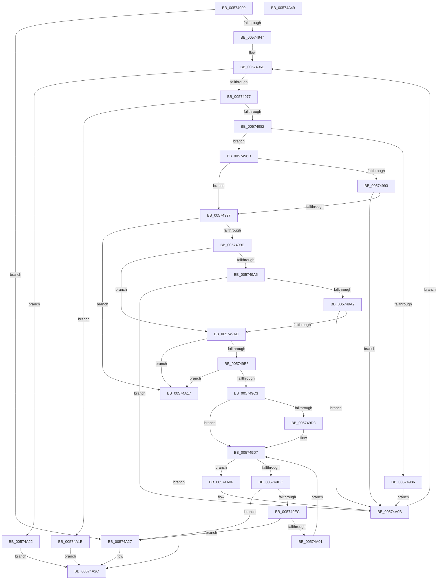

# HsaProcessIvmd

- RVA: `0x00574900`–`0x00574A4A` (길이 `330` bytes)
- VA: `0x0000000140574900`
- 실행 섹션: `.text`
- PDB 이름 있음: `예`; PDB Function 태그: `아니요`
- unwind 정보 RVA: `0x000C5440`
- 디코드: `105`개 명령, `330/330` bytes 표시
- 미해석 바이트: `0` (있으면 어셈블리에 `.byte`로 보존)

> 이 문서는 커널 이미지의 기계어와 PDB 기호를 분석해 생성했습니다. 4번과 5번은 함수 원형과 자료형을 바이너리 사용 방식에서 추정한 C 해석이며 원본 소스 복구 결과는 아닙니다.

## 1. Dependencies

- 직접 호출 지점: **3**; 고유 호출 대상: **3**
- 직접 호출자로 확인된 함수: **1**
- RIP 상대 이미지 참조: **0**

### Outgoing calls
- `0x0057493A` → [ExtEnvAllocateMemory](../56/ExtEnvAllocateMemory_function_005610B0.md) (function, `0x005610B0`)
- `0x005749E2` → [IvmdFindDeviceEntry](IvmdFindDeviceEntry_function_005752FC.md) (function, `0x005752FC`)
- `0x005749F5` → [IvmdProcessRange](IvmdProcessRange_function_0057539C.md) (function, `0x0057539C`)

### Direct callers
- [HalpIommuProcessIvhdEntry](HalpIommuProcessIvhdEntry_function_00572F38.md) at `0x0057312A`

### Static image references
- 디코드된 RIP-relative 메모리 참조가 없습니다.

## 2. Other-region calls and transfers

- 다른 실행 섹션으로 향하는 call: **0**
- 별도 외부 분기/꼬리 이동을 확인하지 못했습니다.

## 3. Assembly (complete function range)

```asm
00574900  48 8B C4                        mov rax, rsp
00574903  48 89 58 08                     mov qword ptr [rax + 8], rbx
00574907  48 89 68 18                     mov qword ptr [rax + 0x18], rbp
0057490B  48 89 70 20                     mov qword ptr [rax + 0x20], rsi
0057490F  48 89 50 10                     mov qword ptr [rax + 0x10], rdx
00574913  57                              push rdi
00574914  41 54                           push r12
00574916  41 55                           push r13
00574918  41 56                           push r14
0057491A  41 57                           push r15
0057491C  48 83 EC 30                     sub rsp, 0x30
00574920  48 83 60 C8 00                  and qword ptr [rax - 0x38], 0
00574925  4D 8B E8                        mov r13, r8
00574928  48 8B FA                        mov rdi, rdx
0057492B  4C 8D 40 C8                     lea r8, [rax - 0x38]
0057492F  BA 18 00 00 00                  mov edx, 0x18
00574934  49 8B D9                        mov rbx, r9
00574937  4C 8B F9                        mov r15, rcx
0057493A  E8 71 C7 FE FF                  call 0x1405610b0
0057493F  85 C0                           test eax, eax
00574941  0F 88 E0 00 00 00               js 0x140574a27
00574947  4C 8B 74 24 20                  mov r14, qword ptr [rsp + 0x20]
0057494C  45 33 C0                        xor r8d, r8d
0057494F  4C 89 33                        mov qword ptr [rbx], r14
00574952  41 C6 45 00 00                  mov byte ptr [r13], 0
00574957  49 8D 46 08                     lea rax, [r14 + 8]
0057495B  48 89 40 08                     mov qword ptr [rax + 8], rax
0057495F  48 89 00                        mov qword ptr [rax], rax
00574962  41 83 26 00                     and dword ptr [r14], 0
00574966  41 0F B7 5F 02                  movzx ebx, word ptr [r15 + 2]
0057496B  49 03 DF                        add rbx, r15
0057496E  48 3B DF                        cmp rbx, rdi
00574971  0F 83 AB 00 00 00               jae 0x140574a22
00574977  8A 03                           mov al, byte ptr [rbx]
00574979  41 3A 07                        cmp al, byte ptr [r15]
0057497C  0F 84 9C 00 00 00               je 0x140574a1e
00574982  3C 20                           cmp al, 0x20
00574984  75 07                           jne 0x14057498d
00574986  41 C6 45 00 01                  mov byte ptr [r13], 1
0057498B  EB 7E                           jmp 0x140574a0b
0057498D  8A D0                           mov dl, al
0057498F  3C 21                           cmp al, 0x21
00574991  74 04                           je 0x140574997
00574993  3C 22                           cmp al, 0x22
00574995  75 74                           jne 0x140574a0b
00574997  66 83 7B 02 20                  cmp word ptr [rbx + 2], 0x20
0057499C  75 79                           jne 0x140574a17
0057499E  8A 43 01                        mov al, byte ptr [rbx + 1]
005749A1  A8 08                           test al, 8
005749A3  75 08                           jne 0x1405749ad
005749A5  A8 01                           test al, 1
005749A7  74 62                           je 0x140574a0b
005749A9  A8 06                           test al, 6
005749AB  74 5E                           je 0x140574a0b
005749AD  48 8B 43 18                     mov rax, qword ptr [rbx + 0x18]
005749B1  48 85 C0                        test rax, rax
005749B4  74 61                           je 0x140574a17
005749B6  48 8B 73 10                     mov rsi, qword ptr [rbx + 0x10]
005749BA  48 8D 0C 06                     lea rcx, [rsi + rax]
005749BE  48 3B CE                        cmp rcx, rsi
005749C1  72 54                           jb 0x140574a17
005749C3  0F B7 7B 04                     movzx edi, word ptr [rbx + 4]
005749C7  4C 8D 61 FF                     lea r12, [rcx - 1]
005749CB  0F B7 EF                        movzx ebp, di
005749CE  80 FA 22                        cmp dl, 0x22
005749D1  75 04                           jne 0x1405749d7
005749D3  0F B7 6B 06                     movzx ebp, word ptr [rbx + 6]
005749D7  66 3B FD                        cmp di, bp
005749DA  77 2A                           ja 0x140574a06
005749DC  0F B7 D7                        movzx edx, di
005749DF  49 8B CE                        mov rcx, r14
005749E2  E8 15 09 00 00                  call 0x1405752fc
005749E7  48 85 C0                        test rax, rax
005749EA  74 3B                           je 0x140574a27
005749EC  4D 8B C4                        mov r8, r12
005749EF  48 8B D6                        mov rdx, rsi
005749F2  48 8B C8                        mov rcx, rax
005749F5  E8 A2 09 00 00                  call 0x14057539c
005749FA  44 8B C0                        mov r8d, eax
005749FD  85 C0                           test eax, eax
005749FF  78 26                           js 0x140574a27
00574A01  66 FF C7                        inc di
00574A04  EB D1                           jmp 0x1405749d7
00574A06  48 8B 7C 24 68                  mov rdi, qword ptr [rsp + 0x68]
00574A0B  0F B7 43 02                     movzx eax, word ptr [rbx + 2]
00574A0F  48 03 D8                        add rbx, rax
00574A12  E9 57 FF FF FF                  jmp 0x14057496e
00574A17  B8 0D 00 00 C0                  mov eax, 0xc000000d
00574A1C  EB 0E                           jmp 0x140574a2c
00574A1E  33 C0                           xor eax, eax
00574A20  EB 0A                           jmp 0x140574a2c
00574A22  41 8B C0                        mov eax, r8d
00574A25  EB 05                           jmp 0x140574a2c
00574A27  B8 9A 00 00 C0                  mov eax, 0xc000009a
00574A2C  48 8B 5C 24 60                  mov rbx, qword ptr [rsp + 0x60]
00574A31  48 8B 6C 24 70                  mov rbp, qword ptr [rsp + 0x70]
00574A36  48 8B 74 24 78                  mov rsi, qword ptr [rsp + 0x78]
00574A3B  48 83 C4 30                     add rsp, 0x30
00574A3F  41 5F                           pop r15
00574A41  41 5E                           pop r14
00574A43  41 5D                           pop r13
00574A45  41 5C                           pop r12
00574A47  5F                              pop rdi
00574A48  C3                              ret
00574A49  CC                              int3
```

## 4. C-style interpretation (structured pseudocode)

```c
__int64 __fastcall HsaProcessIvmd(__int64 a1, __int64 a2, __int64 a3, __int64 a4)
{
    __int64 result;
    __int64 v_rbp;
    __int64 v_rbx;
    __int64 v_rdi;
    __int64 v_rsp;
    unsigned __int64 v_stack_m38;
    unsigned __int64 v_stack_p10;
    unsigned __int64 v_stack_p18;
    unsigned __int64 v_stack_p20;
    unsigned __int64 v_stack_p8;

    *(unsigned __int64 *)(v_rsp + 8) = v_rbx;
    *(unsigned __int64 *)(v_rsp + 24) = v_rbp;
    *(unsigned __int64 *)(v_rsp + 32) = v_rsi;
    *(unsigned __int64 *)(v_rsp + 16) = a2;
    v_rsp = (v_rsp) - (48);
    result = ExtEnvAllocateMemory(a1, 24, v_rsp - 56, a4);
    if (sign_flag) goto loc_00574A27;
    a3 = 0;
    *(unsigned __int64 *)(a4) = v_stack_m38;
    *(unsigned __int8 *)(a3) = 0;
    *(unsigned __int64 *)(v_stack_m38 + 8 + 8) = v_stack_m38 + 8;
    *(unsigned __int64 *)(v_stack_m38 + 8) = v_stack_m38 + 8;
    v_rbx = (*(unsigned __int16 *)(a1 + 2)) + (a1);
loc_0057496E:
    if (v_rbx >= a2) goto loc_00574A22;
    if (((unsigned __int8)(*(unsigned __int8 *)(v_rbx))) == (*(unsigned __int8 *)(a1))) goto loc_00574A1E;
    if (((unsigned __int8)(*(unsigned __int8 *)(v_rbx))) != 32) goto loc_0057498D;
    *(unsigned __int8 *)(a3) = 1;
    goto loc_00574A0B;
loc_0057498D:
    if (((unsigned __int8)(*(unsigned __int8 *)(v_rbx))) == 33) goto loc_00574997;
    if (((unsigned __int8)(*(unsigned __int8 *)(v_rbx))) != 34) goto loc_00574A0B;
loc_00574997:
    if ((*(unsigned __int16 *)(v_rbx + 2)) != 32) goto loc_00574A17;
    if ((((unsigned __int8)(*(unsigned __int8 *)(v_rbx + 1))) & (8)) != 0) goto loc_005749AD;
    if ((((unsigned __int8)(*(unsigned __int8 *)(v_rbx + 1))) & (1)) == 0) goto loc_00574A0B;
    if ((((unsigned __int8)(*(unsigned __int8 *)(v_rbx + 1))) & (6)) == 0) goto loc_00574A0B;
loc_005749AD:
    if (*(unsigned __int64 *)(v_rbx + 24) == 0) goto loc_00574A17;
    if ((*(unsigned __int64 *)(v_rbx + 16) + *(unsigned __int64 *)(v_rbx + 24) * 1) < (*(unsigned __int64 *)(v_rbx + 16))) goto loc_00574A17;
    v_rbp = (unsigned __int16)(*(unsigned __int16 *)(v_rbx + 4));
    if (((unsigned __int8)((unsigned __int8)(*(unsigned __int8 *)(v_rbx)))) == 34) {
        v_rbp = *(unsigned __int16 *)(v_rbx + 6);
    }
    if (((unsigned __int16)(*(unsigned __int16 *)(v_rbx + 4))) > ((unsigned __int16)(v_rbp))) goto loc_00574A06;
    result = IvmdFindDeviceEntry(v_stack_m38, (unsigned __int16)(*(unsigned __int16 *)(v_rbx + 4)), a3, a4);
    if (result == 0) goto loc_00574A27;
    result = IvmdProcessRange(result, *(unsigned __int64 *)(v_rbx + 16), *(unsigned __int64 *)(v_rbx + 16) + *(unsigned __int64 *)(v_rbx + 24) * 1 - 1, a4);
    if (sign_flag) goto loc_00574A27;
    v_rdi = (unsigned __int16)((*(unsigned __int16 *)(v_rbx + 4)) + 1);
    goto loc_005749D7;
loc_00574A06:
loc_00574A0B:
    v_rbx = (v_rbx) + (*(unsigned __int16 *)(v_rbx + 2));
    goto loc_0057496E;
loc_00574A17:
    goto loc_00574A2C;
loc_00574A1E:
    result = 0;
    goto loc_00574A2C;
loc_00574A22:
    goto loc_00574A2C;
loc_00574A27:
loc_00574A2C:
    v_rsp = (v_rsp) + (48);
    return (unsigned int)(0xC000009AULL);
}
```

## 5. (Beta) C Style

```c
int64_t HsaProcessIvmd(void *Arg1, int64_t Arg2, void *Arg3, void *Arg4)
{
    uint8_t *arg1 = (uint8_t *)Arg1;
    uint8_t *arg3 = (uint8_t *)Arg3;
    uint8_t *arg4 = (uint8_t *)Arg4;

    int64_t result;
    int64_t local_rbp;
    int64_t local_rbx;
    int64_t local_rdi;
    int64_t local_rsp;
    uint64_t v_stack_m38;
    uint64_t v_stack_p10;
    uint64_t v_stack_p18;
    uint64_t v_stack_p20;
    uint64_t v_stack_p8;

    *(uint64_t *)(local_rsp + 0x8) = local_rbx;
    *(uint64_t *)(local_rsp + 0x18) = local_rbp;
    *(uint64_t *)(local_rsp + 0x20) = local_rsi;
    *(uint64_t *)(local_rsp + 0x10) = Arg2;
    local_rsp = (local_rsp) - (48);
    result = ExtEnvAllocateMemory(Arg1, 24, local_rsp - 56, Arg4);
    if (sign_flag) goto loc_00574A27;
    Arg3 = 0;
    *(uint64_t *)(arg4) = v_stack_m38;
    *(uint8_t *)(arg3) = 0;
    *(uint64_t *)(v_stack_m38 + 0x8 + 0x8) = v_stack_m38 + 8;
    *(uint64_t *)(v_stack_m38 + 0x8) = v_stack_m38 + 8;
    local_rbx = (*(uint16_t *)(arg1 + 0x2)) + (Arg1);
loc_0057496E:
    if (local_rbx >= Arg2) goto loc_00574A22;
    if (((uint8_t)(*(uint8_t *)(local_rbx))) == (*(uint8_t *)(arg1))) goto loc_00574A1E;
    if (((uint8_t)(*(uint8_t *)(local_rbx))) != 32) goto loc_0057498D;
    *(uint8_t *)(arg3) = 1;
    goto loc_00574A0B;
loc_0057498D:
    if (((uint8_t)(*(uint8_t *)(local_rbx))) == 33) goto loc_00574997;
    if (((uint8_t)(*(uint8_t *)(local_rbx))) != 34) goto loc_00574A0B;
loc_00574997:
    if ((*(uint16_t *)(local_rbx + 0x2)) != 32) goto loc_00574A17;
    if ((((uint8_t)(*(uint8_t *)(local_rbx + 0x1))) & (8)) != 0) goto loc_005749AD;
    if ((((uint8_t)(*(uint8_t *)(local_rbx + 0x1))) & (1)) == 0) goto loc_00574A0B;
    if ((((uint8_t)(*(uint8_t *)(local_rbx + 0x1))) & (6)) == 0) goto loc_00574A0B;
loc_005749AD:
    if (*(uint64_t *)(local_rbx + 0x18) == 0) goto loc_00574A17;
    if ((*(uint64_t *)(local_rbx + 0x10) + *(uint64_t *)(local_rbx + 0x18) * 1) < (*(uint64_t *)(local_rbx + 0x10))) goto loc_00574A17;
    local_rbp = (uint16_t)(*(uint16_t *)(local_rbx + 0x4));
    if (((uint8_t)((uint8_t)(*(uint8_t *)(local_rbx)))) == 34) {
        local_rbp = *(uint16_t *)(local_rbx + 0x6);
    }
    if (((uint16_t)(*(uint16_t *)(local_rbx + 0x4))) > ((uint16_t)(local_rbp))) goto loc_00574A06;
    result = IvmdFindDeviceEntry(v_stack_m38, (uint16_t)(*(uint16_t *)(local_rbx + 0x4)), Arg3, Arg4);
    if (result == 0) goto loc_00574A27;
    result = IvmdProcessRange(result, *(uint64_t *)(local_rbx + 0x10), *(uint64_t *)(local_rbx + 0x10) + *(uint64_t *)(local_rbx + 0x18) * 1 - 1, Arg4);
    if (sign_flag) goto loc_00574A27;
    local_rdi = (uint16_t)((*(uint16_t *)(local_rbx + 0x4)) + 1);
    goto loc_005749D7;
loc_00574A06:
loc_00574A0B:
    local_rbx = (local_rbx) + (*(uint16_t *)(local_rbx + 0x2));
    goto loc_0057496E;
loc_00574A17:
    goto loc_00574A2C;
loc_00574A1E:
    result = 0;
    goto loc_00574A2C;
loc_00574A22:
    goto loc_00574A2C;
loc_00574A27:
loc_00574A2C:
    local_rsp = (local_rsp) + (48);
    return (uint32_t)(0xC000009AULL);
}
```

### 관측된 메모리 오프셋

구조체 형식이 확인되지 않은 접근은 인자 기준의 오프셋으로만 기록했습니다.

| 기준 인자 | 오프셋 표현 | 폭 (bit) | 접근 |
|---|---:|---:|---|
| `Arg1` | `+ 0x0` | `8` | `R` |
| `Arg1` | `+ 0x2` | `16` | `R` |
| `Arg3` | `+ 0x0` | `8` | `W` |
| `Arg4` | `+ 0x0` | `64` | `W` |

## 6. Execution-region graph

[열기: 2D/3D 그래프와 함수 탐색 컨트롤 패널](../../../control-panel.html?section=text&rva=0x00574900&view=graph)

- 2D 그래프는 위에서 아래로 흐르고, 3D 그래프는 빈 공간을 드래그해 회전합니다. Shift+드래그는 이동, 휠은 확대·축소, 함수 노드 선택은 대상 보고서 이동입니다.

### Static fallback


