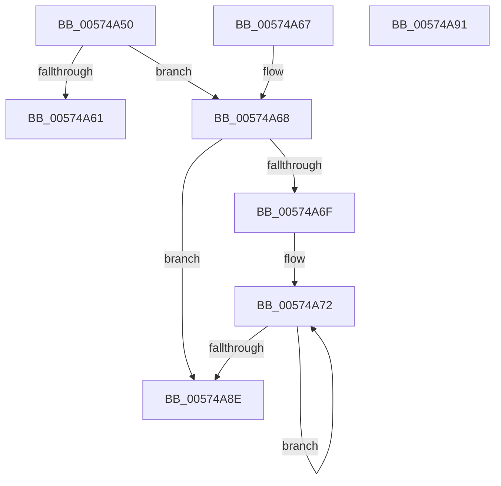

# HsaProcessReservedDomains

- RVA: `0x00574A50`–`0x00574A92` (길이 `66` bytes)
- VA: `0x0000000140574A50`
- 실행 섹션: `.text`
- PDB 이름 있음: `예`; PDB Function 태그: `아니요`
- unwind 정보 RVA: `0x000DB714`
- 디코드: `22`개 명령, `66/66` bytes 표시
- 미해석 바이트: `0` (있으면 어셈블리에 `.byte`로 보존)

> 이 문서는 커널 이미지의 기계어와 PDB 기호를 분석해 생성했습니다. 4번과 5번은 함수 원형과 자료형을 바이너리 사용 방식에서 추정한 C 해석이며 원본 소스 복구 결과는 아닙니다.

## 1. Dependencies

- 직접 호출 지점: **0**; 고유 호출 대상: **0**
- 직접 호출자로 확인된 함수: **0**
- RIP 상대 이미지 참조: **0**

### Outgoing calls
- 직접 디코드된 call 명령이 없습니다.

### Direct callers
- 이 함수 시작 RVA로 연결되는 직접 call은 확인되지 않았습니다. 간접 호출은 완전히 역산할 수 없습니다.

### Static image references
- 디코드된 RIP-relative 메모리 참조가 없습니다.

## 2. Other-region calls and transfers

- 다른 실행 섹션으로 향하는 call: **0**
- 별도 외부 분기/꼬리 이동을 확인하지 못했습니다.

## 3. Assembly (complete function range)

```asm
00574A50  48 8B 81 D8 00 00 00            mov rax, qword ptr [rcx + 0xd8]
00574A57  4C 8B D9                        mov r11, rcx
00574A5A  44 8B CA                        mov r9d, edx
00574A5D  3B 10                           cmp edx, dword ptr [rax]
00574A5F  74 07                           je 0x140574a68
00574A61  B8 0D 00 00 C0                  mov eax, 0xc000000d
00574A66  C3                              ret
00574A67  CC                              int3
00574A68  33 D2                           xor edx, edx
00574A6A  45 85 C9                        test r9d, r9d
00574A6D  74 1F                           je 0x140574a8e
00574A6F  4D 8B D1                        mov r10, r9
00574A72  49 8B 00                        mov rax, qword ptr [r8]
00574A75  48 8D 52 10                     lea rdx, [rdx + 0x10]
00574A79  49 8B 8B D8 00 00 00            mov rcx, qword ptr [r11 + 0xd8]
00574A80  4D 8D 40 08                     lea r8, [r8 + 8]
00574A84  48 89 04 11                     mov qword ptr [rcx + rdx], rax
00574A88  49 83 EA 01                     sub r10, 1
00574A8C  75 E4                           jne 0x140574a72
00574A8E  33 C0                           xor eax, eax
00574A90  C3                              ret
00574A91  CC                              int3
```

## 4. C-style interpretation (structured pseudocode)

```c
__int64 __fastcall HsaProcessReservedDomains(__int64 a1, int a2, __int64 a3)
{
    __int64 result;
    __int64 v_r10;

    if (a2 == (*(unsigned int *)(*(unsigned __int64 *)(a1 + 216)))) goto loc_00574A68;
    return (unsigned int)(0xC000000DULL);
loc_00574A68:
    a2 = 0;
    if ((unsigned int)((unsigned int)(a2)) == 0) goto loc_00574A8E;
loc_00574A72:
    *(unsigned __int64 *)(*(unsigned __int64 *)(a1 + 216) + a2 + 16 * 1) = *(unsigned __int64 *)(a3);
    v_r10 = ((unsigned int)(a2)) - (1);
    if (condition_is_not_equal) goto loc_00574A72;
loc_00574A8E:
    result = 0;
    return result;
}
```

## 5. (Beta) C Style

```c
int64_t HsaProcessReservedDomains(void *Arg1, int32_t Arg2, void *Arg3)
{
    uint8_t *arg1 = (uint8_t *)Arg1;
    uint8_t *arg3 = (uint8_t *)Arg3;

    int64_t result;
    int64_t local_r10;

    if (Arg2 == (*(uint32_t *)(*(uint64_t *)(arg1 + 0xD8)))) goto loc_00574A68;
    return (uint32_t)(0xC000000DULL);
loc_00574A68:
    Arg2 = 0;
    if ((uint32_t)((uint32_t)(Arg2)) == 0) goto loc_00574A8E;
loc_00574A72:
    *(uint64_t *)(*(uint64_t *)(arg1 + 0xD8) + Arg2 + 0x10 * 1) = *(uint64_t *)(arg3);
    local_r10 = ((uint32_t)(Arg2)) - (1);
    if (condition_is_not_equal) goto loc_00574A72;
loc_00574A8E:
    result = 0;
    return result;
}
```

### 관측된 메모리 오프셋

구조체 형식이 확인되지 않은 접근은 인자 기준의 오프셋으로만 기록했습니다.

| 기준 인자 | 오프셋 표현 | 폭 (bit) | 접근 |
|---|---:|---:|---|
| `Arg1` | `+ 0xD8` | `64` | `R` |
| `Arg3` | `+ 0x0` | `64` | `R` |
| `Arg3` | `+ 0x8` | `64` | `R` |

## 6. Execution-region graph

[열기: 2D/3D 그래프와 함수 탐색 컨트롤 패널](../../../control-panel.html?section=text&rva=0x00574A50&view=graph)

- 2D 그래프는 위에서 아래로 흐르고, 3D 그래프는 빈 공간을 드래그해 회전합니다. Shift+드래그는 이동, 휠은 확대·축소, 함수 노드 선택은 대상 보고서 이동입니다.

### Static fallback


