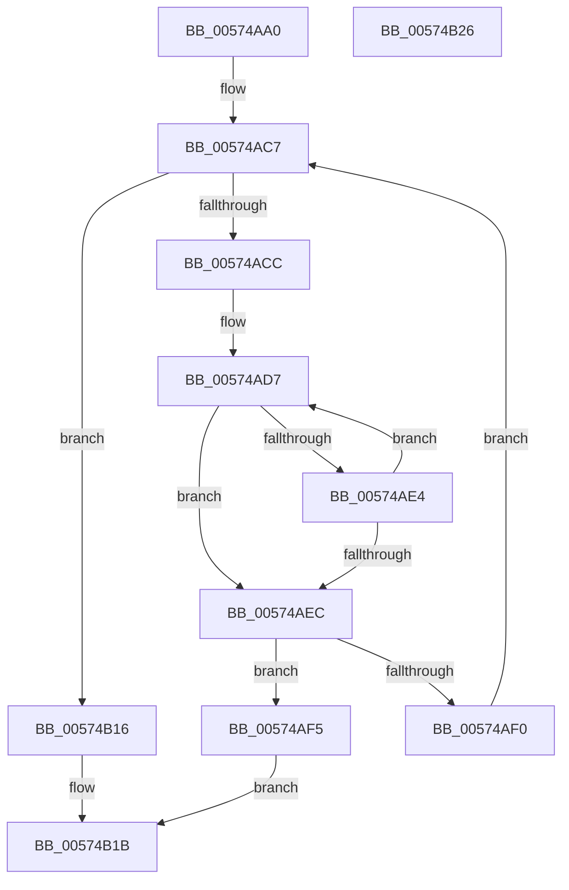

# HsaQueryAcpiDeviceMapping

- RVA: `0x00574AA0`–`0x00574B27` (길이 `135` bytes)
- VA: `0x0000000140574AA0`
- 실행 섹션: `.text`
- PDB 이름 있음: `예`; PDB Function 태그: `아니요`
- unwind 정보 RVA: `0x000950EC`
- 디코드: `38`개 명령, `135/135` bytes 표시
- 미해석 바이트: `0` (있으면 어셈블리에 `.byte`로 보존)

> 이 문서는 커널 이미지의 기계어와 PDB 기호를 분석해 생성했습니다. 4번과 5번은 함수 원형과 자료형을 바이너리 사용 방식에서 추정한 C 해석이며 원본 소스 복구 결과는 아닙니다.

## 1. Dependencies

- 직접 호출 지점: **0**; 고유 호출 대상: **0**
- 직접 호출자로 확인된 함수: **1**
- RIP 상대 이미지 참조: **0**

### Outgoing calls
- 직접 디코드된 call 명령이 없습니다.

### Direct callers
- [HsaCreateDevice](HsaCreateDevice_function_00573B50.md) at `0x00573B99`

### Static image references
- 디코드된 RIP-relative 메모리 참조가 없습니다.

## 2. Other-region calls and transfers

- 다른 실행 섹션으로 향하는 call: **0**
- 별도 외부 분기/꼬리 이동을 확인하지 못했습니다.

## 3. Assembly (complete function range)

```asm
00574AA0  48 89 5C 24 08                  mov qword ptr [rsp + 8], rbx
00574AA5  48 89 7C 24 10                  mov qword ptr [rsp + 0x10], rdi
00574AAA  0F 57 C0                        xorps xmm0, xmm0
00574AAD  4C 8D 99 E0 00 00 00            lea r11, [rcx + 0xe0]
00574AB4  41 0F 11 00                     movups xmmword ptr [r8], xmm0
00574AB8  33 C0                           xor eax, eax
00574ABA  48 8B FA                        mov rdi, rdx
00574ABD  49 89 40 10                     mov qword ptr [r8 + 0x10], rax
00574AC1  48 8B D9                        mov rbx, rcx
00574AC4  4D 8B 0B                        mov r9, qword ptr [r11]
00574AC7  4D 3B CB                        cmp r9, r11
00574ACA  74 4A                           je 0x140574b16
00574ACC  49 8B 41 10                     mov rax, qword ptr [r9 + 0x10]
00574AD0  48 8B 57 08                     mov rdx, qword ptr [rdi + 8]
00574AD4  48 2B D0                        sub rdx, rax
00574AD7  0F B6 08                        movzx ecx, byte ptr [rax]
00574ADA  44 0F B6 14 10                  movzx r10d, byte ptr [rax + rdx]
00574ADF  41 2B CA                        sub ecx, r10d
00574AE2  75 08                           jne 0x140574aec
00574AE4  48 FF C0                        inc rax
00574AE7  45 85 D2                        test r10d, r10d
00574AEA  75 EB                           jne 0x140574ad7
00574AEC  85 C9                           test ecx, ecx
00574AEE  74 05                           je 0x140574af5
00574AF0  4D 8B 09                        mov r9, qword ptr [r9]
00574AF3  EB D2                           jmp 0x140574ac7
00574AF5  0F B7 83 A0 00 00 00            movzx eax, word ptr [rbx + 0xa0]
00574AFC  66 41 89 40 08                  mov word ptr [r8 + 8], ax
00574B01  41 0F B7 41 18                  movzx eax, word ptr [r9 + 0x18]
00574B06  66 41 89 40 0C                  mov word ptr [r8 + 0xc], ax
00574B0B  33 C0                           xor eax, eax
00574B0D  41 C7 00 01 00 00 00            mov dword ptr [r8], 1
00574B14  EB 05                           jmp 0x140574b1b
00574B16  B8 25 02 00 C0                  mov eax, 0xc0000225
00574B1B  48 8B 5C 24 08                  mov rbx, qword ptr [rsp + 8]
00574B20  48 8B 7C 24 10                  mov rdi, qword ptr [rsp + 0x10]
00574B25  C3                              ret
00574B26  CC                              int3
```

## 4. C-style interpretation (structured pseudocode)

```c
__int64 __fastcall HsaQueryAcpiDeviceMapping(__int64 a1, __int64 a2, __int64 a3)
{
    __int64 result;
    unsigned __int64 v_stack_p10;
    unsigned __int64 v_stack_p8;

    v_stack_p8 = v_rbx;
    v_stack_p10 = v_rdi;
    *(unsigned __int64 *)(a3) = v_xmm0;
    result = 0;
    *(unsigned __int64 *)(a3 + 16) = 0;
loc_00574AC7:
    if ((*(unsigned __int64 *)(a1 + 224)) == (a1 + 224)) goto loc_00574B16;
    a2 = (*(unsigned __int64 *)(a2 + 8)) - (*(unsigned __int64 *)(*(unsigned __int64 *)(a1 + 224) + 16));
loc_00574AD7:
    a1 = (unsigned int)((*(unsigned __int8 *)(*(unsigned __int64 *)(*(unsigned __int64 *)(a1 + 224) + 16))) - ((unsigned int)(*(unsigned __int8 *)(*(unsigned __int64 *)(*(unsigned __int64 *)(a1 + 224) + 16) + a2 * 1))));
    if (condition_is_not_equal) goto loc_00574AEC;
    result = (*(unsigned __int64 *)(*(unsigned __int64 *)(a1 + 224) + 16)) + 1;
    if ((unsigned int)(*(unsigned __int8 *)(*(unsigned __int64 *)(*(unsigned __int64 *)(a1 + 224) + 16) + a2 * 1)) != 0) goto loc_00574AD7;
loc_00574AEC:
    if ((unsigned int)(a1) == 0) goto loc_00574AF5;
    goto loc_00574AC7;
loc_00574AF5:
    *(unsigned __int16 *)(a3 + 8) = (unsigned __int16)(*(unsigned __int16 *)(a1 + 160));
    *(unsigned __int16 *)(a3 + 12) = (unsigned __int16)(*(unsigned __int16 *)(*(unsigned __int64 *)(*(unsigned __int64 *)(a1 + 224)) + 24));
    result = 0;
    *(unsigned int *)(a3) = 1;
    goto loc_00574B1B;
loc_00574B16:
loc_00574B1B:
    return (unsigned int)(0xC0000225ULL);
}
```

## 5. (Beta) C Style

```c
int64_t HsaQueryAcpiDeviceMapping(void *Arg1, void *Arg2, void *Arg3)
{
    uint8_t *arg1 = (uint8_t *)Arg1;
    uint8_t *arg2 = (uint8_t *)Arg2;
    uint8_t *arg3 = (uint8_t *)Arg3;

    int64_t result;
    uint64_t v_stack_p10;
    uint64_t v_stack_p8;

    v_stack_p8 = local_rbx;
    v_stack_p10 = local_rdi;
    *(uint64_t *)(arg3) = v_xmm0;
    result = 0;
    *(uint64_t *)(arg3 + 0x10) = 0;
loc_00574AC7:
    if ((*(uint64_t *)(arg1 + 0xE0)) == (Arg1 + 224)) goto loc_00574B16;
    Arg2 = (*(uint64_t *)(arg2 + 0x8)) - (*(uint64_t *)(*(uint64_t *)(arg1 + 0xE0) + 0x10));
loc_00574AD7:
    Arg1 = (uint32_t)((*(uint8_t *)(*(uint64_t *)(*(uint64_t *)(arg1 + 0xE0) + 0x10))) - ((uint32_t)(*(uint8_t *)(*(uint64_t *)(*(uint64_t *)(arg1 + 0xE0) + 0x10) + arg2 * 1))));
    if (condition_is_not_equal) goto loc_00574AEC;
    result = (*(uint64_t *)(*(uint64_t *)(arg1 + 0xE0) + 0x10)) + 1;
    if ((uint32_t)(*(uint8_t *)(*(uint64_t *)(*(uint64_t *)(arg1 + 0xE0) + 0x10) + arg2 * 1)) != 0) goto loc_00574AD7;
loc_00574AEC:
    if ((uint32_t)(Arg1) == 0) goto loc_00574AF5;
    goto loc_00574AC7;
loc_00574AF5:
    *(uint16_t *)(arg3 + 0x8) = (uint16_t)(*(uint16_t *)(arg1 + 0xA0));
    *(uint16_t *)(arg3 + 0xC) = (uint16_t)(*(uint16_t *)(*(uint64_t *)(*(uint64_t *)(arg1 + 0xE0)) + 0x18));
    result = 0;
    *(uint32_t *)(arg3) = 1;
    goto loc_00574B1B;
loc_00574B16:
loc_00574B1B:
    return (uint32_t)(0xC0000225ULL);
}
```

### 관측된 메모리 오프셋

구조체 형식이 확인되지 않은 접근은 인자 기준의 오프셋으로만 기록했습니다.

| 기준 인자 | 오프셋 표현 | 폭 (bit) | 접근 |
|---|---:|---:|---|
| `Arg1` | `+ 0x0` | `64` | `R` |
| `Arg1` | `+ 0xA0` | `16` | `R` |
| `Arg1` | `+ 0xE0` | `64` | `R` |
| `Arg2` | `+ 0x8` | `64` | `R` |
| `Arg3` | `+ 0x0` | `32` | `W` |
| `Arg3` | `+ 0x0` | `128` | `R` |
| `Arg3` | `+ 0x8` | `16` | `W` |
| `Arg3` | `+ 0xC` | `16` | `W` |
| `Arg3` | `+ 0x10` | `64` | `W` |

## 6. Execution-region graph

[열기: 2D/3D 그래프와 함수 탐색 컨트롤 패널](../../../control-panel.html?section=text&rva=0x00574AA0&view=graph)

- 2D 그래프는 위에서 아래로 흐르고, 3D 그래프는 빈 공간을 드래그해 회전합니다. Shift+드래그는 이동, 휠은 확대·축소, 함수 노드 선택은 대상 보고서 이동입니다.

### Static fallback


