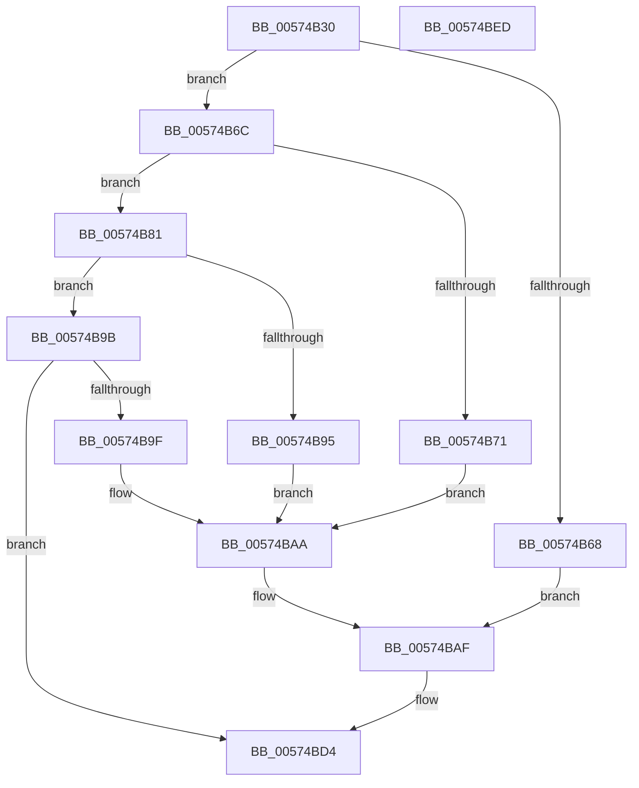

# HsaSetDevicePasidTable

- RVA: `0x00574B30`–`0x00574BEE` (길이 `190` bytes)
- VA: `0x0000000140574B30`
- 실행 섹션: `.text`
- PDB 이름 있음: `예`; PDB Function 태그: `아니요`
- unwind 정보 RVA: `0x000C5278`
- 디코드: `54`개 명령, `190/190` bytes 표시
- 미해석 바이트: `0` (있으면 어셈블리에 `.byte`로 보존)

> 이 문서는 커널 이미지의 기계어와 PDB 기호를 분석해 생성했습니다. 4번과 5번은 함수 원형과 자료형을 바이너리 사용 방식에서 추정한 C 해석이며 원본 소스 복구 결과는 아닙니다.

## 1. Dependencies

- 직접 호출 지점: **2**; 고유 호출 대상: **2**
- 직접 호출자로 확인된 함수: **0**
- RIP 상대 이미지 참조: **0**

### Outgoing calls
- `0x00574B5D` → [memset](../6C/memset_function_006C6C40.md) (function, `0x006C6C40`)
- `0x00574BCF` → [HsaUpdateDeviceTableEntry](../44/HsaUpdateDeviceTableEntry_function_0044E404.md) (function, `0x0044E404`)

### Direct callers
- 이 함수 시작 RVA로 연결되는 직접 call은 확인되지 않았습니다. 간접 호출은 완전히 역산할 수 없습니다.

### Static image references
- 디코드된 RIP-relative 메모리 참조가 없습니다.

## 2. Other-region calls and transfers

- 다른 실행 섹션으로 향하는 call: **0**
- 별도 외부 분기/꼬리 이동을 확인하지 못했습니다.

## 3. Assembly (complete function range)

```asm
00574B30  48 8B C4                        mov rax, rsp
00574B33  48 89 58 08                     mov qword ptr [rax + 8], rbx
00574B37  48 89 68 10                     mov qword ptr [rax + 0x10], rbp
00574B3B  48 89 70 18                     mov qword ptr [rax + 0x18], rsi
00574B3F  57                              push rdi
00574B40  48 81 EC C0 00 00 00            sub rsp, 0xc0
00574B47  48 8B FA                        mov rdi, rdx
00574B4A  41 8A E8                        mov bpl, r8b
00574B4D  33 D2                           xor edx, edx
00574B4F  48 8B F1                        mov rsi, rcx
00574B52  48 8D 48 88                     lea rcx, [rax - 0x78]
00574B56  41 8A D9                        mov bl, r9b
00574B59  44 8D 42 70                     lea r8d, [rdx + 0x70]
00574B5D  E8 DE 20 15 00                  call 0x1406c6c40
00574B62  33 D2                           xor edx, edx
00574B64  84 DB                           test bl, bl
00574B66  74 04                           je 0x140574b6c
00574B68  8B C2                           mov eax, edx
00574B6A  EB 43                           jmp 0x140574baf
00574B6C  40 84 ED                        test bpl, bpl
00574B6F  75 10                           jne 0x140574b81
00574B71  48 8B 47 30                     mov rax, qword ptr [rdi + 0x30]
00574B75  8B 48 20                        mov ecx, dword ptr [rax + 0x20]
00574B78  89 8C 24 80 00 00 00            mov dword ptr [rsp + 0x80], ecx
00574B7F  EB 29                           jmp 0x140574baa
00574B81  8B 86 AC 00 00 00               mov eax, dword ptr [rsi + 0xac]
00574B87  B9 01 00 00 00                  mov ecx, 1
00574B8C  89 4C 24 50                     mov dword ptr [rsp + 0x50], ecx
00574B90  83 F8 02                        cmp eax, 2
00574B93  75 06                           jne 0x140574b9b
00574B95  89 4C 24 54                     mov dword ptr [rsp + 0x54], ecx
00574B99  EB 0F                           jmp 0x140574baa
00574B9B  3B C1                           cmp eax, ecx
00574B9D  75 35                           jne 0x140574bd4
00574B9F  89 54 24 54                     mov dword ptr [rsp + 0x54], edx
00574BA3  89 94 24 80 00 00 00            mov dword ptr [rsp + 0x80], edx
00574BAA  48 8D 44 24 50                  lea rax, [rsp + 0x50]
00574BAF  4C 8B 47 30                     mov r8, qword ptr [rdi + 0x30]
00574BB3  45 33 C9                        xor r9d, r9d
00574BB6  48 89 54 24 48                  mov qword ptr [rsp + 0x48], rdx
00574BBB  48 8B CE                        mov rcx, rsi
00574BBE  89 54 24 30                     mov dword ptr [rsp + 0x30], edx
00574BC2  89 54 24 28                     mov dword ptr [rsp + 0x28], edx
00574BC6  48 8B 57 28                     mov rdx, qword ptr [rdi + 0x28]
00574BCA  48 89 44 24 20                  mov qword ptr [rsp + 0x20], rax
00574BCF  E8 30 98 ED FF                  call 0x14044e404
00574BD4  4C 8D 9C 24 C0 00 00 00         lea r11, [rsp + 0xc0]
00574BDC  49 8B 5B 10                     mov rbx, qword ptr [r11 + 0x10]
00574BE0  49 8B 6B 18                     mov rbp, qword ptr [r11 + 0x18]
00574BE4  49 8B 73 20                     mov rsi, qword ptr [r11 + 0x20]
00574BE8  49 8B E3                        mov rsp, r11
00574BEB  5F                              pop rdi
00574BEC  C3                              ret
00574BED  CC                              int3
```

## 4. C-style interpretation (structured pseudocode)

```c
__int64 __fastcall HsaSetDevicePasidTable(__int64 a1, __int64 a2, unsigned __int8 a3, int a4)
{
    __int64 result;
    __int64 v_rsp;
    unsigned int v_stack_m48;
    unsigned int v_stack_m74;
    unsigned int v_stack_m78;
    unsigned __int64 v_stack_m8;
    unsigned __int64 v_stack_m80;
    unsigned int v_stack_m98;
    unsigned int v_stack_mA0;
    unsigned __int64 v_stack_mA8;

    *(unsigned __int64 *)(v_rsp + 8) = v_rbx;
    *(unsigned __int64 *)(v_rsp + 16) = v_rbp;
    *(unsigned __int64 *)(v_rsp + 24) = v_rsi;
    v_rsp = (v_rsp) - (192);
    a2 = 0;
    result = memset(v_rsp - 120, a2, a2 + 112, a4);
    a2 = 0;
    if ((unsigned __int8)((unsigned __int8)(a4)) == 0) goto loc_00574B6C;
    goto loc_00574BAF;
loc_00574B6C:
    if (a3 != 0) goto loc_00574B81;
    v_stack_m48 = (unsigned int)((unsigned int)(*(unsigned int *)(*(unsigned __int64 *)(a2 + 48) + 32)));
    goto loc_00574BAA;
loc_00574B81:
    v_stack_m78 = 1;
    if (((unsigned int)((unsigned int)(*(unsigned int *)(a1 + 172)))) != 2) goto loc_00574B9B;
    v_stack_m74 = 1;
    goto loc_00574BAA;
loc_00574B9B:
    if (((unsigned int)((unsigned int)(*(unsigned int *)(a1 + 172)))) != 1) goto loc_00574BD4;
    v_stack_m74 = 0;
    v_stack_m48 = 0;
loc_00574BAA:
loc_00574BAF:
    a4 = 0;
    v_stack_m80 = 0;
    v_stack_m98 = 0;
    v_stack_mA0 = 0;
    v_stack_mA8 = v_stack_m78;
    result = HsaUpdateDeviceTableEntry(a1, *(unsigned __int64 *)(a2 + 40), *(unsigned __int64 *)(a2 + 48), a4);
loc_00574BD4:
    return result;
}
```

## 5. (Beta) C Style

```c
int64_t HsaSetDevicePasidTable(void *Arg1, void *Arg2, uint8_t Arg3, int32_t Arg4)
{
    uint8_t *arg1 = (uint8_t *)Arg1;
    uint8_t *arg2 = (uint8_t *)Arg2;

    int64_t result;
    int64_t local_rsp;
    uint32_t v_stack_m48;
    uint32_t v_stack_m74;
    uint32_t v_stack_m78;
    uint64_t v_stack_m8;
    uint64_t v_stack_m80;
    uint32_t v_stack_m98;
    uint32_t v_stack_mA0;
    uint64_t v_stack_mA8;

    *(uint64_t *)(local_rsp + 0x8) = local_rbx;
    *(uint64_t *)(local_rsp + 0x10) = local_rbp;
    *(uint64_t *)(local_rsp + 0x18) = local_rsi;
    local_rsp = (local_rsp) - (192);
    Arg2 = 0;
    result = memset(local_rsp - 120, Arg2, Arg2 + 112, Arg4);
    Arg2 = 0;
    if ((uint8_t)((uint8_t)(Arg4)) == 0) goto loc_00574B6C;
    goto loc_00574BAF;
loc_00574B6C:
    if (Arg3 != 0) goto loc_00574B81;
    v_stack_m48 = (uint32_t)((uint32_t)(*(uint32_t *)(*(uint64_t *)(arg2 + 0x30) + 0x20)));
    goto loc_00574BAA;
loc_00574B81:
    v_stack_m78 = 1;
    if (((uint32_t)((uint32_t)(*(uint32_t *)(arg1 + 0xAC)))) != 2) goto loc_00574B9B;
    v_stack_m74 = 1;
    goto loc_00574BAA;
loc_00574B9B:
    if (((uint32_t)((uint32_t)(*(uint32_t *)(arg1 + 0xAC)))) != 1) goto loc_00574BD4;
    v_stack_m74 = 0;
    v_stack_m48 = 0;
loc_00574BAA:
loc_00574BAF:
    Arg4 = 0;
    v_stack_m80 = 0;
    v_stack_m98 = 0;
    v_stack_mA0 = 0;
    v_stack_mA8 = v_stack_m78;
    result = HsaUpdateDeviceTableEntry(Arg1, *(uint64_t *)(arg2 + 0x28), *(uint64_t *)(arg2 + 0x30), Arg4);
loc_00574BD4:
    return result;
}
```

### 관측된 메모리 오프셋

구조체 형식이 확인되지 않은 접근은 인자 기준의 오프셋으로만 기록했습니다.

| 기준 인자 | 오프셋 표현 | 폭 (bit) | 접근 |
|---|---:|---:|---|
| `Arg1` | `+ 0xAC` | `32` | `R` |
| `Arg2` | `+ 0x28` | `64` | `R` |
| `Arg2` | `+ 0x30` | `64` | `R` |

## 6. Execution-region graph

[열기: 2D/3D 그래프와 함수 탐색 컨트롤 패널](../../../control-panel.html?section=text&rva=0x00574B30&view=graph)

- 2D 그래프는 위에서 아래로 흐르고, 3D 그래프는 빈 공간을 드래그해 회전합니다. Shift+드래그는 이동, 휠은 확대·축소, 함수 노드 선택은 대상 보고서 이동입니다.

### Static fallback


