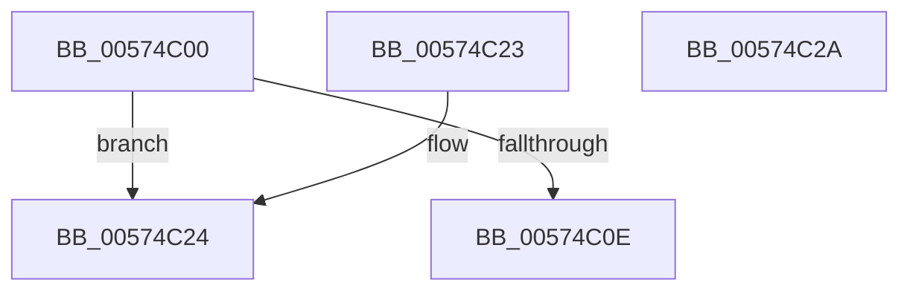

# HsaSetDeviceSvmCapabilities

- RVA: `0x00574C00`–`0x00574C2B` (길이 `43` bytes)
- VA: `0x0000000140574C00`
- 실행 섹션: `.text`
- PDB 이름 있음: `예`; PDB Function 태그: `아니요`
- unwind 정보 RVA: `0x000DB714`
- 디코드: `15`개 명령, `43/43` bytes 표시
- 미해석 바이트: `0` (있으면 어셈블리에 `.byte`로 보존)

> 이 문서는 커널 이미지의 기계어와 PDB 기호를 분석해 생성했습니다. 4번과 5번은 함수 원형과 자료형을 바이너리 사용 방식에서 추정한 C 해석이며 원본 소스 복구 결과는 아닙니다.

## 1. Dependencies

- 직접 호출 지점: **0**; 고유 호출 대상: **0**
- 직접 호출자로 확인된 함수: **0**
- RIP 상대 이미지 참조: **0**

### Outgoing calls
- 직접 디코드된 call 명령이 없습니다.

### Direct callers
- 이 함수 시작 RVA로 연결되는 직접 call은 확인되지 않았습니다. 간접 호출은 완전히 역산할 수 없습니다.

### Static image references
- 디코드된 RIP-relative 메모리 참조가 없습니다.

## 2. Other-region calls and transfers

- 다른 실행 섹션으로 향하는 call: **0**
- 별도 외부 분기/꼬리 이동을 확인하지 못했습니다.

## 3. Assembly (complete function range)

```asm
00574C00  48 8B 42 28                     mov rax, qword ptr [rdx + 0x28]
00574C04  8B 10                           mov edx, dword ptr [rax]
00574C06  81 FA 00 00 01 00               cmp edx, 0x10000
00574C0C  73 16                           jae 0x140574c24
00574C0E  48 8B 49 28                     mov rcx, qword ptr [rcx + 0x28]
00574C12  48 C1 E9 05                     shr rcx, 5
00574C16  48 3B D1                        cmp rdx, rcx
00574C19  1B C0                           sbb eax, eax
00574C1B  F7 D0                           not eax
00574C1D  25 0D 00 00 C0                  and eax, 0xc000000d
00574C22  C3                              ret
00574C23  CC                              int3
00574C24  B8 0D 00 00 C0                  mov eax, 0xc000000d
00574C29  C3                              ret
00574C2A  CC                              int3
```

## 4. C-style interpretation (structured pseudocode)

```c
__int64 __fastcall HsaSetDeviceSvmCapabilities(__int64 a1, __int64 a2)
{
    __int64 result;

    if (((unsigned int)((unsigned int)(*(unsigned int *)(*(unsigned __int64 *)(a2 + 40))))) >= 0x10000ULL) goto loc_00574C24;
    a1 = (*(unsigned __int64 *)(a1 + 40)) >> (5);
    result = (unsigned int)(~(*(unsigned __int64 *)(a2 + 40)));
    result = (unsigned int)((result) & (0xC000000DULL));
    return result;
loc_00574C24:
    return (unsigned int)(0xC000000DULL);
}
```

## 5. (Beta) C Style

```c
int64_t HsaSetDeviceSvmCapabilities(void *Arg1, void *Arg2)
{
    uint8_t *arg1 = (uint8_t *)Arg1;
    uint8_t *arg2 = (uint8_t *)Arg2;

    int64_t result;

    if (((uint32_t)((uint32_t)(*(uint32_t *)(*(uint64_t *)(arg2 + 0x28))))) >= 0x10000ULL) goto loc_00574C24;
    Arg1 = (*(uint64_t *)(arg1 + 0x28)) >> (5);
    result = (uint32_t)(~(*(uint64_t *)(arg2 + 0x28)));
    result = (uint32_t)((result) & (0xC000000DULL));
    return result;
loc_00574C24:
    return (uint32_t)(0xC000000DULL);
}
```

### 관측된 메모리 오프셋

구조체 형식이 확인되지 않은 접근은 인자 기준의 오프셋으로만 기록했습니다.

| 기준 인자 | 오프셋 표현 | 폭 (bit) | 접근 |
|---|---:|---:|---|
| `Arg1` | `+ 0x28` | `64` | `R` |
| `Arg2` | `+ 0x28` | `64` | `R` |

## 6. Execution-region graph

[열기: 2D/3D 그래프와 함수 탐색 컨트롤 패널](../../../control-panel.html?section=text&rva=0x00574C00&view=graph)

- 2D 그래프는 위에서 아래로 흐르고, 3D 그래프는 빈 공간을 드래그해 회전합니다. Shift+드래그는 이동, 휠은 확대·축소, 함수 노드 선택은 대상 보고서 이동입니다.

### Static fallback


