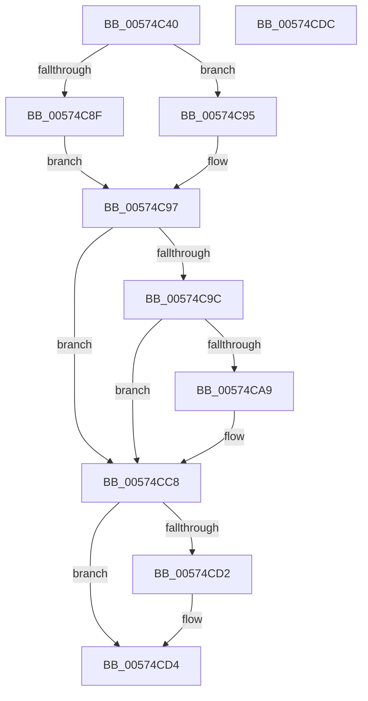

# HsaSetPasidAddressSpace

- RVA: `0x00574C40`–`0x00574CDD` (길이 `157` bytes)
- VA: `0x0000000140574C40`
- 실행 섹션: `.text`
- PDB 이름 있음: `예`; PDB Function 태그: `아니요`
- unwind 정보 RVA: `0x00064C80`
- 디코드: `45`개 명령, `157/157` bytes 표시
- 미해석 바이트: `0` (있으면 어셈블리에 `.byte`로 보존)

> 이 문서는 커널 이미지의 기계어와 PDB 기호를 분석해 생성했습니다. 4번과 5번은 함수 원형과 자료형을 바이너리 사용 방식에서 추정한 C 해석이며 원본 소스 복구 결과는 아닙니다.

## 1. Dependencies

- 직접 호출 지점: **2**; 고유 호출 대상: **2**
- 직접 호출자로 확인된 함수: **0**
- RIP 상대 이미지 참조: **0**

### Outgoing calls
- `0x00574C9F` → [HsaEnsureNoPendingFaults](HsaEnsureNoPendingFaults_function_00573DB8.md) (function, `0x00573DB8`)
- `0x00574CC2` → [KeBugCheckEx](../4F/KeBugCheckEx_function_004FD660.md) (function, `0x004FD660`)

### Direct callers
- 이 함수 시작 RVA로 연결되는 직접 call은 확인되지 않았습니다. 간접 호출은 완전히 역산할 수 없습니다.

### Static image references
- 디코드된 RIP-relative 메모리 참조가 없습니다.

## 2. Other-region calls and transfers

- 다른 실행 섹션으로 향하는 call: **0**
- 별도 외부 분기/꼬리 이동을 확인하지 못했습니다.

## 3. Assembly (complete function range)

```asm
00574C40  40 53                           push rbx
00574C42  48 83 EC 30                     sub rsp, 0x30
00574C46  48 8B 42 30                     mov rax, qword ptr [rdx + 0x30]
00574C4A  BB 01 00 00 00                  mov ebx, 1
00574C4F  45 8B D8                        mov r11d, r8d
00574C52  41 81 E3 FF 01 00 00            and r11d, 0x1ff
00574C59  45 8B D0                        mov r10d, r8d
00574C5C  49 C1 EA 09                     shr r10, 9
00574C60  48 8B 50 30                     mov rdx, qword ptr [rax + 0x30]
00574C64  48 B8 00 F0 FF FF FF FF 0F 00   movabs rax, 0xffffffffff000
00574C6E  4E 8B 94 D2 00 10 00 00         mov r10, qword ptr [rdx + r10*8 + 0x1000]
00574C76  49 8B D1                        mov rdx, r9
00574C79  48 23 D0                        and rdx, rax
00574C7C  48 8B C2                        mov rax, rdx
00574C7F  48 0B C3                        or rax, rbx
00574C82  4D 85 C9                        test r9, r9
00574C85  48 0F 45 D0                     cmovne rdx, rax
00574C89  4B 39 14 DA                     cmp qword ptr [r10 + r11*8], rdx
00574C8D  74 06                           je 0x140574c95
00574C8F  4B 89 14 DA                     mov qword ptr [r10 + r11*8], rdx
00574C93  EB 02                           jmp 0x140574c97
00574C95  32 DB                           xor bl, bl
00574C97  4D 85 C9                        test r9, r9
00574C9A  75 2C                           jne 0x140574cc8
00574C9C  41 8B D0                        mov edx, r8d
00574C9F  E8 14 F1 FF FF                  call 0x140573db8
00574CA4  48 85 C0                        test rax, rax
00574CA7  74 1F                           je 0x140574cc8
00574CA9  48 8B 48 08                     mov rcx, qword ptr [rax + 8]
00574CAD  4C 8B C0                        mov r8, rax
00574CB0  4C 8B 08                        mov r9, qword ptr [rax]
00574CB3  BA 00 20 00 00                  mov edx, 0x2000
00574CB8  48 89 4C 24 20                  mov qword ptr [rsp + 0x20], rcx
00574CBD  B9 59 01 00 00                  mov ecx, 0x159
00574CC2  E8 99 89 F8 FF                  call 0x1404fd660
00574CC7  CC                              int3
00574CC8  48 8B 44 24 60                  mov rax, qword ptr [rsp + 0x60]
00574CCD  48 85 C0                        test rax, rax
00574CD0  74 02                           je 0x140574cd4
00574CD2  88 18                           mov byte ptr [rax], bl
00574CD4  33 C0                           xor eax, eax
00574CD6  48 83 C4 30                     add rsp, 0x30
00574CDA  5B                              pop rbx
00574CDB  C3                              ret
00574CDC  CC                              int3
```

## 4. C-style interpretation (structured pseudocode)

```c
__int64 __fastcall HsaSetPasidAddressSpace(__int64 a1, __int64 a2, int a3, __int64 a4, __int64 a5)
{
    __int64 result;
    __int64 v_r10;
    __int64 v_r11;
    __int64 v_rbx;
    __int64 v_rsp;
    unsigned __int64 v_stack_m18;

    v_rsp = (v_rsp) - (48);
    v_r11 = (unsigned int)(((unsigned int)(a3)) & (511));
    v_r10 = ((unsigned int)(a3)) >> (9);
    a2 = (a4) & (*(unsigned __int64 *)(a2 + 48));
    result = (a2) | (1);
    if (a4 != 0) { a2 = result; }
    if ((*(unsigned __int64 *)(*(unsigned __int64 *)(*(unsigned __int64 *)(*(unsigned __int64 *)(a2 + 48) + 48) + v_r10 * 8 + 4096) + v_r11 * 8)) == a2) goto loc_00574C95;
    *(unsigned __int64 *)(*(unsigned __int64 *)(*(unsigned __int64 *)(*(unsigned __int64 *)(a2 + 48) + 48) + v_r10 * 8 + 4096) + v_r11 * 8) = a2;
    goto loc_00574C97;
loc_00574C95:
    v_rbx = 0;
loc_00574C97:
    if (a4 != 0) goto loc_00574CC8;
    result = HsaEnsureNoPendingFaults(a1, (unsigned int)(a3), a3, a4);
    if (result != 0) {
        a1 = *(unsigned __int64 *)(result + 8);
        a3 = result;
        a4 = *(unsigned __int64 *)(result);
        a2 = 0x2000ULL;
        v_stack_m18 = a1;
        a1 = 345;
        result = KeBugCheckEx(a1, a2, a3, a4);
    }
    if (a5 != 0) {
        *(unsigned __int8 *)(a5) = 0;
    }
    result = 0;
    v_rsp = (v_rsp) + (48);
    return result;
}
```

## 5. (Beta) C Style

```c
int64_t HsaSetPasidAddressSpace(int64_t Arg1, void *Arg2, int32_t Arg3, int64_t Arg4, int64_t Arg5)
{
    uint8_t *arg2 = (uint8_t *)Arg2;

    int64_t result;
    int64_t local_r10;
    int64_t local_r11;
    int64_t local_rbx;
    int64_t local_rsp;
    uint64_t v_stack_m18;

    local_rsp = (local_rsp) - (48);
    local_r11 = (uint32_t)(((uint32_t)(Arg3)) & (511));
    local_r10 = ((uint32_t)(Arg3)) >> (9);
    Arg2 = (Arg4) & (*(uint64_t *)(arg2 + 0x30));
    result = (Arg2) | (1);
    if (Arg4 != 0) { Arg2 = result; }
    if ((*(uint64_t *)(*(uint64_t *)(*(uint64_t *)(*(uint64_t *)(arg2 + 0x30) + 0x30) + local_r10 * 8 + 0x1000) + local_r11 * 8)) == Arg2) goto loc_00574C95;
    *(void **)(*(uint64_t *)(*(uint64_t *)(*(uint64_t *)(arg2 + 0x30) + 0x30) + local_r10 * 8 + 0x1000) + local_r11 * 8) = Arg2;
    goto loc_00574C97;
loc_00574C95:
    local_rbx = 0;
loc_00574C97:
    if (Arg4 != 0) goto loc_00574CC8;
    result = HsaEnsureNoPendingFaults(Arg1, (uint32_t)(Arg3), Arg3, Arg4);
    if (result != 0) {
        Arg1 = *(uint64_t *)(result + 0x8);
        Arg3 = result;
        Arg4 = *(uint64_t *)(result);
        Arg2 = 0x2000ULL;
        v_stack_m18 = Arg1;
        Arg1 = 345;
        result = KeBugCheckEx(Arg1, Arg2, Arg3, Arg4);
    }
    if (Arg5 != 0) {
        *(uint8_t *)(Arg5) = 0;
    }
    result = 0;
    local_rsp = (local_rsp) + (48);
    return result;
}
```

### 관측된 메모리 오프셋

구조체 형식이 확인되지 않은 접근은 인자 기준의 오프셋으로만 기록했습니다.

| 기준 인자 | 오프셋 표현 | 폭 (bit) | 접근 |
|---|---:|---:|---|
| `Arg2` | `+ 0x30` | `64` | `R` |

## 6. Execution-region graph

[열기: 2D/3D 그래프와 함수 탐색 컨트롤 패널](../../../control-panel.html?section=text&rva=0x00574C40&view=graph)

- 2D 그래프는 위에서 아래로 흐르고, 3D 그래프는 빈 공간을 드래그해 회전합니다. Shift+드래그는 이동, 휠은 확대·축소, 함수 노드 선택은 대상 보고서 이동입니다.

### Static fallback


