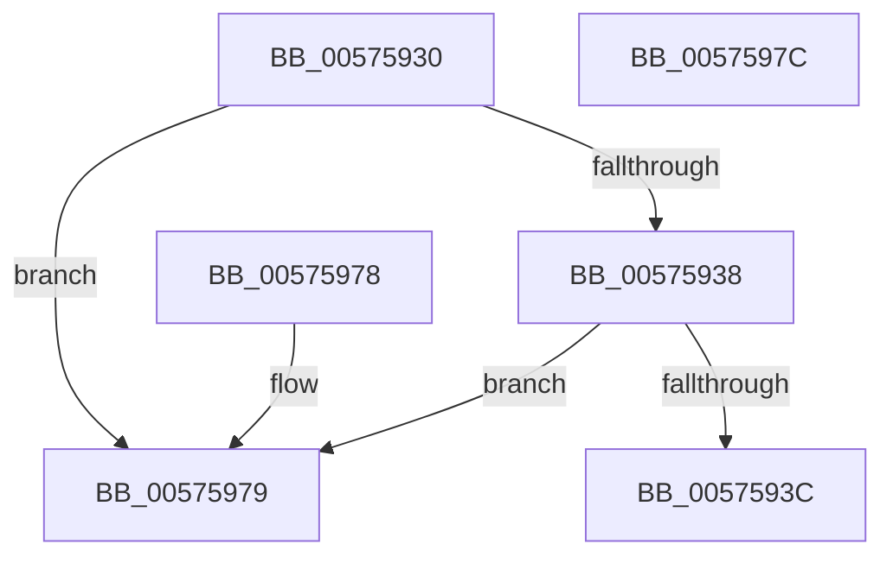

# HsaSlConfigureIntermediatePhysicalPte

- RVA: `0x00575930`–`0x0057597D` (길이 `77` bytes)
- VA: `0x0000000140575930`
- 실행 섹션: `.text`
- PDB 이름 있음: `예`; PDB Function 태그: `아니요`
- unwind 정보 RVA: `0x000DB714`
- 디코드: `24`개 명령, `77/77` bytes 표시
- 미해석 바이트: `0` (있으면 어셈블리에 `.byte`로 보존)

> 이 문서는 커널 이미지의 기계어와 PDB 기호를 분석해 생성했습니다. 4번과 5번은 함수 원형과 자료형을 바이너리 사용 방식에서 추정한 C 해석이며 원본 소스 복구 결과는 아닙니다.

## 1. Dependencies

- 직접 호출 지점: **0**; 고유 호출 대상: **0**
- 직접 호출자로 확인된 함수: **0**
- RIP 상대 이미지 참조: **0**

### Outgoing calls
- 직접 디코드된 call 명령이 없습니다.

### Direct callers
- 이 함수 시작 RVA로 연결되는 직접 call은 확인되지 않았습니다. 간접 호출은 완전히 역산할 수 없습니다.

### Static image references
- 디코드된 RIP-relative 메모리 참조가 없습니다.

## 2. Other-region calls and transfers

- 다른 실행 섹션으로 향하는 call: **0**
- 별도 외부 분기/꼬리 이동을 확인하지 못했습니다.

## 3. Assembly (complete function range)

```asm
00575930  4C 8B 09                        mov r9, qword ptr [rcx]
00575933  4D 85 C9                        test r9, r9
00575936  75 41                           jne 0x140575979
00575938  85 D2                           test edx, edx
0057593A  74 3D                           je 0x140575979
0057593C  8B C2                           mov eax, edx
0057593E  4D 33 C8                        xor r9, r8
00575941  48 C1 E0 09                     shl rax, 9
00575945  48 8B D0                        mov rdx, rax
00575948  49 33 D0                        xor rdx, r8
0057594B  49 B8 FF 01 00 00 00 00 F0 FF   movabs r8, 0xfff00000000001ff
00575955  48 81 E2 FF F1 FF FF            and rdx, 0xfffffffffffff1ff
0057595C  4D 23 C8                        and r9, r8
0057595F  49 33 D1                        xor rdx, r9
00575962  48 33 D0                        xor rdx, rax
00575965  48 B8 01 00 00 00 00 00 00 60   movabs rax, 0x6000000000000001
0057596F  48 0B D0                        or rdx, rax
00575972  B0 01                           mov al, 1
00575974  48 89 11                        mov qword ptr [rcx], rdx
00575977  C3                              ret
00575978  CC                              int3
00575979  32 C0                           xor al, al
0057597B  C3                              ret
0057597C  CC                              int3
```

## 4. C-style interpretation (structured pseudocode)

```c
__int64 __fastcall HsaSlConfigureIntermediatePhysicalPte(__int64 a1, int a2, __int64 a3)
{
    __int64 result;

    if (*(unsigned __int64 *)(a1) != 0) goto loc_00575979;
    if (a2 == 0) goto loc_00575979;
    a4 = (*(unsigned __int64 *)(a1)) ^ (a3);
    result = ((unsigned int)(a2)) << (9);
    a2 = (result) ^ (a3);
    a2 = (a2) & (0xFFFFFFFFFFFFF1FFULL);
    a4 = (a4) & (a3);
    a2 = (a2) ^ (a4);
    a2 = (a2) ^ (result);
    a2 = (a2) | (result);
    *(unsigned __int64 *)(a1) = a2;
    return 1;
loc_00575979:
    result = 0;
    return result;
}
```

## 5. (Beta) C Style

```c
int64_t HsaSlConfigureIntermediatePhysicalPte(void *Arg1, int32_t Arg2, int64_t Arg3)
{
    uint8_t *arg1 = (uint8_t *)Arg1;

    int64_t result;

    if (*(uint64_t *)(arg1) != 0) goto loc_00575979;
    if (Arg2 == 0) goto loc_00575979;
    a4 = (*(uint64_t *)(arg1)) ^ (Arg3);
    result = ((uint32_t)(Arg2)) << (9);
    Arg2 = (result) ^ (Arg3);
    Arg2 = (Arg2) & (0xFFFFFFFFFFFFF1FFULL);
    a4 = (a4) & (Arg3);
    Arg2 = (Arg2) ^ (a4);
    Arg2 = (Arg2) ^ (result);
    Arg2 = (Arg2) | (result);
    *(uint64_t *)(arg1) = Arg2;
    return 1;
loc_00575979:
    result = 0;
    return result;
}
```

### 관측된 메모리 오프셋

구조체 형식이 확인되지 않은 접근은 인자 기준의 오프셋으로만 기록했습니다.

| 기준 인자 | 오프셋 표현 | 폭 (bit) | 접근 |
|---|---:|---:|---|
| `Arg1` | `+ 0x0` | `64` | `R` |
| `Arg1` | `+ 0x0` | `64` | `W` |

## 6. Execution-region graph

[열기: 2D/3D 그래프와 함수 탐색 컨트롤 패널](../../../control-panel.html?section=text&rva=0x00575930&view=graph)

- 2D 그래프는 위에서 아래로 흐르고, 3D 그래프는 빈 공간을 드래그해 회전합니다. Shift+드래그는 이동, 휠은 확대·축소, 함수 노드 선택은 대상 보고서 이동입니다.

### Static fallback


