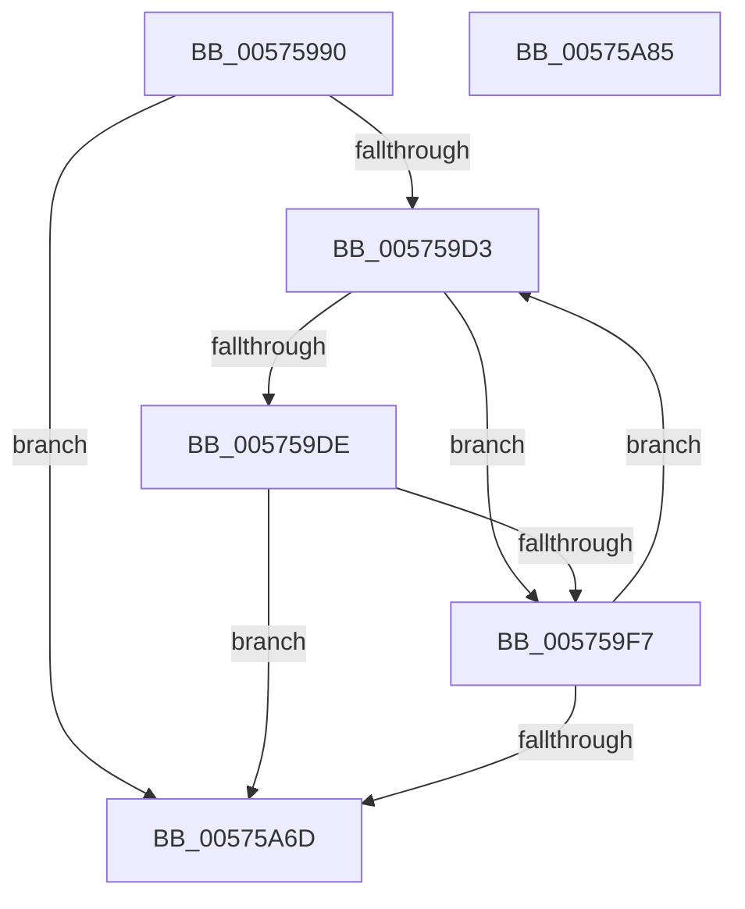

# HsaSlConfigureLeafPhysicalPte

- RVA: `0x00575990`–`0x00575A86` (길이 `246` bytes)
- VA: `0x0000000140575990`
- 실행 섹션: `.text`
- PDB 이름 있음: `예`; PDB Function 태그: `아니요`
- unwind 정보 RVA: `0x000A5A38`
- 디코드: `64`개 명령, `246/246` bytes 표시
- 미해석 바이트: `0` (있으면 어셈블리에 `.byte`로 보존)

> 이 문서는 커널 이미지의 기계어와 PDB 기호를 분석해 생성했습니다. 4번과 5번은 함수 원형과 자료형을 바이너리 사용 방식에서 추정한 C 해석이며 원본 소스 복구 결과는 아닙니다.

## 1. Dependencies

- 직접 호출 지점: **0**; 고유 호출 대상: **0**
- 직접 호출자로 확인된 함수: **0**
- RIP 상대 이미지 참조: **0**

### Outgoing calls
- 직접 디코드된 call 명령이 없습니다.

### Direct callers
- 이 함수 시작 RVA로 연결되는 직접 call은 확인되지 않았습니다. 간접 호출은 완전히 역산할 수 없습니다.

### Static image references
- 디코드된 RIP-relative 메모리 참조가 없습니다.

## 2. Other-region calls and transfers

- 다른 실행 섹션으로 향하는 call: **0**
- 별도 외부 분기/꼬리 이동을 확인하지 못했습니다.

## 3. Assembly (complete function range)

```asm
00575990  48 8B C4                        mov rax, rsp
00575993  48 89 58 08                     mov qword ptr [rax + 8], rbx
00575997  48 89 68 10                     mov qword ptr [rax + 0x10], rbp
0057599B  48 89 70 18                     mov qword ptr [rax + 0x18], rsi
0057599F  48 89 78 20                     mov qword ptr [rax + 0x20], rdi
005759A3  33 FF                           xor edi, edi
005759A5  41 8B E9                        mov ebp, r9d
005759A8  45 8B D8                        mov r11d, r8d
005759AB  45 8B D0                        mov r10d, r8d
005759AE  41 83 E3 01                     and r11d, 1
005759B2  48 8B D9                        mov rbx, rcx
005759B5  41 8A C3                        mov al, r11b
005759B8  34 01                           xor al, 1
005759BA  41 83 E2 02                     and r10d, 2
005759BE  0F B6 C0                        movzx eax, al
005759C1  0F 44 F8                        cmove edi, eax
005759C4  48 C1 EA 0C                     shr rdx, 0xc
005759C8  45 33 C9                        xor r9d, r9d
005759CB  85 ED                           test ebp, ebp
005759CD  0F 84 9A 00 00 00               je 0x140575a6d
005759D3  4C 8B 03                        mov r8, qword ptr [rbx]
005759D6  48 8B F2                        mov rsi, rdx
005759D9  4D 85 C0                        test r8, r8
005759DC  74 19                           je 0x1405759f7
005759DE  49 8B C0                        mov rax, r8
005759E1  48 B9 FF FF FF FF FF 00 00 00   movabs rcx, 0xffffffffff
005759EB  48 C1 E8 0C                     shr rax, 0xc
005759EF  48 23 C1                        and rax, rcx
005759F2  48 3B C2                        cmp rax, rdx
005759F5  75 76                           jne 0x140575a6d
005759F7  48 C1 E2 0C                     shl rdx, 0xc
005759FB  41 8B C2                        mov eax, r10d
005759FE  F7 D8                           neg eax
00575A00  48 B8 00 00 00 00 00 00 00 40   movabs rax, 0x4000000000000000
00575A0A  48 1B C9                        sbb rcx, rcx
00575A0D  41 FF C1                        inc r9d
00575A10  48 23 C8                        and rcx, rax
00575A13  48 B8 FF 0F 00 00 00 00 F0 FF   movabs rax, 0xfff0000000000fff
00575A1D  48 23 C8                        and rcx, rax
00575A20  41 8B C3                        mov eax, r11d
00575A23  48 83 E0 FD                     and rax, 0xfffffffffffffffd
00575A27  48 C1 E0 3D                     shl rax, 0x3d
00575A2B  48 0B C8                        or rcx, rax
00575A2E  48 B8 FF 01 00 00 00 00 F0 9F   movabs rax, 0x9ff00000000001ff
00575A38  4C 23 C0                        and r8, rax
00575A3B  48 B8 00 F0 FF FF FF FF 0F 00   movabs rax, 0xffffffffff000
00575A45  48 23 D0                        and rdx, rax
00575A48  49 0B C8                        or rcx, r8
00575A4B  48 33 CA                        xor rcx, rdx
00575A4E  48 8D 56 01                     lea rdx, [rsi + 1]
00575A52  48 83 C9 01                     or rcx, 1
00575A56  48 89 0B                        mov qword ptr [rbx], rcx
00575A59  48 83 C3 08                     add rbx, 8
00575A5D  40 84 FF                        test dil, dil
00575A60  48 0F 45 D6                     cmovne rdx, rsi
00575A64  44 3B CD                        cmp r9d, ebp
00575A67  0F 82 66 FF FF FF               jb 0x1405759d3
00575A6D  48 8B 5C 24 08                  mov rbx, qword ptr [rsp + 8]
00575A72  41 8B C1                        mov eax, r9d
00575A75  48 8B 6C 24 10                  mov rbp, qword ptr [rsp + 0x10]
00575A7A  48 8B 74 24 18                  mov rsi, qword ptr [rsp + 0x18]
00575A7F  48 8B 7C 24 20                  mov rdi, qword ptr [rsp + 0x20]
00575A84  C3                              ret
00575A85  CC                              int3
```

## 4. C-style interpretation (structured pseudocode)

```c
__int64 __fastcall HsaSlConfigureLeafPhysicalPte(__int64 a1, __int64 a2, int a3, int a4)
{
    __int64 result;
    __int64 v_r10;
    __int64 v_r11;
    __int64 v_rbx;
    __int64 v_rdi;
    unsigned __int64 v_stack_p10;
    unsigned __int64 v_stack_p18;
    unsigned __int64 v_stack_p20;
    unsigned __int64 v_stack_p8;

    *(unsigned __int64 *)(v_rsp + 8) = v_rbx;
    *(unsigned __int64 *)(v_rsp + 16) = v_rbp;
    *(unsigned __int64 *)(v_rsp + 24) = v_rsi;
    *(unsigned __int64 *)(v_rsp + 32) = v_rdi;
    v_rdi = 0;
    v_r11 = (unsigned int)(((unsigned int)(a3)) & (1));
    result = (unsigned __int8)(((unsigned __int8)(v_r11)) ^ (1));
    v_r10 = (unsigned int)(((unsigned int)(a3)) & (2));
    if (condition_is_equal) { v_rdi = (unsigned int)((unsigned __int8)(result)); }
    a2 = (a2) >> (12);
    a4 = 0;
    if ((unsigned int)((unsigned int)(a4)) == 0) goto loc_00575A6D;
loc_005759D3:
    if (*(unsigned __int64 *)(a1) == 0) goto loc_005759F7;
    result = (*(unsigned __int64 *)(a1)) >> (12);
    result = (result) & (a1);
    if (result != a2) goto loc_00575A6D;
loc_005759F7:
    a2 = (a2) << (12);
    result = (unsigned int)(-((unsigned int)((unsigned int)(v_r10))));
    a4 = (unsigned int)((a4) + 1);
    a1 = (a1) & (result);
    a1 = (a1) & (result);
    result = ((unsigned int)((unsigned int)(v_r11))) & (-3);
    result = (result) << (61);
    a1 = (a1) | (result);
    a3 = (*(unsigned __int64 *)(a1)) & (result);
    a2 = (a2) & (result);
    a1 = (a1) | (a3);
    a1 = (a1) ^ (a2);
    a1 = (a1) | (1);
    *(unsigned __int64 *)(a1) = a1;
    v_rbx = (a1) + (8);
    a2 = a2 + 1;
    if ((unsigned __int8)(v_rdi) != 0) { a2 = a2; }
    if (a4 < ((unsigned int)((unsigned int)(a4)))) goto loc_005759D3;
loc_00575A6D:
    return (unsigned int)(a4);
}
```

## 5. (Beta) C Style

```c
int64_t HsaSlConfigureLeafPhysicalPte(void *Arg1, int64_t Arg2, int32_t Arg3, int32_t Arg4)
{
    uint8_t *arg1 = (uint8_t *)Arg1;

    int64_t result;
    int64_t local_r10;
    int64_t local_r11;
    int64_t local_rbx;
    int64_t local_rdi;
    uint64_t v_stack_p10;
    uint64_t v_stack_p18;
    uint64_t v_stack_p20;
    uint64_t v_stack_p8;

    *(uint64_t *)(local_rsp + 0x8) = local_rbx;
    *(uint64_t *)(local_rsp + 0x10) = local_rbp;
    *(uint64_t *)(local_rsp + 0x18) = local_rsi;
    *(uint64_t *)(local_rsp + 0x20) = local_rdi;
    local_rdi = 0;
    local_r11 = (uint32_t)(((uint32_t)(Arg3)) & (1));
    result = (uint8_t)(((uint8_t)(local_r11)) ^ (1));
    local_r10 = (uint32_t)(((uint32_t)(Arg3)) & (2));
    if (condition_is_equal) { local_rdi = (uint32_t)((uint8_t)(result)); }
    Arg2 = (Arg2) >> (12);
    Arg4 = 0;
    if ((uint32_t)((uint32_t)(Arg4)) == 0) goto loc_00575A6D;
loc_005759D3:
    if (*(uint64_t *)(arg1) == 0) goto loc_005759F7;
    result = (*(uint64_t *)(arg1)) >> (12);
    result = (result) & (Arg1);
    if (result != Arg2) goto loc_00575A6D;
loc_005759F7:
    Arg2 = (Arg2) << (12);
    result = (uint32_t)(-((uint32_t)((uint32_t)(local_r10))));
    Arg4 = (uint32_t)((Arg4) + 1);
    Arg1 = (Arg1) & (result);
    Arg1 = (Arg1) & (result);
    result = ((uint32_t)((uint32_t)(local_r11))) & (-3);
    result = (result) << (61);
    Arg1 = (Arg1) | (result);
    Arg3 = (*(uint64_t *)(arg1)) & (result);
    Arg2 = (Arg2) & (result);
    Arg1 = (Arg1) | (Arg3);
    Arg1 = (Arg1) ^ (Arg2);
    Arg1 = (Arg1) | (1);
    *(void **)(arg1) = Arg1;
    local_rbx = (Arg1) + (8);
    Arg2 = Arg2 + 1;
    if ((uint8_t)(local_rdi) != 0) { Arg2 = Arg2; }
    if (Arg4 < ((uint32_t)((uint32_t)(Arg4)))) goto loc_005759D3;
loc_00575A6D:
    return (uint32_t)(Arg4);
}
```

### 관측된 메모리 오프셋

구조체 형식이 확인되지 않은 접근은 인자 기준의 오프셋으로만 기록했습니다.

| 기준 인자 | 오프셋 표현 | 폭 (bit) | 접근 |
|---|---:|---:|---|
| `Arg1` | `+ 0x0` | `64` | `R` |
| `Arg1` | `+ 0x0` | `64` | `W` |

## 6. Execution-region graph

[열기: 2D/3D 그래프와 함수 탐색 컨트롤 패널](../../../control-panel.html?section=text&rva=0x00575990&view=graph)

- 2D 그래프는 위에서 아래로 흐르고, 3D 그래프는 빈 공간을 드래그해 회전합니다. Shift+드래그는 이동, 휠은 확대·축소, 함수 노드 선택은 대상 보고서 이동입니다.

### Static fallback


