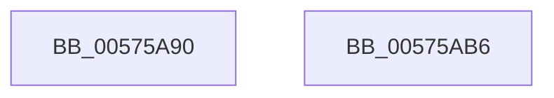

# HsaSlGetPermissions

- RVA: `0x00575A90`–`0x00575AB7` (길이 `39` bytes)
- VA: `0x0000000140575A90`
- 실행 섹션: `.text`
- PDB 이름 있음: `예`; PDB Function 태그: `아니요`
- unwind 정보 RVA: `0x000DB714`
- 디코드: `12`개 명령, `39/39` bytes 표시
- 미해석 바이트: `0` (있으면 어셈블리에 `.byte`로 보존)

> 이 문서는 커널 이미지의 기계어와 PDB 기호를 분석해 생성했습니다. 4번과 5번은 함수 원형과 자료형을 바이너리 사용 방식에서 추정한 C 해석이며 원본 소스 복구 결과는 아닙니다.

## 1. Dependencies

- 직접 호출 지점: **0**; 고유 호출 대상: **0**
- 직접 호출자로 확인된 함수: **0**
- RIP 상대 이미지 참조: **0**

### Outgoing calls
- 직접 디코드된 call 명령이 없습니다.

### Direct callers
- 이 함수 시작 RVA로 연결되는 직접 call은 확인되지 않았습니다. 간접 호출은 완전히 역산할 수 없습니다.

### Static image references
- 디코드된 RIP-relative 메모리 참조가 없습니다.

## 2. Other-region calls and transfers

- 다른 실행 섹션으로 향하는 call: **0**
- 별도 외부 분기/꼬리 이동을 확인하지 못했습니다.

## 3. Assembly (complete function range)

```asm
00575A90  48 8B 11                        mov rdx, qword ptr [rcx]
00575A93  48 B8 00 00 00 00 00 00 00 40   movabs rax, 0x4000000000000000
00575A9D  48 8B CA                        mov rcx, rdx
00575AA0  48 23 D0                        and rdx, rax
00575AA3  48 C1 E9 3D                     shr rcx, 0x3d
00575AA7  83 E1 01                        and ecx, 1
00575AAA  8B C1                           mov eax, ecx
00575AAC  83 C8 02                        or eax, 2
00575AAF  48 85 D2                        test rdx, rdx
00575AB2  0F 44 C1                        cmove eax, ecx
00575AB5  C3                              ret
00575AB6  CC                              int3
```

## 4. C-style interpretation (structured pseudocode)

```c
__int64 __fastcall HsaSlGetPermissions(__int64 a1)
{
    __int64 result;

    a2 = (*(unsigned __int64 *)(a1)) & (result);
    a1 = (*(unsigned __int64 *)(a1)) >> (61);
    a1 = (unsigned int)((a1) & (1));
    result = (unsigned int)(((unsigned int)((unsigned int)(a1))) | (2));
    if (a2 == 0) { result = (unsigned int)(a1); }
    return result;
}
```

## 5. (Beta) C Style

```c
int64_t HsaSlGetPermissions(void *Arg1)
{
    uint8_t *arg1 = (uint8_t *)Arg1;

    int64_t result;

    a2 = (*(uint64_t *)(arg1)) & (result);
    Arg1 = (*(uint64_t *)(arg1)) >> (61);
    Arg1 = (uint32_t)((Arg1) & (1));
    result = (uint32_t)(((uint32_t)((uint32_t)(Arg1))) | (2));
    if (a2 == 0) { result = (uint32_t)(Arg1); }
    return result;
}
```

### 관측된 메모리 오프셋

구조체 형식이 확인되지 않은 접근은 인자 기준의 오프셋으로만 기록했습니다.

| 기준 인자 | 오프셋 표현 | 폭 (bit) | 접근 |
|---|---:|---:|---|
| `Arg1` | `+ 0x0` | `64` | `R` |

## 6. Execution-region graph

[열기: 2D/3D 그래프와 함수 탐색 컨트롤 패널](../../../control-panel.html?section=text&rva=0x00575A90&view=graph)

- 2D 그래프는 위에서 아래로 흐르고, 3D 그래프는 빈 공간을 드래그해 회전합니다. Shift+드래그는 이동, 휠은 확대·축소, 함수 노드 선택은 대상 보고서 이동입니다.

### Static fallback


