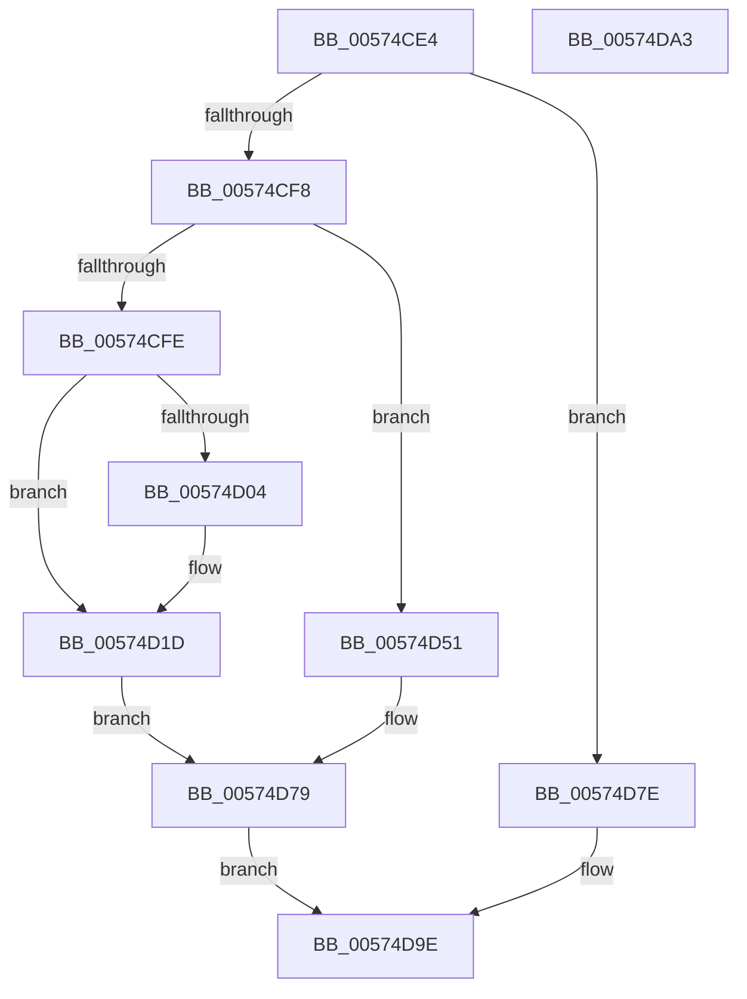

# HsaUpdateInterruptDestination

- RVA: `0x00574CE4`–`0x00574DA4` (길이 `192` bytes)
- VA: `0x0000000140574CE4`
- 실행 섹션: `.text`
- PDB 이름 있음: `예`; PDB Function 태그: `아니요`
- unwind 정보 RVA: `0x0005D2F4`
- 디코드: `52`개 명령, `192/192` bytes 표시
- 미해석 바이트: `0` (있으면 어셈블리에 `.byte`로 보존)

> 이 문서는 커널 이미지의 기계어와 PDB 기호를 분석해 생성했습니다. 4번과 5번은 함수 원형과 자료형을 바이너리 사용 방식에서 추정한 C 해석이며 원본 소스 복구 결과는 아닙니다.

## 1. Dependencies

- 직접 호출 지점: **1**; 고유 호출 대상: **1**
- 직접 호출자로 확인된 함수: **1**
- RIP 상대 이미지 참조: **0**

### Outgoing calls
- `0x00574D17` → [KeBugCheckEx](../4F/KeBugCheckEx_function_004FD660.md) (function, `0x004FD660`)

### Direct callers
- [HsaUpdateRemappingTableEntry](HsaUpdateRemappingTableEntry_function_00575000.md) at `0x005750EB`

### Static image references
- 디코드된 RIP-relative 메모리 참조가 없습니다.

## 2. Other-region calls and transfers

- 다른 실행 섹션으로 향하는 call: **0**
- 별도 외부 분기/꼬리 이동을 확인하지 못했습니다.

## 3. Assembly (complete function range)

```asm
00574CE4  48 83 EC 38                     sub rsp, 0x38
00574CE8  44 8B 02                        mov r8d, dword ptr [rdx]
00574CEB  4C 8B C9                        mov r9, rcx
00574CEE  41 83 E8 01                     sub r8d, 1
00574CF2  0F 84 86 00 00 00               je 0x140574d7e
00574CF8  41 83 E8 03                     sub r8d, 3
00574CFC  74 53                           je 0x140574d51
00574CFE  41 83 F8 02                     cmp r8d, 2
00574D02  74 19                           je 0x140574d1d
00574D04  B9 5C 00 00 00                  mov ecx, 0x5c
00574D09  48 89 54 24 20                  mov qword ptr [rsp + 0x20], rdx
00574D0E  BA 00 70 00 00                  mov edx, 0x7000
00574D13  44 8D 41 C4                     lea r8d, [rcx - 0x3c]
00574D17  E8 44 89 F8 FF                  call 0x1404fd660
00574D1C  CC                              int3
00574D1D  8B 4A 08                        mov ecx, dword ptr [rdx + 8]
00574D20  C1 E1 10                        shl ecx, 0x10
00574D23  0B 4A 0C                        or ecx, dword ptr [rdx + 0xc]
00574D26  48 BA FF 00 00 00 FF FF FF FF   movabs rdx, 0xffffffff000000ff
00574D30  8B C1                           mov eax, ecx
00574D32  C1 E8 18                        shr eax, 0x18
00574D35  41 88 41 0F                     mov byte ptr [r9 + 0xf], al
00574D39  8B C1                           mov eax, ecx
00574D3B  48 C1 E0 08                     shl rax, 8
00574D3F  48 8B C8                        mov rcx, rax
00574D42  49 33 09                        xor rcx, qword ptr [r9]
00574D45  48 23 CA                        and rcx, rdx
00574D48  48 33 C8                        xor rcx, rax
00574D4B  48 83 C9 40                     or rcx, 0x40
00574D4F  EB 28                           jmp 0x140574d79
00574D51  8A 42 0B                        mov al, byte ptr [rdx + 0xb]
00574D54  88 41 0F                        mov byte ptr [rcx + 0xf], al
00574D57  8B 4A 08                        mov ecx, dword ptr [rdx + 8]
00574D5A  BA 00 FF FF FF                  mov edx, 0xffffff00
00574D5F  49 8B 01                        mov rax, qword ptr [r9]
00574D62  48 C1 E1 08                     shl rcx, 8
00574D66  48 23 CA                        and rcx, rdx
00574D69  48 BA BF 00 00 00 FF FF FF FF   movabs rdx, 0xffffffff000000bf
00574D73  48 23 C2                        and rax, rdx
00574D76  48 33 C8                        xor rcx, rax
00574D79  49 89 09                        mov qword ptr [r9], rcx
00574D7C  EB 20                           jmp 0x140574d9e
00574D7E  48 B8 00 00 00 00 00 00 00 FF   movabs rax, 0xff00000000000000
00574D88  BA 00 FF FF FF                  mov edx, 0xffffff00
00574D8D  48 09 41 08                     or qword ptr [rcx + 8], rax
00574D91  48 8B 01                        mov rax, qword ptr [rcx]
00574D94  48 83 E0 BF                     and rax, 0xffffffffffffffbf
00574D98  48 0B C2                        or rax, rdx
00574D9B  48 89 01                        mov qword ptr [rcx], rax
00574D9E  48 83 C4 38                     add rsp, 0x38
00574DA2  C3                              ret
00574DA3  CC                              int3
```

## 4. C-style interpretation (structured pseudocode)

```c
__int64 __fastcall HsaUpdateInterruptDestination(__int64 a1, __int64 a2)
{
    __int64 result;
    __int64 v_rsp;
    unsigned __int64 v_stack_m18;

    v_rsp = (v_rsp) - (56);
    a3 = (unsigned int)(((unsigned int)(*(unsigned int *)(a2))) - (1));
    if (condition_is_equal) goto loc_00574D7E;
    a3 = (unsigned int)((a3) - (3));
    if (condition_is_equal) goto loc_00574D51;
    if (((unsigned int)(a3)) != 2) {
        a1 = 92;
        v_stack_m18 = a2;
        a2 = 0x7000ULL;
        a3 = a1 - 60;
        result = KeBugCheckEx(a1, a2, a3, a1);
    }
    a1 = (unsigned int)(((unsigned int)(*(unsigned int *)(a2 + 8))) << (16));
    a1 = (unsigned int)((a1) | (*(unsigned int *)(a2 + 12)));
    result = (unsigned int)(((unsigned int)((unsigned int)(a1))) >> (24));
    *(unsigned __int8 *)(a1 + 15) = (unsigned __int8)(result);
    result = ((unsigned int)((unsigned int)(a1))) << (8);
    a1 = (result) ^ (*(unsigned __int64 *)(a1));
    a1 = (a1) & (a2);
    a1 = (a1) ^ (result);
    a1 = (a1) | (64);
    goto loc_00574D79;
loc_00574D51:
    *(unsigned __int8 *)(a1 + 15) = (unsigned __int8)(*(unsigned __int8 *)(a2 + 11));
    a1 = ((unsigned int)(*(unsigned int *)(a2 + 8))) << (8);
    a1 = (a1) & ((unsigned int)(0xFFFFFF00ULL));
    result = (*(unsigned __int64 *)(a1)) & ((unsigned int)(0xFFFFFF00ULL));
    a1 = (a1) ^ (result);
loc_00574D79:
    *(unsigned __int64 *)(a1) = a1;
    goto loc_00574D9E;
loc_00574D7E:
    result = (*(unsigned __int64 *)(a1)) & (-65);
    result = (result) | ((unsigned int)(0xFFFFFF00ULL));
    *(unsigned __int64 *)(a1) = result;
loc_00574D9E:
    v_rsp = (v_rsp) + (56);
    return result;
}
```

## 5. (Beta) C Style

```c
int64_t HsaUpdateInterruptDestination(void *Arg1, void *Arg2)
{
    uint8_t *arg1 = (uint8_t *)Arg1;
    uint8_t *arg2 = (uint8_t *)Arg2;

    int64_t result;
    int64_t local_rsp;
    uint64_t v_stack_m18;

    local_rsp = (local_rsp) - (56);
    a3 = (uint32_t)(((uint32_t)(*(uint32_t *)(arg2))) - (1));
    if (condition_is_equal) goto loc_00574D7E;
    a3 = (uint32_t)((a3) - (3));
    if (condition_is_equal) goto loc_00574D51;
    if (((uint32_t)(a3)) != 2) {
        Arg1 = 92;
        v_stack_m18 = Arg2;
        Arg2 = 0x7000ULL;
        a3 = Arg1 - 60;
        result = KeBugCheckEx(Arg1, Arg2, a3, Arg1);
    }
    Arg1 = (uint32_t)(((uint32_t)(*(uint32_t *)(arg2 + 0x8))) << (16));
    Arg1 = (uint32_t)((Arg1) | (*(uint32_t *)(arg2 + 0xC)));
    result = (uint32_t)(((uint32_t)((uint32_t)(Arg1))) >> (24));
    *(uint8_t *)(arg1 + 0xF) = (uint8_t)(result);
    result = ((uint32_t)((uint32_t)(Arg1))) << (8);
    Arg1 = (result) ^ (*(uint64_t *)(arg1));
    Arg1 = (Arg1) & (Arg2);
    Arg1 = (Arg1) ^ (result);
    Arg1 = (Arg1) | (64);
    goto loc_00574D79;
loc_00574D51:
    *(uint8_t *)(arg1 + 0xF) = (uint8_t)(*(uint8_t *)(arg2 + 0xB));
    Arg1 = ((uint32_t)(*(uint32_t *)(arg2 + 0x8))) << (8);
    Arg1 = (Arg1) & ((uint32_t)(0xFFFFFF00ULL));
    result = (*(uint64_t *)(arg1)) & ((uint32_t)(0xFFFFFF00ULL));
    Arg1 = (Arg1) ^ (result);
loc_00574D79:
    *(void **)(arg1) = Arg1;
    goto loc_00574D9E;
loc_00574D7E:
    result = (*(uint64_t *)(arg1)) & (-65);
    result = (result) | ((uint32_t)(0xFFFFFF00ULL));
    *(uint64_t *)(arg1) = result;
loc_00574D9E:
    local_rsp = (local_rsp) + (56);
    return result;
}
```

### 관측된 메모리 오프셋

구조체 형식이 확인되지 않은 접근은 인자 기준의 오프셋으로만 기록했습니다.

| 기준 인자 | 오프셋 표현 | 폭 (bit) | 접근 |
|---|---:|---:|---|
| `Arg1` | `+ 0x0` | `64` | `R` |
| `Arg1` | `+ 0x0` | `64` | `W` |
| `Arg1` | `+ 0x8` | `64` | `R/W` |
| `Arg1` | `+ 0xF` | `8` | `W` |
| `Arg2` | `+ 0x0` | `32` | `R` |
| `Arg2` | `+ 0x8` | `32` | `R` |
| `Arg2` | `+ 0xB` | `8` | `R` |

## 6. Execution-region graph

[열기: 2D/3D 그래프와 함수 탐색 컨트롤 패널](../../../control-panel.html?section=text&rva=0x00574CE4&view=graph)

- 2D 그래프는 위에서 아래로 흐르고, 3D 그래프는 빈 공간을 드래그해 회전합니다. Shift+드래그는 이동, 휠은 확대·축소, 함수 노드 선택은 대상 보고서 이동입니다.

### Static fallback


