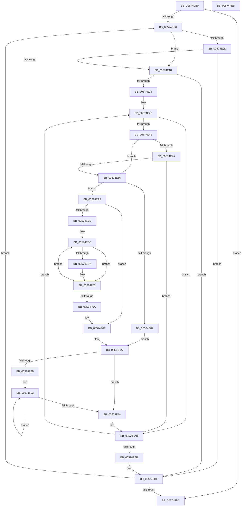

# HsaUpdateRemappingDestination

- RVA: `0x00574DB0`–`0x00574FEE` (길이 `574` bytes)
- VA: `0x0000000140574DB0`
- 실행 섹션: `.text`
- PDB 이름 있음: `예`; PDB Function 태그: `아니요`
- unwind 정보 RVA: `0x000C5404`
- 디코드: `154`개 명령, `574/574` bytes 표시
- 미해석 바이트: `0` (있으면 어셈블리에 `.byte`로 보존)

> 이 문서는 커널 이미지의 기계어와 PDB 기호를 분석해 생성했습니다. 4번과 5번은 함수 원형과 자료형을 바이너리 사용 방식에서 추정한 C 해석이며 원본 소스 복구 결과는 아닙니다.

## 1. Dependencies

- 직접 호출 지점: **4**; 고유 호출 대상: **3**
- 직접 호출자로 확인된 함수: **0**
- RIP 상대 이미지 참조: **1**

### Outgoing calls
- `0x00574DFB` → [HsaGetDeviceAperture](HsaGetDeviceAperture_function_00574288.md) (function, `0x00574288`)
- `0x00574E97` → [HsaUpdateSingleTargetExtendedDestination](HsaUpdateSingleTargetExtendedDestination_function_00572A3C.md) (function, `0x00572A3C`)
- `0x00574EF3` → [HsaUpdateSingleTargetExtendedDestination](HsaUpdateSingleTargetExtendedDestination_function_00572A3C.md) (function, `0x00572A3C`)
- `0x00574FD7` → [HsaInvalidateRemappingTableEntries](HsaInvalidateRemappingTableEntries_function_00574734.md) (function, `0x00574734`)

### Direct callers
- 이 함수 시작 RVA로 연결되는 직접 call은 확인되지 않았습니다. 간접 호출은 완전히 역산할 수 없습니다.

### Static image references
- `0x00574DD7` → RVA `0x00F8F644` (`.data`; read)

## 2. Other-region calls and transfers

- 다른 실행 섹션으로 향하는 call: **0**
- 별도 외부 분기/꼬리 이동을 확인하지 못했습니다.

## 3. Assembly (complete function range)

```asm
00574DB0  48 8B C4                        mov rax, rsp
00574DB3  4C 89 48 20                     mov qword ptr [rax + 0x20], r9
00574DB7  4C 89 40 18                     mov qword ptr [rax + 0x18], r8
00574DBB  88 50 10                        mov byte ptr [rax + 0x10], dl
00574DBE  48 89 48 08                     mov qword ptr [rax + 8], rcx
00574DC2  53                              push rbx
00574DC3  55                              push rbp
00574DC4  56                              push rsi
00574DC5  57                              push rdi
00574DC6  41 54                           push r12
00574DC8  41 55                           push r13
00574DCA  41 56                           push r14
00574DCC  41 57                           push r15
00574DCE  48 83 EC 68                     sub rsp, 0x68
00574DD2  33 ED                           xor ebp, ebp
00574DD4  0F 57 C0                        xorps xmm0, xmm0
00574DD7  39 2D 67 A8 A1 00               cmp dword ptr [rip + 0xa1a867], ebp
00574DDD  4D 8B F9                        mov r15, r9
00574DE0  4D 8B E0                        mov r12, r8
00574DE3  89 6C 24 34                     mov dword ptr [rsp + 0x34], ebp
00574DE7  8A DA                           mov bl, dl
00574DE9  48 8B F1                        mov rsi, rcx
00574DEC  0F 11 40 98                     movups xmmword ptr [rax - 0x68], xmm0
00574DF0  0F 86 DB 01 00 00               jbe 0x140574fd1
00574DF6  8B CD                           mov ecx, ebp
00574DF8  C1 E1 09                        shl ecx, 9
00574DFB  E8 88 F4 FF FF                  call 0x140574288
00574E00  48 89 44 24 38                  mov qword ptr [rsp + 0x38], rax
00574E05  4C 8D 68 10                     lea r13, [rax + 0x10]
00574E09  85 ED                           test ebp, ebp
00574E0B  74 0B                           je 0x140574e18
00574E0D  49 83 7D 00 00                  cmp qword ptr [r13], 0
00574E12  0F 84 A7 01 00 00               je 0x140574fbf
00574E18  45 33 F6                        xor r14d, r14d
00574E1B  44 39 B6 B4 00 00 00            cmp dword ptr [rsi + 0xb4], r14d
00574E22  0F 86 97 01 00 00               jbe 0x140574fbf
00574E28  48 8B E8                        mov rbp, rax
00574E2B  41 8B FE                        mov edi, r14d
00574E2E  48 C1 E7 04                     shl rdi, 4
00574E32  49 03 7D 00                     add rdi, qword ptr [r13]
00574E36  41 8B D6                        mov edx, r14d
00574E39  4C 8B 07                        mov r8, qword ptr [rdi]
00574E3C  41 F6 C0 01                     test r8b, 1
00574E40  0F 84 65 01 00 00               je 0x140574fab
00574E46  84 DB                           test bl, bl
00574E48  74 1C                           je 0x140574e66
00574E4A  48 8B 45 28                     mov rax, qword ptr [rbp + 0x28]
00574E4E  41 8A CE                        mov cl, r14b
00574E51  48 C1 EA 03                     shr rdx, 3
00574E55  80 E1 07                        and cl, 7
00574E58  8A 14 02                        mov dl, byte ptr [rdx + rax]
00574E5B  D2 FA                           sar dl, cl
00574E5D  F6 C2 01                        test dl, 1
00574E60  0F 84 45 01 00 00               je 0x140574fab
00574E66  0F B6 47 0F                     movzx eax, byte ptr [rdi + 0xf]
00574E6A  49 8B D8                        mov rbx, r8
00574E6D  48 C1 EB 08                     shr rbx, 8
00574E71  81 E3 FF FF FF 00               and ebx, 0xffffff
00574E77  C1 E0 18                        shl eax, 0x18
00574E7A  0B D8                           or ebx, eax
00574E7C  41 F6 C0 40                     test r8b, 0x40
00574E80  75 21                           jne 0x140574ea3
00574E82  8B 84 24 D0 00 00 00            mov eax, dword ptr [rsp + 0xd0]
00574E89  4D 8B CF                        mov r9, r15
00574E8C  4D 8B C4                        mov r8, r12
00574E8F  89 44 24 20                     mov dword ptr [rsp + 0x20], eax
00574E93  33 D2                           xor edx, edx
00574E95  8B CB                           mov ecx, ebx
00574E97  E8 A0 DB FF FF                  call 0x140572a3c
00574E9C  8B C8                           mov ecx, eax
00574E9E  E9 84 00 00 00                  jmp 0x140574f27
00574EA3  33 C9                           xor ecx, ecx
00574EA5  44 0F B7 E3                     movzx r12d, bx
00574EA9  8B F3                           mov esi, ebx
00574EAB  89 4C 24 30                     mov dword ptr [rsp + 0x30], ecx
00574EAF  81 E6 00 00 FF FF               and esi, 0xffff0000
00574EB5  44 8D 79 01                     lea r15d, [rcx + 1]
00574EB9  45 85 E4                        test r12d, r12d
00574EBC  74 51                           je 0x140574f0f
00574EBE  8B AC 24 D0 00 00 00            mov ebp, dword ptr [rsp + 0xd0]
00574EC5  4C 8B 8C 24 C8 00 00 00         mov r9, qword ptr [rsp + 0xc8]
00574ECD  4C 8B 84 24 C0 00 00 00         mov r8, qword ptr [rsp + 0xc0]
00574ED5  45 85 FC                        test r12d, r15d
00574ED8  74 28                           je 0x140574f02
00574EDA  41 8B C7                        mov eax, r15d
00574EDD  89 6C 24 20                     mov dword ptr [rsp + 0x20], ebp
00574EE1  F7 D0                           not eax
00574EE3  81 E6 00 00 FF FF               and esi, 0xffff0000
00574EE9  41 0B F7                        or esi, r15d
00574EEC  B2 01                           mov dl, 1
00574EEE  8B CE                           mov ecx, esi
00574EF0  44 23 E0                        and r12d, eax
00574EF3  E8 44 DB FF FF                  call 0x140572a3c
00574EF8  8B 4C 24 30                     mov ecx, dword ptr [rsp + 0x30]
00574EFC  0B C8                           or ecx, eax
00574EFE  89 4C 24 30                     mov dword ptr [rsp + 0x30], ecx
00574F02  45 03 FF                        add r15d, r15d
00574F05  45 85 E4                        test r12d, r12d
00574F08  75 CB                           jne 0x140574ed5
00574F0A  48 8B 6C 24 38                  mov rbp, qword ptr [rsp + 0x38]
00574F0F  48 8B B4 24 B0 00 00 00         mov rsi, qword ptr [rsp + 0xb0]
00574F17  4C 8B BC 24 C8 00 00 00         mov r15, qword ptr [rsp + 0xc8]
00574F1F  4C 8B A4 24 C0 00 00 00         mov r12, qword ptr [rsp + 0xc0]
00574F27  3B D9                           cmp ebx, ecx
00574F29  74 79                           je 0x140574fa4
00574F2B  0F 10 07                        movups xmm0, xmmword ptr [rdi]
00574F2E  48 8B 47 08                     mov rax, qword ptr [rdi + 8]
00574F32  48 BA FF FF FF FF FF FF FF 00   movabs rdx, 0xffffffffffffff
00574F3C  48 23 C2                        and rax, rdx
00574F3F  8B D9                           mov ebx, ecx
00574F41  48 81 E1 00 00 00 FF            and rcx, 0xffffffffff000000
00574F48  81 E3 FF FF FF 00               and ebx, 0xffffff
00574F4E  0F 11 44 24 40                  movups xmmword ptr [rsp + 0x40], xmm0
00574F53  48 C1 E1 20                     shl rcx, 0x20
00574F57  48 BA FF 00 00 00 FF FF FF FF   movabs rdx, 0xffffffff000000ff
00574F61  48 0B C8                        or rcx, rax
00574F64  48 C1 E3 08                     shl rbx, 8
00574F68  48 8B 44 24 40                  mov rax, qword ptr [rsp + 0x40]
00574F6D  48 23 C2                        and rax, rdx
00574F70  48 89 4C 24 48                  mov qword ptr [rsp + 0x48], rcx
00574F75  48 0B D8                        or rbx, rax
00574F78  48 8B 07                        mov rax, qword ptr [rdi]
00574F7B  48 8B 57 08                     mov rdx, qword ptr [rdi + 8]
00574F7F  48 89 44 24 50                  mov qword ptr [rsp + 0x50], rax
00574F84  48 8B 44 24 50                  mov rax, qword ptr [rsp + 0x50]
00574F89  48 89 54 24 58                  mov qword ptr [rsp + 0x58], rdx
00574F8E  48 89 5C 24 40                  mov qword ptr [rsp + 0x40], rbx
00574F93  F0 48 0F C7 0F                  lock cmpxchg16b xmmword ptr [rdi]
00574F98  48 89 44 24 50                  mov qword ptr [rsp + 0x50], rax
00574F9D  48 89 54 24 58                  mov qword ptr [rsp + 0x58], rdx
00574FA2  75 EF                           jne 0x140574f93
00574FA4  8A 9C 24 B8 00 00 00            mov bl, byte ptr [rsp + 0xb8]
00574FAB  41 FF C6                        inc r14d
00574FAE  44 3B B6 B4 00 00 00            cmp r14d, dword ptr [rsi + 0xb4]
00574FB5  0F 82 70 FE FF FF               jb 0x140574e2b
00574FBB  8B 6C 24 34                     mov ebp, dword ptr [rsp + 0x34]
00574FBF  FF C5                           inc ebp
00574FC1  3B 2D 7D A6 A1 00               cmp ebp, dword ptr [rip + 0xa1a67d]
00574FC7  89 6C 24 34                     mov dword ptr [rsp + 0x34], ebp
00574FCB  0F 82 25 FE FF FF               jb 0x140574df6
00574FD1  45 33 C0                        xor r8d, r8d
00574FD4  48 8B CE                        mov rcx, rsi
00574FD7  E8 58 F7 FF FF                  call 0x140574734
00574FDC  48 83 C4 68                     add rsp, 0x68
00574FE0  41 5F                           pop r15
00574FE2  41 5E                           pop r14
00574FE4  41 5D                           pop r13
00574FE6  41 5C                           pop r12
00574FE8  5F                              pop rdi
00574FE9  5E                              pop rsi
00574FEA  5D                              pop rbp
00574FEB  5B                              pop rbx
00574FEC  C3                              ret
00574FED  CC                              int3
```

## 4. C-style interpretation (structured pseudocode)

```c
__int64 __fastcall HsaUpdateRemappingDestination(__int64 a1, unsigned __int8 a2, __int64 a3, __int64 a4, unsigned int a5)
{
    __int64 result;
    __int64 v_r12;
    __int64 v_r14;
    __int64 v_r15;
    __int64 v_rbp;
    __int64 v_rbx;
    __int64 v_rdi;
    __int64 v_rsi;
    __int64 v_rsp;
    unsigned __int64 v_stack_m50;
    unsigned __int64 v_stack_m58;
    unsigned __int64 v_stack_m60;
    unsigned __int64 v_stack_m68;
    unsigned __int64 v_stack_m70;
    unsigned int v_stack_m74;
    unsigned int v_stack_m78;
    unsigned int v_stack_m88;
    unsigned __int8 v_stack_p10;
    unsigned __int64 v_stack_p18;
    unsigned __int64 v_stack_p20;
    unsigned __int64 v_stack_p8;

    *(unsigned __int64 *)(v_rsp + 32) = a4;
    *(unsigned __int64 *)(v_rsp + 24) = a3;
    *(unsigned __int8 *)(v_rsp + 16) = a2;
    *(unsigned __int64 *)(v_rsp + 8) = a1;
    v_rsp = (v_rsp) - (104);
    v_rbp = 0;
    v_stack_m74 = 0;
    *(unsigned __int64 *)(v_rsp - 104) = v_xmm0;
    if ((*(unsigned int *)(v_rip + 10594407)) <= 0) goto loc_00574FD1;
loc_00574DF6:
    a1 = (unsigned int)((0) << (9));
    result = HsaGetDeviceAperture(a1, a2, a3, a4);
    v_stack_m70 = result;
    if (0 == 0) goto loc_00574E18;
    if ((*(unsigned __int64 *)(result + 16)) == 0) goto loc_00574FBF;
loc_00574E18:
    v_r14 = 0;
    if ((*(unsigned int *)(a1 + 180)) <= 0) goto loc_00574FBF;
loc_00574E2B:
    v_rdi = (0) << (4);
    v_rdi = (v_rdi) + (*(unsigned __int64 *)(result + 16));
    if ((((unsigned __int8)(*(unsigned __int64 *)(v_rdi))) & (1)) == 0) goto loc_00574FAB;
    if (a2 == 0) goto loc_00574E66;
    a2 = (0) >> (3);
    a1 = (unsigned __int8)((0) & (7));
    a2 = (unsigned __int8)((*(unsigned __int8 *)(a2 + *(unsigned __int64 *)(result + 40) * 1)) >> ((unsigned __int8)(a1)));
    if (((a2) & (1)) == 0) goto loc_00574FAB;
loc_00574E66:
    v_rbx = (*(unsigned __int64 *)(v_rdi)) >> (8);
    v_rbx = (unsigned int)((v_rbx) & (0xFFFFFFULL));
    result = (unsigned int)((*(unsigned __int8 *)(v_rdi + 15)) << (24));
    v_rbx = (unsigned int)((v_rbx) | ((unsigned int)(result)));
    if ((((unsigned __int8)(*(unsigned __int64 *)(v_rdi))) & (64)) != 0) goto loc_00574EA3;
    v_stack_m88 = (unsigned int)((unsigned int)(a5));
    a2 = 0;
    result = HsaUpdateSingleTargetExtendedDestination((unsigned int)((unsigned int)(v_rbx)), a2, a3, a4);
    goto loc_00574F27;
loc_00574EA3:
    a1 = 0;
    v_stack_m78 = 0;
    v_rsi = (unsigned int)(((unsigned int)((unsigned int)(v_rbx))) & (0xFFFF0000ULL));
    if ((unsigned int)((unsigned __int16)(v_rbx)) == 0) goto loc_00574F0F;
loc_00574ED5:
    v_r12 = (unsigned __int16)(v_rbx);
    if ((((unsigned int)((unsigned __int16)(v_rbx))) & ((unsigned int)(a1 + 1))) != 0) {
        result = (unsigned int)(a1 + 1);
        v_stack_m88 = (unsigned int)((unsigned int)(a5));
        result = (unsigned int)(~(result));
        v_rsi = (unsigned int)((v_rsi) & (0xFFFF0000ULL));
        v_rsi = (unsigned int)((v_rsi) | ((unsigned int)(a1 + 1)));
        a2 = 1;
        a1 = (unsigned int)(v_rsi);
        v_r12 = (unsigned int)(((unsigned __int16)(v_rbx)) & ((unsigned int)(result)));
        result = HsaUpdateSingleTargetExtendedDestination(a1, a2, v_stack_p18, v_stack_p20);
        a1 = v_stack_m78;
        a1 = (unsigned int)((a1) | ((unsigned int)(result)));
        v_stack_m78 = (unsigned int)(a1);
    }
    v_r15 = (unsigned int)((a1 + 1) + ((unsigned int)(a1 + 1)));
    if ((unsigned int)(v_r12) != 0) goto loc_00574ED5;
loc_00574F0F:
loc_00574F27:
    if (((unsigned int)(v_rbx)) == ((unsigned int)(a1))) goto loc_00574FA4;
    result = (*(unsigned __int64 *)(v_rdi + 8)) & (a2);
    a1 = (a1) & (0xFFFFFFFFFF000000ULL);
    v_rbx = (unsigned int)(((unsigned int)((unsigned int)(a1))) & (0xFFFFFFULL));
    v_stack_m68 = v_xmm0;
    a1 = (a1) << (32);
    a1 = (a1) | (result);
    v_rbx = (v_rbx) << (8);
    result = (v_stack_m68) & (a2);
    v_stack_m60 = a1;
    v_rbx = (v_rbx) | (result);
    v_stack_m58 = *(unsigned __int64 *)(v_rdi);
    v_stack_m50 = *(unsigned __int64 *)(v_rdi + 8);
    v_stack_m68 = v_rbx;
loc_00574F93:
    v_stack_m58 = v_stack_m58;
    v_stack_m50 = *(unsigned __int64 *)(v_rdi + 8);
    if (condition_is_not_equal) goto loc_00574F93;
loc_00574FA4:
loc_00574FAB:
    v_r14 = (unsigned int)((v_r14) + 1);
    if (((unsigned int)(v_r14)) < (*(unsigned int *)(v_stack_p8 + 180))) goto loc_00574E2B;
loc_00574FBF:
    v_rbp = (unsigned int)(((unsigned int)(v_stack_m74)) + 1);
    v_stack_m74 = (unsigned int)(v_rbp);
    if (((unsigned int)(v_rbp)) < (*(unsigned int *)(v_rip + 10593917))) goto loc_00574DF6;
loc_00574FD1:
    a3 = 0;
    result = HsaInvalidateRemappingTableEntries(v_stack_p8, *(unsigned __int64 *)(v_rdi + 8), a3, v_stack_p20);
    v_rsp = (v_rsp) + (104);
    return result;
}
```

## 5. (Beta) C Style

```c
int64_t HsaUpdateRemappingDestination(int64_t Arg1, uint8_t Arg2, int64_t Arg3, int64_t Arg4, uint32_t Arg5)
{
    int64_t result;
    int64_t local_r12;
    int64_t local_r14;
    int64_t local_r15;
    int64_t local_rbp;
    int64_t local_rbx;
    int64_t local_rdi;
    int64_t local_rsi;
    int64_t local_rsp;
    uint64_t v_stack_m50;
    uint64_t v_stack_m58;
    uint64_t v_stack_m60;
    uint64_t v_stack_m68;
    uint64_t v_stack_m70;
    uint32_t v_stack_m74;
    uint32_t v_stack_m78;
    uint32_t v_stack_m88;
    uint8_t v_stack_p10;
    uint64_t v_stack_p18;
    uint64_t v_stack_p20;
    uint64_t v_stack_p8;

    *(uint64_t *)(local_rsp + 0x20) = Arg4;
    *(uint64_t *)(local_rsp + 0x18) = Arg3;
    *(uint8_t *)(local_rsp + 0x10) = Arg2;
    *(uint64_t *)(local_rsp + 0x8) = Arg1;
    local_rsp = (local_rsp) - (104);
    local_rbp = 0;
    v_stack_m74 = 0;
    *(uint64_t *)(local_rsp - 0x68) = v_xmm0;
    if ((*(uint32_t *)(v_rip + 0xA1A867)) <= 0) goto loc_00574FD1;
loc_00574DF6:
    Arg1 = (uint32_t)((0) << (9));
    result = HsaGetDeviceAperture(Arg1, Arg2, Arg3, Arg4);
    v_stack_m70 = result;
    if (0 == 0) goto loc_00574E18;
    if ((*(uint64_t *)(result + 0x10)) == 0) goto loc_00574FBF;
loc_00574E18:
    local_r14 = 0;
    if ((*(uint32_t *)(Arg1 + 0xB4)) <= 0) goto loc_00574FBF;
loc_00574E2B:
    local_rdi = (0) << (4);
    local_rdi = (local_rdi) + (*(uint64_t *)(result + 0x10));
    if ((((uint8_t)(*(uint64_t *)(local_rdi))) & (1)) == 0) goto loc_00574FAB;
    if (Arg2 == 0) goto loc_00574E66;
    Arg2 = (0) >> (3);
    Arg1 = (uint8_t)((0) & (7));
    Arg2 = (uint8_t)((*(uint8_t *)(Arg2 + *(uint64_t *)(result + 0x28) * 1)) >> ((uint8_t)(Arg1)));
    if (((Arg2) & (1)) == 0) goto loc_00574FAB;
loc_00574E66:
    local_rbx = (*(uint64_t *)(local_rdi)) >> (8);
    local_rbx = (uint32_t)((local_rbx) & (0xFFFFFFULL));
    result = (uint32_t)((*(uint8_t *)(local_rdi + 0xF)) << (24));
    local_rbx = (uint32_t)((local_rbx) | ((uint32_t)(result)));
    if ((((uint8_t)(*(uint64_t *)(local_rdi))) & (64)) != 0) goto loc_00574EA3;
    v_stack_m88 = (uint32_t)((uint32_t)(Arg5));
    Arg2 = 0;
    result = HsaUpdateSingleTargetExtendedDestination((uint32_t)((uint32_t)(local_rbx)), Arg2, Arg3, Arg4);
    goto loc_00574F27;
loc_00574EA3:
    Arg1 = 0;
    v_stack_m78 = 0;
    local_rsi = (uint32_t)(((uint32_t)((uint32_t)(local_rbx))) & (0xFFFF0000ULL));
    if ((uint32_t)((uint16_t)(local_rbx)) == 0) goto loc_00574F0F;
loc_00574ED5:
    local_r12 = (uint16_t)(local_rbx);
    if ((((uint32_t)((uint16_t)(local_rbx))) & ((uint32_t)(Arg1 + 1))) != 0) {
        result = (uint32_t)(Arg1 + 1);
        v_stack_m88 = (uint32_t)((uint32_t)(Arg5));
        result = (uint32_t)(~(result));
        local_rsi = (uint32_t)((local_rsi) & (0xFFFF0000ULL));
        local_rsi = (uint32_t)((local_rsi) | ((uint32_t)(Arg1 + 1)));
        Arg2 = 1;
        Arg1 = (uint32_t)(local_rsi);
        local_r12 = (uint32_t)(((uint16_t)(local_rbx)) & ((uint32_t)(result)));
        result = HsaUpdateSingleTargetExtendedDestination(Arg1, Arg2, v_stack_p18, v_stack_p20);
        Arg1 = v_stack_m78;
        Arg1 = (uint32_t)((Arg1) | ((uint32_t)(result)));
        v_stack_m78 = (uint32_t)(Arg1);
    }
    local_r15 = (uint32_t)((Arg1 + 1) + ((uint32_t)(Arg1 + 1)));
    if ((uint32_t)(local_r12) != 0) goto loc_00574ED5;
loc_00574F0F:
loc_00574F27:
    if (((uint32_t)(local_rbx)) == ((uint32_t)(Arg1))) goto loc_00574FA4;
    result = (*(uint64_t *)(local_rdi + 0x8)) & (Arg2);
    Arg1 = (Arg1) & (0xFFFFFFFFFF000000ULL);
    local_rbx = (uint32_t)(((uint32_t)((uint32_t)(Arg1))) & (0xFFFFFFULL));
    v_stack_m68 = v_xmm0;
    Arg1 = (Arg1) << (32);
    Arg1 = (Arg1) | (result);
    local_rbx = (local_rbx) << (8);
    result = (v_stack_m68) & (Arg2);
    v_stack_m60 = Arg1;
    local_rbx = (local_rbx) | (result);
    v_stack_m58 = *(uint64_t *)(local_rdi);
    v_stack_m50 = *(uint64_t *)(local_rdi + 0x8);
    v_stack_m68 = local_rbx;
loc_00574F93:
    v_stack_m58 = v_stack_m58;
    v_stack_m50 = *(uint64_t *)(local_rdi + 0x8);
    if (condition_is_not_equal) goto loc_00574F93;
loc_00574FA4:
loc_00574FAB:
    local_r14 = (uint32_t)((local_r14) + 1);
    if (((uint32_t)(local_r14)) < (*(uint32_t *)(v_stack_p8 + 0xB4))) goto loc_00574E2B;
loc_00574FBF:
    local_rbp = (uint32_t)(((uint32_t)(v_stack_m74)) + 1);
    v_stack_m74 = (uint32_t)(local_rbp);
    if (((uint32_t)(local_rbp)) < (*(uint32_t *)(v_rip + 0xA1A67D))) goto loc_00574DF6;
loc_00574FD1:
    Arg3 = 0;
    result = HsaInvalidateRemappingTableEntries(v_stack_p8, *(uint64_t *)(local_rdi + 0x8), Arg3, v_stack_p20);
    local_rsp = (local_rsp) + (104);
    return result;
}
```

## 6. Execution-region graph

[열기: 2D/3D 그래프와 함수 탐색 컨트롤 패널](../../../control-panel.html?section=text&rva=0x00574DB0&view=graph)

- 2D 그래프는 위에서 아래로 흐르고, 3D 그래프는 빈 공간을 드래그해 회전합니다. Shift+드래그는 이동, 휠은 확대·축소, 함수 노드 선택은 대상 보고서 이동입니다.

### Static fallback


