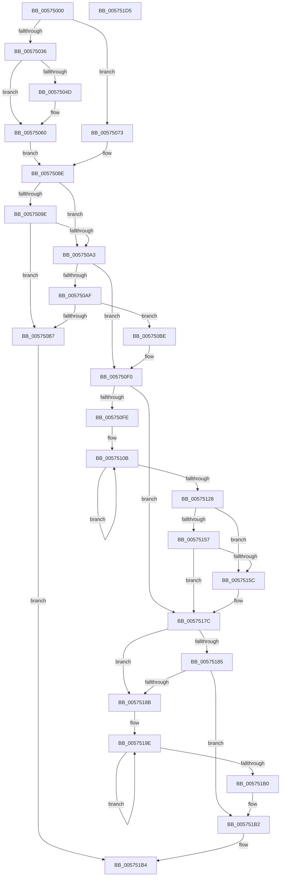

# HsaUpdateRemappingTableEntry

- RVA: `0x00575000`–`0x005751D6` (길이 `470` bytes)
- VA: `0x0000000140575000`
- 실행 섹션: `.text`
- PDB 이름 있음: `예`; PDB Function 태그: `아니요`
- unwind 정보 RVA: `0x000C5420`
- 디코드: `134`개 명령, `470/470` bytes 표시
- 미해석 바이트: `0` (있으면 어셈블리에 `.byte`로 보존)

> 이 문서는 커널 이미지의 기계어와 PDB 기호를 분석해 생성했습니다. 4번과 5번은 함수 원형과 자료형을 바이너리 사용 방식에서 추정한 C 해석이며 원본 소스 복구 결과는 아닙니다.

## 1. Dependencies

- 직접 호출 지점: **7**; 고유 호출 대상: **7**
- 직접 호출자로 확인된 함수: **0**
- RIP 상대 이미지 참조: **3**

### Outgoing calls
- `0x00575038` → [HsaGetDeviceAperture](HsaGetDeviceAperture_function_00574288.md) (function, `0x00574288`)
- `0x0057505A` → [ExtEnvCriticalFailure](../56/ExtEnvCriticalFailure_function_00561300.md) (function, `0x00561300`)
- `0x0057506C` → [RtlSetBits](../3E/RtlSetBits_function_003E1610.md) (function, `0x003E1610`)
- `0x00575089` → [RtlClearBits](../3E/RtlClearBits_function_003E1A90.md) (function, `0x003E1A90`)
- `0x005750EB` → [HsaUpdateInterruptDestination](HsaUpdateInterruptDestination_function_00574CE4.md) (function, `0x00574CE4`)
- `0x00575176` → [KeBugCheckEx](../4F/KeBugCheckEx_function_004FD660.md) (function, `0x004FD660`)
- `0x005751BB` → [_security_check_cookie](../6A/_security_check_cookie_function_006AC640.md) (function, `0x006AC640`)

### Direct callers
- 이 함수 시작 RVA로 연결되는 직접 call은 확인되지 않았습니다. 간접 호출은 완전히 역산할 수 없습니다.

### Static image references
- `0x00575015` → RVA `0x00E0A740` (`.data`; read)
- `0x00575079` → RVA `0x00F8F678` (`.data`; read)
- `0x00575082` → RVA `0x00F8F660` (`.data`; read)

## 2. Other-region calls and transfers

- 다른 실행 섹션으로 향하는 call: **0**
- 별도 외부 분기/꼬리 이동을 확인하지 못했습니다.

## 3. Assembly (complete function range)

```asm
00575000  48 89 5C 24 08                  mov qword ptr [rsp + 8], rbx
00575005  48 89 74 24 10                  mov qword ptr [rsp + 0x10], rsi
0057500A  55                              push rbp
0057500B  57                              push rdi
0057500C  41 56                           push r14
0057500E  48 8B EC                        mov rbp, rsp
00575011  48 83 EC 70                     sub rsp, 0x70
00575015  48 8B 05 24 57 89 00            mov rax, qword ptr [rip + 0x895724]
0057501C  48 33 C4                        xor rax, rsp
0057501F  48 89 45 F0                     mov qword ptr [rbp - 0x10], rax
00575023  33 DB                           xor ebx, ebx
00575025  41 8B F8                        mov edi, r8d
00575028  0F 57 C0                        xorps xmm0, xmm0
0057502B  49 8B F1                        mov rsi, r9
0057502E  0F 11 45 E0                     movups xmmword ptr [rbp - 0x20], xmm0
00575032  84 D2                           test dl, dl
00575034  74 3D                           je 0x140575073
00575036  8B CF                           mov ecx, edi
00575038  E8 4B F2 FF FF                  call 0x140574288
0057503D  81 E7 FF 01 00 00               and edi, 0x1ff
00575043  4C 8D 70 08                     lea r14, [rax + 8]
00575047  49 39 5E 08                     cmp qword ptr [r14 + 8], rbx
0057504B  75 13                           jne 0x140575060
0057504D  45 33 C9                        xor r9d, r9d
00575050  48 89 5C 24 20                  mov qword ptr [rsp + 0x20], rbx
00575055  45 33 C0                        xor r8d, r8d
00575058  33 D2                           xor edx, edx
0057505A  E8 A1 C2 FE FF                  call 0x140561300
0057505F  CC                              int3
00575060  49 8D 4E 18                     lea rcx, [r14 + 0x18]
00575064  41 B8 01 00 00 00               mov r8d, 1
0057506A  8B D7                           mov edx, edi
0057506C  E8 9F C5 E6 FF                  call 0x1403e1610
00575071  EB 1B                           jmp 0x14057508e
00575073  41 B8 01 00 00 00               mov r8d, 1
00575079  48 8D 0D F8 A5 A1 00            lea rcx, [rip + 0xa1a5f8]
00575080  8B D7                           mov edx, edi
00575082  4C 8D 35 D7 A5 A1 00            lea r14, [rip + 0xa1a5d7]
00575089  E8 02 CA E6 FF                  call 0x1403e1a90
0057508E  8B 56 0C                        mov edx, dword ptr [rsi + 0xc]
00575091  48 C1 E7 04                     shl rdi, 4
00575095  49 03 7E 08                     add rdi, qword ptr [r14 + 8]
00575099  F6 07 01                        test byte ptr [rdi], 1
0057509C  75 05                           jne 0x1405750a3
0057509E  F6 C2 10                        test dl, 0x10
005750A1  74 14                           je 0x1405750b7
005750A3  0F 57 C0                        xorps xmm0, xmm0
005750A6  0F 11 45 D0                     movups xmmword ptr [rbp - 0x30], xmm0
005750AA  F6 C2 10                        test dl, 0x10
005750AD  74 41                           je 0x1405750f0
005750AF  8B 4E 14                        mov ecx, dword ptr [rsi + 0x14]
005750B2  83 E9 01                        sub ecx, 1
005750B5  74 07                           je 0x1405750be
005750B7  32 C0                           xor al, al
005750B9  E9 F6 00 00 00                  jmp 0x1405751b4
005750BE  8B 46 30                        mov eax, dword ptr [rsi + 0x30]
005750C1  83 E2 02                        and edx, 2
005750C4  0F B6 C8                        movzx ecx, al
005750C7  48 03 D2                        add rdx, rdx
005750CA  48 8B 45 D8                     mov rax, qword ptr [rbp - 0x28]
005750CE  48 83 CA 01                     or rdx, 1
005750D2  48 25 00 FF FF FF               and rax, 0xffffffffffffff00
005750D8  48 89 55 D0                     mov qword ptr [rbp - 0x30], rdx
005750DC  48 0B C8                        or rcx, rax
005750DF  48 8D 56 18                     lea rdx, [rsi + 0x18]
005750E3  48 89 4D D8                     mov qword ptr [rbp - 0x28], rcx
005750E7  48 8D 4D D0                     lea rcx, [rbp - 0x30]
005750EB  E8 F4 FB FF FF                  call 0x140574ce4
005750F0  4C 8B 4D D0                     mov r9, qword ptr [rbp - 0x30]
005750F4  49 8B C1                        mov rax, r9
005750F7  48 23 07                        and rax, qword ptr [rdi]
005750FA  A8 01                           test al, 1
005750FC  74 7E                           je 0x14057517c
005750FE  48 8D 45 D0                     lea rax, [rbp - 0x30]
00575102  4C 8B D7                        mov r10, rdi
00575105  4C 2B D0                        sub r10, rax
00575108  4C 8B C3                        mov r8, rbx
0057510B  48 8D 45 D0                     lea rax, [rbp - 0x30]
0057510F  49 03 C0                        add rax, r8
00575112  49 8B 14 02                     mov rdx, qword ptr [r10 + rax]
00575116  48 33 10                        xor rdx, qword ptr [rax]
00575119  4A 89 54 05 E0                  mov qword ptr [rbp + r8 - 0x20], rdx
0057511E  49 83 C0 08                     add r8, 8
00575122  49 83 F8 10                     cmp r8, 0x10
00575126  7C E3                           jl 0x14057510b
00575128  48 8B 45 E0                     mov rax, qword ptr [rbp - 0x20]
0057512C  48 B9 FF 00 00 00 FF FF FF FF   movabs rcx, 0xffffffff000000ff
00575136  48 23 C1                        and rax, rcx
00575139  48 BA FF FF FF FF FF FF FF 00   movabs rdx, 0xffffffffffffff
00575143  48 8B 4D E8                     mov rcx, qword ptr [rbp - 0x18]
00575147  48 23 CA                        and rcx, rdx
0057514A  48 89 45 E0                     mov qword ptr [rbp - 0x20], rax
0057514E  48 89 4D E8                     mov qword ptr [rbp - 0x18], rcx
00575152  48 85 C0                        test rax, rax
00575155  75 05                           jne 0x14057515c
00575157  48 85 C9                        test rcx, rcx
0057515A  74 20                           je 0x14057517c
0057515C  B9 5C 00 00 00                  mov ecx, 0x5c
00575161  48 8D 45 E0                     lea rax, [rbp - 0x20]
00575165  4C 8B CF                        mov r9, rdi
00575168  48 89 44 24 20                  mov qword ptr [rsp + 0x20], rax
0057516D  BA 00 70 00 00                  mov edx, 0x7000
00575172  44 8D 41 C4                     lea r8d, [rcx - 0x3c]
00575176  E8 E5 84 F8 FF                  call 0x1404fd660
0057517B  CC                              int3
0057517C  48 8B 4D D8                     mov rcx, qword ptr [rbp - 0x28]
00575180  4C 39 0F                        cmp qword ptr [rdi], r9
00575183  75 06                           jne 0x14057518b
00575185  48 39 4F 08                     cmp qword ptr [rdi + 8], rcx
00575189  74 27                           je 0x1405751b2
0057518B  48 8B 07                        mov rax, qword ptr [rdi]
0057518E  48 8B 57 08                     mov rdx, qword ptr [rdi + 8]
00575192  48 89 45 C0                     mov qword ptr [rbp - 0x40], rax
00575196  48 8B 45 C0                     mov rax, qword ptr [rbp - 0x40]
0057519A  48 89 55 C8                     mov qword ptr [rbp - 0x38], rdx
0057519E  49 8B D9                        mov rbx, r9
005751A1  F0 48 0F C7 0F                  lock cmpxchg16b xmmword ptr [rdi]
005751A6  48 89 45 C0                     mov qword ptr [rbp - 0x40], rax
005751AA  48 89 55 C8                     mov qword ptr [rbp - 0x38], rdx
005751AE  75 EE                           jne 0x14057519e
005751B0  B3 01                           mov bl, 1
005751B2  8A C3                           mov al, bl
005751B4  48 8B 4D F0                     mov rcx, qword ptr [rbp - 0x10]
005751B8  48 33 CC                        xor rcx, rsp
005751BB  E8 80 74 13 00                  call 0x1406ac640
005751C0  4C 8D 5C 24 70                  lea r11, [rsp + 0x70]
005751C5  49 8B 5B 20                     mov rbx, qword ptr [r11 + 0x20]
005751C9  49 8B 73 28                     mov rsi, qword ptr [r11 + 0x28]
005751CD  49 8B E3                        mov rsp, r11
005751D0  41 5E                           pop r14
005751D2  5F                              pop rdi
005751D3  5D                              pop rbp
005751D4  C3                              ret
005751D5  CC                              int3
```

## 4. C-style interpretation (structured pseudocode)

```c
__int64 __fastcall HsaUpdateRemappingTableEntry(__int64 a1, int a2, int a3, __int64 a4)
{
    __int64 result;
    __int64 v_r10;
    __int64 v_rbx;
    __int64 v_rdi;
    __int64 v_rsp;
    unsigned __int64 v_stack_m18;
    unsigned __int64 v_stack_m28;
    unsigned __int64 v_stack_m30;
    unsigned __int64 v_stack_m38;
    unsigned __int64 v_stack_m40;
    unsigned __int64 v_stack_m48;
    unsigned __int64 v_stack_m50;
    unsigned __int64 v_stack_m58;
    unsigned __int64 v_stack_m68;
    unsigned __int64 v_stack_p10;
    unsigned __int64 v_stack_p8;

    v_stack_p8 = v_rbx;
    v_stack_p10 = v_rsi;
    v_rsp = (v_rsp) - (112);
    result = (*(unsigned __int64 *)(v_rip + 9000740)) ^ (v_rsp);
    v_stack_m28 = result;
    v_rbx = 0;
    v_stack_m38 = v_xmm0;
    if ((unsigned __int8)(a2) == 0) goto loc_00575073;
    result = HsaGetDeviceAperture((unsigned int)((unsigned int)((unsigned int)(a3))), a2, a3, a4);
    v_rdi = (unsigned int)(((unsigned int)(a3)) & (511));
    if ((*(unsigned __int64 *)(result + 8 + 8)) == 0) {
        a4 = 0;
        v_stack_m68 = 0;
        a3 = 0;
        a2 = 0;
        result = ExtEnvCriticalFailure((unsigned int)((unsigned int)((unsigned int)(a3))), a2, a3, a4);
    }
    result = RtlSetBits(result + 8 + 24, (unsigned int)((unsigned int)(v_rdi)), 1, a4);
    goto loc_0057508E;
loc_00575073:
    result = RtlClearBits(v_rip + 10593784, (unsigned int)((unsigned int)(v_rdi)), 1, a4);
loc_0057508E:
    v_rdi = (v_rdi) << (4);
    v_rdi = (v_rdi) + (*(unsigned __int64 *)(v_rip + 10593751 + 8));
    if (((*(unsigned __int8 *)(v_rdi)) & (1)) != 0) goto loc_005750A3;
    if ((((unsigned __int8)((unsigned int)(*(unsigned int *)(a4 + 12)))) & (16)) == 0) goto loc_005750B7;
loc_005750A3:
    v_stack_m48 = v_xmm0;
    if ((((unsigned __int8)((unsigned int)(*(unsigned int *)(a4 + 12)))) & (16)) == 0) goto loc_005750F0;
    a1 = (unsigned int)(((unsigned int)(*(unsigned int *)(a4 + 20))) - (1));
    if (condition_is_equal) goto loc_005750BE;
loc_005750B7:
    result = 0;
    goto loc_005751B4;
loc_005750BE:
    a2 = (unsigned int)(((unsigned int)(*(unsigned int *)(a4 + 12))) & (2));
    a2 = (a2) + (a2);
    a2 = (a2) | (1);
    result = (v_stack_m40) & (-256);
    v_stack_m48 = a2;
    a1 = ((unsigned __int8)((unsigned int)(*(unsigned int *)(a4 + 48)))) | (result);
    v_stack_m40 = a1;
    result = HsaUpdateInterruptDestination(v_stack_m48, a4 + 24, 1, a4);
loc_005750F0:
    result = (v_stack_m48) & (*(unsigned __int64 *)(v_rdi));
    if ((((unsigned __int8)(result)) & (1)) == 0) goto loc_0057517C;
    v_r10 = (v_rdi) - (v_stack_m48);
loc_0057510B:
    result = (v_stack_m48) + (0);
    a2 = (*(unsigned __int64 *)(v_r10 + result * 1)) ^ (*(unsigned __int64 *)(result));
    *(unsigned __int64 *)(v_rsp + 0 * 1 - 32) = a2;
    a3 = (0) + (8);
    if (a3 < 16) goto loc_0057510B;
    result = (v_stack_m38) & (v_stack_m48);
    a1 = (v_stack_m30) & (a2);
    v_stack_m38 = result;
    v_stack_m30 = a1;
    if (result != 0) goto loc_0057515C;
    if (a1 != 0) {
        a1 = 92;
        result = v_stack_m38;
        a4 = v_rdi;
        v_stack_m68 = result;
        a2 = 0x7000ULL;
        a3 = a1 - 60;
        result = KeBugCheckEx(a1, a2, a3, a4);
    }
    if ((*(unsigned __int64 *)(v_rdi)) != a4) goto loc_0057518B;
    if ((*(unsigned __int64 *)(v_rdi + 8)) == v_stack_m40) goto loc_005751B2;
loc_0057518B:
    v_stack_m58 = *(unsigned __int64 *)(v_rdi);
    v_stack_m50 = *(unsigned __int64 *)(v_rdi + 8);
loc_0057519E:
    v_stack_m58 = v_stack_m58;
    v_stack_m50 = *(unsigned __int64 *)(v_rdi + 8);
    if ((*(unsigned __int64 *)(v_rdi + 8)) != v_stack_m40) goto loc_0057519E;
loc_005751B2:
loc_005751B4:
    a1 = (v_stack_m28) ^ (v_rsp);
    result = _security_check_cookie(a1, *(unsigned __int64 *)(v_rdi + 8), a3, a4);
    return result;
}
```

## 5. (Beta) C Style

```c
int64_t HsaUpdateRemappingTableEntry(int64_t Arg1, int32_t Arg2, int32_t Arg3, void *Arg4)
{
    uint8_t *arg4 = (uint8_t *)Arg4;

    int64_t result;
    int64_t local_r10;
    int64_t local_rbx;
    int64_t local_rdi;
    int64_t local_rsp;
    uint64_t v_stack_m18;
    uint64_t v_stack_m28;
    uint64_t v_stack_m30;
    uint64_t v_stack_m38;
    uint64_t v_stack_m40;
    uint64_t v_stack_m48;
    uint64_t v_stack_m50;
    uint64_t v_stack_m58;
    uint64_t v_stack_m68;
    uint64_t v_stack_p10;
    uint64_t v_stack_p8;

    v_stack_p8 = local_rbx;
    v_stack_p10 = local_rsi;
    local_rsp = (local_rsp) - (112);
    result = (*(uint64_t *)(v_rip + 0x895724)) ^ (local_rsp);
    v_stack_m28 = result;
    local_rbx = 0;
    v_stack_m38 = v_xmm0;
    if ((uint8_t)(Arg2) == 0) goto loc_00575073;
    result = HsaGetDeviceAperture((uint32_t)((uint32_t)((uint32_t)(Arg3))), Arg2, Arg3, Arg4);
    local_rdi = (uint32_t)(((uint32_t)(Arg3)) & (511));
    if ((*(uint64_t *)(result + 0x8 + 0x8)) == 0) {
        Arg4 = 0;
        v_stack_m68 = 0;
        Arg3 = 0;
        Arg2 = 0;
        result = ExtEnvCriticalFailure((uint32_t)((uint32_t)((uint32_t)(Arg3))), Arg2, Arg3, Arg4);
    }
    result = RtlSetBits(result + 8 + 24, (uint32_t)((uint32_t)(local_rdi)), 1, Arg4);
    goto loc_0057508E;
loc_00575073:
    result = RtlClearBits(v_rip + 10593784, (uint32_t)((uint32_t)(local_rdi)), 1, Arg4);
loc_0057508E:
    local_rdi = (local_rdi) << (4);
    local_rdi = (local_rdi) + (*(uint64_t *)(v_rip + 0xA1A5D7 + 0x8));
    if (((*(uint8_t *)(local_rdi)) & (1)) != 0) goto loc_005750A3;
    if ((((uint8_t)((uint32_t)(*(uint32_t *)(arg4 + 0xC)))) & (16)) == 0) goto loc_005750B7;
loc_005750A3:
    v_stack_m48 = v_xmm0;
    if ((((uint8_t)((uint32_t)(*(uint32_t *)(arg4 + 0xC)))) & (16)) == 0) goto loc_005750F0;
    Arg1 = (uint32_t)(((uint32_t)(*(uint32_t *)(arg4 + 0x14))) - (1));
    if (condition_is_equal) goto loc_005750BE;
loc_005750B7:
    result = 0;
    goto loc_005751B4;
loc_005750BE:
    Arg2 = (uint32_t)(((uint32_t)(*(uint32_t *)(arg4 + 0xC))) & (2));
    Arg2 = (Arg2) + (Arg2);
    Arg2 = (Arg2) | (1);
    result = (v_stack_m40) & (-256);
    v_stack_m48 = Arg2;
    Arg1 = ((uint8_t)((uint32_t)(*(uint32_t *)(arg4 + 0x30)))) | (result);
    v_stack_m40 = Arg1;
    result = HsaUpdateInterruptDestination(v_stack_m48, Arg4 + 24, 1, Arg4);
loc_005750F0:
    result = (v_stack_m48) & (*(uint64_t *)(local_rdi));
    if ((((uint8_t)(result)) & (1)) == 0) goto loc_0057517C;
    local_r10 = (local_rdi) - (v_stack_m48);
loc_0057510B:
    result = (v_stack_m48) + (0);
    Arg2 = (*(uint64_t *)(local_r10 + result * 1)) ^ (*(uint64_t *)(result));
    *(uint64_t *)(local_rsp + 0x0 * 1 - 0x20) = Arg2;
    Arg3 = (0) + (8);
    if (Arg3 < 16) goto loc_0057510B;
    result = (v_stack_m38) & (v_stack_m48);
    Arg1 = (v_stack_m30) & (Arg2);
    v_stack_m38 = result;
    v_stack_m30 = Arg1;
    if (result != 0) goto loc_0057515C;
    if (Arg1 != 0) {
        Arg1 = 92;
        result = v_stack_m38;
        Arg4 = local_rdi;
        v_stack_m68 = result;
        Arg2 = 0x7000ULL;
        Arg3 = Arg1 - 60;
        result = KeBugCheckEx(Arg1, Arg2, Arg3, Arg4);
    }
    if ((*(uint64_t *)(local_rdi)) != Arg4) goto loc_0057518B;
    if ((*(uint64_t *)(local_rdi + 0x8)) == v_stack_m40) goto loc_005751B2;
loc_0057518B:
    v_stack_m58 = *(uint64_t *)(local_rdi);
    v_stack_m50 = *(uint64_t *)(local_rdi + 0x8);
loc_0057519E:
    v_stack_m58 = v_stack_m58;
    v_stack_m50 = *(uint64_t *)(local_rdi + 0x8);
    if ((*(uint64_t *)(local_rdi + 0x8)) != v_stack_m40) goto loc_0057519E;
loc_005751B2:
loc_005751B4:
    Arg1 = (v_stack_m28) ^ (local_rsp);
    result = _security_check_cookie(Arg1, *(uint64_t *)(local_rdi + 0x8), Arg3, Arg4);
    return result;
}
```

### 관측된 메모리 오프셋

구조체 형식이 확인되지 않은 접근은 인자 기준의 오프셋으로만 기록했습니다.

| 기준 인자 | 오프셋 표현 | 폭 (bit) | 접근 |
|---|---:|---:|---|
| `Arg4` | `+ 0xC` | `32` | `R` |
| `Arg4` | `+ 0x14` | `32` | `R` |
| `Arg4` | `+ 0x18` | `64` | `R` |
| `Arg4` | `+ 0x30` | `32` | `R` |

## 6. Execution-region graph

[열기: 2D/3D 그래프와 함수 탐색 컨트롤 패널](../../../control-panel.html?section=text&rva=0x00575000&view=graph)

- 2D 그래프는 위에서 아래로 흐르고, 3D 그래프는 빈 공간을 드래그해 회전합니다. Shift+드래그는 이동, 휠은 확대·축소, 함수 노드 선택은 대상 보고서 이동입니다.

### Static fallback


