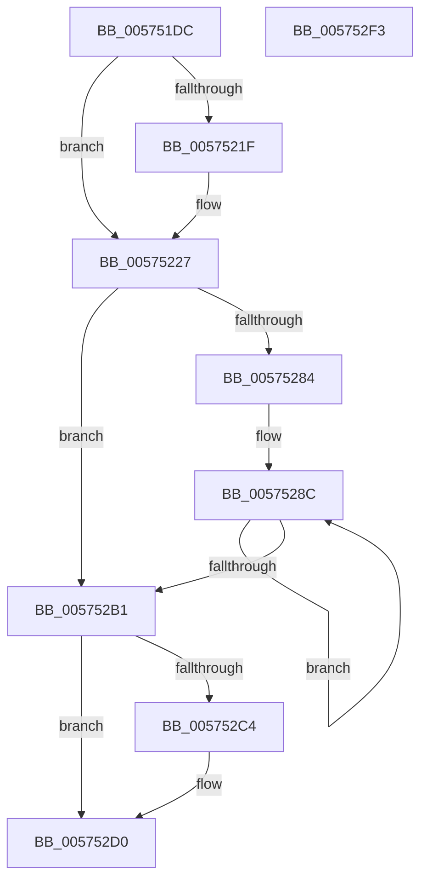

# HsaUpdateRemappingTableInDeviceTableEntry

- RVA: `0x005751DC`–`0x005752F4` (길이 `280` bytes)
- VA: `0x00000001405751DC`
- 실행 섹션: `.text`
- PDB 이름 있음: `예`; PDB Function 태그: `아니요`
- unwind 정보 RVA: `0x000BF908`
- 디코드: `75`개 명령, `280/280` bytes 표시
- 미해석 바이트: `0` (있으면 어셈블리에 `.byte`로 보존)

> 이 문서는 커널 이미지의 기계어와 PDB 기호를 분석해 생성했습니다. 4번과 5번은 함수 원형과 자료형을 바이너리 사용 방식에서 추정한 C 해석이며 원본 소스 복구 결과는 아닙니다.

## 1. Dependencies

- 직접 호출 지점: **6**; 고유 호출 대상: **6**
- 직접 호출자로 확인된 함수: **2**
- RIP 상대 이미지 참조: **1**

### Outgoing calls
- `0x00575222` → [KiRaiseIrqlProcessIrqlFlags](../4F/KiRaiseIrqlProcessIrqlFlags_function_004F56FC.md) (function, `0x004F56FC`)
- `0x00575233` → [KeAcquireInStackQueuedSpinLockAtDpcLevel](../27/KeAcquireInStackQueuedSpinLockAtDpcLevel_function_00275740.md) (function, `0x00275740`)
- `0x0057525E` → [HsaBuildInterruptRemappingEntry](../4F/HsaBuildInterruptRemappingEntry_function_004FC3D4.md) (function, `0x004FC3D4`)
- `0x005752A3` → [HsaInvalidateRemappingTableEntries](HsaInvalidateRemappingTableEntries_function_00574734.md) (function, `0x00574734`)
- `0x005752B6` → [KeReleaseInStackQueuedSpinLockFromDpcLevel](../21/KeReleaseInStackQueuedSpinLockFromDpcLevel_function_002171B0.md) (function, `0x002171B0`)
- `0x005752CB` → [KiLowerIrqlProcessIrqlFlags](../4F/KiLowerIrqlProcessIrqlFlags_function_004F5698.md) (function, `0x004F5698`)

### Direct callers
- [HsaAllocateRemappingTableEntry](HsaAllocateRemappingTableEntry_function_00573820.md) at `0x00573A9C`
- [HsaFreeRemappingTableEntry](HsaFreeRemappingTableEntry_function_00574140.md) at `0x005741D5`

### Static image references
- `0x00575217` → RVA `0x00FC6D20` (`ALMOSTRO`; read)

## 2. Other-region calls and transfers

- 다른 실행 섹션으로 향하는 call: **0**
- 별도 외부 분기/꼬리 이동을 확인하지 못했습니다.

## 3. Assembly (complete function range)

```asm
005751DC  4C 8B DC                        mov r11, rsp
005751DF  49 89 5B 08                     mov qword ptr [r11 + 8], rbx
005751E3  49 89 6B 10                     mov qword ptr [r11 + 0x10], rbp
005751E7  49 89 73 18                     mov qword ptr [r11 + 0x18], rsi
005751EB  49 89 7B 20                     mov qword ptr [r11 + 0x20], rdi
005751EF  41 56                           push r14
005751F1  48 83 EC 60                     sub rsp, 0x60
005751F5  0F 57 C0                        xorps xmm0, xmm0
005751F8  33 C0                           xor eax, eax
005751FA  0F 11 44 24 20                  movups xmmword ptr [rsp + 0x20], xmm0
005751FF  49 89 43 C8                     mov qword ptr [r11 - 0x38], rax
00575203  49 8B E8                        mov rbp, r8
00575206  48 8B F2                        mov rsi, rdx
00575209  4C 8B F1                        mov r14, rcx
0057520C  44 0F 20 C7                     mov rdi, cr8
00575210  8D 50 0F                        lea edx, [rax + 0xf]
00575213  44 0F 22 C2                     mov cr8, rdx
00575217  39 05 03 1B A5 00               cmp dword ptr [rip + 0xa51b03], eax
0057521D  74 08                           je 0x140575227
0057521F  40 8A CF                        mov cl, dil
00575222  E8 D5 04 F8 FF                  call 0x1404f56fc
00575227  49 8D 8E 98 00 00 00            lea rcx, [r14 + 0x98]
0057522E  48 8D 54 24 20                  lea rdx, [rsp + 0x20]
00575233  E8 08 05 D0 FF                  call 0x140275740
00575238  8B 1E                           mov ebx, dword ptr [rsi]
0057523A  4C 8D 44 24 38                  lea r8, [rsp + 0x38]
0057523F  48 C1 E3 05                     shl rbx, 5
00575243  48 8B D5                        mov rdx, rbp
00575246  49 03 5E 18                     add rbx, qword ptr [r14 + 0x18]
0057524A  49 8B CE                        mov rcx, r14
0057524D  0F 10 03                        movups xmm0, xmmword ptr [rbx]
00575250  0F 10 4B 10                     movups xmm1, xmmword ptr [rbx + 0x10]
00575254  0F 11 44 24 38                  movups xmmword ptr [rsp + 0x38], xmm0
00575259  0F 11 4C 24 48                  movups xmmword ptr [rsp + 0x48], xmm1
0057525E  E8 71 71 F8 FF                  call 0x1404fc3d4
00575263  44 8B 46 04                     mov r8d, dword ptr [rsi + 4]
00575267  B8 01 00 00 00                  mov eax, 1
0057526C  41 8B C8                        mov ecx, r8d
0057526F  BA 01 00 00 00                  mov edx, 1
00575274  D3 E0                           shl eax, cl
00575276  B9 03 00 00 00                  mov ecx, 3
0057527B  41 2B C8                        sub ecx, r8d
0057527E  D3 E2                           shl edx, cl
00575280  85 C0                           test eax, eax
00575282  74 2D                           je 0x1405752b1
00575284  8B F2                           mov esi, edx
00575286  48 C1 E6 05                     shl rsi, 5
0057528A  8B E8                           mov ebp, eax
0057528C  48 8B 44 24 48                  mov rax, qword ptr [rsp + 0x48]
00575291  48 89 43 10                     mov qword ptr [rbx + 0x10], rax
00575295  F0 83 0C 24 00                  lock or dword ptr [rsp], 0
0057529A  41 B8 01 00 00 00               mov r8d, 1
005752A0  49 8B CE                        mov rcx, r14
005752A3  E8 8C F4 FF FF                  call 0x140574734
005752A8  48 03 DE                        add rbx, rsi
005752AB  48 83 ED 01                     sub rbp, 1
005752AF  75 DB                           jne 0x14057528c
005752B1  48 8D 4C 24 20                  lea rcx, [rsp + 0x20]
005752B6  E8 F5 1E CA FF                  call 0x1402171b0
005752BB  83 3D 5E 1A A5 00 00            cmp dword ptr [rip + 0xa51a5e], 0
005752C2  74 0C                           je 0x1405752d0
005752C4  44 0F 20 C1                     mov rcx, cr8
005752C8  40 8A D7                        mov dl, dil
005752CB  E8 C8 03 F8 FF                  call 0x1404f5698
005752D0  40 0F B6 C7                     movzx eax, dil
005752D4  44 0F 22 C0                     mov cr8, rax
005752D8  4C 8D 5C 24 60                  lea r11, [rsp + 0x60]
005752DD  49 8B 5B 10                     mov rbx, qword ptr [r11 + 0x10]
005752E1  49 8B 6B 18                     mov rbp, qword ptr [r11 + 0x18]
005752E5  49 8B 73 20                     mov rsi, qword ptr [r11 + 0x20]
005752E9  49 8B 7B 28                     mov rdi, qword ptr [r11 + 0x28]
005752ED  49 8B E3                        mov rsp, r11
005752F0  41 5E                           pop r14
005752F2  C3                              ret
005752F3  CC                              int3
```

## 4. C-style interpretation (structured pseudocode)

```c
__int64 __fastcall HsaUpdateRemappingTableInDeviceTableEntry(__int64 a1, __int64 a2, __int64 a3)
{
    __int64 result;
    __int64 v_rbp;
    __int64 v_rbx;
    __int64 v_rsi;
    __int64 v_rsp;
    unsigned __int64 v_stack_m20;
    unsigned __int64 v_stack_m30;
    unsigned __int64 v_stack_m48;
    unsigned int v_stack_m68;
    unsigned __int64 v_stack_m8;

    *(unsigned __int64 *)(v_rsp + 8) = v_rbx;
    *(unsigned __int64 *)(v_rsp + 16) = v_rbp;
    *(unsigned __int64 *)(v_rsp + 24) = v_rsi;
    *(unsigned __int64 *)(v_rsp + 32) = v_rdi;
    v_rsp = (v_rsp) - (96);
    result = 0;
    v_stack_m48 = v_xmm0;
    *(unsigned __int64 *)(v_rsp - 56) = 0;
    if ((*(unsigned int *)(v_rip + 10820355)) != 0) {
        a1 = (unsigned __int8)(v_cr8);
        result = KiRaiseIrqlProcessIrqlFlags(a1, result + 15, a3, a4);
    }
    result = KeAcquireInStackQueuedSpinLockAtDpcLevel(a1 + 152, v_stack_m48, a3, a4);
    v_rbx = ((unsigned int)(*(unsigned int *)(a2))) << (5);
    v_rbx = (v_rbx) + (*(unsigned __int64 *)(a1 + 24));
    v_stack_m30 = v_xmm0;
    v_stack_m20 = v_xmm1;
    result = HsaBuildInterruptRemappingEntry(a1, a3, v_stack_m30, a4);
    result = (unsigned int)((1) << ((unsigned __int8)((unsigned int)((unsigned int)((unsigned int)(*(unsigned int *)(a2 + 4)))))));
    a1 = (unsigned int)((3) - ((unsigned int)((unsigned int)(*(unsigned int *)(a2 + 4)))));
    a2 = (unsigned int)((1) << ((unsigned __int8)(a1)));
    if ((unsigned int)(result) == 0) goto loc_005752B1;
    v_rsi = ((unsigned int)((unsigned int)(a2))) << (5);
loc_0057528C:
    *(unsigned __int64 *)(v_rbx + 16) = v_stack_m20;
    result = HsaInvalidateRemappingTableEntries(a1, a2, 1, a4);
    v_rbx = (v_rbx) + (v_rsi);
    v_rbp = ((unsigned int)((unsigned int)(result))) - (1);
    if (condition_is_not_equal) goto loc_0057528C;
loc_005752B1:
    result = KeReleaseInStackQueuedSpinLockFromDpcLevel(v_stack_m48, a2, 1, a4);
    if ((*(unsigned int *)(v_rip + 10820190)) != 0) {
        a1 = result + 15;
        a2 = (unsigned __int8)(v_cr8);
        result = KiLowerIrqlProcessIrqlFlags(a1, a2, 1, a4);
    }
    return (unsigned __int8)(v_cr8);
}
```

## 5. (Beta) C Style

```c
int64_t HsaUpdateRemappingTableInDeviceTableEntry(void *Arg1, void *Arg2, int64_t Arg3)
{
    uint8_t *arg1 = (uint8_t *)Arg1;
    uint8_t *arg2 = (uint8_t *)Arg2;

    int64_t result;
    int64_t local_rbp;
    int64_t local_rbx;
    int64_t local_rsi;
    int64_t local_rsp;
    uint64_t v_stack_m20;
    uint64_t v_stack_m30;
    uint64_t v_stack_m48;
    uint32_t v_stack_m68;
    uint64_t v_stack_m8;

    *(uint64_t *)(local_rsp + 0x8) = local_rbx;
    *(uint64_t *)(local_rsp + 0x10) = local_rbp;
    *(uint64_t *)(local_rsp + 0x18) = local_rsi;
    *(uint64_t *)(local_rsp + 0x20) = local_rdi;
    local_rsp = (local_rsp) - (96);
    result = 0;
    v_stack_m48 = v_xmm0;
    *(uint64_t *)(local_rsp - 0x38) = 0;
    if ((*(uint32_t *)(v_rip + 0xA51B03)) != 0) {
        Arg1 = (uint8_t)(v_cr8);
        result = KiRaiseIrqlProcessIrqlFlags(Arg1, result + 15, Arg3, a4);
    }
    result = KeAcquireInStackQueuedSpinLockAtDpcLevel(Arg1 + 152, v_stack_m48, Arg3, a4);
    local_rbx = ((uint32_t)(*(uint32_t *)(arg2))) << (5);
    local_rbx = (local_rbx) + (*(uint64_t *)(arg1 + 0x18));
    v_stack_m30 = v_xmm0;
    v_stack_m20 = v_xmm1;
    result = HsaBuildInterruptRemappingEntry(Arg1, Arg3, v_stack_m30, a4);
    result = (uint32_t)((1) << ((uint8_t)((uint32_t)((uint32_t)((uint32_t)(*(uint32_t *)(arg2 + 0x4)))))));
    Arg1 = (uint32_t)((3) - ((uint32_t)((uint32_t)(*(uint32_t *)(arg2 + 0x4)))));
    Arg2 = (uint32_t)((1) << ((uint8_t)(Arg1)));
    if ((uint32_t)(result) == 0) goto loc_005752B1;
    local_rsi = ((uint32_t)((uint32_t)(Arg2))) << (5);
loc_0057528C:
    *(uint64_t *)(local_rbx + 0x10) = v_stack_m20;
    result = HsaInvalidateRemappingTableEntries(Arg1, Arg2, 1, a4);
    local_rbx = (local_rbx) + (local_rsi);
    local_rbp = ((uint32_t)((uint32_t)(result))) - (1);
    if (condition_is_not_equal) goto loc_0057528C;
loc_005752B1:
    result = KeReleaseInStackQueuedSpinLockFromDpcLevel(v_stack_m48, Arg2, 1, a4);
    if ((*(uint32_t *)(v_rip + 0xA51A5E)) != 0) {
        Arg1 = result + 15;
        Arg2 = (uint8_t)(v_cr8);
        result = KiLowerIrqlProcessIrqlFlags(Arg1, Arg2, 1, a4);
    }
    return (uint8_t)(v_cr8);
}
```

### 관측된 메모리 오프셋

구조체 형식이 확인되지 않은 접근은 인자 기준의 오프셋으로만 기록했습니다.

| 기준 인자 | 오프셋 표현 | 폭 (bit) | 접근 |
|---|---:|---:|---|
| `Arg1` | `+ 0x18` | `64` | `R` |
| `Arg1` | `+ 0x98` | `64` | `R` |
| `Arg2` | `+ 0x0` | `32` | `R` |
| `Arg2` | `+ 0x4` | `32` | `R` |

## 6. Execution-region graph

[열기: 2D/3D 그래프와 함수 탐색 컨트롤 패널](../../../control-panel.html?section=text&rva=0x005751DC&view=graph)

- 2D 그래프는 위에서 아래로 흐르고, 3D 그래프는 빈 공간을 드래그해 회전합니다. Shift+드래그는 이동, 휠은 확대·축소, 함수 노드 선택은 대상 보고서 이동입니다.

### Static fallback


