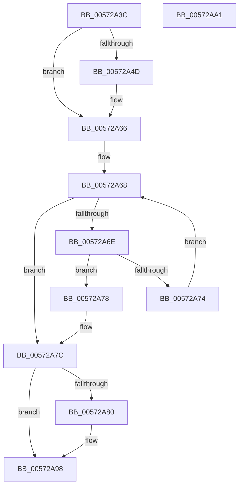

# HsaUpdateSingleTargetExtendedDestination

- RVA: `0x00572A3C`–`0x00572AA2` (길이 `102` bytes)
- VA: `0x0000000140572A3C`
- 실행 섹션: `.text`
- PDB 이름 있음: `예`; PDB Function 태그: `아니요`
- unwind 정보 RVA: `0x00071750`
- 디코드: `33`개 명령, `102/102` bytes 표시
- 미해석 바이트: `0` (있으면 어셈블리에 `.byte`로 보존)

> 이 문서는 커널 이미지의 기계어와 PDB 기호를 분석해 생성했습니다. 4번과 5번은 함수 원형과 자료형을 바이너리 사용 방식에서 추정한 C 해석이며 원본 소스 복구 결과는 아닙니다.

## 1. Dependencies

- 직접 호출 지점: **0**; 고유 호출 대상: **0**
- 직접 호출자로 확인된 함수: **2**
- RIP 상대 이미지 참조: **0**

### Outgoing calls
- 직접 디코드된 call 명령이 없습니다.

### Direct callers
- [IvtUpdateRemappingDestination](IvtUpdateRemappingDestination_function_00572910.md) at `0x00572991`
- [IvtUpdateRemappingDestination](IvtUpdateRemappingDestination_function_00572910.md) at `0x005729CC`
- [HsaUpdateRemappingDestination](HsaUpdateRemappingDestination_function_00574DB0.md) at `0x00574E97`
- [HsaUpdateRemappingDestination](HsaUpdateRemappingDestination_function_00574DB0.md) at `0x00574EF3`

### Static image references
- 디코드된 RIP-relative 메모리 참조가 없습니다.

## 2. Other-region calls and transfers

- 다른 실행 섹션으로 향하는 call: **0**
- 별도 외부 분기/꼬리 이동을 확인하지 못했습니다.

## 3. Assembly (complete function range)

```asm
00572A3C  48 89 5C 24 08                  mov qword ptr [rsp + 8], rbx
00572A41  44 8B D9                        mov r11d, ecx
00572A44  BB 01 00 00 00                  mov ebx, 1
00572A49  84 D2                           test dl, dl
00572A4B  74 19                           je 0x140572a66
00572A4D  41 0F B7 C3                     movzx eax, r11w
00572A51  2B C3                           sub eax, ebx
00572A53  41 C1 EB 0C                     shr r11d, 0xc
00572A57  F3 4C 0F B8 D0                  popcnt r10, rax
00572A5C  41 81 E3 F0 FF 0F 00            and r11d, 0xffff0
00572A63  45 0B DA                        or r11d, r10d
00572A66  33 C0                           xor eax, eax
00572A68  3B 44 24 28                     cmp eax, dword ptr [rsp + 0x28]
00572A6C  73 0E                           jae 0x140572a7c
00572A6E  45 3B 1C 80                     cmp r11d, dword ptr [r8 + rax*4]
00572A72  74 04                           je 0x140572a78
00572A74  03 C3                           add eax, ebx
00572A76  EB F0                           jmp 0x140572a68
00572A78  45 8B 1C 81                     mov r11d, dword ptr [r9 + rax*4]
00572A7C  84 D2                           test dl, dl
00572A7E  74 18                           je 0x140572a98
00572A80  41 8B CB                        mov ecx, r11d
00572A83  41 83 E3 F0                     and r11d, 0xfffffff0
00572A87  41 8B C3                        mov eax, r11d
00572A8A  83 E1 0F                        and ecx, 0xf
00572A8D  D3 E3                           shl ebx, cl
00572A8F  44 8B DB                        mov r11d, ebx
00572A92  C1 E0 0C                        shl eax, 0xc
00572A95  44 0B D8                        or r11d, eax
00572A98  48 8B 5C 24 08                  mov rbx, qword ptr [rsp + 8]
00572A9D  41 8B C3                        mov eax, r11d
00572AA0  C3                              ret
00572AA1  CC                              int3
```

## 4. C-style interpretation (structured pseudocode)

```c
__int64 __fastcall HsaUpdateSingleTargetExtendedDestination(int a1, unsigned __int8 a2, __int64 a3, __int64 a4, unsigned int a5)
{
    __int64 result;
    __int64 v_r11;
    __int64 v_rbx;
    unsigned __int64 v_stack_p8;

    v_stack_p8 = v_rbx;
    v_r11 = (unsigned int)(a1);
    if (a2 != 0) {
        result = (unsigned __int16)((unsigned int)(a1));
        result = (unsigned int)((result) - (1));
        v_r11 = (unsigned int)(((unsigned int)(a1)) >> (12));
        v_r11 = (unsigned int)((v_r11) & (0xFFFF0ULL));
        v_r11 = (unsigned int)((v_r11) | ((unsigned int)(v_r10)));
    }
    result = 0;
loc_00572A68:
    if (0 >= a5) goto loc_00572A7C;
    if (((unsigned int)(v_r11)) == (*(unsigned int *)(a3 + result * 4))) goto loc_00572A78;
    result = (unsigned int)((result) + (1));
    goto loc_00572A68;
loc_00572A78:
loc_00572A7C:
    v_rbx = 1;
    v_r11 = (unsigned int)(*(unsigned int *)(a4 + result * 4));
    if (a2 != 0) {
        a1 = (unsigned int)((unsigned int)(*(unsigned int *)(a4 + result * 4)));
        v_r11 = (unsigned int)(((unsigned int)(*(unsigned int *)(a4 + result * 4))) & (0xFFFFFFF0ULL));
        result = (unsigned int)(v_r11);
        a1 = (unsigned int)((a1) & (15));
        v_rbx = (unsigned int)((1) << ((unsigned __int8)(a1)));
        v_r11 = (unsigned int)(v_rbx);
        result = (unsigned int)((result) << (12));
        v_r11 = (unsigned int)((v_r11) | ((unsigned int)(result)));
    }
    return (unsigned int)((unsigned int)(v_r11));
}
```

## 5. (Beta) C Style

```c
int64_t HsaUpdateSingleTargetExtendedDestination(int32_t Arg1, uint8_t Arg2, void *Arg3, void *Arg4, uint32_t Arg5)
{
    uint8_t *arg3 = (uint8_t *)Arg3;
    uint8_t *arg4 = (uint8_t *)Arg4;

    int64_t result;
    int64_t local_r11;
    int64_t local_rbx;
    uint64_t v_stack_p8;

    v_stack_p8 = local_rbx;
    local_r11 = (uint32_t)(Arg1);
    if (Arg2 != 0) {
        result = (uint16_t)((uint32_t)(Arg1));
        result = (uint32_t)((result) - (1));
        local_r11 = (uint32_t)(((uint32_t)(Arg1)) >> (12));
        local_r11 = (uint32_t)((local_r11) & (0xFFFF0ULL));
        local_r11 = (uint32_t)((local_r11) | ((uint32_t)(local_r10)));
    }
    result = 0;
loc_00572A68:
    if (0 >= Arg5) goto loc_00572A7C;
    if (((uint32_t)(local_r11)) == (*(uint32_t *)(arg3 + result * 4))) goto loc_00572A78;
    result = (uint32_t)((result) + (1));
    goto loc_00572A68;
loc_00572A78:
loc_00572A7C:
    local_rbx = 1;
    local_r11 = (uint32_t)(*(uint32_t *)(arg4 + result * 4));
    if (Arg2 != 0) {
        Arg1 = (uint32_t)((uint32_t)(*(uint32_t *)(arg4 + result * 4)));
        local_r11 = (uint32_t)(((uint32_t)(*(uint32_t *)(arg4 + result * 4))) & (0xFFFFFFF0ULL));
        result = (uint32_t)(local_r11);
        Arg1 = (uint32_t)((Arg1) & (15));
        local_rbx = (uint32_t)((1) << ((uint8_t)(Arg1)));
        local_r11 = (uint32_t)(local_rbx);
        result = (uint32_t)((result) << (12));
        local_r11 = (uint32_t)((local_r11) | ((uint32_t)(result)));
    }
    return (uint32_t)((uint32_t)(local_r11));
}
```

### 관측된 메모리 오프셋

구조체 형식이 확인되지 않은 접근은 인자 기준의 오프셋으로만 기록했습니다.

| 기준 인자 | 오프셋 표현 | 폭 (bit) | 접근 |
|---|---:|---:|---|
| `Arg3` | `+ 0x0 + rax*4` | `32` | `R` |
| `Arg4` | `+ 0x0 + rax*4` | `32` | `R` |

## 6. Execution-region graph

[열기: 2D/3D 그래프와 함수 탐색 컨트롤 패널](../../../control-panel.html?section=text&rva=0x00572A3C&view=graph)

- 2D 그래프는 위에서 아래로 흐르고, 3D 그래프는 빈 공간을 드래그해 회전합니다. Shift+드래그는 이동, 휠은 확대·축소, 함수 노드 선택은 대상 보고서 이동입니다.

### Static fallback


