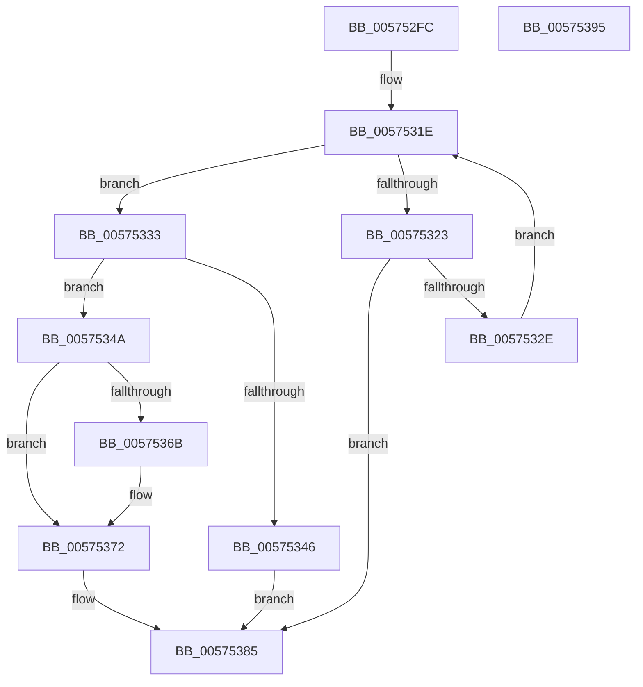

# IvmdFindDeviceEntry

- RVA: `0x005752FC`–`0x00575396` (길이 `154` bytes)
- VA: `0x00000001405752FC`
- 실행 섹션: `.text`
- PDB 이름 있음: `예`; PDB Function 태그: `아니요`
- unwind 정보 RVA: `0x0005FD94`
- 디코드: `46`개 명령, `154/154` bytes 표시
- 미해석 바이트: `0` (있으면 어셈블리에 `.byte`로 보존)

> 이 문서는 커널 이미지의 기계어와 PDB 기호를 분석해 생성했습니다. 4번과 5번은 함수 원형과 자료형을 바이너리 사용 방식에서 추정한 C 해석이며 원본 소스 복구 결과는 아닙니다.

## 1. Dependencies

- 직접 호출 지점: **1**; 고유 호출 대상: **1**
- 직접 호출자로 확인된 함수: **1**
- RIP 상대 이미지 참조: **0**

### Outgoing calls
- `0x0057533D` → [ExtEnvAllocateMemory](../56/ExtEnvAllocateMemory_function_005610B0.md) (function, `0x005610B0`)

### Direct callers
- [HsaProcessIvmd](HsaProcessIvmd_function_00574900.md) at `0x005749E2`

### Static image references
- 디코드된 RIP-relative 메모리 참조가 없습니다.

## 2. Other-region calls and transfers

- 다른 실행 섹션으로 향하는 call: **0**
- 별도 외부 분기/꼬리 이동을 확인하지 못했습니다.

## 3. Assembly (complete function range)

```asm
005752FC  48 89 5C 24 10                  mov qword ptr [rsp + 0x10], rbx
00575301  48 89 74 24 18                  mov qword ptr [rsp + 0x18], rsi
00575306  57                              push rdi
00575307  48 83 EC 20                     sub rsp, 0x20
0057530B  48 83 64 24 30 00               and qword ptr [rsp + 0x30], 0
00575311  48 8D 59 08                     lea rbx, [rcx + 8]
00575315  48 8B 03                        mov rax, qword ptr [rbx]
00575318  0F B7 F2                        movzx esi, dx
0057531B  48 8B F9                        mov rdi, rcx
0057531E  48 3B C3                        cmp rax, rbx
00575321  74 10                           je 0x140575333
00575323  48 89 44 24 30                  mov qword ptr [rsp + 0x30], rax
00575328  66 39 70 10                     cmp word ptr [rax + 0x10], si
0057532C  74 57                           je 0x140575385
0057532E  48 8B 00                        mov rax, qword ptr [rax]
00575331  EB EB                           jmp 0x14057531e
00575333  4C 8D 44 24 30                  lea r8, [rsp + 0x30]
00575338  BA 28 00 00 00                  mov edx, 0x28
0057533D  E8 6E BD FE FF                  call 0x1405610b0
00575342  85 C0                           test eax, eax
00575344  79 04                           jns 0x14057534a
00575346  33 C0                           xor eax, eax
00575348  EB 3B                           jmp 0x140575385
0057534A  48 8B 4C 24 30                  mov rcx, qword ptr [rsp + 0x30]
0057534F  66 89 71 10                     mov word ptr [rcx + 0x10], si
00575353  48 8D 41 18                     lea rax, [rcx + 0x18]
00575357  83 61 14 00                     and dword ptr [rcx + 0x14], 0
0057535B  48 89 40 08                     mov qword ptr [rax + 8], rax
0057535F  48 89 00                        mov qword ptr [rax], rax
00575362  48 8B 43 08                     mov rax, qword ptr [rbx + 8]
00575366  48 39 18                        cmp qword ptr [rax], rbx
00575369  74 07                           je 0x140575372
0057536B  B9 03 00 00 00                  mov ecx, 3
00575370  CD 29                           int 0x29
00575372  48 89 41 08                     mov qword ptr [rcx + 8], rax
00575376  48 89 19                        mov qword ptr [rcx], rbx
00575379  48 89 08                        mov qword ptr [rax], rcx
0057537C  48 8B C1                        mov rax, rcx
0057537F  48 89 4B 08                     mov qword ptr [rbx + 8], rcx
00575383  FF 07                           inc dword ptr [rdi]
00575385  48 8B 5C 24 38                  mov rbx, qword ptr [rsp + 0x38]
0057538A  48 8B 74 24 40                  mov rsi, qword ptr [rsp + 0x40]
0057538F  48 83 C4 20                     add rsp, 0x20
00575393  5F                              pop rdi
00575394  C3                              ret
00575395  CC                              int3
```

## 4. C-style interpretation (structured pseudocode)

```c
__int64 __fastcall IvmdFindDeviceEntry(__int64 a1, unsigned __int16 a2)
{
    __int64 result;
    __int64 v_rsp;
    unsigned __int64 v_stack_p10;
    unsigned __int64 v_stack_p18;
    unsigned __int64 v_stack_p8;

    v_stack_p10 = v_rbx;
    v_stack_p18 = v_rsi;
    v_rsp = (v_rsp) - (32);
loc_0057531E:
    if ((*(unsigned __int64 *)(a1 + 8)) == (a1 + 8)) goto loc_00575333;
    v_stack_p8 = *(unsigned __int64 *)(a1 + 8);
    if ((*(unsigned __int16 *)(*(unsigned __int64 *)(a1 + 8) + 16)) == a2) goto loc_00575385;
    goto loc_0057531E;
loc_00575333:
    result = ExtEnvAllocateMemory(a1, 40, v_stack_p8, a4);
    if (!sign_flag) goto loc_0057534A;
    result = 0;
    goto loc_00575385;
loc_0057534A:
    *(unsigned __int16 *)(v_stack_p8 + 16) = a2;
    *(unsigned __int64 *)(v_stack_p8 + 24 + 8) = v_stack_p8 + 24;
    *(unsigned __int64 *)(v_stack_p8 + 24) = v_stack_p8 + 24;
    if ((*(unsigned __int64 *)(*(unsigned __int64 *)(a1 + 8 + 8))) != (a1 + 8)) {
        a1 = 3;
    }
    *(unsigned __int64 *)(a1 + 8) = *(unsigned __int64 *)(a1 + 8 + 8);
    *(unsigned __int64 *)(a1) = a1 + 8;
    *(unsigned __int64 *)(*(unsigned __int64 *)(a1 + 8 + 8)) = a1;
    *(unsigned __int64 *)(a1 + 8 + 8) = a1;
loc_00575385:
    v_rsp = (v_rsp) + (32);
    return a1;
}
```

## 5. (Beta) C Style

```c
void *IvmdFindDeviceEntry(void *Arg1, uint16_t Arg2)
{
    uint8_t *arg1 = (uint8_t *)Arg1;

    int64_t result;
    int64_t local_rsp;
    uint64_t v_stack_p10;
    uint64_t v_stack_p18;
    uint64_t v_stack_p8;

    v_stack_p10 = local_rbx;
    v_stack_p18 = local_rsi;
    local_rsp = (local_rsp) - (32);
loc_0057531E:
    if ((*(uint64_t *)(arg1 + 0x8)) == (Arg1 + 8)) goto loc_00575333;
    v_stack_p8 = *(uint64_t *)(arg1 + 0x8);
    if ((*(uint16_t *)(*(uint64_t *)(arg1 + 0x8) + 0x10)) == Arg2) goto loc_00575385;
    goto loc_0057531E;
loc_00575333:
    result = ExtEnvAllocateMemory(Arg1, 40, v_stack_p8, a4);
    if (!sign_flag) goto loc_0057534A;
    result = 0;
    goto loc_00575385;
loc_0057534A:
    *(uint16_t *)(v_stack_p8 + 0x10) = Arg2;
    *(uint64_t *)(v_stack_p8 + 0x18 + 0x8) = v_stack_p8 + 24;
    *(uint64_t *)(v_stack_p8 + 0x18) = v_stack_p8 + 24;
    if ((*(uint64_t *)(*(uint64_t *)(arg1 + 0x8 + 0x8))) != (Arg1 + 8)) {
        Arg1 = 3;
    }
    *(uint64_t *)(arg1 + 0x8) = *(uint64_t *)(arg1 + 0x8 + 0x8);
    *(void **)(arg1) = Arg1 + 8;
    *(void **)(*(uint64_t *)(arg1 + 0x8 + 0x8)) = Arg1;
    *(void **)(arg1 + 0x8 + 0x8) = Arg1;
loc_00575385:
    local_rsp = (local_rsp) + (32);
    return Arg1;
}
```

### 관측된 메모리 오프셋

구조체 형식이 확인되지 않은 접근은 인자 기준의 오프셋으로만 기록했습니다.

| 기준 인자 | 오프셋 표현 | 폭 (bit) | 접근 |
|---|---:|---:|---|
| `Arg1` | `+ 0x0` | `32` | `R/W` |
| `Arg1` | `+ 0x0` | `64` | `R` |
| `Arg1` | `+ 0x8` | `64` | `R` |
| `Arg1` | `+ 0x8` | `64` | `W` |

## 6. Execution-region graph

[열기: 2D/3D 그래프와 함수 탐색 컨트롤 패널](../../../control-panel.html?section=text&rva=0x005752FC&view=graph)

- 2D 그래프는 위에서 아래로 흐르고, 3D 그래프는 빈 공간을 드래그해 회전합니다. Shift+드래그는 이동, 휠은 확대·축소, 함수 노드 선택은 대상 보고서 이동입니다.

### Static fallback


