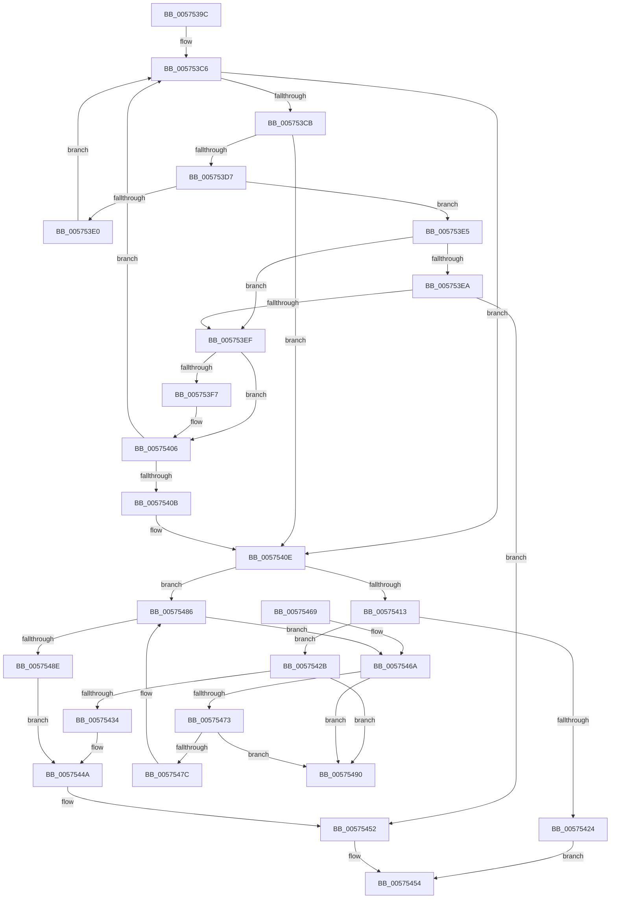

# IvmdProcessRange

- RVA: `0x0057539C`–`0x00575497` (길이 `251` bytes)
- VA: `0x000000014057539C`
- 실행 섹션: `.text`
- PDB 이름 있음: `예`; PDB Function 태그: `아니요`
- unwind 정보 RVA: `0x000C5460`
- 디코드: `81`개 명령, `251/251` bytes 표시
- 미해석 바이트: `0` (있으면 어셈블리에 `.byte`로 보존)

> 이 문서는 커널 이미지의 기계어와 PDB 기호를 분석해 생성했습니다. 4번과 5번은 함수 원형과 자료형을 바이너리 사용 방식에서 추정한 C 해석이며 원본 소스 복구 결과는 아닙니다.

## 1. Dependencies

- 직접 호출 지점: **1**; 고유 호출 대상: **1**
- 직접 호출자로 확인된 함수: **1**
- RIP 상대 이미지 참조: **0**

### Outgoing calls
- `0x0057541B` → [ExtEnvAllocateMemory](../56/ExtEnvAllocateMemory_function_005610B0.md) (function, `0x005610B0`)

### Direct callers
- [HsaProcessIvmd](HsaProcessIvmd_function_00574900.md) at `0x005749F5`

### Static image references
- 디코드된 RIP-relative 메모리 참조가 없습니다.

## 2. Other-region calls and transfers

- 다른 실행 섹션으로 향하는 call: **0**
- 별도 외부 분기/꼬리 이동을 확인하지 못했습니다.

## 3. Assembly (complete function range)

```asm
0057539C  4C 8B DC                        mov r11, rsp
0057539F  49 89 5B 10                     mov qword ptr [r11 + 0x10], rbx
005753A3  49 89 6B 18                     mov qword ptr [r11 + 0x18], rbp
005753A7  49 89 73 20                     mov qword ptr [r11 + 0x20], rsi
005753AB  57                              push rdi
005753AC  48 83 EC 20                     sub rsp, 0x20
005753B0  49 8B F8                        mov rdi, r8
005753B3  33 C0                           xor eax, eax
005753B5  4C 8D 41 18                     lea r8, [rcx + 0x18]
005753B9  49 89 43 08                     mov qword ptr [r11 + 8], rax
005753BD  49 8B 18                        mov rbx, qword ptr [r8]
005753C0  48 8B F2                        mov rsi, rdx
005753C3  48 8B E9                        mov rbp, rcx
005753C6  49 3B D8                        cmp rbx, r8
005753C9  74 43                           je 0x14057540e
005753CB  48 8B 53 10                     mov rdx, qword ptr [rbx + 0x10]
005753CF  4C 8B CB                        mov r9, rbx
005753D2  48 3B D7                        cmp rdx, rdi
005753D5  77 37                           ja 0x14057540e
005753D7  48 8B 4B 18                     mov rcx, qword ptr [rbx + 0x18]
005753DB  48 3B CE                        cmp rcx, rsi
005753DE  73 05                           jae 0x1405753e5
005753E0  48 8B 1B                        mov rbx, qword ptr [rbx]
005753E3  EB E1                           jmp 0x1405753c6
005753E5  48 3B D6                        cmp rdx, rsi
005753E8  75 05                           jne 0x1405753ef
005753EA  48 3B CF                        cmp rcx, rdi
005753ED  74 63                           je 0x140575452
005753EF  48 8B 1B                        mov rbx, qword ptr [rbx]
005753F2  48 85 C0                        test rax, rax
005753F5  75 0F                           jne 0x140575406
005753F7  48 3B D6                        cmp rdx, rsi
005753FA  49 8B C1                        mov rax, r9
005753FD  48 89 44 24 30                  mov qword ptr [rsp + 0x30], rax
00575402  48 0F 42 F2                     cmovb rsi, rdx
00575406  48 3B CF                        cmp rcx, rdi
00575409  72 BB                           jb 0x1405753c6
0057540B  48 8B F9                        mov rdi, rcx
0057540E  48 85 C0                        test rax, rax
00575411  75 73                           jne 0x140575486
00575413  4C 8D 44 24 30                  lea r8, [rsp + 0x30]
00575418  8D 50 20                        lea edx, [rax + 0x20]
0057541B  E8 90 BC FE FF                  call 0x1405610b0
00575420  85 C0                           test eax, eax
00575422  79 07                           jns 0x14057542b
00575424  B8 9A 00 00 C0                  mov eax, 0xc000009a
00575429  EB 29                           jmp 0x140575454
0057542B  48 8B 4B 08                     mov rcx, qword ptr [rbx + 8]
0057542F  48 39 19                        cmp qword ptr [rcx], rbx
00575432  75 5C                           jne 0x140575490
00575434  48 8B 44 24 30                  mov rax, qword ptr [rsp + 0x30]
00575439  48 89 18                        mov qword ptr [rax], rbx
0057543C  48 89 48 08                     mov qword ptr [rax + 8], rcx
00575440  48 89 01                        mov qword ptr [rcx], rax
00575443  48 89 43 08                     mov qword ptr [rbx + 8], rax
00575447  FF 45 14                        inc dword ptr [rbp + 0x14]
0057544A  48 89 70 10                     mov qword ptr [rax + 0x10], rsi
0057544E  48 89 78 18                     mov qword ptr [rax + 0x18], rdi
00575452  33 C0                           xor eax, eax
00575454  48 8B 5C 24 38                  mov rbx, qword ptr [rsp + 0x38]
00575459  48 8B 6C 24 40                  mov rbp, qword ptr [rsp + 0x40]
0057545E  48 8B 74 24 48                  mov rsi, qword ptr [rsp + 0x48]
00575463  48 83 C4 20                     add rsp, 0x20
00575467  5F                              pop rdi
00575468  C3                              ret
00575469  CC                              int3
0057546A  4C 8B 01                        mov r8, qword ptr [rcx]
0057546D  49 39 48 08                     cmp qword ptr [r8 + 8], rcx
00575471  75 1D                           jne 0x140575490
00575473  48 8B 51 08                     mov rdx, qword ptr [rcx + 8]
00575477  48 39 0A                        cmp qword ptr [rdx], rcx
0057547A  75 14                           jne 0x140575490
0057547C  4C 89 02                        mov qword ptr [rdx], r8
0057547F  49 89 50 08                     mov qword ptr [r8 + 8], rdx
00575483  FF 4D 14                        dec dword ptr [rbp + 0x14]
00575486  48 8B 08                        mov rcx, qword ptr [rax]
00575489  48 3B CB                        cmp rcx, rbx
0057548C  75 DC                           jne 0x14057546a
0057548E  EB BA                           jmp 0x14057544a
00575490  B9 03 00 00 00                  mov ecx, 3
00575495  CD 29                           int 0x29
```

## 4. C-style interpretation (structured pseudocode)

```c
__int64 __fastcall IvmdProcessRange(__int64 a1, __int64 a2, __int64 a3)
{
    __int64 result;
    __int64 v_rsp;
    unsigned __int64 v_stack_p10;
    unsigned __int64 v_stack_p18;
    unsigned __int64 v_stack_p20;
    unsigned __int64 v_stack_p8;

    *(unsigned __int64 *)(v_rsp + 16) = v_rbx;
    *(unsigned __int64 *)(v_rsp + 24) = v_rbp;
    *(unsigned __int64 *)(v_rsp + 32) = v_rsi;
    v_rsp = (v_rsp) - (32);
    result = 0;
    *(unsigned __int64 *)(v_rsp + 8) = 0;
loc_005753C6:
    if ((*(unsigned __int64 *)(a1 + 24)) == (a1 + 24)) goto loc_0057540E;
    if ((*(unsigned __int64 *)(*(unsigned __int64 *)(a1 + 24) + 16)) > a3) goto loc_0057540E;
    if ((*(unsigned __int64 *)(*(unsigned __int64 *)(a1 + 24) + 24)) >= a2) goto loc_005753E5;
    goto loc_005753C6;
loc_005753E5:
    if ((*(unsigned __int64 *)(*(unsigned __int64 *)(a1 + 24) + 16)) != a2) goto loc_005753EF;
    if ((*(unsigned __int64 *)(*(unsigned __int64 *)(a1 + 24) + 24)) == a3) goto loc_00575452;
loc_005753EF:
    if (0 == 0) {
        result = *(unsigned __int64 *)(a1 + 24);
        v_stack_p8 = result;
        if ((*(unsigned __int64 *)(*(unsigned __int64 *)(a1 + 24) + 16)) < a2) { a2 = *(unsigned __int64 *)(*(unsigned __int64 *)(a1 + 24) + 16); }
    }
    if ((*(unsigned __int64 *)(*(unsigned __int64 *)(a1 + 24) + 24)) < a3) goto loc_005753C6;
loc_0057540E:
    if (result != 0) goto loc_00575486;
    result = ExtEnvAllocateMemory(*(unsigned __int64 *)(*(unsigned __int64 *)(a1 + 24) + 24), result + 32, v_stack_p8, *(unsigned __int64 *)(a1 + 24));
    if (!sign_flag) goto loc_0057542B;
    goto loc_00575454;
loc_0057542B:
    if ((*(unsigned __int64 *)(*(unsigned __int64 *)(*(unsigned __int64 *)(*(unsigned __int64 *)(*(unsigned __int64 *)(a1 + 24))) + 8))) != (*(unsigned __int64 *)(*(unsigned __int64 *)(*(unsigned __int64 *)(a1 + 24))))) goto loc_00575490;
    *(unsigned __int64 *)(v_stack_p8) = *(unsigned __int64 *)(*(unsigned __int64 *)(*(unsigned __int64 *)(a1 + 24)));
    *(unsigned __int64 *)(v_stack_p8 + 8) = *(unsigned __int64 *)(*(unsigned __int64 *)(*(unsigned __int64 *)(*(unsigned __int64 *)(a1 + 24))) + 8);
    *(unsigned __int64 *)(*(unsigned __int64 *)(*(unsigned __int64 *)(*(unsigned __int64 *)(*(unsigned __int64 *)(a1 + 24))) + 8)) = v_stack_p8;
    *(unsigned __int64 *)(*(unsigned __int64 *)(*(unsigned __int64 *)(*(unsigned __int64 *)(a1 + 24))) + 8) = v_stack_p8;
loc_0057544A:
    *(unsigned __int64 *)(v_stack_p8 + 16) = a2;
    *(unsigned __int64 *)(v_stack_p8 + 24) = *(unsigned __int64 *)(*(unsigned __int64 *)(a1 + 24) + 24);
loc_00575452:
    result = 0;
loc_00575454:
    v_rsp = (v_rsp) + (32);
    return result;
loc_0057546A:
    if ((*(unsigned __int64 *)(*(unsigned __int64 *)(*(unsigned __int64 *)(*(unsigned __int64 *)(*(unsigned __int64 *)(*(unsigned __int64 *)(a1 + 24))) + 8)) + 8)) != (*(unsigned __int64 *)(*(unsigned __int64 *)(*(unsigned __int64 *)(*(unsigned __int64 *)(a1 + 24))) + 8))) goto loc_00575490;
    if ((*(unsigned __int64 *)(*(unsigned __int64 *)(*(unsigned __int64 *)(*(unsigned __int64 *)(*(unsigned __int64 *)(*(unsigned __int64 *)(a1 + 24))) + 8) + 8))) != (*(unsigned __int64 *)(*(unsigned __int64 *)(*(unsigned __int64 *)(*(unsigned __int64 *)(a1 + 24))) + 8))) goto loc_00575490;
    *(unsigned __int64 *)(*(unsigned __int64 *)(*(unsigned __int64 *)(*(unsigned __int64 *)(*(unsigned __int64 *)(*(unsigned __int64 *)(a1 + 24))) + 8) + 8)) = *(unsigned __int64 *)(*(unsigned __int64 *)(*(unsigned __int64 *)(*(unsigned __int64 *)(*(unsigned __int64 *)(a1 + 24))) + 8));
    *(unsigned __int64 *)(*(unsigned __int64 *)(*(unsigned __int64 *)(*(unsigned __int64 *)(*(unsigned __int64 *)(*(unsigned __int64 *)(a1 + 24))) + 8)) + 8) = *(unsigned __int64 *)(*(unsigned __int64 *)(*(unsigned __int64 *)(*(unsigned __int64 *)(*(unsigned __int64 *)(a1 + 24))) + 8) + 8);
loc_00575486:
    if ((*(unsigned __int64 *)(result)) != v_stack_p10) goto loc_0057546A;
    goto loc_0057544A;
loc_00575490:
    return result;
}
```

## 5. (Beta) C Style

```c
int64_t IvmdProcessRange(void *Arg1, int64_t Arg2, int64_t Arg3)
{
    uint8_t *arg1 = (uint8_t *)Arg1;

    int64_t result;
    int64_t local_rsp;
    uint64_t v_stack_p10;
    uint64_t v_stack_p18;
    uint64_t v_stack_p20;
    uint64_t v_stack_p8;

    *(uint64_t *)(local_rsp + 0x10) = local_rbx;
    *(uint64_t *)(local_rsp + 0x18) = local_rbp;
    *(uint64_t *)(local_rsp + 0x20) = local_rsi;
    local_rsp = (local_rsp) - (32);
    result = 0;
    *(uint64_t *)(local_rsp + 0x8) = 0;
loc_005753C6:
    if ((*(uint64_t *)(arg1 + 0x18)) == (Arg1 + 24)) goto loc_0057540E;
    if ((*(uint64_t *)(*(uint64_t *)(arg1 + 0x18) + 0x10)) > Arg3) goto loc_0057540E;
    if ((*(uint64_t *)(*(uint64_t *)(arg1 + 0x18) + 0x18)) >= Arg2) goto loc_005753E5;
    goto loc_005753C6;
loc_005753E5:
    if ((*(uint64_t *)(*(uint64_t *)(arg1 + 0x18) + 0x10)) != Arg2) goto loc_005753EF;
    if ((*(uint64_t *)(*(uint64_t *)(arg1 + 0x18) + 0x18)) == Arg3) goto loc_00575452;
loc_005753EF:
    if (0 == 0) {
        result = *(uint64_t *)(arg1 + 0x18);
        v_stack_p8 = result;
        if ((*(uint64_t *)(*(uint64_t *)(arg1 + 0x18) + 0x10)) < Arg2) { Arg2 = *(uint64_t *)(*(uint64_t *)(arg1 + 0x18) + 0x10); }
    }
    if ((*(uint64_t *)(*(uint64_t *)(arg1 + 0x18) + 0x18)) < Arg3) goto loc_005753C6;
loc_0057540E:
    if (result != 0) goto loc_00575486;
    result = ExtEnvAllocateMemory(*(uint64_t *)(*(uint64_t *)(arg1 + 0x18) + 0x18), result + 32, v_stack_p8, *(uint64_t *)(arg1 + 0x18));
    if (!sign_flag) goto loc_0057542B;
    goto loc_00575454;
loc_0057542B:
    if ((*(uint64_t *)(*(uint64_t *)(*(uint64_t *)(*(uint64_t *)(*(uint64_t *)(arg1 + 0x18))) + 0x8))) != (*(uint64_t *)(*(uint64_t *)(*(uint64_t *)(arg1 + 0x18))))) goto loc_00575490;
    *(uint64_t *)(v_stack_p8) = *(uint64_t *)(*(uint64_t *)(*(uint64_t *)(arg1 + 0x18)));
    *(uint64_t *)(v_stack_p8 + 0x8) = *(uint64_t *)(*(uint64_t *)(*(uint64_t *)(*(uint64_t *)(arg1 + 0x18))) + 0x8);
    *(uint64_t *)(*(uint64_t *)(*(uint64_t *)(*(uint64_t *)(*(uint64_t *)(arg1 + 0x18))) + 0x8)) = v_stack_p8;
    *(uint64_t *)(*(uint64_t *)(*(uint64_t *)(*(uint64_t *)(arg1 + 0x18))) + 0x8) = v_stack_p8;
loc_0057544A:
    *(uint64_t *)(v_stack_p8 + 0x10) = Arg2;
    *(uint64_t *)(v_stack_p8 + 0x18) = *(uint64_t *)(*(uint64_t *)(arg1 + 0x18) + 0x18);
loc_00575452:
    result = 0;
loc_00575454:
    local_rsp = (local_rsp) + (32);
    return result;
loc_0057546A:
    if ((*(uint64_t *)(*(uint64_t *)(*(uint64_t *)(*(uint64_t *)(*(uint64_t *)(*(uint64_t *)(arg1 + 0x18))) + 0x8)) + 0x8)) != (*(uint64_t *)(*(uint64_t *)(*(uint64_t *)(*(uint64_t *)(arg1 + 0x18))) + 0x8))) goto loc_00575490;
    if ((*(uint64_t *)(*(uint64_t *)(*(uint64_t *)(*(uint64_t *)(*(uint64_t *)(*(uint64_t *)(arg1 + 0x18))) + 0x8) + 0x8))) != (*(uint64_t *)(*(uint64_t *)(*(uint64_t *)(*(uint64_t *)(arg1 + 0x18))) + 0x8))) goto loc_00575490;
    *(uint64_t *)(*(uint64_t *)(*(uint64_t *)(*(uint64_t *)(*(uint64_t *)(*(uint64_t *)(arg1 + 0x18))) + 0x8) + 0x8)) = *(uint64_t *)(*(uint64_t *)(*(uint64_t *)(*(uint64_t *)(*(uint64_t *)(arg1 + 0x18))) + 0x8));
    *(uint64_t *)(*(uint64_t *)(*(uint64_t *)(*(uint64_t *)(*(uint64_t *)(*(uint64_t *)(arg1 + 0x18))) + 0x8)) + 0x8) = *(uint64_t *)(*(uint64_t *)(*(uint64_t *)(*(uint64_t *)(*(uint64_t *)(arg1 + 0x18))) + 0x8) + 0x8);
loc_00575486:
    if ((*(uint64_t *)(result)) != v_stack_p10) goto loc_0057546A;
    goto loc_0057544A;
loc_00575490:
    return result;
}
```

### 관측된 메모리 오프셋

구조체 형식이 확인되지 않은 접근은 인자 기준의 오프셋으로만 기록했습니다.

| 기준 인자 | 오프셋 표현 | 폭 (bit) | 접근 |
|---|---:|---:|---|
| `Arg1` | `+ 0x0` | `64` | `R` |
| `Arg1` | `+ 0x14` | `32` | `R/W` |
| `Arg1` | `+ 0x18` | `64` | `R` |

## 6. Execution-region graph

[열기: 2D/3D 그래프와 함수 탐색 컨트롤 패널](../../../control-panel.html?section=text&rva=0x0057539C&view=graph)

- 2D 그래프는 위에서 아래로 흐르고, 3D 그래프는 빈 공간을 드래그해 회전합니다. Shift+드래그는 이동, 휠은 확대·축소, 함수 노드 선택은 대상 보고서 이동입니다.

### Static fallback


