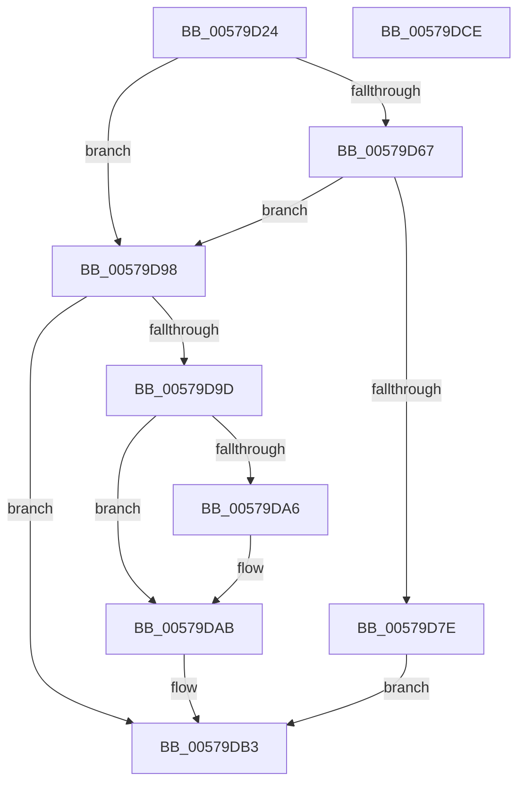

# IvtAllocateDevice

- RVA: `0x00579D24`–`0x00579DCF` (길이 `171` bytes)
- VA: `0x0000000140579D24`
- 실행 섹션: `.text`
- PDB 이름 있음: `예`; PDB Function 태그: `아니요`
- unwind 정보 RVA: `0x000C559C`
- 디코드: `53`개 명령, `171/171` bytes 표시
- 미해석 바이트: `0` (있으면 어셈블리에 `.byte`로 보존)

> 이 문서는 커널 이미지의 기계어와 PDB 기호를 분석해 생성했습니다. 4번과 5번은 함수 원형과 자료형을 바이너리 사용 방식에서 추정한 C 해석이며 원본 소스 복구 결과는 아닙니다.

## 1. Dependencies

- 직접 호출 지점: **4**; 고유 호출 대상: **2**
- 직접 호출자로 확인된 함수: **3**
- RIP 상대 이미지 참조: **0**

### Outgoing calls
- `0x00579D57` → [ExtEnvAllocateMemory](../56/ExtEnvAllocateMemory_function_005610B0.md) (function, `0x005610B0`)
- `0x00579D73` → [ExtEnvAllocateMemory](../56/ExtEnvAllocateMemory_function_005610B0.md) (function, `0x005610B0`)
- `0x00579DA6` → [ExtEnvFreeMemory](../56/ExtEnvFreeMemory_function_00561320.md) (function, `0x00561320`)
- `0x00579DAE` → [ExtEnvFreeMemory](../56/ExtEnvFreeMemory_function_00561320.md) (function, `0x00561320`)

### Direct callers
- [IvtCreateDevice](IvtCreateDevice_function_00579DE0.md) at `0x00579E70`
- [IvtLegacyProcessDeviceExceptions](../../pagelk/B6/IvtLegacyProcessDeviceExceptions_function_00B62944.md) at `0x00B629DF`
- [IvtProcessDeviceExceptions](../../pagelk/B6/IvtProcessDeviceExceptions_function_00B62C34.md) at `0x00B62CD6`

### Static image references
- 디코드된 RIP-relative 메모리 참조가 없습니다.

## 2. Other-region calls and transfers

- 다른 실행 섹션으로 향하는 call: **0**
- 별도 외부 분기/꼬리 이동을 확인하지 못했습니다.

## 3. Assembly (complete function range)

```asm
00579D24  48 8B C4                        mov rax, rsp
00579D27  48 89 58 08                     mov qword ptr [rax + 8], rbx
00579D2B  48 89 68 10                     mov qword ptr [rax + 0x10], rbp
00579D2F  48 89 70 18                     mov qword ptr [rax + 0x18], rsi
00579D33  4C 89 48 20                     mov qword ptr [rax + 0x20], r9
00579D37  57                              push rdi
00579D38  41 56                           push r14
00579D3A  41 57                           push r15
00579D3C  48 83 EC 20                     sub rsp, 0x20
00579D40  48 83 60 20 00                  and qword ptr [rax + 0x20], 0
00579D45  49 8B E8                        mov rbp, r8
00579D48  44 8B F2                        mov r14d, edx
00579D4B  4C 8D 40 20                     lea r8, [rax + 0x20]
00579D4F  BA 58 00 00 00                  mov edx, 0x58
00579D54  44 8B F9                        mov r15d, ecx
00579D57  E8 54 73 FE FF                  call 0x1405610b0
00579D5C  48 8B 5C 24 58                  mov rbx, qword ptr [rsp + 0x58]
00579D61  8B F8                           mov edi, eax
00579D63  85 C0                           test eax, eax
00579D65  78 31                           js 0x140579d98
00579D67  48 8D 73 38                     lea rsi, [rbx + 0x38]
00579D6B  BA 08 00 00 00                  mov edx, 8
00579D70  4C 8B C6                        mov r8, rsi
00579D73  E8 38 73 FE FF                  call 0x1405610b0
00579D78  8B F8                           mov edi, eax
00579D7A  85 C0                           test eax, eax
00579D7C  78 1A                           js 0x140579d98
00579D7E  48 89 2B                        mov qword ptr [rbx], rbp
00579D81  48 8B 06                        mov rax, qword ptr [rsi]
00579D84  44 89 38                        mov dword ptr [rax], r15d
00579D87  48 8B 06                        mov rax, qword ptr [rsi]
00579D8A  44 89 70 04                     mov dword ptr [rax + 4], r14d
00579D8E  48 8B 44 24 60                  mov rax, qword ptr [rsp + 0x60]
00579D93  48 89 18                        mov qword ptr [rax], rbx
00579D96  EB 1B                           jmp 0x140579db3
00579D98  48 85 DB                        test rbx, rbx
00579D9B  74 16                           je 0x140579db3
00579D9D  48 8B 53 38                     mov rdx, qword ptr [rbx + 0x38]
00579DA1  48 85 D2                        test rdx, rdx
00579DA4  74 05                           je 0x140579dab
00579DA6  E8 75 75 FE FF                  call 0x140561320
00579DAB  48 8B D3                        mov rdx, rbx
00579DAE  E8 6D 75 FE FF                  call 0x140561320
00579DB3  48 8B 5C 24 40                  mov rbx, qword ptr [rsp + 0x40]
00579DB8  8B C7                           mov eax, edi
00579DBA  48 8B 6C 24 48                  mov rbp, qword ptr [rsp + 0x48]
00579DBF  48 8B 74 24 50                  mov rsi, qword ptr [rsp + 0x50]
00579DC4  48 83 C4 20                     add rsp, 0x20
00579DC8  41 5F                           pop r15
00579DCA  41 5E                           pop r14
00579DCC  5F                              pop rdi
00579DCD  C3                              ret
00579DCE  CC                              int3
```

## 4. C-style interpretation (structured pseudocode)

```c
__int64 __fastcall IvtAllocateDevice(int a1, int a2, __int64 a3, __int64 a4, __int64 a5)
{
    __int64 result;
    __int64 v_rsp;
    unsigned __int64 v_stack_p10;
    unsigned __int64 v_stack_p18;
    unsigned __int64 v_stack_p20;
    unsigned __int64 v_stack_p8;

    *(unsigned __int64 *)(v_rsp + 8) = v_rbx;
    *(unsigned __int64 *)(v_rsp + 16) = v_rbp;
    *(unsigned __int64 *)(v_rsp + 24) = v_rsi;
    *(unsigned __int64 *)(v_rsp + 32) = a4;
    v_rsp = (v_rsp) - (32);
    result = ExtEnvAllocateMemory(a1, 88, v_rsp + 32, a4);
    if (sign_flag) goto loc_00579D98;
    result = ExtEnvAllocateMemory(a1, 8, v_stack_p20 + 56, a4);
    if (sign_flag) goto loc_00579D98;
    *(unsigned __int64 *)(v_stack_p20) = a3;
    *(unsigned int *)(*(unsigned __int64 *)(v_stack_p20 + 56)) = (unsigned int)((unsigned int)(a1));
    *(unsigned int *)(*(unsigned __int64 *)(v_stack_p20 + 56) + 4) = (unsigned int)((unsigned int)(a2));
    *(unsigned __int64 *)(a5) = v_stack_p20;
    goto loc_00579DB3;
loc_00579D98:
    if (v_stack_p20 == 0) goto loc_00579DB3;
    result = a5;
    if (*(unsigned __int64 *)(v_stack_p20 + 56) != 0) {
        result = ExtEnvFreeMemory(a1, *(unsigned __int64 *)(v_stack_p20 + 56), v_stack_p20 + 56, a4);
    }
    result = ExtEnvFreeMemory(a1, v_stack_p20, v_stack_p20 + 56, a4);
loc_00579DB3:
    v_rsp = (v_rsp) + (32);
    return (unsigned int)((unsigned int)((unsigned int)((unsigned int)(result))));
}
```

## 5. (Beta) C Style

```c
int64_t IvtAllocateDevice(int32_t Arg1, int32_t Arg2, int64_t Arg3, int64_t Arg4, void *Arg5)
{
    uint8_t *arg5 = (uint8_t *)Arg5;

    int64_t result;
    int64_t local_rsp;
    uint64_t v_stack_p10;
    uint64_t v_stack_p18;
    uint64_t v_stack_p20;
    uint64_t v_stack_p8;

    *(uint64_t *)(local_rsp + 0x8) = local_rbx;
    *(uint64_t *)(local_rsp + 0x10) = local_rbp;
    *(uint64_t *)(local_rsp + 0x18) = local_rsi;
    *(uint64_t *)(local_rsp + 0x20) = Arg4;
    local_rsp = (local_rsp) - (32);
    result = ExtEnvAllocateMemory(Arg1, 88, local_rsp + 32, Arg4);
    if (sign_flag) goto loc_00579D98;
    result = ExtEnvAllocateMemory(Arg1, 8, v_stack_p20 + 56, Arg4);
    if (sign_flag) goto loc_00579D98;
    *(uint64_t *)(v_stack_p20) = Arg3;
    *(uint32_t *)(*(uint64_t *)(v_stack_p20 + 0x38)) = (uint32_t)((uint32_t)(Arg1));
    *(uint32_t *)(*(uint64_t *)(v_stack_p20 + 0x38) + 0x4) = (uint32_t)((uint32_t)(Arg2));
    *(uint64_t *)(arg5) = v_stack_p20;
    goto loc_00579DB3;
loc_00579D98:
    if (v_stack_p20 == 0) goto loc_00579DB3;
    result = Arg5;
    if (*(uint64_t *)(v_stack_p20 + 0x38) != 0) {
        result = ExtEnvFreeMemory(Arg1, *(uint64_t *)(v_stack_p20 + 0x38), v_stack_p20 + 56, Arg4);
    }
    result = ExtEnvFreeMemory(Arg1, v_stack_p20, v_stack_p20 + 56, Arg4);
loc_00579DB3:
    local_rsp = (local_rsp) + (32);
    return (uint32_t)((uint32_t)((uint32_t)((uint32_t)(result))));
}
```

### 관측된 메모리 오프셋

구조체 형식이 확인되지 않은 접근은 인자 기준의 오프셋으로만 기록했습니다.

| 기준 인자 | 오프셋 표현 | 폭 (bit) | 접근 |
|---|---:|---:|---|
| `Arg5` | `+ 0x0` | `64` | `W` |

## 6. Execution-region graph

[열기: 2D/3D 그래프와 함수 탐색 컨트롤 패널](../../../control-panel.html?section=text&rva=0x00579D24&view=graph)

- 2D 그래프는 위에서 아래로 흐르고, 3D 그래프는 빈 공간을 드래그해 회전합니다. Shift+드래그는 이동, 휠은 확대·축소, 함수 노드 선택은 대상 보고서 이동입니다.

### Static fallback


