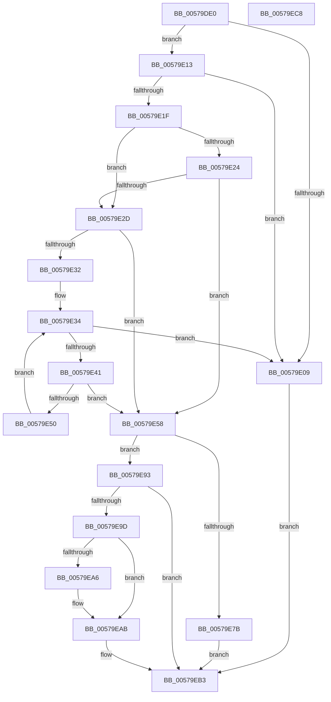

# IvtCreateDevice

- RVA: `0x00579DE0`–`0x00579EC9` (길이 `233` bytes)
- VA: `0x0000000140579DE0`
- 실행 섹션: `.text`
- PDB 이름 있음: `예`; PDB Function 태그: `아니요`
- unwind 정보 RVA: `0x000B8D7C`
- 디코드: `72`개 명령, `233/233` bytes 표시
- 미해석 바이트: `0` (있으면 어셈블리에 `.byte`로 보존)

> 이 문서는 커널 이미지의 기계어와 PDB 기호를 분석해 생성했습니다. 4번과 5번은 함수 원형과 자료형을 바이너리 사용 방식에서 추정한 C 해석이며 원본 소스 복구 결과는 아닙니다.

## 1. Dependencies

- 직접 호출 지점: **5**; 고유 호출 대상: **4**
- 직접 호출자로 확인된 함수: **0**
- RIP 상대 이미지 참조: **0**

### Outgoing calls
- `0x00579E34` → [IvtpGetNextInternalDeviceScope](../4F/IvtpGetNextInternalDeviceScope_function_004F993C.md) (function, `0x004F993C`)
- `0x00579E47` → [HalpIvtCheckIdPathMatch](../4F/HalpIvtCheckIdPathMatch_function_004FAF2C.md) (function, `0x004FAF2C`)
- `0x00579E70` → [IvtAllocateDevice](IvtAllocateDevice_function_00579D24.md) (function, `0x00579D24`)
- `0x00579EA6` → [ExtEnvFreeMemory](../56/ExtEnvFreeMemory_function_00561320.md) (function, `0x00561320`)
- `0x00579EAE` → [ExtEnvFreeMemory](../56/ExtEnvFreeMemory_function_00561320.md) (function, `0x00561320`)

### Direct callers
- 이 함수 시작 RVA로 연결되는 직접 call은 확인되지 않았습니다. 간접 호출은 완전히 역산할 수 없습니다.

### Static image references
- 디코드된 RIP-relative 메모리 참조가 없습니다.

## 2. Other-region calls and transfers

- 다른 실행 섹션으로 향하는 call: **0**
- 별도 외부 분기/꼬리 이동을 확인하지 못했습니다.

## 3. Assembly (complete function range)

```asm
00579DE0  48 89 5C 24 10                  mov qword ptr [rsp + 0x10], rbx
00579DE5  48 89 6C 24 18                  mov qword ptr [rsp + 0x18], rbp
00579DEA  56                              push rsi
00579DEB  57                              push rdi
00579DEC  41 56                           push r14
00579DEE  48 83 EC 30                     sub rsp, 0x30
00579DF2  48 83 64 24 50 00               and qword ptr [rsp + 0x50], 0
00579DF8  4D 8B F1                        mov r14, r9
00579DFB  83 3A 01                        cmp dword ptr [rdx], 1
00579DFE  41 8B D8                        mov ebx, r8d
00579E01  48 8B EA                        mov rbp, rdx
00579E04  48 8B F9                        mov rdi, rcx
00579E07  74 0A                           je 0x140579e13
00579E09  BF 25 02 00 C0                  mov edi, 0xc0000225
00579E0E  E9 A0 00 00 00                  jmp 0x140579eb3
00579E13  0F B7 42 08                     movzx eax, word ptr [rdx + 8]
00579E17  39 81 FC 00 00 00               cmp dword ptr [rcx + 0xfc], eax
00579E1D  75 EA                           jne 0x140579e09
00579E1F  F6 C3 01                        test bl, 1
00579E22  74 09                           je 0x140579e2d
00579E24  80 B9 0C 01 00 00 00            cmp byte ptr [rcx + 0x10c], 0
00579E2B  75 2B                           jne 0x140579e58
00579E2D  F6 C3 08                        test bl, 8
00579E30  75 26                           jne 0x140579e58
00579E32  33 D2                           xor edx, edx
00579E34  E8 03 FB F7 FF                  call 0x1404f993c
00579E39  48 8B F0                        mov rsi, rax
00579E3C  48 85 C0                        test rax, rax
00579E3F  74 C8                           je 0x140579e09
00579E41  48 8B D0                        mov rdx, rax
00579E44  48 8B CD                        mov rcx, rbp
00579E47  E8 E0 10 F8 FF                  call 0x1404faf2c
00579E4C  84 C0                           test al, al
00579E4E  75 08                           jne 0x140579e58
00579E50  48 8B D6                        mov rdx, rsi
00579E53  48 8B CF                        mov rcx, rdi
00579E56  EB DC                           jmp 0x140579e34
00579E58  0F B7 55 0A                     movzx edx, word ptr [rbp + 0xa]
00579E5C  48 8D 44 24 50                  lea rax, [rsp + 0x50]
00579E61  0F B7 4D 0C                     movzx ecx, word ptr [rbp + 0xc]
00579E65  83 E2 03                        and edx, 3
00579E68  4D 8B C6                        mov r8, r14
00579E6B  48 89 44 24 20                  mov qword ptr [rsp + 0x20], rax
00579E70  E8 AF FE FF FF                  call 0x140579d24
00579E75  8B F8                           mov edi, eax
00579E77  85 C0                           test eax, eax
00579E79  78 18                           js 0x140579e93
00579E7B  48 8B 54 24 50                  mov rdx, qword ptr [rsp + 0x50]
00579E80  48 8B 4C 24 70                  mov rcx, qword ptr [rsp + 0x70]
00579E85  C1 EB 03                        shr ebx, 3
00579E88  80 E3 01                        and bl, 1
00579E8B  88 5A 23                        mov byte ptr [rdx + 0x23], bl
00579E8E  48 89 11                        mov qword ptr [rcx], rdx
00579E91  EB 20                           jmp 0x140579eb3
00579E93  48 8B 5C 24 50                  mov rbx, qword ptr [rsp + 0x50]
00579E98  48 85 DB                        test rbx, rbx
00579E9B  74 16                           je 0x140579eb3
00579E9D  48 8B 53 38                     mov rdx, qword ptr [rbx + 0x38]
00579EA1  48 85 D2                        test rdx, rdx
00579EA4  74 05                           je 0x140579eab
00579EA6  E8 75 74 FE FF                  call 0x140561320
00579EAB  48 8B D3                        mov rdx, rbx
00579EAE  E8 6D 74 FE FF                  call 0x140561320
00579EB3  48 8B 5C 24 58                  mov rbx, qword ptr [rsp + 0x58]
00579EB8  8B C7                           mov eax, edi
00579EBA  48 8B 6C 24 60                  mov rbp, qword ptr [rsp + 0x60]
00579EBF  48 83 C4 30                     add rsp, 0x30
00579EC3  41 5E                           pop r14
00579EC5  5F                              pop rdi
00579EC6  5E                              pop rsi
00579EC7  C3                              ret
00579EC8  CC                              int3
```

## 4. C-style interpretation (structured pseudocode)

```c
__int64 __fastcall IvtCreateDevice(__int64 a1, __int64 a2, int a3, __int64 a4, __int64 a5)
{
    __int64 result;
    __int64 v_rbx;
    __int64 v_rsp;
    unsigned __int64 v_stack_m28;
    unsigned __int64 v_stack_p10;
    unsigned __int64 v_stack_p18;
    unsigned __int64 v_stack_p8;

    v_stack_p10 = v_rbx;
    v_stack_p18 = v_rbp;
    v_rsp = (v_rsp) - (48);
    if ((*(unsigned int *)(a2)) == 1) goto loc_00579E13;
loc_00579E09:
    goto loc_00579EB3;
loc_00579E13:
    if ((*(unsigned int *)(a1 + 252)) != ((unsigned int)(*(unsigned __int16 *)(a2 + 8)))) goto loc_00579E09;
    if ((((unsigned __int8)((unsigned int)(a3))) & (1)) == 0) goto loc_00579E2D;
    if ((*(unsigned __int8 *)(a1 + 268)) != 0) goto loc_00579E58;
loc_00579E2D:
    if ((((unsigned __int8)((unsigned int)(a3))) & (8)) != 0) goto loc_00579E58;
    a2 = 0;
loc_00579E34:
    result = IvtpGetNextInternalDeviceScope(a1, a2, a3, a4);
    if (result == 0) goto loc_00579E09;
    result = HalpIvtCheckIdPathMatch(0, result, a3, a4);
    if ((unsigned __int8)(result) != 0) goto loc_00579E58;
    goto loc_00579E34;
loc_00579E58:
    a2 = (unsigned int)((*(unsigned __int16 *)(a2 + 10)) & (3));
    v_stack_m28 = v_stack_p8;
    result = IvtAllocateDevice(*(unsigned __int16 *)(a2 + 12), a2, a4, a4);
    if (sign_flag) goto loc_00579E93;
    v_rbx = (unsigned int)(((unsigned int)(a3)) >> (3));
    v_rbx = (unsigned __int8)((v_rbx) & (1));
    *(unsigned __int8 *)(v_stack_p8 + 35) = (unsigned __int8)(v_rbx);
    *(unsigned __int64 *)(a5) = v_stack_p8;
    goto loc_00579EB3;
loc_00579E93:
    if (v_stack_p8 == 0) goto loc_00579EB3;
    if (*(unsigned __int64 *)(v_stack_p8 + 56) != 0) {
        result = ExtEnvFreeMemory(a5, *(unsigned __int64 *)(v_stack_p8 + 56), a4, a4);
    }
    result = ExtEnvFreeMemory(a5, v_stack_p8, a4, a4);
loc_00579EB3:
    v_rsp = (v_rsp) + (48);
    return (unsigned int)((unsigned int)((unsigned int)((unsigned int)(result))));
}
```

## 5. (Beta) C Style

```c
int64_t IvtCreateDevice(void *Arg1, void *Arg2, int32_t Arg3, int64_t Arg4, void *Arg5)
{
    uint8_t *arg1 = (uint8_t *)Arg1;
    uint8_t *arg2 = (uint8_t *)Arg2;
    uint8_t *arg5 = (uint8_t *)Arg5;

    int64_t result;
    int64_t local_rbx;
    int64_t local_rsp;
    uint64_t v_stack_m28;
    uint64_t v_stack_p10;
    uint64_t v_stack_p18;
    uint64_t v_stack_p8;

    v_stack_p10 = local_rbx;
    v_stack_p18 = local_rbp;
    local_rsp = (local_rsp) - (48);
    if ((*(uint32_t *)(arg2)) == 1) goto loc_00579E13;
loc_00579E09:
    goto loc_00579EB3;
loc_00579E13:
    if ((*(uint32_t *)(arg1 + 0xFC)) != ((uint32_t)(*(uint16_t *)(arg2 + 0x8)))) goto loc_00579E09;
    if ((((uint8_t)((uint32_t)(Arg3))) & (1)) == 0) goto loc_00579E2D;
    if ((*(uint8_t *)(arg1 + 0x10C)) != 0) goto loc_00579E58;
loc_00579E2D:
    if ((((uint8_t)((uint32_t)(Arg3))) & (8)) != 0) goto loc_00579E58;
    Arg2 = 0;
loc_00579E34:
    result = IvtpGetNextInternalDeviceScope(Arg1, Arg2, Arg3, Arg4);
    if (result == 0) goto loc_00579E09;
    result = HalpIvtCheckIdPathMatch(0, result, Arg3, Arg4);
    if ((uint8_t)(result) != 0) goto loc_00579E58;
    goto loc_00579E34;
loc_00579E58:
    Arg2 = (uint32_t)((*(uint16_t *)(arg2 + 0xA)) & (3));
    v_stack_m28 = v_stack_p8;
    result = IvtAllocateDevice(*(uint16_t *)(arg2 + 0xC), Arg2, Arg4, Arg4);
    if (sign_flag) goto loc_00579E93;
    local_rbx = (uint32_t)(((uint32_t)(Arg3)) >> (3));
    local_rbx = (uint8_t)((local_rbx) & (1));
    *(uint8_t *)(v_stack_p8 + 0x23) = (uint8_t)(local_rbx);
    *(uint64_t *)(arg5) = v_stack_p8;
    goto loc_00579EB3;
loc_00579E93:
    if (v_stack_p8 == 0) goto loc_00579EB3;
    if (*(uint64_t *)(v_stack_p8 + 0x38) != 0) {
        result = ExtEnvFreeMemory(Arg5, *(uint64_t *)(v_stack_p8 + 0x38), Arg4, Arg4);
    }
    result = ExtEnvFreeMemory(Arg5, v_stack_p8, Arg4, Arg4);
loc_00579EB3:
    local_rsp = (local_rsp) + (48);
    return (uint32_t)((uint32_t)((uint32_t)((uint32_t)(result))));
}
```

### 관측된 메모리 오프셋

구조체 형식이 확인되지 않은 접근은 인자 기준의 오프셋으로만 기록했습니다.

| 기준 인자 | 오프셋 표현 | 폭 (bit) | 접근 |
|---|---:|---:|---|
| `Arg1` | `+ 0xFC` | `32` | `R` |
| `Arg1` | `+ 0x10C` | `8` | `R` |
| `Arg2` | `+ 0x0` | `32` | `R` |
| `Arg2` | `+ 0x8` | `16` | `R` |
| `Arg2` | `+ 0xA` | `16` | `R` |
| `Arg2` | `+ 0xC` | `16` | `R` |
| `Arg5` | `+ 0x0` | `64` | `W` |

## 6. Execution-region graph

[열기: 2D/3D 그래프와 함수 탐색 컨트롤 패널](../../../control-panel.html?section=text&rva=0x00579DE0&view=graph)

- 2D 그래프는 위에서 아래로 흐르고, 3D 그래프는 빈 공간을 드래그해 회전합니다. Shift+드래그는 이동, 휠은 확대·축소, 함수 노드 선택은 대상 보고서 이동입니다.

### Static fallback


