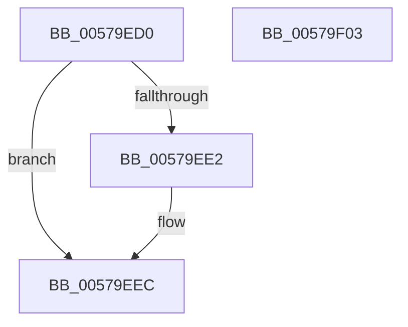

# IvtDeleteDevice

- RVA: `0x00579ED0`–`0x00579F04` (길이 `52` bytes)
- VA: `0x0000000140579ED0`
- 실행 섹션: `.text`
- PDB 이름 있음: `예`; PDB Function 태그: `아니요`
- unwind 정보 RVA: `0x0005CF00`
- 디코드: `16`개 명령, `52/52` bytes 표시
- 미해석 바이트: `0` (있으면 어셈블리에 `.byte`로 보존)

> 이 문서는 커널 이미지의 기계어와 PDB 기호를 분석해 생성했습니다. 4번과 5번은 함수 원형과 자료형을 바이너리 사용 방식에서 추정한 C 해석이며 원본 소스 복구 결과는 아닙니다.

## 1. Dependencies

- 직접 호출 지점: **3**; 고유 호출 대상: **2**
- 직접 호출자로 확인된 함수: **1**
- RIP 상대 이미지 참조: **0**

### Outgoing calls
- `0x00579EE2` → [IvtFreeScalableModePasidTables](../56/IvtFreeScalableModePasidTables_function_0056F980.md) (function, `0x0056F980`)
- `0x00579EF0` → [ExtEnvFreeMemory](../56/ExtEnvFreeMemory_function_00561320.md) (function, `0x00561320`)
- `0x00579EF8` → [ExtEnvFreeMemory](../56/ExtEnvFreeMemory_function_00561320.md) (function, `0x00561320`)

### Direct callers
- [HalpIvtCreateReservedDevice](HalpIvtCreateReservedDevice_function_0057A024.md) at `0x0057A0D8`

### Static image references
- 디코드된 RIP-relative 메모리 참조가 없습니다.

## 2. Other-region calls and transfers

- 다른 실행 섹션으로 향하는 call: **0**
- 별도 외부 분기/꼬리 이동을 확인하지 못했습니다.

## 3. Assembly (complete function range)

```asm
00579ED0  40 53                           push rbx
00579ED2  48 83 EC 20                     sub rsp, 0x20
00579ED6  48 8B DA                        mov rbx, rdx
00579ED9  48 8B 52 40                     mov rdx, qword ptr [rdx + 0x40]
00579EDD  48 85 D2                        test rdx, rdx
00579EE0  74 0A                           je 0x140579eec
00579EE2  E8 99 5A FF FF                  call 0x14056f980
00579EE7  48 83 63 40 00                  and qword ptr [rbx + 0x40], 0
00579EEC  48 8B 53 38                     mov rdx, qword ptr [rbx + 0x38]
00579EF0  E8 2B 74 FE FF                  call 0x140561320
00579EF5  48 8B D3                        mov rdx, rbx
00579EF8  E8 23 74 FE FF                  call 0x140561320
00579EFD  48 83 C4 20                     add rsp, 0x20
00579F01  5B                              pop rbx
00579F02  C3                              ret
00579F03  CC                              int3
```

## 4. C-style interpretation (structured pseudocode)

```c
__int64 __fastcall IvtDeleteDevice(__int64 a1, __int64 a2)
{
    __int64 result;
    __int64 v_rsp;

    v_rsp = (v_rsp) - (32);
    if (*(unsigned __int64 *)(a2 + 64) != 0) {
        result = IvtFreeScalableModePasidTables(a1, *(unsigned __int64 *)(a2 + 64), a3, a4);
    }
    result = ExtEnvFreeMemory(a1, *(unsigned __int64 *)(a2 + 56), a3, a4);
    result = ExtEnvFreeMemory(a1, a2, a3, a4);
    v_rsp = (v_rsp) + (32);
    return result;
}
```

## 5. (Beta) C Style

```c
int64_t IvtDeleteDevice(int64_t Arg1, void *Arg2)
{
    uint8_t *arg2 = (uint8_t *)Arg2;

    int64_t result;
    int64_t local_rsp;

    local_rsp = (local_rsp) - (32);
    if (*(uint64_t *)(arg2 + 0x40) != 0) {
        result = IvtFreeScalableModePasidTables(Arg1, *(uint64_t *)(arg2 + 0x40), a3, a4);
    }
    result = ExtEnvFreeMemory(Arg1, *(uint64_t *)(arg2 + 0x38), a3, a4);
    result = ExtEnvFreeMemory(Arg1, Arg2, a3, a4);
    local_rsp = (local_rsp) + (32);
    return result;
}
```

### 관측된 메모리 오프셋

구조체 형식이 확인되지 않은 접근은 인자 기준의 오프셋으로만 기록했습니다.

| 기준 인자 | 오프셋 표현 | 폭 (bit) | 접근 |
|---|---:|---:|---|
| `Arg2` | `+ 0x38` | `64` | `R` |
| `Arg2` | `+ 0x40` | `64` | `R` |
| `Arg2` | `+ 0x40` | `64` | `R/W` |

## 6. Execution-region graph

[열기: 2D/3D 그래프와 함수 탐색 컨트롤 패널](../../../control-panel.html?section=text&rva=0x00579ED0&view=graph)

- 2D 그래프는 위에서 아래로 흐르고, 3D 그래프는 빈 공간을 드래그해 회전합니다. Shift+드래그는 이동, 휠은 확대·축소, 함수 노드 선택은 대상 보고서 이동입니다.

### Static fallback


