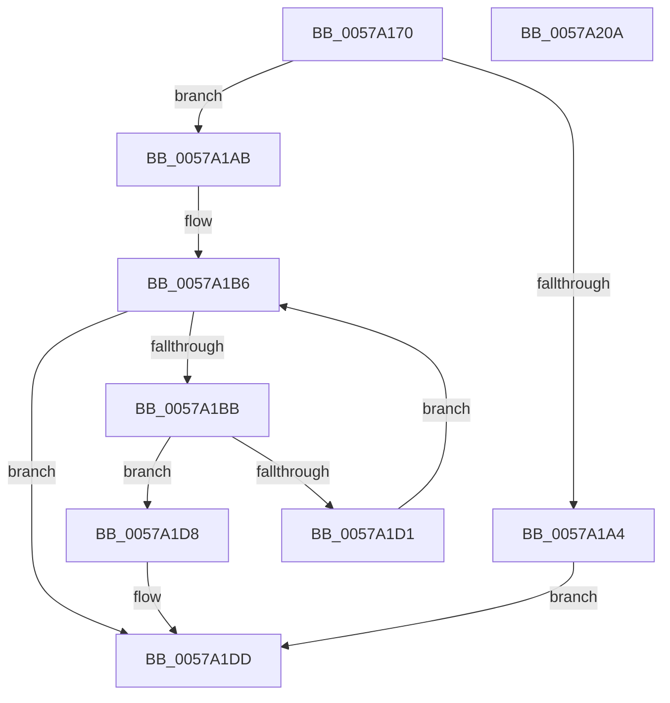

# IvtEnumerateRmrrDevices

- RVA: `0x0057A170`–`0x0057A20B` (길이 `155` bytes)
- VA: `0x000000014057A170`
- 실행 섹션: `.text`
- PDB 이름 있음: `예`; PDB Function 태그: `아니요`
- unwind 정보 RVA: `0x0005FEF8`
- 디코드: `49`개 명령, `155/155` bytes 표시
- 미해석 바이트: `0` (있으면 어셈블리에 `.byte`로 보존)

> 이 문서는 커널 이미지의 기계어와 PDB 기호를 분석해 생성했습니다. 4번과 5번은 함수 원형과 자료형을 바이너리 사용 방식에서 추정한 C 해석이며 원본 소스 복구 결과는 아닙니다.

## 1. Dependencies

- 직접 호출 지점: **1**; 고유 호출 대상: **1**
- 직접 호출자로 확인된 함수: **0**
- RIP 상대 이미지 참조: **0**

### Outgoing calls
- `0x0057A1BE` → [HalpIvtCreateReservedDevice](HalpIvtCreateReservedDevice_function_0057A024.md) (function, `0x0057A024`)

### Direct callers
- 이 함수 시작 RVA로 연결되는 직접 call은 확인되지 않았습니다. 간접 호출은 완전히 역산할 수 없습니다.

### Static image references
- 디코드된 RIP-relative 메모리 참조가 없습니다.

## 2. Other-region calls and transfers

- 다른 실행 섹션으로 향하는 call: **0**
- 별도 외부 분기/꼬리 이동을 확인하지 못했습니다.

## 3. Assembly (complete function range)

```asm
0057A170  48 8B C4                        mov rax, rsp
0057A173  48 89 58 08                     mov qword ptr [rax + 8], rbx
0057A177  48 89 68 10                     mov qword ptr [rax + 0x10], rbp
0057A17B  48 89 70 18                     mov qword ptr [rax + 0x18], rsi
0057A17F  48 89 78 20                     mov qword ptr [rax + 0x20], rdi
0057A183  41 54                           push r12
0057A185  41 56                           push r14
0057A187  41 57                           push r15
0057A189  48 83 EC 20                     sub rsp, 0x20
0057A18D  4C 8B B1 58 01 00 00            mov r14, qword ptr [rcx + 0x158]
0057A194  4D 8B E0                        mov r12, r8
0057A197  4C 8B FA                        mov r15, rdx
0057A19A  48 8B E9                        mov rbp, rcx
0057A19D  41 8B 06                        mov eax, dword ptr [r14]
0057A1A0  39 02                           cmp dword ptr [rdx], eax
0057A1A2  73 07                           jae 0x14057a1ab
0057A1A4  BB 23 00 00 C0                  mov ebx, 0xc0000023
0057A1A9  EB 32                           jmp 0x14057a1dd
0057A1AB  33 DB                           xor ebx, ebx
0057A1AD  49 83 C6 08                     add r14, 8
0057A1B1  8B F3                           mov esi, ebx
0057A1B3  49 8B 3E                        mov rdi, qword ptr [r14]
0057A1B6  49 3B FE                        cmp rdi, r14
0057A1B9  74 22                           je 0x14057a1dd
0057A1BB  48 8B D7                        mov rdx, rdi
0057A1BE  E8 61 FE FF FF                  call 0x14057a024
0057A1C3  48 8B C8                        mov rcx, rax
0057A1C6  8B C6                           mov eax, esi
0057A1C8  49 89 0C C4                     mov qword ptr [r12 + rax*8], rcx
0057A1CC  48 85 C9                        test rcx, rcx
0057A1CF  74 07                           je 0x14057a1d8
0057A1D1  48 8B 3F                        mov rdi, qword ptr [rdi]
0057A1D4  FF C6                           inc esi
0057A1D6  EB DE                           jmp 0x14057a1b6
0057A1D8  BB 9A 00 00 C0                  mov ebx, 0xc000009a
0057A1DD  48 8B 8D 58 01 00 00            mov rcx, qword ptr [rbp + 0x158]
0057A1E4  8B C3                           mov eax, ebx
0057A1E6  48 8B 5C 24 40                  mov rbx, qword ptr [rsp + 0x40]
0057A1EB  48 8B 6C 24 48                  mov rbp, qword ptr [rsp + 0x48]
0057A1F0  48 8B 74 24 50                  mov rsi, qword ptr [rsp + 0x50]
0057A1F5  8B 11                           mov edx, dword ptr [rcx]
0057A1F7  48 8B 7C 24 58                  mov rdi, qword ptr [rsp + 0x58]
0057A1FC  41 89 17                        mov dword ptr [r15], edx
0057A1FF  48 83 C4 20                     add rsp, 0x20
0057A203  41 5F                           pop r15
0057A205  41 5E                           pop r14
0057A207  41 5C                           pop r12
0057A209  C3                              ret
0057A20A  CC                              int3
```

## 4. C-style interpretation (structured pseudocode)

```c
__int64 __fastcall IvtEnumerateRmrrDevices(__int64 a1, __int64 a2, __int64 a3)
{
    __int64 result;
    __int64 v_r14;
    __int64 v_rbx;
    __int64 v_rsi;
    __int64 v_rsp;
    unsigned __int64 v_stack_p10;
    unsigned __int64 v_stack_p18;
    unsigned __int64 v_stack_p20;
    unsigned __int64 v_stack_p8;

    *(unsigned __int64 *)(v_rsp + 8) = v_rbx;
    *(unsigned __int64 *)(v_rsp + 16) = v_rbp;
    *(unsigned __int64 *)(v_rsp + 24) = v_rsi;
    *(unsigned __int64 *)(v_rsp + 32) = v_rdi;
    v_rsp = (v_rsp) - (32);
    if ((*(unsigned int *)(a2)) >= ((unsigned int)((unsigned int)(*(unsigned int *)(*(unsigned __int64 *)(a1 + 344)))))) goto loc_0057A1AB;
    goto loc_0057A1DD;
loc_0057A1AB:
    v_rbx = 0;
    v_r14 = (*(unsigned __int64 *)(a1 + 344)) + (8);
loc_0057A1B6:
    if ((*(unsigned __int64 *)(v_r14)) == v_r14) goto loc_0057A1DD;
    result = HalpIvtCreateReservedDevice(a1, *(unsigned __int64 *)(v_r14), a3, a4);
    *(unsigned __int64 *)(a3 + 0 * 8) = result;
    if (result == 0) goto loc_0057A1D8;
    v_rsi = (unsigned int)((0) + 1);
    goto loc_0057A1B6;
loc_0057A1D8:
loc_0057A1DD:
    *(unsigned int *)(a2) = (unsigned int)((unsigned int)(*(unsigned int *)(*(unsigned __int64 *)(a1 + 344))));
    v_rsp = (v_rsp) + (32);
    return (unsigned int)((unsigned int)((unsigned int)(0xC000009AULL)));
}
```

## 5. (Beta) C Style

```c
int64_t IvtEnumerateRmrrDevices(void *Arg1, void *Arg2, void *Arg3)
{
    uint8_t *arg1 = (uint8_t *)Arg1;
    uint8_t *arg2 = (uint8_t *)Arg2;
    uint8_t *arg3 = (uint8_t *)Arg3;

    int64_t result;
    int64_t local_r14;
    int64_t local_rbx;
    int64_t local_rsi;
    int64_t local_rsp;
    uint64_t v_stack_p10;
    uint64_t v_stack_p18;
    uint64_t v_stack_p20;
    uint64_t v_stack_p8;

    *(uint64_t *)(local_rsp + 0x8) = local_rbx;
    *(uint64_t *)(local_rsp + 0x10) = local_rbp;
    *(uint64_t *)(local_rsp + 0x18) = local_rsi;
    *(uint64_t *)(local_rsp + 0x20) = local_rdi;
    local_rsp = (local_rsp) - (32);
    if ((*(uint32_t *)(arg2)) >= ((uint32_t)((uint32_t)(*(uint32_t *)(*(uint64_t *)(arg1 + 0x158)))))) goto loc_0057A1AB;
    goto loc_0057A1DD;
loc_0057A1AB:
    local_rbx = 0;
    local_r14 = (*(uint64_t *)(arg1 + 0x158)) + (8);
loc_0057A1B6:
    if ((*(uint64_t *)(local_r14)) == local_r14) goto loc_0057A1DD;
    result = HalpIvtCreateReservedDevice(Arg1, *(uint64_t *)(local_r14), Arg3, a4);
    *(uint64_t *)(arg3 + 0x0 * 8) = result;
    if (result == 0) goto loc_0057A1D8;
    local_rsi = (uint32_t)((0) + 1);
    goto loc_0057A1B6;
loc_0057A1D8:
loc_0057A1DD:
    *(uint32_t *)(arg2) = (uint32_t)((uint32_t)(*(uint32_t *)(*(uint64_t *)(arg1 + 0x158))));
    local_rsp = (local_rsp) + (32);
    return (uint32_t)((uint32_t)((uint32_t)(0xC000009AULL)));
}
```

### 관측된 메모리 오프셋

구조체 형식이 확인되지 않은 접근은 인자 기준의 오프셋으로만 기록했습니다.

| 기준 인자 | 오프셋 표현 | 폭 (bit) | 접근 |
|---|---:|---:|---|
| `Arg1` | `+ 0x158` | `64` | `R` |
| `Arg2` | `+ 0x0` | `32` | `R` |
| `Arg2` | `+ 0x0` | `32` | `W` |
| `Arg3` | `+ 0x0 + rax*8` | `64` | `W` |

## 6. Execution-region graph

[열기: 2D/3D 그래프와 함수 탐색 컨트롤 패널](../../../control-panel.html?section=text&rva=0x0057A170&view=graph)

- 2D 그래프는 위에서 아래로 흐르고, 3D 그래프는 빈 공간을 드래그해 회전합니다. Shift+드래그는 이동, 휠은 확대·축소, 함수 노드 선택은 대상 보고서 이동입니다.

### Static fallback


