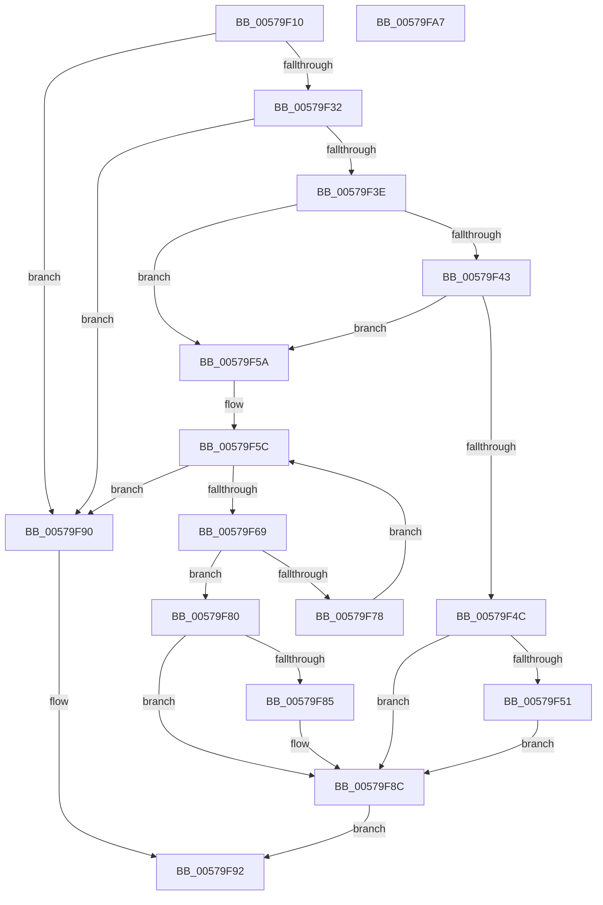

# IvtFindDevice

- RVA: `0x00579F10`–`0x00579FA8` (길이 `152` bytes)
- VA: `0x0000000140579F10`
- 실행 섹션: `.text`
- PDB 이름 있음: `예`; PDB Function 태그: `아니요`
- unwind 정보 RVA: `0x0005C954`
- 디코드: `49`개 명령, `152/152` bytes 표시
- 미해석 바이트: `0` (있으면 어셈블리에 `.byte`로 보존)

> 이 문서는 커널 이미지의 기계어와 PDB 기호를 분석해 생성했습니다. 4번과 5번은 함수 원형과 자료형을 바이너리 사용 방식에서 추정한 C 해석이며 원본 소스 복구 결과는 아닙니다.

## 1. Dependencies

- 직접 호출 지점: **2**; 고유 호출 대상: **2**
- 직접 호출자로 확인된 함수: **0**
- RIP 상대 이미지 참조: **0**

### Outgoing calls
- `0x00579F5C` → [IvtpGetNextInternalDeviceScope](../4F/IvtpGetNextInternalDeviceScope_function_004F993C.md) (function, `0x004F993C`)
- `0x00579F6F` → [HalpIvtCheckIdPathMatch](../4F/HalpIvtCheckIdPathMatch_function_004FAF2C.md) (function, `0x004FAF2C`)

### Direct callers
- 이 함수 시작 RVA로 연결되는 직접 call은 확인되지 않았습니다. 간접 호출은 완전히 역산할 수 없습니다.

### Static image references
- 디코드된 RIP-relative 메모리 참조가 없습니다.

## 2. Other-region calls and transfers

- 다른 실행 섹션으로 향하는 call: **0**
- 별도 외부 분기/꼬리 이동을 확인하지 못했습니다.

## 3. Assembly (complete function range)

```asm
00579F10  48 89 5C 24 08                  mov qword ptr [rsp + 8], rbx
00579F15  48 89 6C 24 10                  mov qword ptr [rsp + 0x10], rbp
00579F1A  48 89 74 24 18                  mov qword ptr [rsp + 0x18], rsi
00579F1F  57                              push rdi
00579F20  48 83 EC 20                     sub rsp, 0x20
00579F24  83 3A 01                        cmp dword ptr [rdx], 1
00579F27  49 8B D9                        mov rbx, r9
00579F2A  48 8B FA                        mov rdi, rdx
00579F2D  48 8B F1                        mov rsi, rcx
00579F30  75 5E                           jne 0x140579f90
00579F32  0F B7 42 08                     movzx eax, word ptr [rdx + 8]
00579F36  39 81 FC 00 00 00               cmp dword ptr [rcx + 0xfc], eax
00579F3C  75 52                           jne 0x140579f90
00579F3E  45 84 C0                        test r8b, r8b
00579F41  74 17                           je 0x140579f5a
00579F43  80 B9 0C 01 00 00 00            cmp byte ptr [rcx + 0x10c], 0
00579F4A  74 0E                           je 0x140579f5a
00579F4C  48 85 DB                        test rbx, rbx
00579F4F  74 3B                           je 0x140579f8c
00579F51  0F B7 42 0C                     movzx eax, word ptr [rdx + 0xc]
00579F55  49 89 01                        mov qword ptr [r9], rax
00579F58  EB 32                           jmp 0x140579f8c
00579F5A  33 D2                           xor edx, edx
00579F5C  E8 DB F9 F7 FF                  call 0x1404f993c
00579F61  48 8B E8                        mov rbp, rax
00579F64  48 85 C0                        test rax, rax
00579F67  74 27                           je 0x140579f90
00579F69  48 8B D0                        mov rdx, rax
00579F6C  48 8B CF                        mov rcx, rdi
00579F6F  E8 B8 0F F8 FF                  call 0x1404faf2c
00579F74  84 C0                           test al, al
00579F76  75 08                           jne 0x140579f80
00579F78  48 8B D5                        mov rdx, rbp
00579F7B  48 8B CE                        mov rcx, rsi
00579F7E  EB DC                           jmp 0x140579f5c
00579F80  48 85 DB                        test rbx, rbx
00579F83  74 07                           je 0x140579f8c
00579F85  0F B7 4F 0C                     movzx ecx, word ptr [rdi + 0xc]
00579F89  48 89 0B                        mov qword ptr [rbx], rcx
00579F8C  B0 01                           mov al, 1
00579F8E  EB 02                           jmp 0x140579f92
00579F90  32 C0                           xor al, al
00579F92  48 8B 5C 24 30                  mov rbx, qword ptr [rsp + 0x30]
00579F97  48 8B 6C 24 38                  mov rbp, qword ptr [rsp + 0x38]
00579F9C  48 8B 74 24 40                  mov rsi, qword ptr [rsp + 0x40]
00579FA1  48 83 C4 20                     add rsp, 0x20
00579FA5  5F                              pop rdi
00579FA6  C3                              ret
00579FA7  CC                              int3
```

## 4. C-style interpretation (structured pseudocode)

```c
__int64 __fastcall IvtFindDevice(__int64 a1, __int64 a2, unsigned __int8 a3, __int64 a4)
{
    __int64 result;
    __int64 v_rsp;
    unsigned __int64 v_stack_p10;
    unsigned __int64 v_stack_p18;
    unsigned __int64 v_stack_p8;

    v_stack_p8 = v_rbx;
    v_stack_p10 = v_rbp;
    v_stack_p18 = v_rsi;
    v_rsp = (v_rsp) - (32);
    if ((*(unsigned int *)(a2)) != 1) goto loc_00579F90;
    if ((*(unsigned int *)(a1 + 252)) != ((unsigned int)(*(unsigned __int16 *)(a2 + 8)))) goto loc_00579F90;
    if (a3 == 0) goto loc_00579F5A;
    if ((*(unsigned __int8 *)(a1 + 268)) == 0) goto loc_00579F5A;
    if (a4 == 0) goto loc_00579F8C;
    *(unsigned __int64 *)(a4) = *(unsigned __int16 *)(a2 + 12);
    goto loc_00579F8C;
loc_00579F5A:
    a2 = 0;
loc_00579F5C:
    result = IvtpGetNextInternalDeviceScope(a1, a2, a3, a4);
    if (result == 0) goto loc_00579F90;
    result = HalpIvtCheckIdPathMatch(0, result, a3, a4);
    if ((unsigned __int8)(result) != 0) goto loc_00579F80;
    goto loc_00579F5C;
loc_00579F80:
    if (a4 != 0) {
        a1 = *(unsigned __int16 *)(a2 + 12);
        *(unsigned __int64 *)(a4) = a1;
    }
    goto loc_00579F92;
loc_00579F90:
    result = 0;
loc_00579F92:
    v_rsp = (v_rsp) + (32);
    return result;
}
```

## 5. (Beta) C Style

```c
int64_t IvtFindDevice(void *Arg1, void *Arg2, uint8_t Arg3, void *Arg4)
{
    uint8_t *arg1 = (uint8_t *)Arg1;
    uint8_t *arg2 = (uint8_t *)Arg2;
    uint8_t *arg4 = (uint8_t *)Arg4;

    int64_t result;
    int64_t local_rsp;
    uint64_t v_stack_p10;
    uint64_t v_stack_p18;
    uint64_t v_stack_p8;

    v_stack_p8 = local_rbx;
    v_stack_p10 = local_rbp;
    v_stack_p18 = local_rsi;
    local_rsp = (local_rsp) - (32);
    if ((*(uint32_t *)(arg2)) != 1) goto loc_00579F90;
    if ((*(uint32_t *)(arg1 + 0xFC)) != ((uint32_t)(*(uint16_t *)(arg2 + 0x8)))) goto loc_00579F90;
    if (Arg3 == 0) goto loc_00579F5A;
    if ((*(uint8_t *)(arg1 + 0x10C)) == 0) goto loc_00579F5A;
    if (Arg4 == NULL) goto loc_00579F8C;
    *(uint64_t *)(arg4) = *(uint16_t *)(arg2 + 0xC);
    goto loc_00579F8C;
loc_00579F5A:
    Arg2 = 0;
loc_00579F5C:
    result = IvtpGetNextInternalDeviceScope(Arg1, Arg2, Arg3, Arg4);
    if (result == 0) goto loc_00579F90;
    result = HalpIvtCheckIdPathMatch(0, result, Arg3, Arg4);
    if ((uint8_t)(result) != 0) goto loc_00579F80;
    goto loc_00579F5C;
loc_00579F80:
    if (Arg4 != NULL) {
        Arg1 = *(uint16_t *)(arg2 + 0xC);
        *(void **)(arg4) = Arg1;
    }
    goto loc_00579F92;
loc_00579F90:
    result = 0;
loc_00579F92:
    local_rsp = (local_rsp) + (32);
    return result;
}
```

### 관측된 메모리 오프셋

구조체 형식이 확인되지 않은 접근은 인자 기준의 오프셋으로만 기록했습니다.

| 기준 인자 | 오프셋 표현 | 폭 (bit) | 접근 |
|---|---:|---:|---|
| `Arg1` | `+ 0xFC` | `32` | `R` |
| `Arg1` | `+ 0x10C` | `8` | `R` |
| `Arg2` | `+ 0x0` | `32` | `R` |
| `Arg2` | `+ 0x8` | `16` | `R` |
| `Arg2` | `+ 0xC` | `16` | `R` |
| `Arg4` | `+ 0x0` | `64` | `W` |

## 6. Execution-region graph

[열기: 2D/3D 그래프와 함수 탐색 컨트롤 패널](../../../control-panel.html?section=text&rva=0x00579F10&view=graph)

- 2D 그래프는 위에서 아래로 흐르고, 3D 그래프는 빈 공간을 드래그해 회전합니다. Shift+드래그는 이동, 휠은 확대·축소, 함수 노드 선택은 대상 보고서 이동입니다.

### Static fallback


