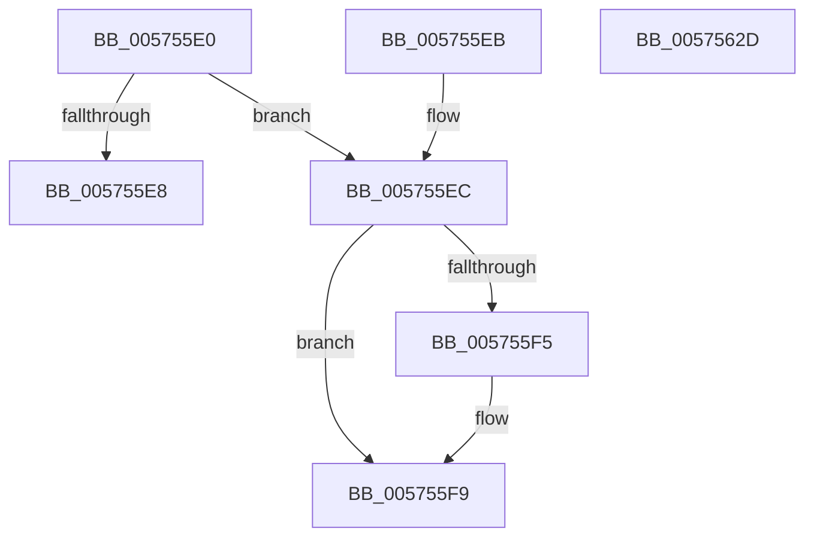

# IvtFlConfigureIntermediatePhysicalPte

- RVA: `0x005755E0`–`0x0057562E` (길이 `78` bytes)
- VA: `0x00000001405755E0`
- 실행 섹션: `.text`
- PDB 이름 있음: `예`; PDB Function 태그: `아니요`
- unwind 정보 RVA: `0x000DB714`
- 디코드: `21`개 명령, `78/78` bytes 표시
- 미해석 바이트: `0` (있으면 어셈블리에 `.byte`로 보존)

> 이 문서는 커널 이미지의 기계어와 PDB 기호를 분석해 생성했습니다. 4번과 5번은 함수 원형과 자료형을 바이너리 사용 방식에서 추정한 C 해석이며 원본 소스 복구 결과는 아닙니다.

## 1. Dependencies

- 직접 호출 지점: **0**; 고유 호출 대상: **0**
- 직접 호출자로 확인된 함수: **0**
- RIP 상대 이미지 참조: **1**

### Outgoing calls
- 직접 디코드된 call 명령이 없습니다.

### Direct callers
- 이 함수 시작 RVA로 연결되는 직접 call은 확인되지 않았습니다. 간접 호출은 완전히 역산할 수 없습니다.

### Static image references
- `0x005755EC` → RVA `0x00FC1910` (`.data`; read)

## 2. Other-region calls and transfers

- 다른 실행 섹션으로 향하는 call: **0**
- 별도 외부 분기/꼬리 이동을 확인하지 못했습니다.

## 3. Assembly (complete function range)

```asm
005755E0  48 8B 01                        mov rax, qword ptr [rcx]
005755E3  48 85 C0                        test rax, rax
005755E6  74 04                           je 0x1405755ec
005755E8  32 C0                           xor al, al
005755EA  C3                              ret
005755EB  CC                              int3
005755EC  80 3D 1D C3 A4 00 00            cmp byte ptr [rip + 0xa4c31d], 0
005755F3  75 04                           jne 0x1405755f9
005755F5  48 83 C8 60                     or rax, 0x60
005755F9  48 BA FF 0F 00 00 00 00 F0 FF   movabs rdx, 0xfff0000000000fff
00575603  48 23 C2                        and rax, rdx
00575606  48 BA 07 00 00 00 00 00 00 80   movabs rdx, 0x8000000000000007
00575610  48 0B C2                        or rax, rdx
00575613  48 BA 00 F0 FF FF FF FF 0F 00   movabs rdx, 0xffffffffff000
0057561D  4C 23 C2                        and r8, rdx
00575620  49 33 C0                        xor rax, r8
00575623  48 83 C8 01                     or rax, 1
00575627  48 89 01                        mov qword ptr [rcx], rax
0057562A  B0 01                           mov al, 1
0057562C  C3                              ret
0057562D  CC                              int3
```

## 4. C-style interpretation (structured pseudocode)

```c
__int64 __fastcall IvtFlConfigureIntermediatePhysicalPte(__int64 a1, __int64 a2, __int64 a3)
{
    __int64 result;

    if (*(unsigned __int64 *)(a1) == 0) goto loc_005755EC;
    result = 0;
    return result;
loc_005755EC:
    if ((*(unsigned __int8 *)(v_rip + 10797853)) == 0) {
        result = (result) | (96);
    }
    result = (result) & (a2);
    result = (result) | (a2);
    a3 = (a3) & (a2);
    result = (result) ^ (a3);
    result = (result) | (1);
    *(unsigned __int64 *)(a1) = result;
    return 1;
}
```

## 5. (Beta) C Style

```c
int64_t IvtFlConfigureIntermediatePhysicalPte(void *Arg1, int64_t Arg2, int64_t Arg3)
{
    uint8_t *arg1 = (uint8_t *)Arg1;

    int64_t result;

    if (*(uint64_t *)(arg1) == 0) goto loc_005755EC;
    result = 0;
    return result;
loc_005755EC:
    if ((*(uint8_t *)(v_rip + 0xA4C31D)) == 0) {
        result = (result) | (96);
    }
    result = (result) & (Arg2);
    result = (result) | (Arg2);
    Arg3 = (Arg3) & (Arg2);
    result = (result) ^ (Arg3);
    result = (result) | (1);
    *(uint64_t *)(arg1) = result;
    return 1;
}
```

### 관측된 메모리 오프셋

구조체 형식이 확인되지 않은 접근은 인자 기준의 오프셋으로만 기록했습니다.

| 기준 인자 | 오프셋 표현 | 폭 (bit) | 접근 |
|---|---:|---:|---|
| `Arg1` | `+ 0x0` | `64` | `R` |
| `Arg1` | `+ 0x0` | `64` | `W` |

## 6. Execution-region graph

[열기: 2D/3D 그래프와 함수 탐색 컨트롤 패널](../../../control-panel.html?section=text&rva=0x005755E0&view=graph)

- 2D 그래프는 위에서 아래로 흐르고, 3D 그래프는 빈 공간을 드래그해 회전합니다. Shift+드래그는 이동, 휠은 확대·축소, 함수 노드 선택은 대상 보고서 이동입니다.

### Static fallback


