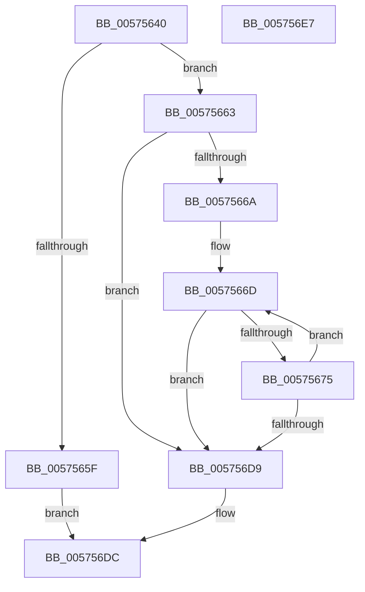

# IvtFlConfigureLeafPhysicalPfn

- RVA: `0x00575640`–`0x005756E8` (길이 `168` bytes)
- VA: `0x0000000140575640`
- 실행 섹션: `.text`
- PDB 이름 있음: `예`; PDB Function 태그: `아니요`
- unwind 정보 RVA: `0x000950EC`
- 디코드: `49`개 명령, `168/168` bytes 표시
- 미해석 바이트: `0` (있으면 어셈블리에 `.byte`로 보존)

> 이 문서는 커널 이미지의 기계어와 PDB 기호를 분석해 생성했습니다. 4번과 5번은 함수 원형과 자료형을 바이너리 사용 방식에서 추정한 C 해석이며 원본 소스 복구 결과는 아닙니다.

## 1. Dependencies

- 직접 호출 지점: **0**; 고유 호출 대상: **0**
- 직접 호출자로 확인된 함수: **0**
- RIP 상대 이미지 참조: **1**

### Outgoing calls
- 직접 디코드된 call 명령이 없습니다.

### Direct callers
- 이 함수 시작 RVA로 연결되는 직접 call은 확인되지 않았습니다. 간접 호출은 완전히 역산할 수 없습니다.

### Static image references
- `0x00575675` → RVA `0x00FC1910` (`.data`; read)

## 2. Other-region calls and transfers

- 다른 실행 섹션으로 향하는 call: **0**
- 별도 외부 분기/꼬리 이동을 확인하지 못했습니다.

## 3. Assembly (complete function range)

```asm
00575640  48 89 5C 24 08                  mov qword ptr [rsp + 8], rbx
00575645  48 89 7C 24 10                  mov qword ptr [rsp + 0x10], rdi
0057564A  41 8B D8                        mov ebx, r8d
0057564D  41 8B F9                        mov edi, r9d
00575650  83 E3 02                        and ebx, 2
00575653  4C 8B DA                        mov r11, rdx
00575656  4C 8B D1                        mov r10, rcx
00575659  41 F6 C0 01                     test r8b, 1
0057565D  75 04                           jne 0x140575663
0057565F  33 C0                           xor eax, eax
00575661  EB 79                           jmp 0x1405756dc
00575663  45 33 C9                        xor r9d, r9d
00575666  85 FF                           test edi, edi
00575668  74 6F                           je 0x1405756d9
0057566A  4C 2B D9                        sub r11, rcx
0057566D  49 8B 0A                        mov rcx, qword ptr [r10]
00575670  48 85 C9                        test rcx, rcx
00575673  75 64                           jne 0x1405756d9
00575675  38 0D 95 C2 A4 00               cmp byte ptr [rip + 0xa4c295], cl
0057567B  8D 41 60                        lea eax, [rcx + 0x60]
0057567E  48 0F 44 C8                     cmove rcx, rax
00575682  8B C3                           mov eax, ebx
00575684  F7 D8                           neg eax
00575686  48 B8 00 00 00 00 00 00 00 80   movabs rax, 0x8000000000000000
00575690  4D 1B C0                        sbb r8, r8
00575693  48 83 E1 FD                     and rcx, 0xfffffffffffffffd
00575697  41 83 E0 02                     and r8d, 2
0057569B  41 FF C1                        inc r9d
0057569E  49 83 C0 04                     add r8, 4
005756A2  4C 0B C1                        or r8, rcx
005756A5  4C 0B C0                        or r8, rax
005756A8  48 B8 FF 0F 00 00 00 00 F0 FF   movabs rax, 0xfff0000000000fff
005756B2  4D 89 02                        mov qword ptr [r10], r8
005756B5  4B 8B 0C 13                     mov rcx, qword ptr [r11 + r10]
005756B9  48 C1 E1 0C                     shl rcx, 0xc
005756BD  48 8B D1                        mov rdx, rcx
005756C0  49 33 D0                        xor rdx, r8
005756C3  48 23 D0                        and rdx, rax
005756C6  48 33 D1                        xor rdx, rcx
005756C9  48 83 CA 01                     or rdx, 1
005756CD  49 89 12                        mov qword ptr [r10], rdx
005756D0  49 83 C2 08                     add r10, 8
005756D4  44 3B CF                        cmp r9d, edi
005756D7  72 94                           jb 0x14057566d
005756D9  41 8B C1                        mov eax, r9d
005756DC  48 8B 5C 24 08                  mov rbx, qword ptr [rsp + 8]
005756E1  48 8B 7C 24 10                  mov rdi, qword ptr [rsp + 0x10]
005756E6  C3                              ret
005756E7  CC                              int3
```

## 4. C-style interpretation (structured pseudocode)

```c
__int64 __fastcall IvtFlConfigureLeafPhysicalPfn(__int64 a1, __int64 a2, __int64 a3, int a4)
{
    __int64 result;
    __int64 v_r10;
    __int64 v_r11;
    __int64 v_rbx;
    unsigned __int64 v_stack_p10;
    unsigned __int64 v_stack_p8;

    v_stack_p8 = v_rbx;
    v_stack_p10 = v_rdi;
    v_rbx = (unsigned int)(((unsigned int)((unsigned int)(a3))) & (2));
    if ((((unsigned __int8)(a3)) & (1)) != 0) goto loc_00575663;
    result = 0;
    goto loc_005756DC;
loc_00575663:
    a4 = 0;
    if ((unsigned int)((unsigned int)(a4)) == 0) goto loc_005756D9;
    v_r11 = (a2) - (a1);
loc_0057566D:
    if (*(unsigned __int64 *)(a1) != 0) goto loc_005756D9;
    a1 = *(unsigned __int64 *)(a1);
    if ((*(unsigned __int8 *)(v_rip + 10797717)) == ((unsigned __int8)(*(unsigned __int64 *)(a1)))) { a1 = *(unsigned __int64 *)(a1) + 96; }
    result = (unsigned int)(-((unsigned int)((unsigned int)(v_rbx))));
    a1 = (a1) & (-3);
    a3 = (unsigned int)((a3) & (2));
    a4 = (unsigned int)((a4) + 1);
    a3 = (a3) + (4);
    a3 = (a3) | (a1);
    a3 = (a3) | (result);
    *(unsigned __int64 *)(a1) = a3;
    a1 = (*(unsigned __int64 *)(v_r11 + a1 * 1)) << (12);
    a2 = (a1) ^ (a3);
    a2 = (a2) & (result);
    a2 = (a2) ^ (a1);
    a2 = (a2) | (1);
    *(unsigned __int64 *)(a1) = a2;
    v_r10 = (a1) + (8);
    if (a4 < ((unsigned int)((unsigned int)(a4)))) goto loc_0057566D;
loc_005756D9:
loc_005756DC:
    return (unsigned int)(a4);
}
```

## 5. (Beta) C Style

```c
int64_t IvtFlConfigureLeafPhysicalPfn(void *Arg1, void *Arg2, int64_t Arg3, int32_t Arg4)
{
    uint8_t *arg1 = (uint8_t *)Arg1;
    uint8_t *arg2 = (uint8_t *)Arg2;

    int64_t result;
    int64_t local_r10;
    int64_t local_r11;
    int64_t local_rbx;
    uint64_t v_stack_p10;
    uint64_t v_stack_p8;

    v_stack_p8 = local_rbx;
    v_stack_p10 = local_rdi;
    local_rbx = (uint32_t)(((uint32_t)((uint32_t)(Arg3))) & (2));
    if ((((uint8_t)(Arg3)) & (1)) != 0) goto loc_00575663;
    result = 0;
    goto loc_005756DC;
loc_00575663:
    Arg4 = 0;
    if ((uint32_t)((uint32_t)(Arg4)) == 0) goto loc_005756D9;
    local_r11 = (Arg2) - (Arg1);
loc_0057566D:
    if (*(uint64_t *)(arg1) != 0) goto loc_005756D9;
    Arg1 = *(uint64_t *)(arg1);
    if ((*(uint8_t *)(v_rip + 0xA4C295)) == ((uint8_t)(*(uint64_t *)(arg1)))) { Arg1 = *(uint64_t *)(arg1) + 96; }
    result = (uint32_t)(-((uint32_t)((uint32_t)(local_rbx))));
    Arg1 = (Arg1) & (-3);
    Arg3 = (uint32_t)((Arg3) & (2));
    Arg4 = (uint32_t)((Arg4) + 1);
    Arg3 = (Arg3) + (4);
    Arg3 = (Arg3) | (Arg1);
    Arg3 = (Arg3) | (result);
    *(uint64_t *)(arg1) = Arg3;
    Arg1 = (*(uint64_t *)(local_r11 + arg1 * 1)) << (12);
    Arg2 = (Arg1) ^ (Arg3);
    Arg2 = (Arg2) & (result);
    Arg2 = (Arg2) ^ (Arg1);
    Arg2 = (Arg2) | (1);
    *(void **)(arg1) = Arg2;
    local_r10 = (Arg1) + (8);
    if (Arg4 < ((uint32_t)((uint32_t)(Arg4)))) goto loc_0057566D;
loc_005756D9:
loc_005756DC:
    return (uint32_t)(Arg4);
}
```

### 관측된 메모리 오프셋

구조체 형식이 확인되지 않은 접근은 인자 기준의 오프셋으로만 기록했습니다.

| 기준 인자 | 오프셋 표현 | 폭 (bit) | 접근 |
|---|---:|---:|---|
| `Arg1` | `+ 0x0` | `64` | `R` |
| `Arg1` | `+ 0x0` | `64` | `W` |
| `Arg2` | `+ 0x0 + r10*1` | `64` | `R` |

## 6. Execution-region graph

[열기: 2D/3D 그래프와 함수 탐색 컨트롤 패널](../../../control-panel.html?section=text&rva=0x00575640&view=graph)

- 2D 그래프는 위에서 아래로 흐르고, 3D 그래프는 빈 공간을 드래그해 회전합니다. Shift+드래그는 이동, 휠은 확대·축소, 함수 노드 선택은 대상 보고서 이동입니다.

### Static fallback


