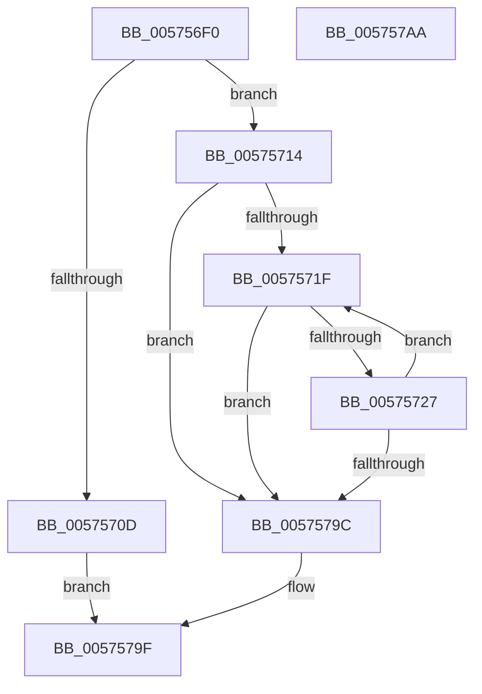

# IvtFlConfigureLeafPhysicalPte

- RVA: `0x005756F0`–`0x005757AB` (길이 `187` bytes)
- VA: `0x00000001405756F0`
- 실행 섹션: `.text`
- PDB 이름 있음: `예`; PDB Function 태그: `아니요`
- unwind 정보 RVA: `0x000950EC`
- 디코드: `49`개 명령, `187/187` bytes 표시
- 미해석 바이트: `0` (있으면 어셈블리에 `.byte`로 보존)

> 이 문서는 커널 이미지의 기계어와 PDB 기호를 분석해 생성했습니다. 4번과 5번은 함수 원형과 자료형을 바이너리 사용 방식에서 추정한 C 해석이며 원본 소스 복구 결과는 아닙니다.

## 1. Dependencies

- 직접 호출 지점: **0**; 고유 호출 대상: **0**
- 직접 호출자로 확인된 함수: **0**
- RIP 상대 이미지 참조: **1**

### Outgoing calls
- 직접 디코드된 call 명령이 없습니다.

### Direct callers
- 이 함수 시작 RVA로 연결되는 직접 call은 확인되지 않았습니다. 간접 호출은 완전히 역산할 수 없습니다.

### Static image references
- `0x00575727` → RVA `0x00FC1910` (`.data`; read)

## 2. Other-region calls and transfers

- 다른 실행 섹션으로 향하는 call: **0**
- 별도 외부 분기/꼬리 이동을 확인하지 못했습니다.

## 3. Assembly (complete function range)

```asm
005756F0  48 89 5C 24 08                  mov qword ptr [rsp + 8], rbx
005756F5  48 89 7C 24 10                  mov qword ptr [rsp + 0x10], rdi
005756FA  45 8B D8                        mov r11d, r8d
005756FD  41 8B F9                        mov edi, r9d
00575700  41 83 E3 02                     and r11d, 2
00575704  48 8B D9                        mov rbx, rcx
00575707  41 F6 C0 01                     test r8b, 1
0057570B  75 07                           jne 0x140575714
0057570D  33 C0                           xor eax, eax
0057570F  E9 8B 00 00 00                  jmp 0x14057579f
00575714  48 C1 EA 0C                     shr rdx, 0xc
00575718  45 33 D2                        xor r10d, r10d
0057571B  85 FF                           test edi, edi
0057571D  74 7D                           je 0x14057579c
0057571F  4C 8B 0B                        mov r9, qword ptr [rbx]
00575722  4D 85 C9                        test r9, r9
00575725  75 75                           jne 0x14057579c
00575727  44 38 0D E2 C1 A4 00            cmp byte ptr [rip + 0xa4c1e2], r9b
0057572E  41 8D 41 60                     lea eax, [r9 + 0x60]
00575732  4C 8B C2                        mov r8, rdx
00575735  4C 0F 44 C8                     cmove r9, rax
00575739  49 C1 E0 0C                     shl r8, 0xc
0057573D  41 8B C3                        mov eax, r11d
00575740  F7 D8                           neg eax
00575742  48 B8 FF 0F 00 00 00 00 F0 FF   movabs rax, 0xfff0000000000fff
0057574C  48 1B C9                        sbb rcx, rcx
0057574F  41 FF C2                        inc r10d
00575752  83 E1 02                        and ecx, 2
00575755  48 FF C2                        inc rdx
00575758  48 83 C1 04                     add rcx, 4
0057575C  48 23 C8                        and rcx, rax
0057575F  48 B8 FD 0F 00 00 00 00 F0 FF   movabs rax, 0xfff0000000000ffd
00575769  4C 23 C8                        and r9, rax
0057576C  48 B8 01 00 00 00 00 00 00 80   movabs rax, 0x8000000000000001
00575776  49 0B C9                        or rcx, r9
00575779  48 0B C8                        or rcx, rax
0057577C  48 B8 00 F0 FF FF FF FF 0F 00   movabs rax, 0xffffffffff000
00575786  4C 23 C0                        and r8, rax
00575789  49 33 C8                        xor rcx, r8
0057578C  48 83 C9 01                     or rcx, 1
00575790  48 89 0B                        mov qword ptr [rbx], rcx
00575793  48 83 C3 08                     add rbx, 8
00575797  44 3B D7                        cmp r10d, edi
0057579A  72 83                           jb 0x14057571f
0057579C  41 8B C2                        mov eax, r10d
0057579F  48 8B 5C 24 08                  mov rbx, qword ptr [rsp + 8]
005757A4  48 8B 7C 24 10                  mov rdi, qword ptr [rsp + 0x10]
005757A9  C3                              ret
005757AA  CC                              int3
```

## 4. C-style interpretation (structured pseudocode)

```c
__int64 __fastcall IvtFlConfigureLeafPhysicalPte(__int64 a1, __int64 a2, int a3, int a4)
{
    __int64 result;
    __int64 v_r10;
    __int64 v_r11;
    __int64 v_rbx;
    unsigned __int64 v_stack_p10;
    unsigned __int64 v_stack_p8;

    v_stack_p8 = v_rbx;
    v_stack_p10 = v_rdi;
    v_r11 = (unsigned int)(((unsigned int)(a3)) & (2));
    if ((((unsigned __int8)(a3)) & (1)) != 0) goto loc_00575714;
    result = 0;
    goto loc_0057579F;
loc_00575714:
    a2 = (a2) >> (12);
    v_r10 = 0;
    if ((unsigned int)((unsigned int)(a4)) == 0) goto loc_0057579C;
loc_0057571F:
    if (*(unsigned __int64 *)(a1) != 0) goto loc_0057579C;
    a4 = *(unsigned __int64 *)(a1);
    if ((*(unsigned __int8 *)(v_rip + 10797538)) == ((unsigned __int8)(*(unsigned __int64 *)(a1)))) { a4 = *(unsigned __int64 *)(a1) + 96; }
    a3 = (a2) << (12);
    result = (unsigned int)(-((unsigned int)((unsigned int)(v_r11))));
    v_r10 = (unsigned int)((v_r10) + 1);
    a1 = (unsigned int)((a1) & (2));
    a2 = (a2) + 1;
    a1 = (a1) + (4);
    a1 = (a1) & (result);
    a4 = (a4) & (result);
    a1 = (a1) | (a4);
    a1 = (a1) | (result);
    a3 = (a3) & (result);
    a1 = (a1) ^ (a3);
    a1 = (a1) | (1);
    *(unsigned __int64 *)(a1) = a1;
    v_rbx = (a1) + (8);
    if (((unsigned int)(v_r10)) < ((unsigned int)((unsigned int)(a4)))) goto loc_0057571F;
loc_0057579C:
loc_0057579F:
    return (unsigned int)((unsigned int)(v_r10));
}
```

## 5. (Beta) C Style

```c
int64_t IvtFlConfigureLeafPhysicalPte(void *Arg1, int64_t Arg2, int32_t Arg3, int32_t Arg4)
{
    uint8_t *arg1 = (uint8_t *)Arg1;

    int64_t result;
    int64_t local_r10;
    int64_t local_r11;
    int64_t local_rbx;
    uint64_t v_stack_p10;
    uint64_t v_stack_p8;

    v_stack_p8 = local_rbx;
    v_stack_p10 = local_rdi;
    local_r11 = (uint32_t)(((uint32_t)(Arg3)) & (2));
    if ((((uint8_t)(Arg3)) & (1)) != 0) goto loc_00575714;
    result = 0;
    goto loc_0057579F;
loc_00575714:
    Arg2 = (Arg2) >> (12);
    local_r10 = 0;
    if ((uint32_t)((uint32_t)(Arg4)) == 0) goto loc_0057579C;
loc_0057571F:
    if (*(uint64_t *)(arg1) != 0) goto loc_0057579C;
    Arg4 = *(uint64_t *)(arg1);
    if ((*(uint8_t *)(v_rip + 0xA4C1E2)) == ((uint8_t)(*(uint64_t *)(arg1)))) { Arg4 = *(uint64_t *)(arg1) + 96; }
    Arg3 = (Arg2) << (12);
    result = (uint32_t)(-((uint32_t)((uint32_t)(local_r11))));
    local_r10 = (uint32_t)((local_r10) + 1);
    Arg1 = (uint32_t)((Arg1) & (2));
    Arg2 = (Arg2) + 1;
    Arg1 = (Arg1) + (4);
    Arg1 = (Arg1) & (result);
    Arg4 = (Arg4) & (result);
    Arg1 = (Arg1) | (Arg4);
    Arg1 = (Arg1) | (result);
    Arg3 = (Arg3) & (result);
    Arg1 = (Arg1) ^ (Arg3);
    Arg1 = (Arg1) | (1);
    *(void **)(arg1) = Arg1;
    local_rbx = (Arg1) + (8);
    if (((uint32_t)(local_r10)) < ((uint32_t)((uint32_t)(Arg4)))) goto loc_0057571F;
loc_0057579C:
loc_0057579F:
    return (uint32_t)((uint32_t)(local_r10));
}
```

### 관측된 메모리 오프셋

구조체 형식이 확인되지 않은 접근은 인자 기준의 오프셋으로만 기록했습니다.

| 기준 인자 | 오프셋 표현 | 폭 (bit) | 접근 |
|---|---:|---:|---|
| `Arg1` | `+ 0x0` | `64` | `R` |
| `Arg1` | `+ 0x0` | `64` | `W` |

## 6. Execution-region graph

[열기: 2D/3D 그래프와 함수 탐색 컨트롤 패널](../../../control-panel.html?section=text&rva=0x005756F0&view=graph)

- 2D 그래프는 위에서 아래로 흐르고, 3D 그래프는 빈 공간을 드래그해 회전합니다. Shift+드래그는 이동, 휠은 확대·축소, 함수 노드 선택은 대상 보고서 이동입니다.

### Static fallback


