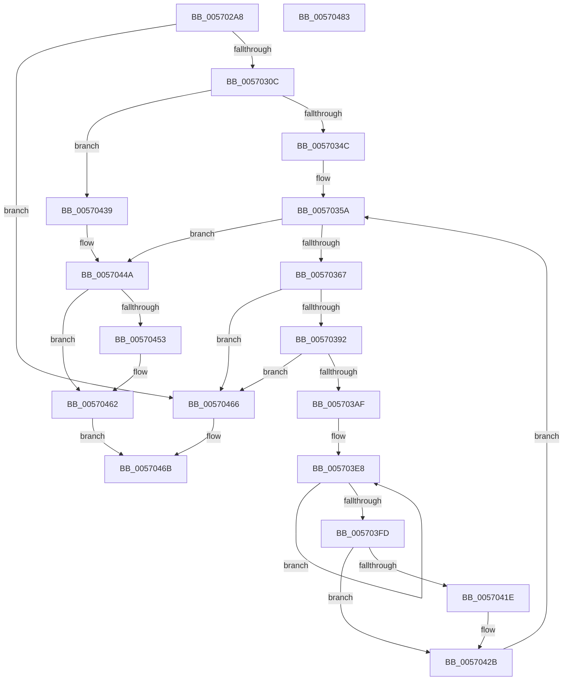

# IvtInitializeIdentityMappings

- RVA: `0x005702A8`–`0x00570484` (길이 `476` bytes)
- VA: `0x00000001405702A8`
- 실행 섹션: `.text`
- PDB 이름 있음: `예`; PDB Function 태그: `아니요`
- unwind 정보 RVA: `0x000C53AC`
- 디코드: `118`개 명령, `476/476` bytes 표시
- 미해석 바이트: `0` (있으면 어셈블리에 `.byte`로 보존)

> 이 문서는 커널 이미지의 기계어와 PDB 기호를 분석해 생성했습니다. 4번과 5번은 함수 원형과 자료형을 바이너리 사용 방식에서 추정한 C 해석이며 원본 소스 복구 결과는 아닙니다.

## 1. Dependencies

- 직접 호출 지점: **10**; 고유 호출 대상: **5**
- 직접 호출자로 확인된 함수: **1**
- RIP 상대 이미지 참조: **1**

### Outgoing calls
- `0x005702F7` → [guard_dispatch_icall](../6B/guard_dispatch_icall_function_006BAAD0.md) (function, `0x006BAAD0`)
- `0x0057031E` → [HalMapIoSpace](../4F/HalMapIoSpace_function_004FCD40.md) (function, `0x004FCD40`)
- `0x00570332` → [memset](../6C/memset_function_006C6C40.md) (function, `0x006C6C40`)
- `0x00570381` → [guard_dispatch_icall](../6B/guard_dispatch_icall_function_006BAAD0.md) (function, `0x006BAAD0`)
- `0x0057039E` → [HalMapIoSpace](../4F/HalMapIoSpace_function_004FCD40.md) (function, `0x004FCD40`)
- `0x005703BA` → [memset](../6C/memset_function_006C6C40.md) (function, `0x006C6C40`)
- `0x005703D6` → [IvtInitializeLargePagePte](IvtInitializeLargePagePte_function_0057048C.md) (function, `0x0057048C`)
- `0x00570426` → [KeInvalidateRangeAllCachesNoIpi](../30/KeInvalidateRangeAllCachesNoIpi_function_00308C50.md) (function, `0x00308C50`)
- `0x00570445` → [IvtInitializeLargePagePte](IvtInitializeLargePagePte_function_0057048C.md) (function, `0x0057048C`)
- `0x0057045D` → [KeInvalidateRangeAllCachesNoIpi](../30/KeInvalidateRangeAllCachesNoIpi_function_00308C50.md) (function, `0x00308C50`)

### Direct callers
- [IvtInitializeIommu](../../pagelk/B6/IvtInitializeIommu_function_00B61FE0.md) at `0x00B62259`

### Static image references
- `0x005702E4` → RVA `0x00F8F7D0` (`.data`; read)

## 2. Other-region calls and transfers

- 다른 실행 섹션으로 향하는 call: **0**
- 별도 외부 분기/꼬리 이동을 확인하지 못했습니다.

## 3. Assembly (complete function range)

```asm
005702A8  48 89 5C 24 10                  mov qword ptr [rsp + 0x10], rbx
005702AD  48 89 6C 24 18                  mov qword ptr [rsp + 0x18], rbp
005702B2  56                              push rsi
005702B3  41 54                           push r12
005702B5  41 55                           push r13
005702B7  41 56                           push r14
005702B9  41 57                           push r15
005702BB  48 83 EC 20                     sub rsp, 0x20
005702BF  48 8B 81 D8 00 00 00            mov rax, qword ptr [rcx + 0xd8]
005702C6  48 8B F1                        mov rsi, rcx
005702C9  8B 99 F8 00 00 00               mov ebx, dword ptr [rcx + 0xf8]
005702CF  BA 01 00 00 00                  mov edx, 1
005702D4  48 B9 00 00 00 00 08 00 00 00   movabs rcx, 0x800000000
005702DE  48 23 C1                        and rax, rcx
005702E1  48 F7 D8                        neg rax
005702E4  48 8B 05 E5 F4 A1 00            mov rax, qword ptr [rip + 0xa1f4e5]
005702EB  1B ED                           sbb ebp, ebp
005702ED  48 83 C9 FF                     or rcx, 0xffffffffffffffff
005702F1  83 E5 09                        and ebp, 9
005702F4  83 C5 15                        add ebp, 0x15
005702F7  E8 D4 A7 14 00                  call 0x1406baad0
005702FC  48 89 86 48 01 00 00            mov qword ptr [rsi + 0x148], rax
00570303  48 85 C0                        test rax, rax
00570306  0F 84 5A 01 00 00               je 0x140570466
0057030C  41 BC 00 10 00 00               mov r12d, 0x1000
00570312  41 B8 01 00 00 00               mov r8d, 1
00570318  41 8B D4                        mov edx, r12d
0057031B  48 8B C8                        mov rcx, rax
0057031E  E8 1D CA F8 FF                  call 0x1404fcd40
00570323  45 8B C4                        mov r8d, r12d
00570326  48 89 86 50 01 00 00            mov qword ptr [rsi + 0x150], rax
0057032D  33 D2                           xor edx, edx
0057032F  48 8B C8                        mov rcx, rax
00570332  E8 09 69 15 00                  call 0x1406c6c40
00570337  F7 DB                           neg ebx
00570339  1B C0                           sbb eax, eax
0057033B  83 E0 09                        and eax, 9
0057033E  83 C0 27                        add eax, 0x27
00570341  2B C5                           sub eax, ebp
00570343  83 F8 09                        cmp eax, 9
00570346  0F 86 ED 00 00 00               jbe 0x140570439
0057034C  45 33 F6                        xor r14d, r14d
0057034F  8B C5                           mov eax, ebp
00570351  48 83 C0 09                     add rax, 9
00570355  48 89 44 24 50                  mov qword ptr [rsp + 0x50], rax
0057035A  41 81 FE 00 02 00 00            cmp r14d, 0x200
00570361  0F 83 E3 00 00 00               jae 0x14057044a
00570367  48 8B 05 62 F4 A1 00            mov rax, qword ptr [rip + 0xa1f462]
0057036E  BA 01 00 00 00                  mov edx, 1
00570373  4C 8B AE 50 01 00 00            mov r13, qword ptr [rsi + 0x150]
0057037A  48 83 C9 FF                     or rcx, 0xffffffffffffffff
0057037E  45 8B FE                        mov r15d, r14d
00570381  E8 4A A7 14 00                  call 0x1406baad0
00570386  48 8B D8                        mov rbx, rax
00570389  48 85 C0                        test rax, rax
0057038C  0F 84 D4 00 00 00               je 0x140570466
00570392  41 B8 01 00 00 00               mov r8d, 1
00570398  49 8B D4                        mov rdx, r12
0057039B  48 8B C8                        mov rcx, rax
0057039E  E8 9D C9 F8 FF                  call 0x1404fcd40
005703A3  4C 8B E0                        mov r12, rax
005703A6  48 85 C0                        test rax, rax
005703A9  0F 84 B7 00 00 00               je 0x140570466
005703AF  33 D2                           xor edx, edx
005703B1  41 B8 00 10 00 00               mov r8d, 0x1000
005703B7  48 8B C8                        mov rcx, rax
005703BA  E8 81 68 15 00                  call 0x1406c6c40
005703BF  48 8B 4C 24 50                  mov rcx, qword ptr [rsp + 0x50]
005703C4  BA 01 00 00 00                  mov edx, 1
005703C9  48 D3 E2                        shl rdx, cl
005703CC  44 8B C5                        mov r8d, ebp
005703CF  49 0F AF D7                     imul rdx, r15
005703D3  49 8B CC                        mov rcx, r12
005703D6  E8 B1 00 00 00                  call 0x14057048c
005703DB  41 B8 01 00 00 00               mov r8d, 1
005703E1  41 8B C8                        mov ecx, r8d
005703E4  41 8D 50 01                     lea edx, [r8 + 1]
005703E8  48 8B C1                        mov rax, rcx
005703EB  49 03 C8                        add rcx, r8
005703EE  4B 0B 44 F5 00                  or rax, qword ptr [r13 + r14*8]
005703F3  4B 89 44 F5 00                  mov qword ptr [r13 + r14*8], rax
005703F8  49 2B D0                        sub rdx, r8
005703FB  75 EB                           jne 0x1405703e8
005703FD  48 33 C3                        xor rax, rbx
00570400  48 B9 FF 0F 00 00 00 00 F0 FF   movabs rcx, 0xfff0000000000fff
0057040A  48 23 C1                        and rax, rcx
0057040D  48 33 C3                        xor rax, rbx
00570410  4B 89 44 F5 00                  mov qword ptr [r13 + r14*8], rax
00570415  44 84 86 E0 00 00 00            test byte ptr [rsi + 0xe0], r8b
0057041C  75 0D                           jne 0x14057042b
0057041E  BA 00 10 00 00                  mov edx, 0x1000
00570423  49 8B CC                        mov rcx, r12
00570426  E8 25 88 D9 FF                  call 0x140308c50
0057042B  41 FF C6                        inc r14d
0057042E  41 BC 00 10 00 00               mov r12d, 0x1000
00570434  E9 21 FF FF FF                  jmp 0x14057035a
00570439  48 8B 8E 50 01 00 00            mov rcx, qword ptr [rsi + 0x150]
00570440  44 8B C5                        mov r8d, ebp
00570443  33 D2                           xor edx, edx
00570445  E8 42 00 00 00                  call 0x14057048c
0057044A  F6 86 E0 00 00 00 01            test byte ptr [rsi + 0xe0], 1
00570451  75 0F                           jne 0x140570462
00570453  48 8B 8E 50 01 00 00            mov rcx, qword ptr [rsi + 0x150]
0057045A  41 8B D4                        mov edx, r12d
0057045D  E8 EE 87 D9 FF                  call 0x140308c50
00570462  33 C0                           xor eax, eax
00570464  EB 05                           jmp 0x14057046b
00570466  B8 01 00 00 C0                  mov eax, 0xc0000001
0057046B  48 8B 5C 24 58                  mov rbx, qword ptr [rsp + 0x58]
00570470  48 8B 6C 24 60                  mov rbp, qword ptr [rsp + 0x60]
00570475  48 83 C4 20                     add rsp, 0x20
00570479  41 5F                           pop r15
0057047B  41 5E                           pop r14
0057047D  41 5D                           pop r13
0057047F  41 5C                           pop r12
00570481  5E                              pop rsi
00570482  C3                              ret
00570483  CC                              int3
```

## 4. C-style interpretation (structured pseudocode)

```c
__int64 __fastcall IvtInitializeIdentityMappings(__int64 a1)
{
    __int64 result;
    __int64 v_r14;
    __int64 v_rbp;
    __int64 v_rbx;
    __int64 v_rsp;
    unsigned __int64 v_stack_p10;
    unsigned __int64 v_stack_p18;
    unsigned __int64 v_stack_p8;

    v_stack_p10 = v_rbx;
    v_stack_p18 = v_rbp;
    v_rsp = (v_rsp) - (32);
    result = (*(unsigned __int64 *)(a1 + 216)) & (a1);
    result = -(result);
    a1 = (a1) | (-1);
    v_rbp = (unsigned int)((v_rbp) & (9));
    v_rbp = (unsigned int)((v_rbp) + (21));
    result = guard_dispatch_icall(a1, 1, a3, a4);
    *(unsigned __int64 *)(a1 + 328) = result;
    if (result == 0) goto loc_00570466;
    result = HalMapIoSpace(result, (unsigned int)((unsigned int)((unsigned int)(0x1000ULL))), 1, a4);
    *(unsigned __int64 *)(a1 + 336) = result;
    a2 = 0;
    result = memset(result, a2, (unsigned int)((unsigned int)((unsigned int)(0x1000ULL))), a4);
    v_rbx = (unsigned int)(-((unsigned int)(*(unsigned int *)(a1 + 248))));
    result = (unsigned int)((result) & (9));
    result = (unsigned int)((result) + (39));
    result = (unsigned int)((result) - ((unsigned int)(v_rbp)));
    if (((unsigned int)(result)) <= 9) goto loc_00570439;
    v_r14 = 0;
    result = ((unsigned int)((unsigned int)(v_rbp))) + (9);
    v_stack_p8 = result;
loc_0057035A:
    if (0 >= 512) goto loc_0057044A;
    a1 = (result) | (-1);
    result = guard_dispatch_icall(a1, 1, (unsigned int)((unsigned int)((unsigned int)(0x1000ULL))), a4);
    if (result == 0) goto loc_00570466;
    result = HalMapIoSpace(result, (unsigned int)(0x1000ULL), 1, a4);
    if (result == 0) goto loc_00570466;
    a2 = 0;
    result = memset(result, a2, (unsigned int)(0x1000ULL), a4);
    a2 = (1) << ((unsigned __int8)(v_stack_p8));
    a2 = (a2) * (0);
    result = IvtInitializeLargePagePte(result, a2, (unsigned int)((unsigned int)(v_rbp)), a4);
loc_005703E8:
    a1 = (1) + (1);
    result = (1) | (*(unsigned __int64 *)(*(unsigned __int64 *)(a1 + 336) + v_r14 * 8));
    *(unsigned __int64 *)(*(unsigned __int64 *)(a1 + 336) + v_r14 * 8) = result;
    a2 = (1 + 1) - (1);
    if (condition_is_not_equal) goto loc_005703E8;
    result = (result) ^ (result);
    result = (result) & (a1);
    result = (result) ^ (result);
    *(unsigned __int64 *)(*(unsigned __int64 *)(a1 + 336) + v_r14 * 8) = result;
    if (((*(unsigned __int8 *)(a1 + 224)) & (1)) == 0) {
        a2 = 0x1000ULL;
        a1 = result;
        result = KeInvalidateRangeAllCachesNoIpi(a1, a2, 1, a4);
    }
    v_r14 = (unsigned int)((v_r14) + 1);
    goto loc_0057035A;
loc_00570439:
    a2 = 0;
    result = IvtInitializeLargePagePte(*(unsigned __int64 *)(a1 + 336), a2, (unsigned int)((unsigned int)(v_rbp)), a4);
loc_0057044A:
    if (((*(unsigned __int8 *)(a1 + 224)) & (1)) == 0) {
        a1 = *(unsigned __int64 *)(a1 + 336);
        a2 = (unsigned int)((unsigned int)(0x1000ULL));
        result = KeInvalidateRangeAllCachesNoIpi(a1, a2, (unsigned int)((unsigned int)(v_rbp)), a4);
    }
    result = 0;
    goto loc_0057046B;
loc_00570466:
loc_0057046B:
    v_rsp = (v_rsp) + (32);
    return (unsigned int)(0xC0000001ULL);
}
```

## 5. (Beta) C Style

```c
int64_t IvtInitializeIdentityMappings(void *Arg1)
{
    uint8_t *arg1 = (uint8_t *)Arg1;

    int64_t result;
    int64_t local_r14;
    int64_t local_rbp;
    int64_t local_rbx;
    int64_t local_rsp;
    uint64_t v_stack_p10;
    uint64_t v_stack_p18;
    uint64_t v_stack_p8;

    v_stack_p10 = local_rbx;
    v_stack_p18 = local_rbp;
    local_rsp = (local_rsp) - (32);
    result = (*(uint64_t *)(arg1 + 0xD8)) & (Arg1);
    result = -(result);
    Arg1 = (Arg1) | (-1);
    local_rbp = (uint32_t)((local_rbp) & (9));
    local_rbp = (uint32_t)((local_rbp) + (21));
    result = guard_dispatch_icall(Arg1, 1, a3, a4);
    *(uint64_t *)(arg1 + 0x148) = result;
    if (result == 0) goto loc_00570466;
    result = HalMapIoSpace(result, (uint32_t)((uint32_t)((uint32_t)(0x1000ULL))), 1, a4);
    *(uint64_t *)(arg1 + 0x150) = result;
    a2 = 0;
    result = memset(result, a2, (uint32_t)((uint32_t)((uint32_t)(0x1000ULL))), a4);
    local_rbx = (uint32_t)(-((uint32_t)(*(uint32_t *)(arg1 + 0xF8))));
    result = (uint32_t)((result) & (9));
    result = (uint32_t)((result) + (39));
    result = (uint32_t)((result) - ((uint32_t)(local_rbp)));
    if (((uint32_t)(result)) <= 9) goto loc_00570439;
    local_r14 = 0;
    result = ((uint32_t)((uint32_t)(local_rbp))) + (9);
    v_stack_p8 = result;
loc_0057035A:
    if (0 >= 512) goto loc_0057044A;
    Arg1 = (result) | (-1);
    result = guard_dispatch_icall(Arg1, 1, (uint32_t)((uint32_t)((uint32_t)(0x1000ULL))), a4);
    if (result == 0) goto loc_00570466;
    result = HalMapIoSpace(result, (uint32_t)(0x1000ULL), 1, a4);
    if (result == 0) goto loc_00570466;
    a2 = 0;
    result = memset(result, a2, (uint32_t)(0x1000ULL), a4);
    a2 = (1) << ((uint8_t)(v_stack_p8));
    a2 = (a2) * (0);
    result = IvtInitializeLargePagePte(result, a2, (uint32_t)((uint32_t)(local_rbp)), a4);
loc_005703E8:
    Arg1 = (1) + (1);
    result = (1) | (*(uint64_t *)(*(uint64_t *)(arg1 + 0x150) + local_r14 * 8));
    *(uint64_t *)(*(uint64_t *)(arg1 + 0x150) + local_r14 * 8) = result;
    a2 = (1 + 1) - (1);
    if (condition_is_not_equal) goto loc_005703E8;
    result = (result) ^ (result);
    result = (result) & (Arg1);
    result = (result) ^ (result);
    *(uint64_t *)(*(uint64_t *)(arg1 + 0x150) + local_r14 * 8) = result;
    if (((*(uint8_t *)(arg1 + 0xE0)) & (1)) == 0) {
        a2 = 0x1000ULL;
        Arg1 = result;
        result = KeInvalidateRangeAllCachesNoIpi(Arg1, a2, 1, a4);
    }
    local_r14 = (uint32_t)((local_r14) + 1);
    goto loc_0057035A;
loc_00570439:
    a2 = 0;
    result = IvtInitializeLargePagePte(*(uint64_t *)(arg1 + 0x150), a2, (uint32_t)((uint32_t)(local_rbp)), a4);
loc_0057044A:
    if (((*(uint8_t *)(arg1 + 0xE0)) & (1)) == 0) {
        Arg1 = *(uint64_t *)(arg1 + 0x150);
        a2 = (uint32_t)((uint32_t)(0x1000ULL));
        result = KeInvalidateRangeAllCachesNoIpi(Arg1, a2, (uint32_t)((uint32_t)(local_rbp)), a4);
    }
    result = 0;
    goto loc_0057046B;
loc_00570466:
loc_0057046B:
    local_rsp = (local_rsp) + (32);
    return (uint32_t)(0xC0000001ULL);
}
```

### 관측된 메모리 오프셋

구조체 형식이 확인되지 않은 접근은 인자 기준의 오프셋으로만 기록했습니다.

| 기준 인자 | 오프셋 표현 | 폭 (bit) | 접근 |
|---|---:|---:|---|
| `Arg1` | `+ 0xD8` | `64` | `R` |
| `Arg1` | `+ 0xE0` | `8` | `R` |
| `Arg1` | `+ 0xF8` | `32` | `R` |
| `Arg1` | `+ 0x148` | `64` | `W` |
| `Arg1` | `+ 0x150` | `64` | `R` |
| `Arg1` | `+ 0x150` | `64` | `W` |

## 6. Execution-region graph

[열기: 2D/3D 그래프와 함수 탐색 컨트롤 패널](../../../control-panel.html?section=text&rva=0x005702A8&view=graph)

- 2D 그래프는 위에서 아래로 흐르고, 3D 그래프는 빈 공간을 드래그해 회전합니다. Shift+드래그는 이동, 휠은 확대·축소, 함수 노드 선택은 대상 보고서 이동입니다.

### Static fallback


