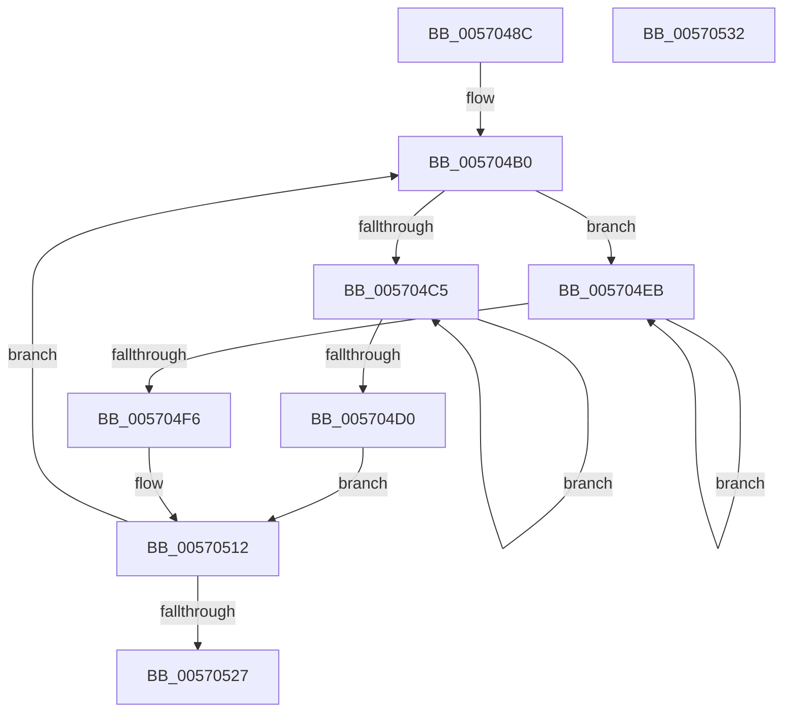

# IvtInitializeLargePagePte

- RVA: `0x0057048C`–`0x00570533` (길이 `167` bytes)
- VA: `0x000000014057048C`
- 실행 섹션: `.text`
- PDB 이름 있음: `예`; PDB Function 태그: `아니요`
- unwind 정보 RVA: `0x000950EC`
- 디코드: `47`개 명령, `167/167` bytes 표시
- 미해석 바이트: `0` (있으면 어셈블리에 `.byte`로 보존)

> 이 문서는 커널 이미지의 기계어와 PDB 기호를 분석해 생성했습니다. 4번과 5번은 함수 원형과 자료형을 바이너리 사용 방식에서 추정한 C 해석이며 원본 소스 복구 결과는 아닙니다.

## 1. Dependencies

- 직접 호출 지점: **0**; 고유 호출 대상: **0**
- 직접 호출자로 확인된 함수: **1**
- RIP 상대 이미지 참조: **0**

### Outgoing calls
- 직접 디코드된 call 명령이 없습니다.

### Direct callers
- [IvtInitializeIdentityMappings](IvtInitializeIdentityMappings_function_005702A8.md) at `0x005703D6`
- [IvtInitializeIdentityMappings](IvtInitializeIdentityMappings_function_005702A8.md) at `0x00570445`

### Static image references
- 디코드된 RIP-relative 메모리 참조가 없습니다.

## 2. Other-region calls and transfers

- 다른 실행 섹션으로 향하는 call: **0**
- 별도 외부 분기/꼬리 이동을 확인하지 못했습니다.

## 3. Assembly (complete function range)

```asm
0057048C  48 89 5C 24 08                  mov qword ptr [rsp + 8], rbx
00570491  48 89 7C 24 10                  mov qword ptr [rsp + 0x10], rdi
00570496  BF 01 00 00 00                  mov edi, 1
0057049B  4C 8B C9                        mov r9, rcx
0057049E  44 8B D7                        mov r10d, edi
005704A1  41 8B C8                        mov ecx, r8d
005704A4  49 D3 E2                        shl r10, cl
005704A7  41 8B D8                        mov ebx, r8d
005704AA  41 BB 00 02 00 00               mov r11d, 0x200
005704B0  4D 8B 01                        mov r8, qword ptr [r9]
005704B3  48 8B C7                        mov rax, rdi
005704B6  49 0F BA E8 07                  bts r8, 7
005704BB  B9 02 00 00 00                  mov ecx, 2
005704C0  83 FB 1E                        cmp ebx, 0x1e
005704C3  75 26                           jne 0x1405704eb
005704C5  4C 0B C0                        or r8, rax
005704C8  48 03 C7                        add rax, rdi
005704CB  48 2B CF                        sub rcx, rdi
005704CE  75 F5                           jne 0x1405704c5
005704D0  48 8B C2                        mov rax, rdx
005704D3  48 25 00 00 00 C0               and rax, 0xffffffffc0000000
005704D9  48 8B C8                        mov rcx, rax
005704DC  49 33 C8                        xor rcx, r8
005704DF  49 B8 FF FF FF 3F 00 00 F0 FF   movabs r8, 0xfff000003fffffff
005704E9  EB 27                           jmp 0x140570512
005704EB  4C 0B C0                        or r8, rax
005704EE  48 03 C7                        add rax, rdi
005704F1  48 2B CF                        sub rcx, rdi
005704F4  75 F5                           jne 0x1405704eb
005704F6  8B CB                           mov ecx, ebx
005704F8  48 8B C2                        mov rax, rdx
005704FB  48 D3 F8                        sar rax, cl
005704FE  48 C1 E0 15                     shl rax, 0x15
00570502  48 8B C8                        mov rcx, rax
00570505  49 33 C8                        xor rcx, r8
00570508  49 B8 FF FF 1F 00 00 00 F0 FF   movabs r8, 0xfff00000001fffff
00570512  49 23 C8                        and rcx, r8
00570515  49 03 D2                        add rdx, r10
00570518  48 33 C8                        xor rcx, rax
0057051B  49 89 09                        mov qword ptr [r9], rcx
0057051E  49 83 C1 08                     add r9, 8
00570522  4C 2B DF                        sub r11, rdi
00570525  75 89                           jne 0x1405704b0
00570527  48 8B 5C 24 08                  mov rbx, qword ptr [rsp + 8]
0057052C  48 8B 7C 24 10                  mov rdi, qword ptr [rsp + 0x10]
00570531  C3                              ret
00570532  CC                              int3
```

## 4. C-style interpretation (structured pseudocode)

```c
__int64 __fastcall IvtInitializeLargePagePte(__int64 a1, __int64 a2, int a3)
{
    __int64 result;
    __int64 v_r10;
    __int64 v_r11;
    unsigned __int64 v_stack_p10;
    unsigned __int64 v_stack_p8;

    v_stack_p8 = v_rbx;
    v_stack_p10 = v_rdi;
    v_r10 = (1) << ((unsigned __int8)((unsigned int)(a3)));
loc_005704B0:
    if (((unsigned int)((unsigned int)(a3))) != 30) goto loc_005704EB;
loc_005704C5:
    a3 = (*(unsigned __int64 *)(a1)) | (1);
    result = (1) + (1);
    a1 = (2) - (1);
    if (condition_is_not_equal) goto loc_005704C5;
    result = (a2) & (0xFFFFFFFFC0000000ULL);
    a1 = (result) ^ (a3);
    goto loc_00570512;
loc_005704EB:
    a3 = (a3) | (result);
    result = (result) + (1);
    a1 = (a1) - (1);
    if (condition_is_not_equal) goto loc_005704EB;
    result = (a2) >> ((unsigned __int8)((unsigned int)((unsigned int)((unsigned int)(a3)))));
    result = (result) << (21);
    a1 = (result) ^ (a3);
loc_00570512:
    a1 = (a1) & (a3);
    a2 = (a2) + (v_r10);
    a1 = (a1) ^ (result);
    *(unsigned __int64 *)(a1) = a1;
    a4 = (a1) + (8);
    v_r11 = (512) - (1);
    if (condition_is_not_equal) goto loc_005704B0;
    return result;
}
```

## 5. (Beta) C Style

```c
int64_t IvtInitializeLargePagePte(void *Arg1, int64_t Arg2, int32_t Arg3)
{
    uint8_t *arg1 = (uint8_t *)Arg1;

    int64_t result;
    int64_t local_r10;
    int64_t local_r11;
    uint64_t v_stack_p10;
    uint64_t v_stack_p8;

    v_stack_p8 = local_rbx;
    v_stack_p10 = local_rdi;
    local_r10 = (1) << ((uint8_t)((uint32_t)(Arg3)));
loc_005704B0:
    if (((uint32_t)((uint32_t)(Arg3))) != 30) goto loc_005704EB;
loc_005704C5:
    Arg3 = (*(uint64_t *)(arg1)) | (1);
    result = (1) + (1);
    Arg1 = (2) - (1);
    if (condition_is_not_equal) goto loc_005704C5;
    result = (Arg2) & (0xFFFFFFFFC0000000ULL);
    Arg1 = (result) ^ (Arg3);
    goto loc_00570512;
loc_005704EB:
    Arg3 = (Arg3) | (result);
    result = (result) + (1);
    Arg1 = (Arg1) - (1);
    if (condition_is_not_equal) goto loc_005704EB;
    result = (Arg2) >> ((uint8_t)((uint32_t)((uint32_t)((uint32_t)(Arg3)))));
    result = (result) << (21);
    Arg1 = (result) ^ (Arg3);
loc_00570512:
    Arg1 = (Arg1) & (Arg3);
    Arg2 = (Arg2) + (local_r10);
    Arg1 = (Arg1) ^ (result);
    *(void **)(arg1) = Arg1;
    a4 = (Arg1) + (8);
    local_r11 = (512) - (1);
    if (condition_is_not_equal) goto loc_005704B0;
    return result;
}
```

### 관측된 메모리 오프셋

구조체 형식이 확인되지 않은 접근은 인자 기준의 오프셋으로만 기록했습니다.

| 기준 인자 | 오프셋 표현 | 폭 (bit) | 접근 |
|---|---:|---:|---|
| `Arg1` | `+ 0x0` | `64` | `R` |
| `Arg1` | `+ 0x0` | `64` | `W` |

## 6. Execution-region graph

[열기: 2D/3D 그래프와 함수 탐색 컨트롤 패널](../../../control-panel.html?section=text&rva=0x0057048C&view=graph)

- 2D 그래프는 위에서 아래로 흐르고, 3D 그래프는 빈 공간을 드래그해 회전합니다. Shift+드래그는 이동, 휠은 확대·축소, 함수 노드 선택은 대상 보고서 이동입니다.

### Static fallback


