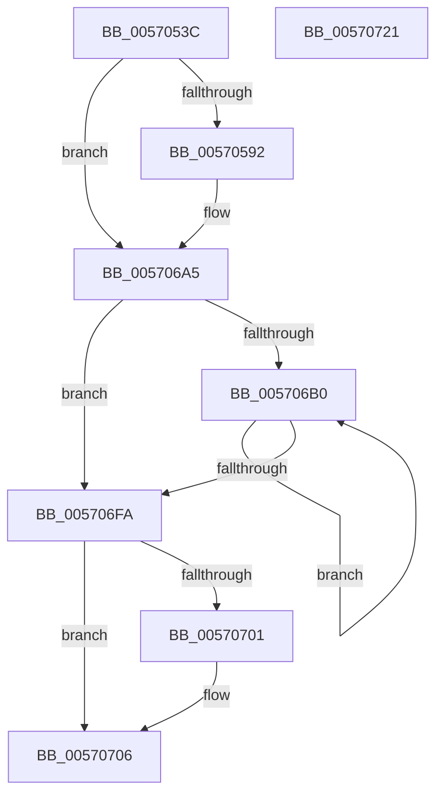

# IvtInitializeMTRR

- RVA: `0x0057053C`–`0x00570722` (길이 `486` bytes)
- VA: `0x000000014057053C`
- 실행 섹션: `.text`
- PDB 이름 있음: `예`; PDB Function 태그: `아니요`
- unwind 정보 RVA: `0x00069588`
- 디코드: `121`개 명령, `486/486` bytes 표시
- 미해석 바이트: `0` (있으면 어셈블리에 `.byte`로 보존)

> 이 문서는 커널 이미지의 기계어와 PDB 기호를 분석해 생성했습니다. 4번과 5번은 함수 원형과 자료형을 바이너리 사용 방식에서 추정한 C 해석이며 원본 소스 복구 결과는 아닙니다.

## 1. Dependencies

- 직접 호출 지점: **0**; 고유 호출 대상: **0**
- 직접 호출자로 확인된 함수: **1**
- RIP 상대 이미지 참조: **0**

### Outgoing calls
- 직접 디코드된 call 명령이 없습니다.

### Direct callers
- [IvtInitializeIommu](../../pagelk/B6/IvtInitializeIommu_function_00B61FE0.md) at `0x00B628AD`

### Static image references
- 디코드된 RIP-relative 메모리 참조가 없습니다.

## 2. Other-region calls and transfers

- 다른 실행 섹션으로 향하는 call: **0**
- 별도 외부 분기/꼬리 이동을 확인하지 못했습니다.

## 3. Assembly (complete function range)

```asm
0057053C  48 89 5C 24 08                  mov qword ptr [rsp + 8], rbx
00570541  48 89 74 24 10                  mov qword ptr [rsp + 0x10], rsi
00570546  48 89 7C 24 18                  mov qword ptr [rsp + 0x18], rdi
0057054B  4C 8B 59 08                     mov r11, qword ptr [rcx + 8]
0057054F  B9 FE 00 00 00                  mov ecx, 0xfe
00570554  0F 32                           rdmsr
00570556  48 C1 E2 20                     shl rdx, 0x20
0057055A  B9 FF 02 00 00                  mov ecx, 0x2ff
0057055F  48 0B C2                        or rax, rdx
00570562  4C 8B C0                        mov r8, rax
00570565  41 81 E0 FF 05 00 00            and r8d, 0x5ff
0057056C  0F 32                           rdmsr
0057056E  48 C1 E2 20                     shl rdx, 0x20
00570572  48 0B C2                        or rax, rdx
00570575  48 0F BA E0 0A                  bt rax, 0xa
0057057A  4C 8B C8                        mov r9, rax
0057057D  0F 92 C1                        setb cl
00570580  49 0F BA E0 08                  bt r8, 8
00570585  0F 92 C0                        setb al
00570588  33 F6                           xor esi, esi
0057058A  84 C8                           test al, cl
0057058C  0F 84 13 01 00 00               je 0x1405706a5
00570592  B9 50 02 00 00                  mov ecx, 0x250
00570597  0F 32                           rdmsr
00570599  48 C1 E2 20                     shl rdx, 0x20
0057059D  48 0B C2                        or rax, rdx
005705A0  49 89 83 20 01 00 00            mov qword ptr [r11 + 0x120], rax
005705A7  F0 09 34 24                     lock or dword ptr [rsp], esi
005705AB  B9 58 02 00 00                  mov ecx, 0x258
005705B0  0F 32                           rdmsr
005705B2  48 C1 E2 20                     shl rdx, 0x20
005705B6  48 0B C2                        or rax, rdx
005705B9  49 89 83 28 01 00 00            mov qword ptr [r11 + 0x128], rax
005705C0  F0 09 34 24                     lock or dword ptr [rsp], esi
005705C4  B9 59 02 00 00                  mov ecx, 0x259
005705C9  0F 32                           rdmsr
005705CB  48 C1 E2 20                     shl rdx, 0x20
005705CF  48 0B C2                        or rax, rdx
005705D2  49 89 83 30 01 00 00            mov qword ptr [r11 + 0x130], rax
005705D9  F0 09 34 24                     lock or dword ptr [rsp], esi
005705DD  B9 68 02 00 00                  mov ecx, 0x268
005705E2  0F 32                           rdmsr
005705E4  48 C1 E2 20                     shl rdx, 0x20
005705E8  48 0B C2                        or rax, rdx
005705EB  49 89 83 38 01 00 00            mov qword ptr [r11 + 0x138], rax
005705F2  F0 09 34 24                     lock or dword ptr [rsp], esi
005705F6  B9 69 02 00 00                  mov ecx, 0x269
005705FB  0F 32                           rdmsr
005705FD  48 C1 E2 20                     shl rdx, 0x20
00570601  48 0B C2                        or rax, rdx
00570604  49 89 83 40 01 00 00            mov qword ptr [r11 + 0x140], rax
0057060B  F0 09 34 24                     lock or dword ptr [rsp], esi
0057060F  B9 6A 02 00 00                  mov ecx, 0x26a
00570614  0F 32                           rdmsr
00570616  48 C1 E2 20                     shl rdx, 0x20
0057061A  48 0B C2                        or rax, rdx
0057061D  49 89 83 48 01 00 00            mov qword ptr [r11 + 0x148], rax
00570624  F0 09 34 24                     lock or dword ptr [rsp], esi
00570628  B9 6B 02 00 00                  mov ecx, 0x26b
0057062D  0F 32                           rdmsr
0057062F  48 C1 E2 20                     shl rdx, 0x20
00570633  48 0B C2                        or rax, rdx
00570636  49 89 83 50 01 00 00            mov qword ptr [r11 + 0x150], rax
0057063D  F0 09 34 24                     lock or dword ptr [rsp], esi
00570641  B9 6C 02 00 00                  mov ecx, 0x26c
00570646  0F 32                           rdmsr
00570648  48 C1 E2 20                     shl rdx, 0x20
0057064C  48 0B C2                        or rax, rdx
0057064F  49 89 83 58 01 00 00            mov qword ptr [r11 + 0x158], rax
00570656  F0 09 34 24                     lock or dword ptr [rsp], esi
0057065A  B9 6D 02 00 00                  mov ecx, 0x26d
0057065F  0F 32                           rdmsr
00570661  48 C1 E2 20                     shl rdx, 0x20
00570665  48 0B C2                        or rax, rdx
00570668  49 89 83 60 01 00 00            mov qword ptr [r11 + 0x160], rax
0057066F  F0 09 34 24                     lock or dword ptr [rsp], esi
00570673  B9 6E 02 00 00                  mov ecx, 0x26e
00570678  0F 32                           rdmsr
0057067A  48 C1 E2 20                     shl rdx, 0x20
0057067E  48 0B C2                        or rax, rdx
00570681  49 89 83 68 01 00 00            mov qword ptr [r11 + 0x168], rax
00570688  F0 09 34 24                     lock or dword ptr [rsp], esi
0057068C  B9 6F 02 00 00                  mov ecx, 0x26f
00570691  0F 32                           rdmsr
00570693  48 C1 E2 20                     shl rdx, 0x20
00570697  48 0B C2                        or rax, rdx
0057069A  49 89 83 70 01 00 00            mov qword ptr [r11 + 0x170], rax
005706A1  F0 09 34 24                     lock or dword ptr [rsp], esi
005706A5  41 0F B6 F8                     movzx edi, r8b
005706A9  8B DE                           mov ebx, esi
005706AB  45 84 C0                        test r8b, r8b
005706AE  74 4A                           je 0x1405706fa
005706B0  8D 0C 1B                        lea ecx, [rbx + rbx]
005706B3  44 8B D1                        mov r10d, ecx
005706B6  81 C1 00 02 00 00               add ecx, 0x200
005706BC  0F 32                           rdmsr
005706BE  48 C1 E2 20                     shl rdx, 0x20
005706C2  48 0B C2                        or rax, rdx
005706C5  4B 89 84 D3 80 01 00 00         mov qword ptr [r11 + r10*8 + 0x180], rax
005706CD  F0 09 34 24                     lock or dword ptr [rsp], esi
005706D1  41 8D 8A 01 02 00 00            lea ecx, [r10 + 0x201]
005706D8  0F 32                           rdmsr
005706DA  48 C1 E2 20                     shl rdx, 0x20
005706DE  41 8D 4A 01                     lea ecx, [r10 + 1]
005706E2  48 0B C2                        or rax, rdx
005706E5  49 89 84 CB 80 01 00 00         mov qword ptr [r11 + rcx*8 + 0x180], rax
005706ED  F0 09 34 24                     lock or dword ptr [rsp], esi
005706F1  FF C3                           inc ebx
005706F3  8B C3                           mov eax, ebx
005706F5  48 3B C7                        cmp rax, rdi
005706F8  72 B6                           jb 0x1405706b0
005706FA  49 0F BA E0 08                  bt r8, 8
005706FF  72 05                           jb 0x140570706
00570701  49 0F BA F1 0A                  btr r9, 0xa
00570706  4D 89 8B 08 01 00 00            mov qword ptr [r11 + 0x108], r9
0057070D  F0 09 34 24                     lock or dword ptr [rsp], esi
00570711  48 8B 5C 24 08                  mov rbx, qword ptr [rsp + 8]
00570716  48 8B 74 24 10                  mov rsi, qword ptr [rsp + 0x10]
0057071B  48 8B 7C 24 18                  mov rdi, qword ptr [rsp + 0x18]
00570720  C3                              ret
00570721  CC                              int3
```

## 4. C-style interpretation (structured pseudocode)

```c
__int64 __fastcall IvtInitializeMTRR(__int64 a1, __int64 a2)
{
    __int64 result;
    __int64 v_rbx;
    __int64 v_rsi;
    unsigned int v_stack_p0;
    unsigned __int64 v_stack_p10;
    unsigned __int64 v_stack_p18;
    unsigned __int64 v_stack_p8;

    v_stack_p8 = v_rbx;
    v_stack_p10 = v_rsi;
    v_stack_p18 = v_rdi;
    a2 = (a2) << (32);
    result = (result) | (a2);
    a3 = (unsigned int)((result) & (0x5FFULL));
    a2 = (a2) << (32);
    result = (result) | (a2);
    a1 = (condition_is_below) ? 1 : 0;
    result = (condition_is_below) ? 1 : 0;
    v_rsi = 0;
    if ((((unsigned __int8)(result)) & ((unsigned __int8)(a1))) != 0) {
        a1 = 592;
        a2 = (a2) << (32);
        result = (result) | (a2);
        *(unsigned __int64 *)(*(unsigned __int64 *)(a1 + 8) + 288) = result;
        a1 = 600;
        a2 = (a2) << (32);
        result = (result) | (a2);
        *(unsigned __int64 *)(*(unsigned __int64 *)(a1 + 8) + 296) = result;
        a1 = 601;
        a2 = (a2) << (32);
        result = (result) | (a2);
        *(unsigned __int64 *)(*(unsigned __int64 *)(a1 + 8) + 304) = result;
        a1 = 616;
        a2 = (a2) << (32);
        result = (result) | (a2);
        *(unsigned __int64 *)(*(unsigned __int64 *)(a1 + 8) + 312) = result;
        a1 = 617;
        a2 = (a2) << (32);
        result = (result) | (a2);
        *(unsigned __int64 *)(*(unsigned __int64 *)(a1 + 8) + 320) = result;
        a1 = 618;
        a2 = (a2) << (32);
        result = (result) | (a2);
        *(unsigned __int64 *)(*(unsigned __int64 *)(a1 + 8) + 328) = result;
        a1 = 619;
        a2 = (a2) << (32);
        result = (result) | (a2);
        *(unsigned __int64 *)(*(unsigned __int64 *)(a1 + 8) + 336) = result;
        a1 = 620;
        a2 = (a2) << (32);
        result = (result) | (a2);
        *(unsigned __int64 *)(*(unsigned __int64 *)(a1 + 8) + 344) = result;
        a1 = 621;
        a2 = (a2) << (32);
        result = (result) | (a2);
        *(unsigned __int64 *)(*(unsigned __int64 *)(a1 + 8) + 352) = result;
        a1 = 622;
        a2 = (a2) << (32);
        result = (result) | (a2);
        *(unsigned __int64 *)(*(unsigned __int64 *)(a1 + 8) + 360) = result;
        a1 = 623;
        a2 = (a2) << (32);
        result = (result) | (a2);
        *(unsigned __int64 *)(*(unsigned __int64 *)(a1 + 8) + 368) = result;
    }
    if ((unsigned __int8)(a3) == 0) goto loc_005706FA;
loc_005706B0:
    a1 = (unsigned int)((0 + 0 * 1) + (512));
    a2 = (a2) << (32);
    result = (result) | (a2);
    *(unsigned __int64 *)(*(unsigned __int64 *)(a1 + 8) + (unsigned int)((unsigned int)(0 + 0 * 1)) * 8 + 384) = result;
    a2 = (a2) << (32);
    result = (result) | (a2);
    *(unsigned __int64 *)(*(unsigned __int64 *)(a1 + 8) + (unsigned int)((unsigned int)(0 + 0 * 1)) + 1 * 8 + 384) = result;
    v_rbx = (unsigned int)((0) + 1);
    if (((unsigned int)((unsigned int)(v_rbx))) < ((unsigned __int8)(a3))) goto loc_005706B0;
loc_005706FA:
    if (((unsigned int)((unsigned int)(v_rbx))) >= ((unsigned __int8)(a3))) {
    }
    *(unsigned __int64 *)(*(unsigned __int64 *)(a1 + 8) + 264) = result;
    return (unsigned int)((unsigned int)(v_rbx));
}
```

## 5. (Beta) C Style

```c
int64_t IvtInitializeMTRR(void *Arg1, int64_t Arg2)
{
    uint8_t *arg1 = (uint8_t *)Arg1;

    int64_t result;
    int64_t local_rbx;
    int64_t local_rsi;
    uint32_t v_stack_p0;
    uint64_t v_stack_p10;
    uint64_t v_stack_p18;
    uint64_t v_stack_p8;

    v_stack_p8 = local_rbx;
    v_stack_p10 = local_rsi;
    v_stack_p18 = local_rdi;
    Arg2 = (Arg2) << (32);
    result = (result) | (Arg2);
    a3 = (uint32_t)((result) & (0x5FFULL));
    Arg2 = (Arg2) << (32);
    result = (result) | (Arg2);
    Arg1 = (condition_is_below) ? 1 : 0;
    result = (condition_is_below) ? 1 : 0;
    local_rsi = 0;
    if ((((uint8_t)(result)) & ((uint8_t)(Arg1))) != 0) {
        Arg1 = 592;
        Arg2 = (Arg2) << (32);
        result = (result) | (Arg2);
        *(uint64_t *)(*(uint64_t *)(arg1 + 0x8) + 0x120) = result;
        Arg1 = 600;
        Arg2 = (Arg2) << (32);
        result = (result) | (Arg2);
        *(uint64_t *)(*(uint64_t *)(arg1 + 0x8) + 0x128) = result;
        Arg1 = 601;
        Arg2 = (Arg2) << (32);
        result = (result) | (Arg2);
        *(uint64_t *)(*(uint64_t *)(arg1 + 0x8) + 0x130) = result;
        Arg1 = 616;
        Arg2 = (Arg2) << (32);
        result = (result) | (Arg2);
        *(uint64_t *)(*(uint64_t *)(arg1 + 0x8) + 0x138) = result;
        Arg1 = 617;
        Arg2 = (Arg2) << (32);
        result = (result) | (Arg2);
        *(uint64_t *)(*(uint64_t *)(arg1 + 0x8) + 0x140) = result;
        Arg1 = 618;
        Arg2 = (Arg2) << (32);
        result = (result) | (Arg2);
        *(uint64_t *)(*(uint64_t *)(arg1 + 0x8) + 0x148) = result;
        Arg1 = 619;
        Arg2 = (Arg2) << (32);
        result = (result) | (Arg2);
        *(uint64_t *)(*(uint64_t *)(arg1 + 0x8) + 0x150) = result;
        Arg1 = 620;
        Arg2 = (Arg2) << (32);
        result = (result) | (Arg2);
        *(uint64_t *)(*(uint64_t *)(arg1 + 0x8) + 0x158) = result;
        Arg1 = 621;
        Arg2 = (Arg2) << (32);
        result = (result) | (Arg2);
        *(uint64_t *)(*(uint64_t *)(arg1 + 0x8) + 0x160) = result;
        Arg1 = 622;
        Arg2 = (Arg2) << (32);
        result = (result) | (Arg2);
        *(uint64_t *)(*(uint64_t *)(arg1 + 0x8) + 0x168) = result;
        Arg1 = 623;
        Arg2 = (Arg2) << (32);
        result = (result) | (Arg2);
        *(uint64_t *)(*(uint64_t *)(arg1 + 0x8) + 0x170) = result;
    }
    if ((uint8_t)(a3) == 0) goto loc_005706FA;
loc_005706B0:
    Arg1 = (uint32_t)((0 + 0 * 1) + (512));
    Arg2 = (Arg2) << (32);
    result = (result) | (Arg2);
    *(uint64_t *)(*(uint64_t *)(arg1 + 0x8) + (uint32_t)((uint32_t)(0 + 0x0 * 1)) * 8 + 0x180) = result;
    Arg2 = (Arg2) << (32);
    result = (result) | (Arg2);
    *(uint64_t *)(*(uint64_t *)(arg1 + 0x8) + (uint32_t)((uint32_t)(0 + 0x0 * 1)) + 0x1 * 8 + 0x180) = result;
    local_rbx = (uint32_t)((0) + 1);
    if (((uint32_t)((uint32_t)(local_rbx))) < ((uint8_t)(a3))) goto loc_005706B0;
loc_005706FA:
    if (((uint32_t)((uint32_t)(local_rbx))) >= ((uint8_t)(a3))) {
    }
    *(uint64_t *)(*(uint64_t *)(arg1 + 0x8) + 0x108) = result;
    return (uint32_t)((uint32_t)(local_rbx));
}
```

### 관측된 메모리 오프셋

구조체 형식이 확인되지 않은 접근은 인자 기준의 오프셋으로만 기록했습니다.

| 기준 인자 | 오프셋 표현 | 폭 (bit) | 접근 |
|---|---:|---:|---|
| `Arg1` | `+ 0x8` | `64` | `R` |

## 6. Execution-region graph

[열기: 2D/3D 그래프와 함수 탐색 컨트롤 패널](../../../control-panel.html?section=text&rva=0x0057053C&view=graph)

- 2D 그래프는 위에서 아래로 흐르고, 3D 그래프는 빈 공간을 드래그해 회전합니다. Shift+드래그는 이동, 휠은 확대·축소, 함수 노드 선택은 대상 보고서 이동입니다.

### Static fallback


