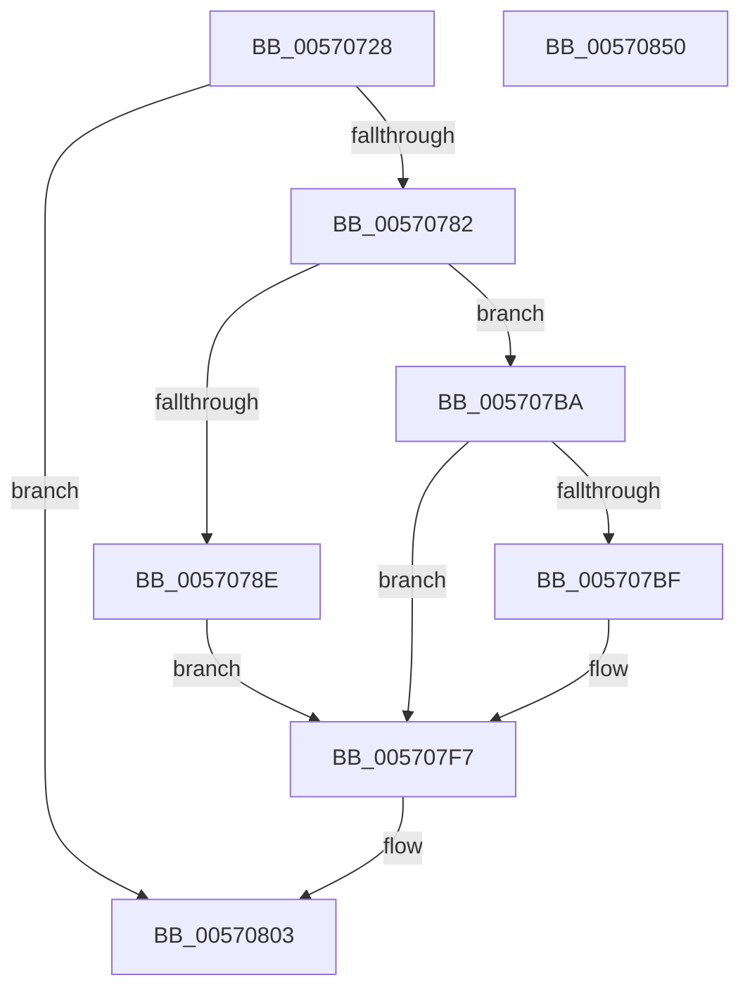

# IvtInitializeScalableModePasidTables

- RVA: `0x00570728`–`0x00570851` (길이 `297` bytes)
- VA: `0x0000000140570728`
- 실행 섹션: `.text`
- PDB 이름 있음: `예`; PDB Function 태그: `아니요`
- unwind 정보 RVA: `0x0009A96C`
- 디코드: `73`개 명령, `297/297` bytes 표시
- 미해석 바이트: `0` (있으면 어셈블리에 `.byte`로 보존)

> 이 문서는 커널 이미지의 기계어와 PDB 기호를 분석해 생성했습니다. 4번과 5번은 함수 원형과 자료형을 바이너리 사용 방식에서 추정한 C 해석이며 원본 소스 복구 결과는 아닙니다.

## 1. Dependencies

- 직접 호출 지점: **5**; 고유 호출 대상: **4**
- 직접 호출자로 확인된 함수: **1**
- RIP 상대 이미지 참조: **2**

### Outgoing calls
- `0x0057075F` → [memset](../6C/memset_function_006C6C40.md) (function, `0x006C6C40`)
- `0x00570771` → [memset](../6C/memset_function_006C6C40.md) (function, `0x006C6C40`)
- `0x005707B3` → [IvtBuildScalableModePasidTableS1Entry](../4F/IvtBuildScalableModePasidTableS1Entry_function_004F6644.md) (function, `0x004F6644`)
- `0x00570816` → [IvtBuildScalableModePasidDirectoryEntry](../4E/IvtBuildScalableModePasidDirectoryEntry_function_004E2D28.md) (function, `0x004E2D28`)
- `0x00570840` → [_security_check_cookie](../6A/_security_check_cookie_function_006AC640.md) (function, `0x006AC640`)

### Direct callers
- [IvtExtendScalableModePasidTables](../56/IvtExtendScalableModePasidTables_function_0056F6C8.md) at `0x0056F768`

### Static image references
- `0x00570733` → RVA `0x00E0A740` (`.data`; read)
- `0x00570796` → RVA `0x00F8F7B8` (`.data`; read)

## 2. Other-region calls and transfers

- 다른 실행 섹션으로 향하는 call: **0**
- 별도 외부 분기/꼬리 이동을 확인하지 못했습니다.

## 3. Assembly (complete function range)

```asm
00570728  40 53                           push rbx
0057072A  56                              push rsi
0057072B  57                              push rdi
0057072C  48 81 EC A0 00 00 00            sub rsp, 0xa0
00570733  48 8B 05 06 A0 89 00            mov rax, qword ptr [rip + 0x89a006]
0057073A  48 33 C4                        xor rax, rsp
0057073D  48 89 84 24 90 00 00 00         mov qword ptr [rsp + 0x90], rax
00570745  48 83 64 24 40 00               and qword ptr [rsp + 0x40], 0
0057074B  48 8B DA                        mov rbx, rdx
0057074E  33 D2                           xor edx, edx
00570750  41 8B F8                        mov edi, r8d
00570753  48 8B F1                        mov rsi, rcx
00570756  48 8D 4C 24 50                  lea rcx, [rsp + 0x50]
0057075B  44 8D 42 40                     lea r8d, [rdx + 0x40]
0057075F  E8 DC 64 15 00                  call 0x1406c6c40
00570764  48 8B 4C FB 40                  mov rcx, qword ptr [rbx + rdi*8 + 0x40]
00570769  33 D2                           xor edx, edx
0057076B  41 B8 00 10 00 00               mov r8d, 0x1000
00570771  E8 CA 64 15 00                  call 0x1406c6c40
00570776  48 8B 46 68                     mov rax, qword ptr [rsi + 0x68]
0057077A  85 FF                           test edi, edi
0057077C  0F 85 81 00 00 00               jne 0x140570803
00570782  8D 57 01                        lea edx, [rdi + 1]
00570785  39 94 24 E0 00 00 00            cmp dword ptr [rsp + 0xe0], edx
0057078C  75 2C                           jne 0x1405707ba
0057078E  8B 43 2C                        mov eax, dword ptr [rbx + 0x2c]
00570791  48 8D 4C 24 50                  lea rcx, [rsp + 0x50]
00570796  4C 8B 05 1B F0 A1 00            mov r8, qword ptr [rip + 0xa1f01b]
0057079D  48 89 4C 24 30                  mov qword ptr [rsp + 0x30], rcx
005707A2  48 8B CE                        mov rcx, rsi
005707A5  48 89 44 24 28                  mov qword ptr [rsp + 0x28], rax
005707AA  49 C1 E8 0C                     shr r8, 0xc
005707AE  40 88 7C 24 20                  mov byte ptr [rsp + 0x20], dil
005707B3  E8 8C 5E F8 FF                  call 0x1404f6644
005707B8  EB 3D                           jmp 0x1405707f7
005707BA  48 85 C0                        test rax, rax
005707BD  74 38                           je 0x1405707f7
005707BF  48 8B 40 40                     mov rax, qword ptr [rax + 0x40]
005707C3  0F 10 40 10                     movups xmm0, xmmword ptr [rax + 0x10]
005707C7  0F 10 10                        movups xmm2, xmmword ptr [rax]
005707CA  0F 10 48 20                     movups xmm1, xmmword ptr [rax + 0x20]
005707CE  0F 29 44 24 60                  movaps xmmword ptr [rsp + 0x60], xmm0
005707D3  0F 10 40 30                     movups xmm0, xmmword ptr [rax + 0x30]
005707D7  66 48 0F 7E D0                  movq rax, xmm2
005707DC  0F 29 54 24 50                  movaps xmmword ptr [rsp + 0x50], xmm2
005707E1  48 83 E0 FD                     and rax, 0xfffffffffffffffd
005707E5  0F 29 4C 24 70                  movaps xmmword ptr [rsp + 0x70], xmm1
005707EA  48 89 44 24 50                  mov qword ptr [rsp + 0x50], rax
005707EF  0F 29 84 24 80 00 00 00         movaps xmmword ptr [rsp + 0x80], xmm0
005707F7  48 8B 43 40                     mov rax, qword ptr [rbx + 0x40]
005707FB  66 48 0F 38 F8 44 24 50         movdir64b rax, zmmword ptr [rsp + 0x50]
00570803  48 8D 44 24 40                  lea rax, [rsp + 0x40]
00570808  C1 E7 06                        shl edi, 6
0057080B  44 8B C7                        mov r8d, edi
0057080E  48 89 44 24 20                  mov qword ptr [rsp + 0x20], rax
00570813  48 8B D3                        mov rdx, rbx
00570816  E8 0D 25 F7 FF                  call 0x1404e2d28
0057081B  48 8B 4B 38                     mov rcx, qword ptr [rbx + 0x38]
0057081F  8B D7                           mov edx, edi
00570821  48 8B 44 24 40                  mov rax, qword ptr [rsp + 0x40]
00570826  90                              nop
00570827  48 C1 EA 06                     shr rdx, 6
0057082B  81 E2 FF 3F 00 00               and edx, 0x3fff
00570831  48 89 04 D1                     mov qword ptr [rcx + rdx*8], rax
00570835  48 8B 8C 24 90 00 00 00         mov rcx, qword ptr [rsp + 0x90]
0057083D  48 33 CC                        xor rcx, rsp
00570840  E8 FB BD 13 00                  call 0x1406ac640
00570845  48 81 C4 A0 00 00 00            add rsp, 0xa0
0057084C  5F                              pop rdi
0057084D  5E                              pop rsi
0057084E  5B                              pop rbx
0057084F  C3                              ret
00570850  CC                              int3
```

## 4. C-style interpretation (structured pseudocode)

```c
__int64 __fastcall IvtInitializeScalableModePasidTables(__int64 a1, __int64 a2, int a3, __int64 a4, unsigned int a5)
{
    __int64 result;
    __int64 v_rdi;
    __int64 v_rsp;
    unsigned __int64 v_stack_m28;
    unsigned __int64 v_stack_m38;
    unsigned __int64 v_stack_m48;
    unsigned __int64 v_stack_m58;
    unsigned __int64 v_stack_m68;
    unsigned __int64 v_stack_m78;
    unsigned __int64 v_stack_m88;
    unsigned __int64 v_stack_m90;
    unsigned __int8 v_stack_m98;

    v_rsp = (v_rsp) - (160);
    result = (*(unsigned __int64 *)(v_rip + 9019398)) ^ (v_rsp);
    v_stack_m28 = result;
    a2 = 0;
    result = memset(v_stack_m68, a2, a2 + 64, a4);
    a2 = 0;
    result = memset(*(unsigned __int64 *)(a2 + (unsigned int)(a3) * 8 + 64), a2, (unsigned int)(0x1000ULL), a4);
    if ((unsigned int)((unsigned int)(a3)) != 0) goto loc_00570803;
    if (a5 != ((unsigned int)((unsigned int)(a3) + 1))) goto loc_005707BA;
    v_stack_m88 = v_stack_m68;
    v_stack_m90 = (unsigned int)(*(unsigned int *)(a2 + 44));
    a3 = (*(unsigned __int64 *)(v_rip + 10612763)) >> (12);
    v_stack_m98 = (unsigned __int8)((unsigned int)(a3));
    result = IvtBuildScalableModePasidTableS1Entry(a1, (unsigned int)(a3) + 1, a3, a4);
    goto loc_005707F7;
loc_005707BA:
    if (result != 0) {
        result = *(unsigned __int64 *)(result + 64);
        v_stack_m58 = v_xmm0;
        v_stack_m68 = v_xmm2;
        result = (result) & (-3);
        v_stack_m48 = v_xmm1;
        v_stack_m68 = result;
        v_stack_m38 = v_xmm0;
    }
loc_00570803:
    v_rdi = (unsigned int)(((unsigned int)(a3)) << (6));
    v_stack_m98 = v_stack_m78;
    result = IvtBuildScalableModePasidDirectoryEntry(a1, 0, (unsigned int)((unsigned int)(v_rdi)), a4);
    a2 = ((unsigned int)((unsigned int)(v_rdi))) >> (6);
    a2 = (unsigned int)((a2) & (0x3FFFULL));
    *(unsigned __int64 *)(*(unsigned __int64 *)(a2 + 56) + a2 * 8) = v_stack_m78;
    a1 = (v_stack_m28) ^ (v_rsp);
    result = _security_check_cookie(a1, a2, (unsigned int)((unsigned int)(v_rdi)), a4);
    v_rsp = (v_rsp) + (160);
    return result;
}
```

## 5. (Beta) C Style

```c
int64_t IvtInitializeScalableModePasidTables(void *Arg1, void *Arg2, int32_t Arg3, int64_t Arg4, uint32_t Arg5)
{
    uint8_t *arg1 = (uint8_t *)Arg1;
    uint8_t *arg2 = (uint8_t *)Arg2;

    int64_t result;
    int64_t local_rdi;
    int64_t local_rsp;
    uint64_t v_stack_m28;
    uint64_t v_stack_m38;
    uint64_t v_stack_m48;
    uint64_t v_stack_m58;
    uint64_t v_stack_m68;
    uint64_t v_stack_m78;
    uint64_t v_stack_m88;
    uint64_t v_stack_m90;
    uint8_t v_stack_m98;

    local_rsp = (local_rsp) - (160);
    result = (*(uint64_t *)(v_rip + 0x89A006)) ^ (local_rsp);
    v_stack_m28 = result;
    Arg2 = 0;
    result = memset(v_stack_m68, Arg2, Arg2 + 64, Arg4);
    Arg2 = 0;
    result = memset(*(uint64_t *)(arg2 + (uint32_t)(Arg3) * 8 + 0x40), Arg2, (uint32_t)(0x1000ULL), Arg4);
    if ((uint32_t)((uint32_t)(Arg3)) != 0) goto loc_00570803;
    if (Arg5 != ((uint32_t)((uint32_t)(Arg3) + 1))) goto loc_005707BA;
    v_stack_m88 = v_stack_m68;
    v_stack_m90 = (uint32_t)(*(uint32_t *)(arg2 + 0x2C));
    Arg3 = (*(uint64_t *)(v_rip + 0xA1F01B)) >> (12);
    v_stack_m98 = (uint8_t)((uint32_t)(Arg3));
    result = IvtBuildScalableModePasidTableS1Entry(Arg1, (uint32_t)(Arg3) + 1, Arg3, Arg4);
    goto loc_005707F7;
loc_005707BA:
    if (result != 0) {
        result = *(uint64_t *)(result + 0x40);
        v_stack_m58 = v_xmm0;
        v_stack_m68 = v_xmm2;
        result = (result) & (-3);
        v_stack_m48 = v_xmm1;
        v_stack_m68 = result;
        v_stack_m38 = v_xmm0;
    }
loc_00570803:
    local_rdi = (uint32_t)(((uint32_t)(Arg3)) << (6));
    v_stack_m98 = v_stack_m78;
    result = IvtBuildScalableModePasidDirectoryEntry(Arg1, 0, (uint32_t)((uint32_t)(local_rdi)), Arg4);
    Arg2 = ((uint32_t)((uint32_t)(local_rdi))) >> (6);
    Arg2 = (uint32_t)((Arg2) & (0x3FFFULL));
    *(uint64_t *)(*(uint64_t *)(arg2 + 0x38) + arg2 * 8) = v_stack_m78;
    Arg1 = (v_stack_m28) ^ (local_rsp);
    result = _security_check_cookie(Arg1, Arg2, (uint32_t)((uint32_t)(local_rdi)), Arg4);
    local_rsp = (local_rsp) + (160);
    return result;
}
```

### 관측된 메모리 오프셋

구조체 형식이 확인되지 않은 접근은 인자 기준의 오프셋으로만 기록했습니다.

| 기준 인자 | 오프셋 표현 | 폭 (bit) | 접근 |
|---|---:|---:|---|
| `Arg1` | `+ 0x68` | `64` | `R` |
| `Arg2` | `+ 0x2C` | `32` | `R` |
| `Arg2` | `+ 0x38` | `64` | `R` |
| `Arg2` | `+ 0x40` | `64` | `R` |
| `Arg2` | `+ 0x40 + rdi*8` | `64` | `R` |

## 6. Execution-region graph

[열기: 2D/3D 그래프와 함수 탐색 컨트롤 패널](../../../control-panel.html?section=text&rva=0x00570728&view=graph)

- 2D 그래프는 위에서 아래로 흐르고, 3D 그래프는 빈 공간을 드래그해 회전합니다. Shift+드래그는 이동, 휠은 확대·축소, 함수 노드 선택은 대상 보고서 이동입니다.

### Static fallback


