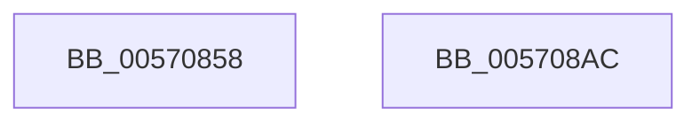

# IvtInvalidateAllContextEntries

- RVA: `0x00570858`–`0x005708AD` (길이 `85` bytes)
- VA: `0x0000000140570858`
- 실행 섹션: `.text`
- PDB 이름 있음: `예`; PDB Function 태그: `아니요`
- unwind 정보 RVA: `0x000AB2E4`
- 디코드: `22`개 명령, `85/85` bytes 표시
- 미해석 바이트: `0` (있으면 어셈블리에 `.byte`로 보존)

> 이 문서는 커널 이미지의 기계어와 PDB 기호를 분석해 생성했습니다. 4번과 5번은 함수 원형과 자료형을 바이너리 사용 방식에서 추정한 C 해석이며 원본 소스 복구 결과는 아닙니다.

## 1. Dependencies

- 직접 호출 지점: **3**; 고유 호출 대상: **3**
- 직접 호출자로 확인된 함수: **1**
- RIP 상대 이미지 참조: **1**

### Outgoing calls
- `0x00570887` → [IvtIommuSendCommand](../46/IvtIommuSendCommand_function_0046A6E4.md) (function, `0x0046A6E4`)
- `0x00570894` → [IvtIommuWaitCommand](../46/IvtIommuWaitCommand_function_0046A594.md) (function, `0x0046A594`)
- `0x005708A1` → [_security_check_cookie](../6A/_security_check_cookie_function_006AC640.md) (function, `0x006AC640`)

### Direct callers
- [IvtInitializeIommu](../../pagelk/B6/IvtInitializeIommu_function_00B61FE0.md) at `0x00B620A9`
- [IvtInitializeIommu](../../pagelk/B6/IvtInitializeIommu_function_00B61FE0.md) at `0x00B620B0`

### Static image references
- `0x0057085E` → RVA `0x00E0A740` (`.data`; read)

## 2. Other-region calls and transfers

- 다른 실행 섹션으로 향하는 call: **0**
- 별도 외부 분기/꼬리 이동을 확인하지 못했습니다.

## 3. Assembly (complete function range)

```asm
00570858  40 53                           push rbx
0057085A  48 83 EC 40                     sub rsp, 0x40
0057085E  48 8B 05 DB 9E 89 00            mov rax, qword ptr [rip + 0x899edb]
00570865  48 33 C4                        xor rax, rsp
00570868  48 89 44 24 30                  mov qword ptr [rsp + 0x30], rax
0057086D  48 83 64 24 28 00               and qword ptr [rsp + 0x28], 0
00570873  48 8D 54 24 20                  lea rdx, [rsp + 0x20]
00570878  45 33 C0                        xor r8d, r8d
0057087B  48 C7 44 24 20 11 00 00 00      mov qword ptr [rsp + 0x20], 0x11
00570884  48 8B D9                        mov rbx, rcx
00570887  E8 58 9E EF FF                  call 0x14046a6e4
0057088C  45 33 C0                        xor r8d, r8d
0057088F  33 D2                           xor edx, edx
00570891  48 8B CB                        mov rcx, rbx
00570894  E8 FB 9C EF FF                  call 0x14046a594
00570899  48 8B 4C 24 30                  mov rcx, qword ptr [rsp + 0x30]
0057089E  48 33 CC                        xor rcx, rsp
005708A1  E8 9A BD 13 00                  call 0x1406ac640
005708A6  48 83 C4 40                     add rsp, 0x40
005708AA  5B                              pop rbx
005708AB  C3                              ret
005708AC  CC                              int3
```

## 4. C-style interpretation (structured pseudocode)

```c
__int64 __fastcall IvtInvalidateAllContextEntries(__int64 a1, __int64 a2, int a3)
{
    __int64 result;
    __int64 v_rsp;
    unsigned __int64 v_stack_m18;
    unsigned __int64 v_stack_m20;
    unsigned __int64 v_stack_m28;

    v_rsp = (v_rsp) - (64);
    result = (*(unsigned __int64 *)(v_rip + 9019099)) ^ (v_rsp);
    v_stack_m18 = result;
    a3 = 0;
    v_stack_m28 = 17;
    result = IvtIommuSendCommand(a1, v_stack_m28, a3, a4);
    a3 = 0;
    a2 = 0;
    result = IvtIommuWaitCommand(a1, a2, a3, a4);
    a1 = (v_stack_m18) ^ (v_rsp);
    result = _security_check_cookie(a1, a2, a3, a4);
    v_rsp = (v_rsp) + (64);
    return result;
}
```

## 5. (Beta) C Style

```c
int64_t IvtInvalidateAllContextEntries(int64_t Arg1, int64_t Arg2, int32_t Arg3)
{
    int64_t result;
    int64_t local_rsp;
    uint64_t v_stack_m18;
    uint64_t v_stack_m20;
    uint64_t v_stack_m28;

    local_rsp = (local_rsp) - (64);
    result = (*(uint64_t *)(v_rip + 0x899EDB)) ^ (local_rsp);
    v_stack_m18 = result;
    Arg3 = 0;
    v_stack_m28 = 17;
    result = IvtIommuSendCommand(Arg1, v_stack_m28, Arg3, a4);
    Arg3 = 0;
    Arg2 = 0;
    result = IvtIommuWaitCommand(Arg1, Arg2, Arg3, a4);
    Arg1 = (v_stack_m18) ^ (local_rsp);
    result = _security_check_cookie(Arg1, Arg2, Arg3, a4);
    local_rsp = (local_rsp) + (64);
    return result;
}
```

## 6. Execution-region graph

[열기: 2D/3D 그래프와 함수 탐색 컨트롤 패널](../../../control-panel.html?section=text&rva=0x00570858&view=graph)

- 2D 그래프는 위에서 아래로 흐르고, 3D 그래프는 빈 공간을 드래그해 회전합니다. Shift+드래그는 이동, 휠은 확대·축소, 함수 노드 선택은 대상 보고서 이동입니다.

### Static fallback


