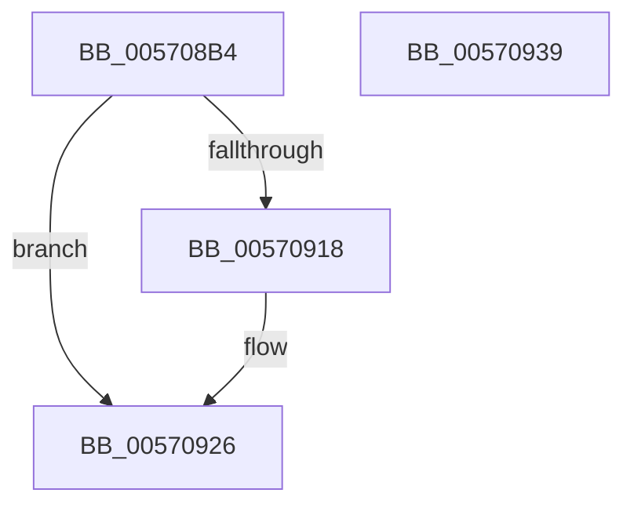

# IvtInvalidateContextEntry

- RVA: `0x005708B4`–`0x0057093A` (길이 `134` bytes)
- VA: `0x00000001405708B4`
- 실행 섹션: `.text`
- PDB 이름 있음: `예`; PDB Function 태그: `아니요`
- unwind 정보 RVA: `0x000AB2E4`
- 디코드: `36`개 명령, `134/134` bytes 표시
- 미해석 바이트: `0` (있으면 어셈블리에 `.byte`로 보존)

> 이 문서는 커널 이미지의 기계어와 PDB 기호를 분석해 생성했습니다. 4번과 5번은 함수 원형과 자료형을 바이너리 사용 방식에서 추정한 C 해석이며 원본 소스 복구 결과는 아닙니다.

## 1. Dependencies

- 직접 호출 지점: **3**; 고유 호출 대상: **3**
- 직접 호출자로 확인된 함수: **2**
- RIP 상대 이미지 참조: **1**

### Outgoing calls
- `0x0057090C` → [IvtIommuSendCommand](../46/IvtIommuSendCommand_function_0046A6E4.md) (function, `0x0046A6E4`)
- `0x00570921` → [IvtIommuWaitCommand](../46/IvtIommuWaitCommand_function_0046A594.md) (function, `0x0046A594`)
- `0x0057092E` → [_security_check_cookie](../6A/_security_check_cookie_function_006AC640.md) (function, `0x006AC640`)

### Direct callers
- [IvtUpdateContextEntry](../4D/IvtUpdateContextEntry_function_004D207C.md) at `0x004D21CA`
- [IvtUpdateContextEntry](../4D/IvtUpdateContextEntry_function_004D207C.md) at `0x004D21DD`
- [IvtInvalidateScalableModeContextEntry](IvtInvalidateScalableModeContextEntry_function_00570940.md) at `0x00570974`

### Static image references
- `0x005708BA` → RVA `0x00E0A740` (`.data`; read)

## 2. Other-region calls and transfers

- 다른 실행 섹션으로 향하는 call: **0**
- 별도 외부 분기/꼬리 이동을 확인하지 못했습니다.

## 3. Assembly (complete function range)

```asm
005708B4  40 53                           push rbx
005708B6  48 83 EC 40                     sub rsp, 0x40
005708BA  48 8B 05 7F 9E 89 00            mov rax, qword ptr [rip + 0x899e7f]
005708C1  48 33 C4                        xor rax, rsp
005708C4  48 89 44 24 30                  mov qword ptr [rsp + 0x30], rax
005708C9  44 8B 4A 04                     mov r9d, dword ptr [rdx + 4]
005708CD  48 8B D9                        mov rbx, rcx
005708D0  8B 02                           mov eax, dword ptr [rdx]
005708D2  41 83 E1 03                     and r9d, 3
005708D6  48 83 64 24 28 00               and qword ptr [rsp + 0x28], 0
005708DC  48 8D 54 24 20                  lea rdx, [rsp + 0x20]
005708E1  49 C1 E1 10                     shl r9, 0x10
005708E5  0F B7 C8                        movzx ecx, ax
005708E8  4C 0B C9                        or r9, rcx
005708EB  41 0F B7 C0                     movzx eax, r8w
005708EF  49 C1 E1 10                     shl r9, 0x10
005708F3  41 B8 01 00 00 00               mov r8d, 1
005708F9  4C 0B C8                        or r9, rax
005708FC  48 8B CB                        mov rcx, rbx
005708FF  49 C1 E1 10                     shl r9, 0x10
00570903  49 83 C9 31                     or r9, 0x31
00570907  4C 89 4C 24 20                  mov qword ptr [rsp + 0x20], r9
0057090C  E8 D3 9D EF FF                  call 0x14046a6e4
00570911  80 7C 24 70 00                  cmp byte ptr [rsp + 0x70], 0
00570916  74 0E                           je 0x140570926
00570918  33 D2                           xor edx, edx
0057091A  48 8B CB                        mov rcx, rbx
0057091D  44 8D 42 01                     lea r8d, [rdx + 1]
00570921  E8 6E 9C EF FF                  call 0x14046a594
00570926  48 8B 4C 24 30                  mov rcx, qword ptr [rsp + 0x30]
0057092B  48 33 CC                        xor rcx, rsp
0057092E  E8 0D BD 13 00                  call 0x1406ac640
00570933  48 83 C4 40                     add rsp, 0x40
00570937  5B                              pop rbx
00570938  C3                              ret
00570939  CC                              int3
```

## 4. C-style interpretation (structured pseudocode)

```c
__int64 __fastcall IvtInvalidateContextEntry(__int64 a1, __int64 a2, unsigned __int16 a3, __int64 a4, unsigned __int8 a5)
{
    __int64 result;
    __int64 v_rsp;
    unsigned __int64 v_stack_m18;
    unsigned __int64 v_stack_m20;
    unsigned __int64 v_stack_m28;

    v_rsp = (v_rsp) - (64);
    result = (*(unsigned __int64 *)(v_rip + 9019007)) ^ (v_rsp);
    v_stack_m18 = result;
    a4 = (unsigned int)(((unsigned int)(*(unsigned int *)(a2 + 4))) & (3));
    a4 = (a4) << (16);
    a4 = (a4) | ((unsigned __int16)((unsigned int)(*(unsigned int *)(a2))));
    a4 = (a4) << (16);
    a4 = (a4) | (a3);
    a4 = (a4) << (16);
    a4 = (a4) | (49);
    v_stack_m28 = a4;
    result = IvtIommuSendCommand(a1, v_stack_m28, 1, a4);
    if (a5 != 0) {
        a2 = 0;
        a1 = a1;
        a3 = a2 + 1;
        result = IvtIommuWaitCommand(a1, a2, a3, a4);
    }
    a1 = (v_stack_m18) ^ (v_rsp);
    result = _security_check_cookie(a1, a2, a3, a4);
    v_rsp = (v_rsp) + (64);
    return result;
}
```

## 5. (Beta) C Style

```c
int64_t IvtInvalidateContextEntry(int64_t Arg1, void *Arg2, uint16_t Arg3, int64_t Arg4, uint8_t Arg5)
{
    uint8_t *arg2 = (uint8_t *)Arg2;

    int64_t result;
    int64_t local_rsp;
    uint64_t v_stack_m18;
    uint64_t v_stack_m20;
    uint64_t v_stack_m28;

    local_rsp = (local_rsp) - (64);
    result = (*(uint64_t *)(v_rip + 0x899E7F)) ^ (local_rsp);
    v_stack_m18 = result;
    Arg4 = (uint32_t)(((uint32_t)(*(uint32_t *)(arg2 + 0x4))) & (3));
    Arg4 = (Arg4) << (16);
    Arg4 = (Arg4) | ((uint16_t)((uint32_t)(*(uint32_t *)(arg2))));
    Arg4 = (Arg4) << (16);
    Arg4 = (Arg4) | (Arg3);
    Arg4 = (Arg4) << (16);
    Arg4 = (Arg4) | (49);
    v_stack_m28 = Arg4;
    result = IvtIommuSendCommand(Arg1, v_stack_m28, 1, Arg4);
    if (Arg5 != 0) {
        Arg2 = 0;
        Arg1 = Arg1;
        Arg3 = Arg2 + 1;
        result = IvtIommuWaitCommand(Arg1, Arg2, Arg3, Arg4);
    }
    Arg1 = (v_stack_m18) ^ (local_rsp);
    result = _security_check_cookie(Arg1, Arg2, Arg3, Arg4);
    local_rsp = (local_rsp) + (64);
    return result;
}
```

### 관측된 메모리 오프셋

구조체 형식이 확인되지 않은 접근은 인자 기준의 오프셋으로만 기록했습니다.

| 기준 인자 | 오프셋 표현 | 폭 (bit) | 접근 |
|---|---:|---:|---|
| `Arg2` | `+ 0x0` | `32` | `R` |
| `Arg2` | `+ 0x4` | `32` | `R` |

## 6. Execution-region graph

[열기: 2D/3D 그래프와 함수 탐색 컨트롤 패널](../../../control-panel.html?section=text&rva=0x005708B4&view=graph)

- 2D 그래프는 위에서 아래로 흐르고, 3D 그래프는 빈 공간을 드래그해 회전합니다. Shift+드래그는 이동, 휠은 확대·축소, 함수 노드 선택은 대상 보고서 이동입니다.

### Static fallback


