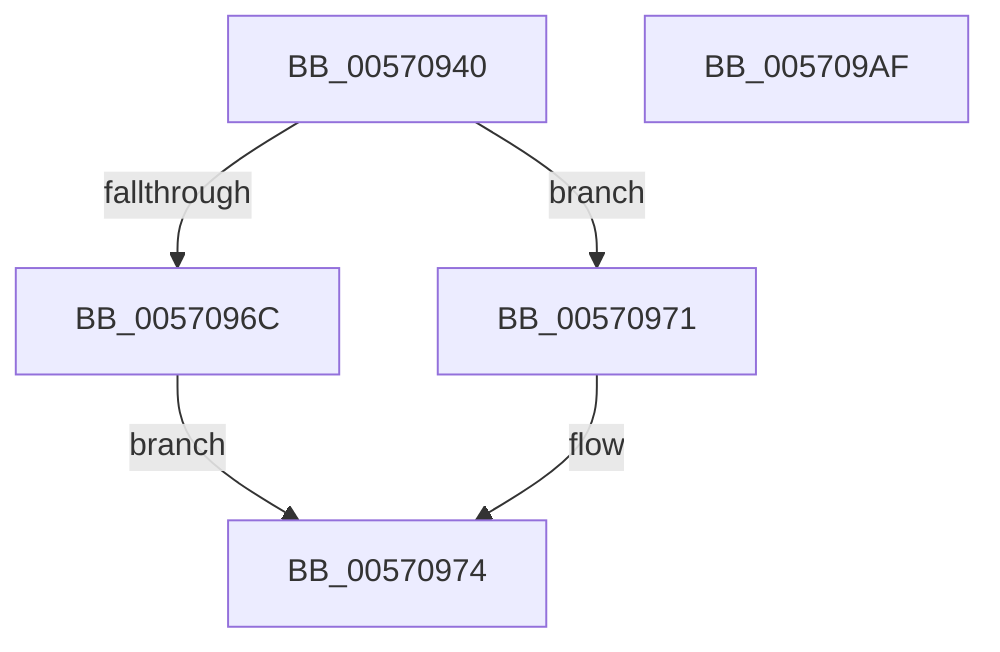

# IvtInvalidateScalableModeContextEntry

- RVA: `0x00570940`–`0x005709B0` (길이 `112` bytes)
- VA: `0x0000000140570940`
- 실행 섹션: `.text`
- PDB 이름 있음: `예`; PDB Function 태그: `아니요`
- unwind 정보 RVA: `0x00086C28`
- 디코드: `32`개 명령, `112/112` bytes 표시
- 미해석 바이트: `0` (있으면 어셈블리에 `.byte`로 보존)

> 이 문서는 커널 이미지의 기계어와 PDB 기호를 분석해 생성했습니다. 4번과 5번은 함수 원형과 자료형을 바이너리 사용 방식에서 추정한 C 해석이며 원본 소스 복구 결과는 아닙니다.

## 1. Dependencies

- 직접 호출 지점: **3**; 고유 호출 대상: **3**
- 직접 호출자로 확인된 함수: **2**
- RIP 상대 이미지 참조: **0**

### Outgoing calls
- `0x00570958` → [Feature_Test57481295__private_IsEnabledDeviceUsageNoInline](../4F/Feature_Test57481295__private_IsEnabledDeviceUsageNoInline_function_004F7B90.md) (function, `0x004F7B90`)
- `0x00570974` → [IvtInvalidateContextEntry](IvtInvalidateContextEntry_function_005708B4.md) (function, `0x005708B4`)
- `0x0057099A` → [IvtInvalidateScalableModePasidCache](IvtInvalidateScalableModePasidCache_function_005709B8.md) (function, `0x005709B8`)

### Direct callers
- [IvtUpdateScalableModeContextEntry](../4C/IvtUpdateScalableModeContextEntry_function_004CD880.md) at `0x004CDA0C`
- [IvtLegacyUpdateScalableModeContextEntry](IvtLegacyUpdateScalableModeContextEntry_function_005721B8.md) at `0x00572346`

### Static image references
- 디코드된 RIP-relative 메모리 참조가 없습니다.

## 2. Other-region calls and transfers

- 다른 실행 섹션으로 향하는 call: **0**
- 별도 외부 분기/꼬리 이동을 확인하지 못했습니다.

## 3. Assembly (complete function range)

```asm
00570940  48 89 5C 24 08                  mov qword ptr [rsp + 8], rbx
00570945  48 89 74 24 10                  mov qword ptr [rsp + 0x10], rsi
0057094A  57                              push rdi
0057094B  48 83 EC 40                     sub rsp, 0x40
0057094F  49 8B F0                        mov rsi, r8
00570952  48 8B DA                        mov rbx, rdx
00570955  48 8B F9                        mov rdi, rcx
00570958  E8 33 72 F8 FF                  call 0x1404f7b90
0057095D  C6 44 24 20 00                  mov byte ptr [rsp + 0x20], 0
00570962  48 8B D3                        mov rdx, rbx
00570965  48 8B CF                        mov rcx, rdi
00570968  85 C0                           test eax, eax
0057096A  74 05                           je 0x140570971
0057096C  4C 8B C6                        mov r8, rsi
0057096F  EB 03                           jmp 0x140570974
00570971  45 33 C0                        xor r8d, r8d
00570974  E8 3B FF FF FF                  call 0x1405708b4
00570979  8A 44 24 70                     mov al, byte ptr [rsp + 0x70]
0057097D  41 83 C9 FF                     or r9d, 0xffffffff
00570981  8B 13                           mov edx, dword ptr [rbx]
00570983  4C 8B C6                        mov r8, rsi
00570986  88 44 24 30                     mov byte ptr [rsp + 0x30], al
0057098A  48 8B CF                        mov rcx, rdi
0057098D  C6 44 24 28 01                  mov byte ptr [rsp + 0x28], 1
00570992  C7 44 24 20 01 00 00 00         mov dword ptr [rsp + 0x20], 1
0057099A  E8 19 00 00 00                  call 0x1405709b8
0057099F  48 8B 5C 24 50                  mov rbx, qword ptr [rsp + 0x50]
005709A4  48 8B 74 24 58                  mov rsi, qword ptr [rsp + 0x58]
005709A9  48 83 C4 40                     add rsp, 0x40
005709AD  5F                              pop rdi
005709AE  C3                              ret
005709AF  CC                              int3
```

## 4. C-style interpretation (structured pseudocode)

```c
__int64 __fastcall IvtInvalidateScalableModeContextEntry(__int64 a1, __int64 a2, __int64 a3, int a4, unsigned __int8 a5)
{
    __int64 result;
    __int64 v_rsp;
    unsigned __int8 v_stack_m18;
    unsigned __int8 v_stack_m20;
    unsigned __int8 v_stack_m28;
    unsigned __int64 v_stack_p10;
    unsigned __int64 v_stack_p8;

    v_stack_p8 = v_rbx;
    v_stack_p10 = v_rsi;
    v_rsp = (v_rsp) - (64);
    result = Feature_Test57481295__private_IsEnabledDeviceUsageNoInline(a1, a2, a3, a4);
    v_stack_m28 = 0;
    if ((unsigned int)(result) == 0) goto loc_00570971;
    goto loc_00570974;
loc_00570971:
    a3 = 0;
loc_00570974:
    result = IvtInvalidateContextEntry(a1, a2, a3, a4);
    a4 = (unsigned int)((a4) | (0xFFFFFFFFULL));
    v_stack_m18 = a5;
    v_stack_m20 = 1;
    v_stack_m28 = 1;
    result = IvtInvalidateScalableModePasidCache(a1, (unsigned int)(*(unsigned int *)(a2)), 0, a4);
    v_rsp = (v_rsp) + (64);
    return result;
}
```

## 5. (Beta) C Style

```c
int64_t IvtInvalidateScalableModeContextEntry(int64_t Arg1, void *Arg2, int64_t Arg3, int32_t Arg4, uint8_t Arg5)
{
    uint8_t *arg2 = (uint8_t *)Arg2;

    int64_t result;
    int64_t local_rsp;
    uint8_t v_stack_m18;
    uint8_t v_stack_m20;
    uint8_t v_stack_m28;
    uint64_t v_stack_p10;
    uint64_t v_stack_p8;

    v_stack_p8 = local_rbx;
    v_stack_p10 = local_rsi;
    local_rsp = (local_rsp) - (64);
    result = Feature_Test57481295__private_IsEnabledDeviceUsageNoInline(Arg1, Arg2, Arg3, Arg4);
    v_stack_m28 = 0;
    if ((uint32_t)(result) == 0) goto loc_00570971;
    goto loc_00570974;
loc_00570971:
    Arg3 = 0;
loc_00570974:
    result = IvtInvalidateContextEntry(Arg1, Arg2, Arg3, Arg4);
    Arg4 = (uint32_t)((Arg4) | (0xFFFFFFFFULL));
    v_stack_m18 = Arg5;
    v_stack_m20 = 1;
    v_stack_m28 = 1;
    result = IvtInvalidateScalableModePasidCache(Arg1, (uint32_t)(*(uint32_t *)(arg2)), 0, Arg4);
    local_rsp = (local_rsp) + (64);
    return result;
}
```

### 관측된 메모리 오프셋

구조체 형식이 확인되지 않은 접근은 인자 기준의 오프셋으로만 기록했습니다.

| 기준 인자 | 오프셋 표현 | 폭 (bit) | 접근 |
|---|---:|---:|---|
| `Arg2` | `+ 0x0` | `32` | `R` |

## 6. Execution-region graph

[열기: 2D/3D 그래프와 함수 탐색 컨트롤 패널](../../../control-panel.html?section=text&rva=0x00570940&view=graph)

- 2D 그래프는 위에서 아래로 흐르고, 3D 그래프는 빈 공간을 드래그해 회전합니다. Shift+드래그는 이동, 휠은 확대·축소, 함수 노드 선택은 대상 보고서 이동입니다.

### Static fallback


