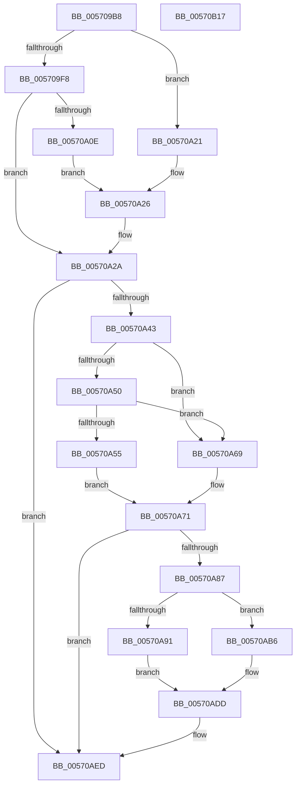

# IvtInvalidateScalableModePasidCache

- RVA: `0x005709B8`–`0x00570B18` (길이 `352` bytes)
- VA: `0x00000001405709B8`
- 실행 섹션: `.text`
- PDB 이름 있음: `예`; PDB Function 태그: `아니요`
- unwind 정보 RVA: `0x000C52C0`
- 디코드: `100`개 명령, `352/352` bytes 표시
- 미해석 바이트: `0` (있으면 어셈블리에 `.byte`로 보존)

> 이 문서는 커널 이미지의 기계어와 PDB 기호를 분석해 생성했습니다. 4번과 5번은 함수 원형과 자료형을 바이너리 사용 방식에서 추정한 C 해석이며 원본 소스 복구 결과는 아닙니다.

## 1. Dependencies

- 직접 호출 지점: **5**; 고유 호출 대상: **3**
- 직접 호출자로 확인된 함수: **4**
- RIP 상대 이미지 참조: **1**

### Outgoing calls
- `0x00570A32` → [IvtIommuSendCommand](../46/IvtIommuSendCommand_function_0046A6E4.md) (function, `0x0046A6E4`)
- `0x00570A7C` → [IvtIommuSendCommand](../46/IvtIommuSendCommand_function_0046A6E4.md) (function, `0x0046A6E4`)
- `0x00570AE8` → [IvtIommuSendCommand](../46/IvtIommuSendCommand_function_0046A6E4.md) (function, `0x0046A6E4`)
- `0x00570AF6` → [IvtIommuWaitCommand](../46/IvtIommuWaitCommand_function_0046A594.md) (function, `0x0046A594`)
- `0x00570B02` → [_security_check_cookie](../6A/_security_check_cookie_function_006AC640.md) (function, `0x006AC640`)

### Direct callers
- [IvtInvalidateScalableModeContextEntry](IvtInvalidateScalableModeContextEntry_function_00570940.md) at `0x0057099A`
- [IvtLegacySetPasidAddressSpace](IvtLegacySetPasidAddressSpace_function_00571FD0.md) at `0x00572135`
- [IvtSetPasidAddressSpace](IvtSetPasidAddressSpace_function_00572630.md) at `0x005727D3`
- [IvtInitializeIommu](../../pagelk/B6/IvtInitializeIommu_function_00B61FE0.md) at `0x00B620D8`

### Static image references
- `0x005709CB` → RVA `0x00E0A740` (`.data`; read)

## 2. Other-region calls and transfers

- 다른 실행 섹션으로 향하는 call: **0**
- 별도 외부 분기/꼬리 이동을 확인하지 못했습니다.

## 3. Assembly (complete function range)

```asm
005709B8  40 55                           push rbp
005709BA  53                              push rbx
005709BB  57                              push rdi
005709BC  41 54                           push r12
005709BE  41 55                           push r13
005709C0  41 56                           push r14
005709C2  41 57                           push r15
005709C4  48 8B EC                        mov rbp, rsp
005709C7  48 83 EC 40                     sub rsp, 0x40
005709CB  48 8B 05 6E 9D 89 00            mov rax, qword ptr [rip + 0x899d6e]
005709D2  48 33 C4                        xor rax, rsp
005709D5  48 89 45 F0                     mov qword ptr [rbp - 0x10], rax
005709D9  44 8B E2                        mov r12d, edx
005709DC  0F 57 C0                        xorps xmm0, xmm0
005709DF  45 8B F1                        mov r14d, r9d
005709E2  4C 8B F9                        mov r15, rcx
005709E5  41 BD FF FF 0F 00               mov r13d, 0xfffff
005709EB  0F 11 45 E0                     movups xmmword ptr [rbp - 0x20], xmm0
005709EF  49 81 F8 00 00 01 00            cmp r8, 0x10000
005709F6  74 29                           je 0x140570a21
005709F8  41 0F B7 D8                     movzx ebx, r8w
005709FC  48 C1 E3 10                     shl rbx, 0x10
00570A00  48 83 CB 07                     or rbx, 7
00570A04  48 89 5D E0                     mov qword ptr [rbp - 0x20], rbx
00570A08  41 83 F9 FF                     cmp r9d, -1
00570A0C  74 1C                           je 0x140570a2a
00570A0E  41 8B C1                        mov eax, r9d
00570A11  49 23 C5                        and rax, r13
00570A14  48 C1 E0 20                     shl rax, 0x20
00570A18  48 0B D8                        or rbx, rax
00570A1B  48 83 CB 10                     or rbx, 0x10
00570A1F  EB 05                           jmp 0x140570a26
00570A21  BB 37 00 00 00                  mov ebx, 0x37
00570A26  48 89 5D E0                     mov qword ptr [rbp - 0x20], rbx
00570A2A  44 8B 45 60                     mov r8d, dword ptr [rbp + 0x60]
00570A2E  48 8D 55 E0                     lea rdx, [rbp - 0x20]
00570A32  E8 AD 9C EF FF                  call 0x14046a6e4
00570A37  33 FF                           xor edi, edi
00570A39  40 38 7D 68                     cmp byte ptr [rbp + 0x68], dil
00570A3D  0F 84 AA 00 00 00               je 0x140570aed
00570A43  83 E3 30                        and ebx, 0x30
00570A46  48 89 7D E8                     mov qword ptr [rbp - 0x18], rdi
00570A4A  48 83 FB 30                     cmp rbx, 0x30
00570A4E  74 19                           je 0x140570a69
00570A50  48 85 DB                        test rbx, rbx
00570A53  74 14                           je 0x140570a69
00570A55  41 8B C6                        mov eax, r14d
00570A58  49 23 C5                        and rax, r13
00570A5B  48 C1 E0 20                     shl rax, 0x20
00570A5F  48 83 C8 26                     or rax, 0x26
00570A63  48 89 45 E0                     mov qword ptr [rbp - 0x20], rax
00570A67  EB 08                           jmp 0x140570a71
00570A69  48 C7 45 E0 12 00 00 00         mov qword ptr [rbp - 0x20], 0x12
00570A71  44 8B 45 60                     mov r8d, dword ptr [rbp + 0x60]
00570A75  48 8D 55 E0                     lea rdx, [rbp - 0x20]
00570A79  49 8B CF                        mov rcx, r15
00570A7C  E8 63 9C EF FF                  call 0x14046a6e4
00570A81  40 38 7D 70                     cmp byte ptr [rbp + 0x70], dil
00570A85  74 66                           je 0x140570aed
00570A87  41 0F B7 CC                     movzx ecx, r12w
00570A8B  41 83 FE FF                     cmp r14d, -1
00570A8F  75 25                           jne 0x140570ab6
00570A91  48 C1 E1 20                     shl rcx, 0x20
00570A95  81 E7 FE 0F 00 00               and edi, 0xffe
00570A9B  48 83 C9 03                     or rcx, 3
00570A9F  48 B8 01 F0 FF FF FF FF FF 7F   movabs rax, 0x7ffffffffffff001
00570AA9  48 0B F8                        or rdi, rax
00570AAC  48 89 4D E0                     mov qword ptr [rbp - 0x20], rcx
00570AB0  48 89 7D E8                     mov qword ptr [rbp - 0x18], rdi
00570AB4  EB 27                           jmp 0x140570add
00570AB6  48 B8 00 F8 FF FF FF FF FF 7F   movabs rax, 0x7ffffffffffff800
00570AC0  48 89 45 E8                     mov qword ptr [rbp - 0x18], rax
00570AC4  41 8B C6                        mov eax, r14d
00570AC7  49 23 C5                        and rax, r13
00570ACA  48 C1 E0 10                     shl rax, 0x10
00570ACE  48 0B C1                        or rax, rcx
00570AD1  48 C1 E0 10                     shl rax, 0x10
00570AD5  48 83 C8 08                     or rax, 8
00570AD9  48 89 45 E0                     mov qword ptr [rbp - 0x20], rax
00570ADD  44 8B 45 60                     mov r8d, dword ptr [rbp + 0x60]
00570AE1  48 8D 55 E0                     lea rdx, [rbp - 0x20]
00570AE5  49 8B CF                        mov rcx, r15
00570AE8  E8 F7 9B EF FF                  call 0x14046a6e4
00570AED  44 8B 45 60                     mov r8d, dword ptr [rbp + 0x60]
00570AF1  33 D2                           xor edx, edx
00570AF3  49 8B CF                        mov rcx, r15
00570AF6  E8 99 9A EF FF                  call 0x14046a594
00570AFB  48 8B 4D F0                     mov rcx, qword ptr [rbp - 0x10]
00570AFF  48 33 CC                        xor rcx, rsp
00570B02  E8 39 BB 13 00                  call 0x1406ac640
00570B07  48 83 C4 40                     add rsp, 0x40
00570B0B  41 5F                           pop r15
00570B0D  41 5E                           pop r14
00570B0F  41 5D                           pop r13
00570B11  41 5C                           pop r12
00570B13  5F                              pop rdi
00570B14  5B                              pop rbx
00570B15  5D                              pop rbp
00570B16  C3                              ret
00570B17  CC                              int3
```

## 4. C-style interpretation (structured pseudocode)

```c
__int64 __fastcall IvtInvalidateScalableModePasidCache(__int64 a1, int a2, __int64 a3, int a4, unsigned int a5, unsigned __int8 a6, unsigned __int8 a7)
{
    __int64 result;
    __int64 v_rbx;
    __int64 v_rdi;
    __int64 v_rsp;
    unsigned __int64 v_stack_m48;
    unsigned __int64 v_stack_m50;
    unsigned __int64 v_stack_m58;

    v_rsp = (v_rsp) - (64);
    result = (*(unsigned __int64 *)(v_rip + 9018734)) ^ (v_rsp);
    v_stack_m48 = result;
    v_stack_m58 = v_xmm0;
    if (a3 == 0x10000ULL) goto loc_00570A21;
    v_rbx = ((unsigned __int16)(a3)) << (16);
    v_rbx = (v_rbx) | (7);
    v_stack_m58 = v_rbx;
    if (a4 == -1) goto loc_00570A2A;
    result = ((unsigned int)(a4)) & ((unsigned int)(0xFFFFFULL));
    result = (result) << (32);
    v_rbx = (v_rbx) | (result);
    v_rbx = (v_rbx) | (16);
    goto loc_00570A26;
loc_00570A21:
loc_00570A26:
    v_stack_m58 = 55;
loc_00570A2A:
    result = IvtIommuSendCommand(a1, v_stack_m58, (unsigned int)(a5), a4);
    v_rdi = 0;
    if (a6 == 0) goto loc_00570AED;
    v_rbx = (unsigned int)((55) & (48));
    v_stack_m50 = 0;
    if (v_rbx == 48) goto loc_00570A69;
    if (v_rbx == 0) goto loc_00570A69;
    result = ((unsigned int)((unsigned int)((unsigned int)(a4)))) & ((unsigned int)(0xFFFFFULL));
    result = (result) << (32);
    result = (result) | (38);
    v_stack_m58 = result;
    goto loc_00570A71;
loc_00570A69:
    v_stack_m58 = 18;
loc_00570A71:
    result = IvtIommuSendCommand(a1, v_stack_m58, (unsigned int)(a5), a4);
    if (a7 == 0) goto loc_00570AED;
    if (((unsigned int)((unsigned int)(a4))) != -1) goto loc_00570AB6;
    a1 = ((unsigned __int16)((unsigned int)(a2))) << (32);
    v_rdi = (unsigned int)((v_rdi) & (0xFFEULL));
    a1 = (a1) | (3);
    v_rdi = (v_rdi) | (result);
    v_stack_m58 = a1;
    v_stack_m50 = v_rdi;
    goto loc_00570ADD;
loc_00570AB6:
    v_stack_m50 = result;
    result = ((unsigned int)((unsigned int)((unsigned int)(a4)))) & ((unsigned int)(0xFFFFFULL));
    result = (result) << (16);
    result = (result) | (a1);
    result = (result) << (16);
    result = (result) | (8);
    v_stack_m58 = result;
loc_00570ADD:
    result = IvtIommuSendCommand(a1, v_stack_m58, (unsigned int)(a5), a4);
loc_00570AED:
    a2 = 0;
    result = IvtIommuWaitCommand(a1, a2, (unsigned int)(a5), a4);
    a1 = (v_stack_m48) ^ (v_rsp);
    result = _security_check_cookie(a1, a2, (unsigned int)(a5), a4);
    v_rsp = (v_rsp) + (64);
    return result;
}
```

## 5. (Beta) C Style

```c
int64_t IvtInvalidateScalableModePasidCache(int64_t Arg1, int32_t Arg2, int64_t Arg3, int32_t Arg4, uint32_t Arg5, uint8_t Arg6, uint8_t Arg7)
{
    int64_t result;
    int64_t local_rbx;
    int64_t local_rdi;
    int64_t local_rsp;
    uint64_t v_stack_m48;
    uint64_t v_stack_m50;
    uint64_t v_stack_m58;

    local_rsp = (local_rsp) - (64);
    result = (*(uint64_t *)(v_rip + 0x899D6E)) ^ (local_rsp);
    v_stack_m48 = result;
    v_stack_m58 = v_xmm0;
    if (Arg3 == 0x10000ULL) goto loc_00570A21;
    local_rbx = ((uint16_t)(Arg3)) << (16);
    local_rbx = (local_rbx) | (7);
    v_stack_m58 = local_rbx;
    if (Arg4 == -1) goto loc_00570A2A;
    result = ((uint32_t)(Arg4)) & ((uint32_t)(0xFFFFFULL));
    result = (result) << (32);
    local_rbx = (local_rbx) | (result);
    local_rbx = (local_rbx) | (16);
    goto loc_00570A26;
loc_00570A21:
loc_00570A26:
    v_stack_m58 = 55;
loc_00570A2A:
    result = IvtIommuSendCommand(Arg1, v_stack_m58, (uint32_t)(Arg5), Arg4);
    local_rdi = 0;
    if (Arg6 == 0) goto loc_00570AED;
    local_rbx = (uint32_t)((55) & (48));
    v_stack_m50 = 0;
    if (local_rbx == 48) goto loc_00570A69;
    if (local_rbx == 0) goto loc_00570A69;
    result = ((uint32_t)((uint32_t)((uint32_t)(Arg4)))) & ((uint32_t)(0xFFFFFULL));
    result = (result) << (32);
    result = (result) | (38);
    v_stack_m58 = result;
    goto loc_00570A71;
loc_00570A69:
    v_stack_m58 = 18;
loc_00570A71:
    result = IvtIommuSendCommand(Arg1, v_stack_m58, (uint32_t)(Arg5), Arg4);
    if (Arg7 == 0) goto loc_00570AED;
    if (((uint32_t)((uint32_t)(Arg4))) != -1) goto loc_00570AB6;
    Arg1 = ((uint16_t)((uint32_t)(Arg2))) << (32);
    local_rdi = (uint32_t)((local_rdi) & (0xFFEULL));
    Arg1 = (Arg1) | (3);
    local_rdi = (local_rdi) | (result);
    v_stack_m58 = Arg1;
    v_stack_m50 = local_rdi;
    goto loc_00570ADD;
loc_00570AB6:
    v_stack_m50 = result;
    result = ((uint32_t)((uint32_t)((uint32_t)(Arg4)))) & ((uint32_t)(0xFFFFFULL));
    result = (result) << (16);
    result = (result) | (Arg1);
    result = (result) << (16);
    result = (result) | (8);
    v_stack_m58 = result;
loc_00570ADD:
    result = IvtIommuSendCommand(Arg1, v_stack_m58, (uint32_t)(Arg5), Arg4);
loc_00570AED:
    Arg2 = 0;
    result = IvtIommuWaitCommand(Arg1, Arg2, (uint32_t)(Arg5), Arg4);
    Arg1 = (v_stack_m48) ^ (local_rsp);
    result = _security_check_cookie(Arg1, Arg2, (uint32_t)(Arg5), Arg4);
    local_rsp = (local_rsp) + (64);
    return result;
}
```

## 6. Execution-region graph

[열기: 2D/3D 그래프와 함수 탐색 컨트롤 패널](../../../control-panel.html?section=text&rva=0x005709B8&view=graph)

- 2D 그래프는 위에서 아래로 흐르고, 3D 그래프는 빈 공간을 드래그해 회전합니다. Shift+드래그는 이동, 휠은 확대·축소, 함수 노드 선택은 대상 보고서 이동입니다.

### Static fallback


