# IvtLegacyAllocateScalableModePasidTables

- RVA: `0x00570B20`–`0x00570E22` (길이 `770` bytes)
- VA: `0x0000000140570B20`
- 실행 섹션: `.text`
- PDB 이름 있음: `예`; PDB Function 태그: `아니요`
- unwind 정보 RVA: `0x000C5198`
- 디코드: `200`개 명령, `770/770` bytes 표시
- 미해석 바이트: `0` (있으면 어셈블리에 `.byte`로 보존)

> 이 문서는 커널 이미지의 기계어와 PDB 기호를 분석해 생성했습니다. 4번과 5번은 함수 원형과 자료형을 바이너리 사용 방식에서 추정한 C 해석이며 원본 소스 복구 결과는 아닙니다.

## 1. Dependencies

- 직접 호출 지점: **9**; 고유 호출 대상: **9**
- 직접 호출자로 확인된 함수: **3**
- RIP 상대 이미지 참조: **1**

### Outgoing calls
- `0x00570C02` → [ExtEnvAllocateMemory](../56/ExtEnvAllocateMemory_function_005610B0.md) (function, `0x005610B0`)
- `0x00570C90` → [ExtEnvAllocatePhysicalMemory](../56/ExtEnvAllocatePhysicalMemory_function_00561124.md) (function, `0x00561124`)
- `0x00570CA4` → [memset](../6C/memset_function_006C6C40.md) (function, `0x006C6C40`)
- `0x00570CB2` → [IvtLegacyExtendScalableModePasidTables](IvtLegacyExtendScalableModePasidTables_function_0057134C.md) (function, `0x0057134C`)
- `0x00570CD2` → [KiRaiseIrqlProcessIrqlFlags](../4F/KiRaiseIrqlProcessIrqlFlags_function_004F56FC.md) (function, `0x004F56FC`)
- `0x00570CE3` → [KeAcquireInStackQueuedSpinLockAtDpcLevel](../27/KeAcquireInStackQueuedSpinLockAtDpcLevel_function_00275740.md) (function, `0x00275740`)
- `0x00570DA7` → [KeReleaseInStackQueuedSpinLockFromDpcLevel](../21/KeReleaseInStackQueuedSpinLockFromDpcLevel_function_002171B0.md) (function, `0x002171B0`)
- `0x00570DBC` → [KiLowerIrqlProcessIrqlFlags](../4F/KiLowerIrqlProcessIrqlFlags_function_004F5698.md) (function, `0x004F5698`)
- `0x00570DDC` → [IvtFreeScalableModePasidTables](../56/IvtFreeScalableModePasidTables_function_0056F980.md) (function, `0x0056F980`)

### Direct callers
- [IvtLegacyAllocateTranslationStructures](IvtLegacyAllocateTranslationStructures_function_00570E28.md) at `0x00570E9B`
- [IvtLegacyGrowPasidTable](IvtLegacyGrowPasidTable_function_00571CA0.md) at `0x00571D4D`
- [IvtLegacySetupScalableModeDefaultPasidTables](../../pagelk/B6/IvtLegacySetupScalableModeDefaultPasidTables_function_00B62A5C.md) at `0x00B62AA8`

### Static image references
- `0x00570CC6` → RVA `0x00FC6D20` (`ALMOSTRO`; read)

## 2. Other-region calls and transfers

- 다른 실행 섹션으로 향하는 call: **0**
- 별도 외부 분기/꼬리 이동을 확인하지 못했습니다.

## 3. Assembly (complete function range)

```asm
00570B20  4C 8B DC                        mov r11, rsp
00570B23  49 89 5B 08                     mov qword ptr [r11 + 8], rbx
00570B27  45 89 43 18                     mov dword ptr [r11 + 0x18], r8d
00570B2B  55                              push rbp
00570B2C  56                              push rsi
00570B2D  57                              push rdi
00570B2E  41 54                           push r12
00570B30  41 55                           push r13
00570B32  41 56                           push r14
00570B34  41 57                           push r15
00570B36  48 83 EC 50                     sub rsp, 0x50
00570B3A  4C 8B B4 24 C8 00 00 00         mov r14, qword ptr [rsp + 0xc8]
00570B42  33 C0                           xor eax, eax
00570B44  49 21 43 A8                     and qword ptr [r11 - 0x58], rax
00570B48  0F 57 C0                        xorps xmm0, xmm0
00570B4B  41 8B E9                        mov ebp, r9d
00570B4E  48 8B F2                        mov rsi, rdx
00570B51  4C 8B F9                        mov r15, rcx
00570B54  0F 11 44 24 38                  movups xmmword ptr [rsp + 0x38], xmm0
00570B59  49 89 43 C0                     mov qword ptr [r11 - 0x40], rax
00570B5D  4D 85 F6                        test r14, r14
00570B60  0F 84 C3 01 00 00               je 0x140570d29
00570B66  48 85 D2                        test rdx, rdx
00570B69  74 0C                           je 0x140570b77
00570B6B  48 8B 42 40                     mov rax, qword ptr [rdx + 0x40]
00570B6F  49 89 06                        mov qword ptr [r14], rax
00570B72  E9 BB 01 00 00                  jmp 0x140570d32
00570B77  49 21 06                        and qword ptr [r14], rax
00570B7A  41 83 CD FF                     or r13d, 0xffffffff
00570B7E  48 83 A4 24 C8 00 00 00 00      and qword ptr [rsp + 0xc8], 0
00570B87  33 C9                           xor ecx, ecx
00570B89  B8 00 00 10 00                  mov eax, 0x100000
00570B8E  48 89 8C 24 98 00 00 00         mov qword ptr [rsp + 0x98], rcx
00570B96  BB 01 00 00 C0                  mov ebx, 0xc0000001
00570B9B  3B E8                           cmp ebp, eax
00570B9D  0F 83 4F 02 00 00               jae 0x140570df2
00570BA3  8B 8C 24 B0 00 00 00            mov ecx, dword ptr [rsp + 0xb0]
00570BAA  3B C8                           cmp ecx, eax
00570BAC  0F 83 40 02 00 00               jae 0x140570df2
00570BB2  3B CD                           cmp ecx, ebp
00570BB4  0F 82 38 02 00 00               jb 0x140570df2
00570BBA  41 B8 C0 FF FF FF               mov r8d, 0xffffffc0
00570BC0  8B C5                           mov eax, ebp
00570BC2  41 23 C8                        and ecx, r8d
00570BC5  41 23 C0                        and eax, r8d
00570BC8  41 B8 C0 FF 0F 00               mov r8d, 0xfffc0
00570BCE  8D 51 40                        lea edx, [rcx + 0x40]
00570BD1  89 94 24 A8 00 00 00            mov dword ptr [rsp + 0xa8], edx
00570BD8  41 3B C0                        cmp eax, r8d
00570BDB  0F 87 11 02 00 00               ja 0x140570df2
00570BE1  41 3B C8                        cmp ecx, r8d
00570BE4  0F 87 08 02 00 00               ja 0x140570df2
00570BEA  C1 EA 06                        shr edx, 6
00570BED  4C 8D 84 24 C8 00 00 00         lea r8, [rsp + 0xc8]
00570BF5  81 E2 FF 3F 00 00               and edx, 0x3fff
00570BFB  8D 14 D5 40 00 00 00            lea edx, [rdx*8 + 0x40]
00570C02  E8 A9 04 FF FF                  call 0x1405610b0
00570C07  8B D8                           mov ebx, eax
00570C09  85 C0                           test eax, eax
00570C0B  0F 88 E1 01 00 00               js 0x140570df2
00570C11  48 8B BC 24 C8 00 00 00         mov rdi, qword ptr [rsp + 0xc8]
00570C19  41 B8 00 10 00 00               mov r8d, 0x1000
00570C1F  8B 84 24 A8 00 00 00            mov eax, dword ptr [rsp + 0xa8]
00570C26  48 89 7F 08                     mov qword ptr [rdi + 8], rdi
00570C2A  4C 8D 67 10                     lea r12, [rdi + 0x10]
00570C2E  48 89 3F                        mov qword ptr [rdi], rdi
00570C31  4D 89 64 24 08                  mov qword ptr [r12 + 8], r12
00570C36  4D 89 24 24                     mov qword ptr [r12], r12
00570C3A  44 89 6F 28                     mov dword ptr [rdi + 0x28], r13d
00570C3E  83 67 20 00                     and dword ptr [rdi + 0x20], 0
00570C42  89 47 24                        mov dword ptr [rdi + 0x24], eax
00570C45  8B 84 24 A0 00 00 00            mov eax, dword ptr [rsp + 0xa0]
00570C4C  89 47 2C                        mov dword ptr [rdi + 0x2c], eax
00570C4F  8B 84 24 B8 00 00 00            mov eax, dword ptr [rsp + 0xb8]
00570C56  89 47 30                        mov dword ptr [rdi + 0x30], eax
00570C59  8B 47 24                        mov eax, dword ptr [rdi + 0x24]
00570C5C  45 8B 8F 10 01 00 00            mov r9d, dword ptr [r15 + 0x110]
00570C63  C1 E8 06                        shr eax, 6
00570C66  25 FF 3F 00 00                  and eax, 0x3fff
00570C6B  44 8D 2C C5 FF 0F 00 00         lea r13d, [rax*8 + 0xfff]
00570C73  48 8D 47 38                     lea rax, [rdi + 0x38]
00570C77  41 81 E5 00 F0 FF FF            and r13d, 0xfffff000
00570C7E  48 89 44 24 28                  mov qword ptr [rsp + 0x28], rax
00570C83  41 8B D5                        mov edx, r13d
00570C86  48 8D 44 24 30                  lea rax, [rsp + 0x30]
00570C8B  48 89 44 24 20                  mov qword ptr [rsp + 0x20], rax
00570C90  E8 8F 04 FF FF                  call 0x140561124
00570C95  8B D8                           mov ebx, eax
00570C97  85 C0                           test eax, eax
00570C99  78 1E                           js 0x140570cb9
00570C9B  48 8B 4F 38                     mov rcx, qword ptr [rdi + 0x38]
00570C9F  33 D2                           xor edx, edx
00570CA1  45 8B C5                        mov r8d, r13d
00570CA4  E8 97 5F 15 00                  call 0x1406c6c40
00570CA9  44 8B C5                        mov r8d, ebp
00570CAC  48 8B D7                        mov rdx, rdi
00570CAF  49 8B CF                        mov rcx, r15
00570CB2  E8 95 06 00 00                  call 0x14057134c
00570CB7  8B D8                           mov ebx, eax
00570CB9  45 0F 20 C5                     mov r13, cr8
00570CBD  BA 0F 00 00 00                  mov edx, 0xf
00570CC2  44 0F 22 C2                     mov cr8, rdx
00570CC6  83 3D 53 60 A5 00 00            cmp dword ptr [rip + 0xa56053], 0
00570CCD  74 08                           je 0x140570cd7
00570CCF  41 8A CD                        mov cl, r13b
00570CD2  E8 25 4A F8 FF                  call 0x1404f56fc
00570CD7  49 8D 8F D0 00 00 00            lea rcx, [r15 + 0xd0]
00570CDE  48 8D 54 24 38                  lea rdx, [rsp + 0x38]
00570CE3  E8 58 4A D0 FF                  call 0x140275740
00570CE8  48 85 F6                        test rsi, rsi
00570CEB  74 51                           je 0x140570d3e
00570CED  48 8B 46 40                     mov rax, qword ptr [rsi + 0x40]
00570CF1  48 85 C0                        test rax, rax
00570CF4  74 48                           je 0x140570d3e
00570CF6  8B 8C 24 A0 00 00 00            mov ecx, dword ptr [rsp + 0xa0]
00570CFD  3B 48 2C                        cmp ecx, dword ptr [rax + 0x2c]
00570D00  75 3C                           jne 0x140570d3e
00570D02  8B 8C 24 A8 00 00 00            mov ecx, dword ptr [rsp + 0xa8]
00570D09  3B 48 24                        cmp ecx, dword ptr [rax + 0x24]
00570D0C  77 05                           ja 0x140570d13
00570D0E  3B 68 20                        cmp ebp, dword ptr [rax + 0x20]
00570D11  72 02                           jb 0x140570d15
00570D13  33 C0                           xor eax, eax
00570D15  48 85 C0                        test rax, rax
00570D18  74 24                           je 0x140570d3e
00570D1A  48 89 BC 24 98 00 00 00         mov qword ptr [rsp + 0x98], rdi
00570D22  33 DB                           xor ebx, ebx
00570D24  48 8B F8                        mov rdi, rax
00570D27  EB 5D                           jmp 0x140570d86
00570D29  48 85 F6                        test rsi, rsi
00570D2C  0F 84 48 FE FF FF               je 0x140570b7a
00570D32  48 8B 42 38                     mov rax, qword ptr [rdx + 0x38]
00570D36  44 8B 28                        mov r13d, dword ptr [rax]
00570D39  E9 40 FE FF FF                  jmp 0x140570b7e
00570D3E  85 DB                           test ebx, ebx
00570D40  78 60                           js 0x140570da2
00570D42  48 85 F6                        test rsi, rsi
00570D45  74 1B                           je 0x140570d62
00570D47  49 8D 47 38                     lea rax, [r15 + 0x38]
00570D4B  48 8B 08                        mov rcx, qword ptr [rax]
00570D4E  48 39 41 08                     cmp qword ptr [rcx + 8], rax
00570D52  75 1B                           jne 0x140570d6f
00570D54  48 89 0F                        mov qword ptr [rdi], rcx
00570D57  48 89 47 08                     mov qword ptr [rdi + 8], rax
00570D5B  48 89 79 08                     mov qword ptr [rcx + 8], rdi
00570D5F  48 89 38                        mov qword ptr [rax], rdi
00570D62  49 8D 47 58                     lea rax, [r15 + 0x58]
00570D66  48 8B 08                        mov rcx, qword ptr [rax]
00570D69  48 39 41 08                     cmp qword ptr [rcx + 8], rax
00570D6D  74 07                           je 0x140570d76
00570D6F  B9 03 00 00 00                  mov ecx, 3
00570D74  CD 29                           int 0x29
00570D76  49 89 0C 24                     mov qword ptr [r12], rcx
00570D7A  49 89 44 24 08                  mov qword ptr [r12 + 8], rax
00570D7F  4C 89 61 08                     mov qword ptr [rcx + 8], r12
00570D83  4C 89 20                        mov qword ptr [rax], r12
00570D86  8B 84 24 B8 00 00 00            mov eax, dword ptr [rsp + 0xb8]
00570D8D  3B 47 30                        cmp eax, dword ptr [rdi + 0x30]
00570D90  74 07                           je 0x140570d99
00570D92  C7 47 30 01 00 00 00            mov dword ptr [rdi + 0x30], 1
00570D99  48 85 F6                        test rsi, rsi
00570D9C  74 04                           je 0x140570da2
00570D9E  48 89 7E 40                     mov qword ptr [rsi + 0x40], rdi
00570DA2  48 8D 4C 24 38                  lea rcx, [rsp + 0x38]
00570DA7  E8 04 64 CA FF                  call 0x1402171b0
00570DAC  83 3D 6D 5F A5 00 00            cmp dword ptr [rip + 0xa55f6d], 0
00570DB3  74 0C                           je 0x140570dc1
00570DB5  44 0F 20 C1                     mov rcx, cr8
00570DB9  41 8A D5                        mov dl, r13b
00570DBC  E8 D7 48 F8 FF                  call 0x1404f5698
00570DC1  41 0F B6 C5                     movzx eax, r13b
00570DC5  44 0F 22 C0                     mov cr8, rax
00570DC9  48 8B 84 24 98 00 00 00         mov rax, qword ptr [rsp + 0x98]
00570DD1  48 85 C0                        test rax, rax
00570DD4  74 0B                           je 0x140570de1
00570DD6  48 8B D0                        mov rdx, rax
00570DD9  49 8B CF                        mov rcx, r15
00570DDC  E8 9F EB FF FF                  call 0x14056f980
00570DE1  85 DB                           test ebx, ebx
00570DE3  78 0D                           js 0x140570df2
00570DE5  48 8B 84 24 C0 00 00 00         mov rax, qword ptr [rsp + 0xc0]
00570DED  48 89 38                        mov qword ptr [rax], rdi
00570DF0  EB 15                           jmp 0x140570e07
00570DF2  48 8B 84 24 C0 00 00 00         mov rax, qword ptr [rsp + 0xc0]
00570DFA  48 83 20 00                     and qword ptr [rax], 0
00570DFE  4D 85 F6                        test r14, r14
00570E01  74 04                           je 0x140570e07
00570E03  49 83 26 00                     and qword ptr [r14], 0
00570E07  8B C3                           mov eax, ebx
00570E09  48 8B 9C 24 90 00 00 00         mov rbx, qword ptr [rsp + 0x90]
00570E11  48 83 C4 50                     add rsp, 0x50
00570E15  41 5F                           pop r15
00570E17  41 5E                           pop r14
00570E19  41 5D                           pop r13
00570E1B  41 5C                           pop r12
00570E1D  5F                              pop rdi
00570E1E  5E                              pop rsi
00570E1F  5D                              pop rbp
00570E20  C3                              ret
00570E21  CC                              int3
```

## 4. C-style interpretation (structured pseudocode)

```c
__int64 __fastcall IvtLegacyAllocateScalableModePasidTables(__int64 a1, __int64 a2, int a3, int a4, unsigned int a5, unsigned int a6, __int64 a7, __int64 a8)
{
    __int64 result;
    __int64 v_r13;
    __int64 v_rbx;
    __int64 v_rsp;
    unsigned __int64 v_stack_m50;
    unsigned __int64 v_stack_m58;
    unsigned __int64 v_stack_m60;
    unsigned __int64 v_stack_m68;
    unsigned __int64 v_stack_p10;
    unsigned int v_stack_p18;
    unsigned int v_stack_p20;
    unsigned __int64 v_stack_p8;

    *(unsigned __int64 *)(v_rsp + 8) = v_rbx;
    *(unsigned int *)(v_rsp + 24) = a3;
    v_rsp = (v_rsp) - (80);
    result = 0;
    v_stack_m50 = v_xmm0;
    *(unsigned __int64 *)(v_rsp - 64) = 0;
    if (a8 == 0) goto loc_00570D29;
    if (a2 == 0) goto loc_00570B77;
    *(unsigned __int64 *)(a8) = *(unsigned __int64 *)(a2 + 64);
    goto loc_00570D32;
loc_00570B77:
loc_00570B7A:
    v_r13 = (unsigned int)((v_r13) | (0xFFFFFFFFULL));
loc_00570B7E:
    a1 = 0;
    v_stack_p10 = 0;
    if (((unsigned int)((unsigned int)(a4))) >= ((unsigned int)((unsigned int)(0x100000ULL)))) goto loc_00570DF2;
    if (((unsigned int)((unsigned int)(a5))) >= ((unsigned int)((unsigned int)(0x100000ULL)))) goto loc_00570DF2;
    if (((unsigned int)((unsigned int)(a5))) < ((unsigned int)((unsigned int)(a4)))) goto loc_00570DF2;
    a1 = (unsigned int)(((unsigned int)(a5)) & ((unsigned int)((unsigned int)(0xFFFFFFC0ULL))));
    result = (unsigned int)(((unsigned int)((unsigned int)((unsigned int)(a4)))) & ((unsigned int)((unsigned int)(0xFFFFFFC0ULL))));
    v_stack_p20 = (unsigned int)(a1 + 64);
    if (((unsigned int)(result)) > ((unsigned int)((unsigned int)(0xFFFC0ULL)))) goto loc_00570DF2;
    if (((unsigned int)(a1)) > ((unsigned int)((unsigned int)(0xFFFC0ULL)))) goto loc_00570DF2;
    a2 = (unsigned int)((a1 + 64) >> (6));
    a2 = (unsigned int)((a2) & (0x3FFFULL));
    result = ExtEnvAllocateMemory(a1, a2 * 8 + 64, a8, a4);
    if (sign_flag) goto loc_00570DF2;
    *(unsigned __int64 *)(a8 + 8) = a8;
    *(unsigned __int64 *)(a8) = a8;
    *(unsigned __int64 *)(a8 + 16 + 8) = a8 + 16;
    *(unsigned __int64 *)(a8 + 16) = a8 + 16;
    *(unsigned int *)(a8 + 40) = (unsigned int)(v_r13);
    *(unsigned int *)(a8 + 36) = (unsigned int)((unsigned int)(v_stack_p20));
    *(unsigned int *)(a8 + 44) = (unsigned int)((unsigned int)(v_stack_p18));
    *(unsigned int *)(a8 + 48) = (unsigned int)((unsigned int)(a6));
    result = (unsigned int)(((unsigned int)(*(unsigned int *)(a8 + 36))) >> (6));
    result = (unsigned int)((result) & (0x3FFFULL));
    v_r13 = (unsigned int)((result * 8 + 4095) & (0xFFFFF000ULL));
    v_stack_m60 = a8 + 56;
    v_stack_m68 = v_stack_m58;
    result = ExtEnvAllocatePhysicalMemory(a1, (unsigned int)((unsigned int)(v_r13)), (unsigned int)(0x1000ULL), (unsigned int)(*(unsigned int *)(a1 + 272)));
    v_rbx = (unsigned int)((unsigned int)(result));
    if (!(sign_flag)) {
        a1 = *(unsigned __int64 *)(a8 + 56);
        a2 = 0;
        a3 = (unsigned int)(v_r13);
        result = memset(a1, a2, a3, (unsigned int)(*(unsigned int *)(a1 + 272)));
        a3 = (unsigned int)((unsigned int)(a4));
        a2 = a8;
        a1 = a1;
        result = IvtLegacyExtendScalableModePasidTables(a1, a2, a3, (unsigned int)(*(unsigned int *)(a1 + 272)));
        v_rbx = (unsigned int)(result);
    }
    if ((*(unsigned int *)(v_rip + 10838099)) != 0) {
        a1 = (unsigned __int8)(v_cr8);
        result = KiRaiseIrqlProcessIrqlFlags(a1, 15, a3, (unsigned int)(*(unsigned int *)(a1 + 272)));
    }
    result = KeAcquireInStackQueuedSpinLockAtDpcLevel(a1 + 208, v_stack_m50, a3, (unsigned int)(*(unsigned int *)(a1 + 272)));
    if (a2 == 0) goto loc_00570D3E;
    if (*(unsigned __int64 *)(a2 + 64) == 0) goto loc_00570D3E;
    if (((unsigned int)((unsigned int)(v_stack_p18))) != (*(unsigned int *)(*(unsigned __int64 *)(a2 + 64) + 44))) goto loc_00570D3E;
    if (((unsigned int)((unsigned int)(v_stack_p20))) > (*(unsigned int *)(*(unsigned __int64 *)(a2 + 64) + 36))) goto loc_00570D13;
    result = *(unsigned __int64 *)(a2 + 64);
    if (((unsigned int)((unsigned int)(a4))) >= (*(unsigned int *)(*(unsigned __int64 *)(a2 + 64) + 32))) {
        result = 0;
    }
    if (0 == 0) goto loc_00570D3E;
    v_stack_p10 = a8;
    v_rbx = 0;
    goto loc_00570D86;
loc_00570D29:
    if (a2 == 0) goto loc_00570B7A;
loc_00570D32:
    goto loc_00570B7E;
loc_00570D3E:
    if (sign_flag) goto loc_00570DA2;
    if (a2 == 0) goto loc_00570D62;
    if ((*(unsigned __int64 *)(*(unsigned __int64 *)(a1 + 56) + 8)) != (a1 + 56)) goto loc_00570D6F;
    *(unsigned __int64 *)(0) = *(unsigned __int64 *)(a1 + 56);
    *(unsigned __int64 *)(0 + 8) = a1 + 56;
    *(unsigned __int64 *)(*(unsigned __int64 *)(a1 + 56) + 8) = 0;
    *(unsigned __int64 *)(a1 + 56) = 0;
loc_00570D62:
    if ((*(unsigned __int64 *)(*(unsigned __int64 *)(a1 + 88) + 8)) != (a1 + 88)) {
        a1 = 3;
    }
    *(unsigned __int64 *)(a8 + 16) = a1;
    *(unsigned __int64 *)(a8 + 16 + 8) = a1 + 88;
    *(unsigned __int64 *)(a1 + 8) = a8 + 16;
    *(unsigned __int64 *)(a1 + 88) = a8 + 16;
loc_00570D86:
    if (((unsigned int)((unsigned int)(a6))) != (*(unsigned int *)(0 + 48))) {
        *(unsigned int *)(0 + 48) = 1;
    }
    if (a2 != 0) {
        *(unsigned __int64 *)(a2 + 64) = 0;
    }
    result = KeReleaseInStackQueuedSpinLockFromDpcLevel(v_stack_m50, v_stack_m50, a3, (unsigned int)(*(unsigned int *)(a1 + 272)));
    if ((*(unsigned int *)(v_rip + 10837869)) != 0) {
        a1 = 15;
        a2 = (unsigned __int8)((unsigned int)(*(unsigned int *)(*(unsigned __int64 *)(v_stack_m50 + 56))));
        result = KiLowerIrqlProcessIrqlFlags(a1, a2, a3, (unsigned int)(*(unsigned int *)(a1 + 272)));
    }
    result = v_stack_p10;
    if (v_stack_p10 != 0) {
        a2 = v_stack_p10;
        a1 = a1;
        result = IvtFreeScalableModePasidTables(a1, a2, a3, (unsigned int)(*(unsigned int *)(a1 + 272)));
    }
    if (sign_flag) goto loc_00570DF2;
    *(unsigned __int64 *)(a7) = 0;
    goto loc_00570E07;
loc_00570DF2:
    if (a8 != 0) {
    }
    v_rsp = (v_rsp) + (80);
    return 0;
}
```

## 5. (Beta) C Style

```c
int64_t IvtLegacyAllocateScalableModePasidTables(void *Arg1, int64_t Arg2, int32_t Arg3, int32_t Arg4, uint32_t Arg5, uint32_t Arg6, void *Arg7, void *Arg8)
{
    uint8_t *arg1 = (uint8_t *)Arg1;
    uint8_t *arg7 = (uint8_t *)Arg7;
    uint8_t *arg8 = (uint8_t *)Arg8;

    int64_t result;
    int64_t local_r13;
    int64_t local_rbx;
    int64_t local_rsp;
    uint64_t v_stack_m50;
    uint64_t v_stack_m58;
    uint64_t v_stack_m60;
    uint64_t v_stack_m68;
    uint64_t v_stack_p10;
    uint32_t v_stack_p18;
    uint32_t v_stack_p20;
    uint64_t v_stack_p8;

    *(uint64_t *)(local_rsp + 0x8) = local_rbx;
    *(uint32_t *)(local_rsp + 0x18) = Arg3;
    local_rsp = (local_rsp) - (80);
    result = 0;
    v_stack_m50 = v_xmm0;
    *(uint64_t *)(local_rsp - 0x40) = 0;
    if (Arg8 == NULL) goto loc_00570D29;
    if (Arg2 == 0) goto loc_00570B77;
    *(uint64_t *)(arg8) = *(uint64_t *)(Arg2 + 0x40);
    goto loc_00570D32;
loc_00570B77:
loc_00570B7A:
    local_r13 = (uint32_t)((local_r13) | (0xFFFFFFFFULL));
loc_00570B7E:
    Arg1 = 0;
    v_stack_p10 = 0;
    if (((uint32_t)((uint32_t)(Arg4))) >= ((uint32_t)((uint32_t)(0x100000ULL)))) goto loc_00570DF2;
    if (((uint32_t)((uint32_t)(Arg5))) >= ((uint32_t)((uint32_t)(0x100000ULL)))) goto loc_00570DF2;
    if (((uint32_t)((uint32_t)(Arg5))) < ((uint32_t)((uint32_t)(Arg4)))) goto loc_00570DF2;
    Arg1 = (uint32_t)(((uint32_t)(Arg5)) & ((uint32_t)((uint32_t)(0xFFFFFFC0ULL))));
    result = (uint32_t)(((uint32_t)((uint32_t)((uint32_t)(Arg4)))) & ((uint32_t)((uint32_t)(0xFFFFFFC0ULL))));
    v_stack_p20 = (uint32_t)(Arg1 + 64);
    if (((uint32_t)(result)) > ((uint32_t)((uint32_t)(0xFFFC0ULL)))) goto loc_00570DF2;
    if (((uint32_t)(Arg1)) > ((uint32_t)((uint32_t)(0xFFFC0ULL)))) goto loc_00570DF2;
    Arg2 = (uint32_t)((Arg1 + 64) >> (6));
    Arg2 = (uint32_t)((Arg2) & (0x3FFFULL));
    result = ExtEnvAllocateMemory(Arg1, Arg2 * 8 + 64, Arg8, Arg4);
    if (sign_flag) goto loc_00570DF2;
    *(void **)(arg8 + 0x8) = Arg8;
    *(void **)(arg8) = Arg8;
    *(void **)(arg8 + 0x10 + 0x8) = Arg8 + 16;
    *(void **)(arg8 + 0x10) = Arg8 + 16;
    *(uint32_t *)(arg8 + 0x28) = (uint32_t)(local_r13);
    *(uint32_t *)(arg8 + 0x24) = (uint32_t)((uint32_t)(v_stack_p20));
    *(uint32_t *)(arg8 + 0x2C) = (uint32_t)((uint32_t)(v_stack_p18));
    *(uint32_t *)(arg8 + 0x30) = (uint32_t)((uint32_t)(Arg6));
    result = (uint32_t)(((uint32_t)(*(uint32_t *)(arg8 + 0x24))) >> (6));
    result = (uint32_t)((result) & (0x3FFFULL));
    local_r13 = (uint32_t)((result * 8 + 4095) & (0xFFFFF000ULL));
    v_stack_m60 = Arg8 + 56;
    v_stack_m68 = v_stack_m58;
    result = ExtEnvAllocatePhysicalMemory(Arg1, (uint32_t)((uint32_t)(local_r13)), (uint32_t)(0x1000ULL), (uint32_t)(*(uint32_t *)(arg1 + 0x110)));
    local_rbx = (uint32_t)((uint32_t)(result));
    if (!(sign_flag)) {
        Arg1 = *(uint64_t *)(arg8 + 0x38);
        Arg2 = 0;
        Arg3 = (uint32_t)(local_r13);
        result = memset(Arg1, Arg2, Arg3, (uint32_t)(*(uint32_t *)(arg1 + 0x110)));
        Arg3 = (uint32_t)((uint32_t)(Arg4));
        Arg2 = Arg8;
        Arg1 = Arg1;
        result = IvtLegacyExtendScalableModePasidTables(Arg1, Arg2, Arg3, (uint32_t)(*(uint32_t *)(arg1 + 0x110)));
        local_rbx = (uint32_t)(result);
    }
    if ((*(uint32_t *)(v_rip + 0xA56053)) != 0) {
        Arg1 = (uint8_t)(v_cr8);
        result = KiRaiseIrqlProcessIrqlFlags(Arg1, 15, Arg3, (uint32_t)(*(uint32_t *)(arg1 + 0x110)));
    }
    result = KeAcquireInStackQueuedSpinLockAtDpcLevel(Arg1 + 208, v_stack_m50, Arg3, (uint32_t)(*(uint32_t *)(arg1 + 0x110)));
    if (Arg2 == 0) goto loc_00570D3E;
    if (*(uint64_t *)(Arg2 + 0x40) == 0) goto loc_00570D3E;
    if (((uint32_t)((uint32_t)(v_stack_p18))) != (*(uint32_t *)(*(uint64_t *)(Arg2 + 0x40) + 0x2C))) goto loc_00570D3E;
    if (((uint32_t)((uint32_t)(v_stack_p20))) > (*(uint32_t *)(*(uint64_t *)(Arg2 + 0x40) + 0x24))) goto loc_00570D13;
    result = *(uint64_t *)(Arg2 + 0x40);
    if (((uint32_t)((uint32_t)(Arg4))) >= (*(uint32_t *)(*(uint64_t *)(Arg2 + 0x40) + 0x20))) {
        result = 0;
    }
    if (0 == 0) goto loc_00570D3E;
    v_stack_p10 = Arg8;
    local_rbx = 0;
    goto loc_00570D86;
loc_00570D29:
    if (Arg2 == 0) goto loc_00570B7A;
loc_00570D32:
    goto loc_00570B7E;
loc_00570D3E:
    if (sign_flag) goto loc_00570DA2;
    if (Arg2 == 0) goto loc_00570D62;
    if ((*(uint64_t *)(*(uint64_t *)(arg1 + 0x38) + 0x8)) != (Arg1 + 56)) goto loc_00570D6F;
    *(uint64_t *)(0) = *(uint64_t *)(arg1 + 0x38);
    *(void **)(0 + 0x8) = Arg1 + 56;
    *(uint64_t *)(*(uint64_t *)(arg1 + 0x38) + 0x8) = 0;
    *(uint64_t *)(arg1 + 0x38) = 0;
loc_00570D62:
    if ((*(uint64_t *)(*(uint64_t *)(arg1 + 0x58) + 0x8)) != (Arg1 + 88)) {
        Arg1 = 3;
    }
    *(void **)(arg8 + 0x10) = Arg1;
    *(void **)(arg8 + 0x10 + 0x8) = Arg1 + 88;
    *(void **)(arg1 + 0x8) = Arg8 + 16;
    *(void **)(arg1 + 0x58) = Arg8 + 16;
loc_00570D86:
    if (((uint32_t)((uint32_t)(Arg6))) != (*(uint32_t *)(0 + 0x30))) {
        *(uint32_t *)(0 + 0x30) = 1;
    }
    if (Arg2 != 0) {
        *(uint64_t *)(Arg2 + 0x40) = 0;
    }
    result = KeReleaseInStackQueuedSpinLockFromDpcLevel(v_stack_m50, v_stack_m50, Arg3, (uint32_t)(*(uint32_t *)(arg1 + 0x110)));
    if ((*(uint32_t *)(v_rip + 0xA55F6D)) != 0) {
        Arg1 = 15;
        Arg2 = (uint8_t)((uint32_t)(*(uint32_t *)(*(uint64_t *)(v_stack_m50 + 0x38))));
        result = KiLowerIrqlProcessIrqlFlags(Arg1, Arg2, Arg3, (uint32_t)(*(uint32_t *)(arg1 + 0x110)));
    }
    result = v_stack_p10;
    if (v_stack_p10 != 0) {
        Arg2 = v_stack_p10;
        Arg1 = Arg1;
        result = IvtFreeScalableModePasidTables(Arg1, Arg2, Arg3, (uint32_t)(*(uint32_t *)(arg1 + 0x110)));
    }
    if (sign_flag) goto loc_00570DF2;
    *(uint64_t *)(arg7) = 0;
    goto loc_00570E07;
loc_00570DF2:
    if (Arg8 != NULL) {
    }
    local_rsp = (local_rsp) + (80);
    return 0;
}
```

### 관측된 메모리 오프셋

구조체 형식이 확인되지 않은 접근은 인자 기준의 오프셋으로만 기록했습니다.

| 기준 인자 | 오프셋 표현 | 폭 (bit) | 접근 |
|---|---:|---:|---|
| `Arg1` | `+ 0x0` | `64` | `R` |
| `Arg1` | `+ 0x0` | `64` | `W` |
| `Arg1` | `+ 0x38` | `64` | `R` |
| `Arg1` | `+ 0x58` | `64` | `R` |
| `Arg1` | `+ 0xD0` | `64` | `R` |
| `Arg1` | `+ 0x110` | `32` | `R` |
| `Arg7` | `+ 0x0` | `64` | `R/W` |
| `Arg7` | `+ 0x0` | `64` | `W` |
| `Arg8` | `+ 0x0` | `64` | `W` |
| `Arg8` | `+ 0x8` | `64` | `W` |
| `Arg8` | `+ 0x10` | `64` | `R` |
| `Arg8` | `+ 0x20` | `32` | `R/W` |
| `Arg8` | `+ 0x24` | `32` | `R` |
| `Arg8` | `+ 0x24` | `32` | `W` |
| `Arg8` | `+ 0x28` | `32` | `W` |
| `Arg8` | `+ 0x2C` | `32` | `W` |
| `Arg8` | `+ 0x30` | `32` | `W` |
| `Arg8` | `+ 0x38` | `64` | `R` |

## 6. Execution-region graph

[열기: 2D/3D 그래프와 함수 탐색 컨트롤 패널](../../../control-panel.html?section=text&rva=0x00570B20&view=graph)

- 2D 그래프는 위에서 아래로 흐르고, 3D 그래프는 빈 공간을 드래그해 회전합니다. Shift+드래그는 이동, 휠은 확대·축소, 함수 노드 선택은 대상 보고서 이동입니다.

### Static fallback

```mermaid
flowchart TD
  bb_00570B20[BB_00570B20]
  bb_00570B66[BB_00570B66]
  bb_00570B6B[BB_00570B6B]
  bb_00570B77[BB_00570B77]
  bb_00570B7A[BB_00570B7A]
  bb_00570B7E[BB_00570B7E]
  bb_00570BA3[BB_00570BA3]
  bb_00570BB2[BB_00570BB2]
  bb_00570BBA[BB_00570BBA]
  bb_00570BE1[BB_00570BE1]
  bb_00570BEA[BB_00570BEA]
  bb_00570C11[BB_00570C11]
  bb_00570C9B[BB_00570C9B]
  bb_00570CB9[BB_00570CB9]
  bb_00570CCF[BB_00570CCF]
  bb_00570CD7[BB_00570CD7]
  bb_00570CED[BB_00570CED]
  bb_00570CF6[BB_00570CF6]
  bb_00570D02[BB_00570D02]
  bb_00570D0E[BB_00570D0E]
  bb_00570D13[BB_00570D13]
  bb_00570D15[BB_00570D15]
  bb_00570D1A[BB_00570D1A]
  bb_00570D29[BB_00570D29]
  bb_00570D32[BB_00570D32]
  bb_00570D3E[BB_00570D3E]
  bb_00570D42[BB_00570D42]
  bb_00570D47[BB_00570D47]
  bb_00570D54[BB_00570D54]
  bb_00570D62[BB_00570D62]
  bb_00570D6F[BB_00570D6F]
  bb_00570D76[BB_00570D76]
  bb_00570D86[BB_00570D86]
  bb_00570D92[BB_00570D92]
  bb_00570D99[BB_00570D99]
  bb_00570D9E[BB_00570D9E]
  bb_00570DA2[BB_00570DA2]
  bb_00570DB5[BB_00570DB5]
  bb_00570DC1[BB_00570DC1]
  bb_00570DD6[BB_00570DD6]
  bb_00570DE1[BB_00570DE1]
  bb_00570DE5[BB_00570DE5]
  bb_00570DF2[BB_00570DF2]
  bb_00570E03[BB_00570E03]
  bb_00570E07[BB_00570E07]
  bb_00570E21[BB_00570E21]
  bb_00570B20 -->|branch| bb_00570D29
  bb_00570B20 -->|fallthrough| bb_00570B66
  bb_00570B66 -->|branch| bb_00570B77
  bb_00570B66 -->|fallthrough| bb_00570B6B
  bb_00570B6B -->|branch| bb_00570D32
  bb_00570B77 -->|flow| bb_00570B7A
  bb_00570B7A -->|flow| bb_00570B7E
  bb_00570B7E -->|branch| bb_00570DF2
  bb_00570B7E -->|fallthrough| bb_00570BA3
  bb_00570BA3 -->|branch| bb_00570DF2
  bb_00570BA3 -->|fallthrough| bb_00570BB2
  bb_00570BB2 -->|branch| bb_00570DF2
  bb_00570BB2 -->|fallthrough| bb_00570BBA
  bb_00570BBA -->|branch| bb_00570DF2
  bb_00570BBA -->|fallthrough| bb_00570BE1
  bb_00570BE1 -->|branch| bb_00570DF2
  bb_00570BE1 -->|fallthrough| bb_00570BEA
  bb_00570BEA -->|branch| bb_00570DF2
  bb_00570BEA -->|fallthrough| bb_00570C11
  bb_00570C11 -->|branch| bb_00570CB9
  bb_00570C11 -->|fallthrough| bb_00570C9B
  bb_00570C9B -->|flow| bb_00570CB9
  bb_00570CB9 -->|branch| bb_00570CD7
  bb_00570CB9 -->|fallthrough| bb_00570CCF
  bb_00570CCF -->|flow| bb_00570CD7
  bb_00570CD7 -->|branch| bb_00570D3E
  bb_00570CD7 -->|fallthrough| bb_00570CED
  bb_00570CED -->|branch| bb_00570D3E
  bb_00570CED -->|fallthrough| bb_00570CF6
  bb_00570CF6 -->|branch| bb_00570D3E
  bb_00570CF6 -->|fallthrough| bb_00570D02
  bb_00570D02 -->|branch| bb_00570D13
  bb_00570D02 -->|fallthrough| bb_00570D0E
  bb_00570D0E -->|branch| bb_00570D15
  bb_00570D0E -->|fallthrough| bb_00570D13
  bb_00570D13 -->|flow| bb_00570D15
  bb_00570D15 -->|branch| bb_00570D3E
  bb_00570D15 -->|fallthrough| bb_00570D1A
  bb_00570D1A -->|branch| bb_00570D86
  bb_00570D29 -->|branch| bb_00570B7A
  bb_00570D29 -->|fallthrough| bb_00570D32
  bb_00570D32 -->|branch| bb_00570B7E
  bb_00570D3E -->|branch| bb_00570DA2
  bb_00570D3E -->|fallthrough| bb_00570D42
  bb_00570D42 -->|branch| bb_00570D62
  bb_00570D42 -->|fallthrough| bb_00570D47
  bb_00570D47 -->|branch| bb_00570D6F
  bb_00570D47 -->|fallthrough| bb_00570D54
  bb_00570D54 -->|flow| bb_00570D62
  bb_00570D62 -->|branch| bb_00570D76
  bb_00570D62 -->|fallthrough| bb_00570D6F
  bb_00570D6F -->|flow| bb_00570D76
  bb_00570D76 -->|flow| bb_00570D86
  bb_00570D86 -->|branch| bb_00570D99
  bb_00570D86 -->|fallthrough| bb_00570D92
  bb_00570D92 -->|flow| bb_00570D99
  bb_00570D99 -->|branch| bb_00570DA2
  bb_00570D99 -->|fallthrough| bb_00570D9E
  bb_00570D9E -->|flow| bb_00570DA2
  bb_00570DA2 -->|branch| bb_00570DC1
  bb_00570DA2 -->|fallthrough| bb_00570DB5
  bb_00570DB5 -->|flow| bb_00570DC1
  bb_00570DC1 -->|branch| bb_00570DE1
  bb_00570DC1 -->|fallthrough| bb_00570DD6
  bb_00570DD6 -->|flow| bb_00570DE1
  bb_00570DE1 -->|branch| bb_00570DF2
  bb_00570DE1 -->|fallthrough| bb_00570DE5
  bb_00570DE5 -->|branch| bb_00570E07
  bb_00570DF2 -->|branch| bb_00570E07
  bb_00570DF2 -->|fallthrough| bb_00570E03
  bb_00570E03 -->|flow| bb_00570E07
```


