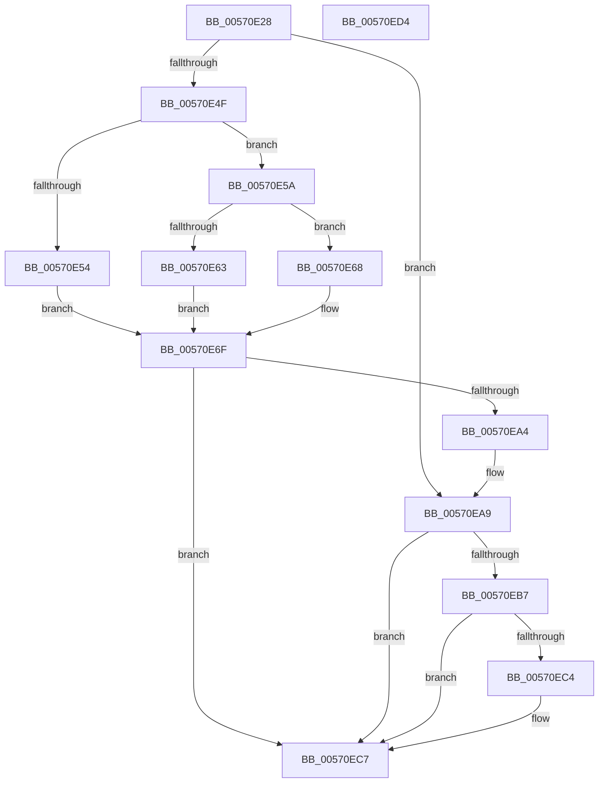

# IvtLegacyAllocateTranslationStructures

- RVA: `0x00570E28`–`0x00570ED5` (길이 `173` bytes)
- VA: `0x0000000140570E28`
- 실행 섹션: `.text`
- PDB 이름 있음: `예`; PDB Function 태그: `아니요`
- unwind 정보 RVA: `0x000C51C8`
- 디코드: `54`개 명령, `173/173` bytes 표시
- 미해석 바이트: `0` (있으면 어셈블리에 `.byte`로 보존)

> 이 문서는 커널 이미지의 기계어와 PDB 기호를 분석해 생성했습니다. 4번과 5번은 함수 원형과 자료형을 바이너리 사용 방식에서 추정한 C 해석이며 원본 소스 복구 결과는 아닙니다.

## 1. Dependencies

- 직접 호출 지점: **3**; 고유 호출 대상: **3**
- 직접 호출자로 확인된 함수: **4**
- RIP 상대 이미지 참조: **0**

### Outgoing calls
- `0x00570E6A` → [IvtLegacyGetDomainId](IvtLegacyGetDomainId_function_00571C14.md) (function, `0x00571C14`)
- `0x00570E9B` → [IvtLegacyAllocateScalableModePasidTables](IvtLegacyAllocateScalableModePasidTables_function_00570B20.md) (function, `0x00570B20`)
- `0x00570EAE` → [IvtAllocateContextTable](../4D/IvtAllocateContextTable_function_004DE0D4.md) (function, `0x004DE0D4`)

### Direct callers
- [IvtLegacyAttachDeviceDomainInternal](IvtLegacyAttachDeviceDomainInternal_function_00570EDC.md) at `0x00570F21`
- [IvtLegacyConfigureAts](IvtLegacyConfigureAts_function_00571270.md) at `0x005712AA`
- [IvtLegacyProcessDeviceExceptions](../../pagelk/B6/IvtLegacyProcessDeviceExceptions_function_00B62944.md) at `0x00B62A01`
- [HalpIvtpLegacyInitializeReservedDomain](../../pagelk/B6/HalpIvtpLegacyInitializeReservedDomain_function_00B63924.md) at `0x00B639AA`

### Static image references
- 디코드된 RIP-relative 메모리 참조가 없습니다.

## 2. Other-region calls and transfers

- 다른 실행 섹션으로 향하는 call: **0**
- 별도 외부 분기/꼬리 이동을 확인하지 못했습니다.

## 3. Assembly (complete function range)

```asm
00570E28  48 89 5C 24 18                  mov qword ptr [rsp + 0x18], rbx
00570E2D  55                              push rbp
00570E2E  56                              push rsi
00570E2F  57                              push rdi
00570E30  48 83 EC 40                     sub rsp, 0x40
00570E34  48 8B 42 38                     mov rax, qword ptr [rdx + 0x38]
00570E38  33 DB                           xor ebx, ebx
00570E3A  48 8B F2                        mov rsi, rdx
00570E3D  48 8B F9                        mov rdi, rcx
00570E40  48 89 5C 24 60                  mov qword ptr [rsp + 0x60], rbx
00570E45  8B 28                           mov ebp, dword ptr [rax]
00570E47  38 99 40 01 00 00               cmp byte ptr [rcx + 0x140], bl
00570E4D  74 5A                           je 0x140570ea9
00570E4F  4D 85 C0                        test r8, r8
00570E52  74 06                           je 0x140570e5a
00570E54  41 8B 40 30                     mov eax, dword ptr [r8 + 0x30]
00570E58  EB 15                           jmp 0x140570e6f
00570E5A  48 8B 42 40                     mov rax, qword ptr [rdx + 0x40]
00570E5E  48 85 C0                        test rax, rax
00570E61  74 05                           je 0x140570e68
00570E63  8B 40 2C                        mov eax, dword ptr [rax + 0x2c]
00570E66  EB 07                           jmp 0x140570e6f
00570E68  8B D5                           mov edx, ebp
00570E6A  E8 A5 0D 00 00                  call 0x140571c14
00570E6F  48 8D 4C 24 68                  lea rcx, [rsp + 0x68]
00570E74  45 33 C9                        xor r9d, r9d
00570E77  48 89 4C 24 38                  mov qword ptr [rsp + 0x38], rcx
00570E7C  44 8B C0                        mov r8d, eax
00570E7F  48 8D 4C 24 60                  lea rcx, [rsp + 0x60]
00570E84  48 8B D6                        mov rdx, rsi
00570E87  48 89 4C 24 30                  mov qword ptr [rsp + 0x30], rcx
00570E8C  48 8B CF                        mov rcx, rdi
00570E8F  C7 44 24 28 03 00 00 00         mov dword ptr [rsp + 0x28], 3
00570E97  21 5C 24 20                     and dword ptr [rsp + 0x20], ebx
00570E9B  E8 80 FC FF FF                  call 0x140570b20
00570EA0  85 C0                           test eax, eax
00570EA2  78 23                           js 0x140570ec7
00570EA4  48 8B 5C 24 60                  mov rbx, qword ptr [rsp + 0x60]
00570EA9  8B D5                           mov edx, ebp
00570EAB  48 8B CF                        mov rcx, rdi
00570EAE  E8 21 D2 F6 FF                  call 0x1404de0d4
00570EB3  85 C0                           test eax, eax
00570EB5  78 10                           js 0x140570ec7
00570EB7  48 8B 8C 24 88 00 00 00         mov rcx, qword ptr [rsp + 0x88]
00570EBF  48 85 C9                        test rcx, rcx
00570EC2  74 03                           je 0x140570ec7
00570EC4  48 89 19                        mov qword ptr [rcx], rbx
00570EC7  48 8B 5C 24 70                  mov rbx, qword ptr [rsp + 0x70]
00570ECC  48 83 C4 40                     add rsp, 0x40
00570ED0  5F                              pop rdi
00570ED1  5E                              pop rsi
00570ED2  5D                              pop rbp
00570ED3  C3                              ret
00570ED4  CC                              int3
```

## 4. C-style interpretation (structured pseudocode)

```c
__int64 __fastcall IvtLegacyAllocateTranslationStructures(__int64 a1, __int64 a2, __int64 a3, int a4, __int64 a5, __int64 a6)
{
    __int64 result;
    __int64 v_rbx;
    __int64 v_rsp;
    unsigned __int64 v_stack_m20;
    unsigned __int64 v_stack_m28;
    unsigned int v_stack_m30;
    unsigned int v_stack_m38;
    unsigned __int64 v_stack_p10;
    unsigned __int64 v_stack_p18;
    unsigned __int64 v_stack_p8;

    v_stack_p18 = v_rbx;
    v_rsp = (v_rsp) - (64);
    v_rbx = 0;
    v_stack_p8 = 0;
    if ((*(unsigned __int8 *)(a1 + 320)) == 0) goto loc_00570EA9;
    if (a3 == 0) goto loc_00570E5A;
    goto loc_00570E6F;
loc_00570E5A:
    if (*(unsigned __int64 *)(a2 + 64) == 0) goto loc_00570E68;
    goto loc_00570E6F;
loc_00570E68:
    result = IvtLegacyGetDomainId(a1, (unsigned int)((unsigned int)((unsigned int)(*(unsigned int *)(*(unsigned __int64 *)(a2 + 56))))), a3, a4);
loc_00570E6F:
    a4 = 0;
    v_stack_m20 = v_stack_p10;
    v_stack_m28 = v_stack_p8;
    v_stack_m30 = 3;
    result = IvtLegacyAllocateScalableModePasidTables(a1, a2, (unsigned int)((unsigned int)(result)), a4);
    if (sign_flag) goto loc_00570EC7;
loc_00570EA9:
    result = IvtAllocateContextTable(a1, (unsigned int)((unsigned int)((unsigned int)(*(unsigned int *)(*(unsigned __int64 *)(a2 + 56))))), (unsigned int)((unsigned int)(result)), a4);
    if (sign_flag) goto loc_00570EC7;
    if (a6 != 0) {
        *(unsigned __int64 *)(a6) = v_stack_p8;
    }
    v_rsp = (v_rsp) + (64);
    return result;
}
```

## 5. (Beta) C Style

```c
int64_t IvtLegacyAllocateTranslationStructures(void *Arg1, void *Arg2, int64_t Arg3, int32_t Arg4, uint64_t Arg5, int64_t Arg6)
{
    uint8_t *arg1 = (uint8_t *)Arg1;
    uint8_t *arg2 = (uint8_t *)Arg2;

    int64_t result;
    int64_t local_rbx;
    int64_t local_rsp;
    uint64_t v_stack_m20;
    uint64_t v_stack_m28;
    uint32_t v_stack_m30;
    uint32_t v_stack_m38;
    uint64_t v_stack_p10;
    uint64_t v_stack_p18;
    uint64_t v_stack_p8;

    v_stack_p18 = local_rbx;
    local_rsp = (local_rsp) - (64);
    local_rbx = 0;
    v_stack_p8 = 0;
    if ((*(uint8_t *)(arg1 + 0x140)) == 0) goto loc_00570EA9;
    if (Arg3 == 0) goto loc_00570E5A;
    goto loc_00570E6F;
loc_00570E5A:
    if (*(uint64_t *)(arg2 + 0x40) == 0) goto loc_00570E68;
    goto loc_00570E6F;
loc_00570E68:
    result = IvtLegacyGetDomainId(Arg1, (uint32_t)((uint32_t)((uint32_t)(*(uint32_t *)(*(uint64_t *)(arg2 + 0x38))))), Arg3, Arg4);
loc_00570E6F:
    Arg4 = 0;
    v_stack_m20 = v_stack_p10;
    v_stack_m28 = v_stack_p8;
    v_stack_m30 = 3;
    result = IvtLegacyAllocateScalableModePasidTables(Arg1, Arg2, (uint32_t)((uint32_t)(result)), Arg4);
    if (sign_flag) goto loc_00570EC7;
loc_00570EA9:
    result = IvtAllocateContextTable(Arg1, (uint32_t)((uint32_t)((uint32_t)(*(uint32_t *)(*(uint64_t *)(arg2 + 0x38))))), (uint32_t)((uint32_t)(result)), Arg4);
    if (sign_flag) goto loc_00570EC7;
    if (Arg6 != 0) {
        *(uint64_t *)(Arg6) = v_stack_p8;
    }
    local_rsp = (local_rsp) + (64);
    return result;
}
```

### 관측된 메모리 오프셋

구조체 형식이 확인되지 않은 접근은 인자 기준의 오프셋으로만 기록했습니다.

| 기준 인자 | 오프셋 표현 | 폭 (bit) | 접근 |
|---|---:|---:|---|
| `Arg1` | `+ 0x140` | `8` | `R` |
| `Arg2` | `+ 0x38` | `64` | `R` |
| `Arg2` | `+ 0x40` | `64` | `R` |

## 6. Execution-region graph

[열기: 2D/3D 그래프와 함수 탐색 컨트롤 패널](../../../control-panel.html?section=text&rva=0x00570E28&view=graph)

- 2D 그래프는 위에서 아래로 흐르고, 3D 그래프는 빈 공간을 드래그해 회전합니다. Shift+드래그는 이동, 휠은 확대·축소, 함수 노드 선택은 대상 보고서 이동입니다.

### Static fallback


