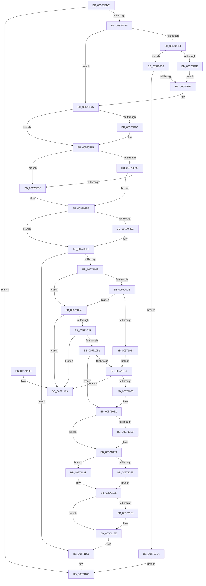

# IvtLegacyAttachDeviceDomainInternal

- RVA: `0x00570EDC`–`0x00571190` (길이 `692` bytes)
- VA: `0x0000000140570EDC`
- 실행 섹션: `.text`
- PDB 이름 있음: `예`; PDB Function 태그: `아니요`
- unwind 정보 RVA: `0x000C532C`
- 디코드: `180`개 명령, `692/692` bytes 표시
- 미해석 바이트: `0` (있으면 어셈블리에 `.byte`로 보존)

> 이 문서는 커널 이미지의 기계어와 PDB 기호를 분석해 생성했습니다. 4번과 5번은 함수 원형과 자료형을 바이너리 사용 방식에서 추정한 C 해석이며 원본 소스 복구 결과는 아닙니다.

## 1. Dependencies

- 직접 호출 지점: **17**; 고유 호출 대상: **11**
- 직접 호출자로 확인된 함수: **2**
- RIP 상대 이미지 참조: **1**

### Outgoing calls
- `0x00570F21` → [IvtLegacyAllocateTranslationStructures](IvtLegacyAllocateTranslationStructures_function_00570E28.md) (function, `0x00570E28`)
- `0x00570F39` → [memset](../6C/memset_function_006C6C40.md) (function, `0x006C6C40`)
- `0x00570F80` → [KiRaiseIrqlProcessIrqlFlags](../4F/KiRaiseIrqlProcessIrqlFlags_function_004F56FC.md) (function, `0x004F56FC`)
- `0x00570F91` → [KeAcquireInStackQueuedSpinLockAtDpcLevel](../27/KeAcquireInStackQueuedSpinLockAtDpcLevel_function_00275740.md) (function, `0x00275740`)
- `0x00570F9F` → [IvtLegacyGetDomainId](IvtLegacyGetDomainId_function_00571C14.md) (function, `0x00571C14`)
- `0x00570FCC` → [IvtLegacyUpdateTranslationStructures](IvtLegacyUpdateTranslationStructures_function_0057247C.md) (function, `0x0057247C`)
- `0x00570FE0` → [KeReleaseInStackQueuedSpinLockFromDpcLevel](../21/KeReleaseInStackQueuedSpinLockFromDpcLevel_function_002171B0.md) (function, `0x002171B0`)
- `0x00570FF4` → [KiLowerIrqlProcessIrqlFlags](../4F/KiLowerIrqlProcessIrqlFlags_function_004F5698.md) (function, `0x004F5698`)
- `0x0057102C` → [HalpAcquireHighLevelLock](../2D/HalpAcquireHighLevelLock_function_002D2390.md) (function, `0x002D2390`)
- `0x00571064` → [HalpReleaseHighLevelLock](../2D/HalpReleaseHighLevelLock_function_002D1C58.md) (function, `0x002D1C58`)
- `0x0057107A` → [HalpAcquireHighLevelLock](../2D/HalpAcquireHighLevelLock_function_002D2390.md) (function, `0x002D2390`)
- `0x005710A8` → [HalpReleaseHighLevelLock](../2D/HalpReleaseHighLevelLock_function_002D1C58.md) (function, `0x002D1C58`)
- `0x005710BF` → [memset](../6C/memset_function_006C6C40.md) (function, `0x006C6C40`)
- `0x005710E4` → [KiRaiseIrqlProcessIrqlFlags](../4F/KiRaiseIrqlProcessIrqlFlags_function_004F56FC.md) (function, `0x004F56FC`)
- `0x00571119` → [IvtLegacyFlushTbInternal](IvtLegacyFlushTbInternal_function_005714E8.md) (function, `0x005714E8`)
- `0x00571145` → [IvtLegacyFlushTbInternal](IvtLegacyFlushTbInternal_function_005714E8.md) (function, `0x005714E8`)
- `0x00571159` → [KiLowerIrqlProcessIrqlFlags](../4F/KiLowerIrqlProcessIrqlFlags_function_004F5698.md) (function, `0x004F5698`)

### Direct callers
- [IvtAttachDeviceDomain](../56/IvtAttachDeviceDomain_function_0056ED40.md) at `0x0056ED71`
- [IvtDetachDeviceDomain](../56/IvtDetachDeviceDomain_function_0056F3A0.md) at `0x0056F3C9`

### Static image references
- `0x00570F73` → RVA `0x00FC6D20` (`ALMOSTRO`; read)

## 2. Other-region calls and transfers

- 다른 실행 섹션으로 향하는 call: **0**
- 별도 외부 분기/꼬리 이동을 확인하지 못했습니다.

## 3. Assembly (complete function range)

```asm
00570EDC  48 89 5C 24 08                  mov qword ptr [rsp + 8], rbx
00570EE1  48 89 6C 24 10                  mov qword ptr [rsp + 0x10], rbp
00570EE6  48 89 74 24 18                  mov qword ptr [rsp + 0x18], rsi
00570EEB  57                              push rdi
00570EEC  41 54                           push r12
00570EEE  41 55                           push r13
00570EF0  41 56                           push r14
00570EF2  41 57                           push r15
00570EF4  48 81 EC 50 01 00 00            sub rsp, 0x150
00570EFB  0F 57 C0                        xorps xmm0, xmm0
00570EFE  33 C0                           xor eax, eax
00570F00  45 33 ED                        xor r13d, r13d
00570F03  48 89 44 24 60                  mov qword ptr [rsp + 0x60], rax
00570F08  0F 11 44 24 50                  movups xmmword ptr [rsp + 0x50], xmm0
00570F0D  45 8A F5                        mov r14b, r13b
00570F10  4C 89 6C 24 28                  mov qword ptr [rsp + 0x28], r13
00570F15  49 8B F8                        mov rdi, r8
00570F18  48 8B F2                        mov rsi, rdx
00570F1B  48 8B E9                        mov rbp, rcx
00570F1E  4D 8B E0                        mov r12, r8
00570F21  E8 02 FF FF FF                  call 0x140570e28
00570F26  85 C0                           test eax, eax
00570F28  0F 88 39 02 00 00               js 0x140571167
00570F2E  33 D2                           xor edx, edx
00570F30  45 8D 45 70                     lea r8d, [r13 + 0x70]
00570F34  48 8D 4C 24 70                  lea rcx, [rsp + 0x70]
00570F39  E8 02 5D 15 00                  call 0x1406c6c40
00570F3E  4D 85 E4                        test r12, r12
00570F41  75 23                           jne 0x140570f66
00570F43  8B 85 34 01 00 00               mov eax, dword ptr [rbp + 0x134]
00570F49  83 F8 02                        cmp eax, 2
00570F4C  75 0A                           jne 0x140570f58
00570F4E  C7 44 24 74 01 00 00 00         mov dword ptr [rsp + 0x74], 1
00570F56  EB 09                           jmp 0x140570f61
00570F58  83 F8 01                        cmp eax, 1
00570F5B  0F 85 B9 00 00 00               jne 0x14057101a
00570F61  48 8D 7C 24 70                  lea rdi, [rsp + 0x70]
00570F66  44 0F 20 C3                     mov rbx, cr8
00570F6A  B8 0F 00 00 00                  mov eax, 0xf
00570F6F  44 0F 22 C0                     mov cr8, rax
00570F73  44 39 2D A6 5D A5 00            cmp dword ptr [rip + 0xa55da6], r13d
00570F7A  74 09                           je 0x140570f85
00570F7C  8A D0                           mov dl, al
00570F7E  8A CB                           mov cl, bl
00570F80  E8 77 47 F8 FF                  call 0x1404f56fc
00570F85  48 8D 8D D0 00 00 00            lea rcx, [rbp + 0xd0]
00570F8C  48 8D 54 24 50                  lea rdx, [rsp + 0x50]
00570F91  E8 AA 47 D0 FF                  call 0x140275740
00570F96  48 8B 56 38                     mov rdx, qword ptr [rsi + 0x38]
00570F9A  48 8B CD                        mov rcx, rbp
00570F9D  8B 12                           mov edx, dword ptr [rdx]
00570F9F  E8 70 0C 00 00                  call 0x140571c14
00570FA4  4C 8B F8                        mov r15, rax
00570FA7  4D 85 E4                        test r12, r12
00570FAA  75 06                           jne 0x140570fb2
00570FAC  48 3B 46 18                     cmp rax, qword ptr [rsi + 0x18]
00570FB0  75 29                           jne 0x140570fdb
00570FB2  4C 8B 4E 40                     mov r9, qword ptr [rsi + 0x40]
00570FB6  48 8B CD                        mov rcx, rbp
00570FB9  48 8B 56 38                     mov rdx, qword ptr [rsi + 0x38]
00570FBD  44 89 6C 24 40                  mov dword ptr [rsp + 0x40], r13d
00570FC2  48 89 7C 24 30                  mov qword ptr [rsp + 0x30], rdi
00570FC7  44 89 6C 24 20                  mov dword ptr [rsp + 0x20], r13d
00570FCC  E8 AB 14 00 00                  call 0x14057247c
00570FD1  8B 47 30                        mov eax, dword ptr [rdi + 0x30]
00570FD4  41 B6 01                        mov r14b, 1
00570FD7  48 89 46 18                     mov qword ptr [rsi + 0x18], rax
00570FDB  48 8D 4C 24 50                  lea rcx, [rsp + 0x50]
00570FE0  E8 CB 61 CA FF                  call 0x1402171b0
00570FE5  44 39 2D 34 5D A5 00            cmp dword ptr [rip + 0xa55d34], r13d
00570FEC  74 0B                           je 0x140570ff9
00570FEE  44 0F 20 C1                     mov rcx, cr8
00570FF2  8A D3                           mov dl, bl
00570FF4  E8 9F 46 F8 FF                  call 0x1404f5698
00570FF9  0F B6 C3                        movzx eax, bl
00570FFC  44 0F 22 C0                     mov cr8, rax
00571000  45 84 F6                        test r14b, r14b
00571003  0F 84 5C 01 00 00               je 0x140571165
00571009  4D 85 E4                        test r12, r12
0057100C  74 16                           je 0x140571024
0057100E  4C 39 6E 10                     cmp qword ptr [rsi + 0x10], r13
00571012  75 10                           jne 0x140571024
00571014  48 8D 5E 28                     lea rbx, [rsi + 0x28]
00571018  EB 5C                           jmp 0x140571076
0057101A  B8 01 00 00 C0                  mov eax, 0xc0000001
0057101F  E9 43 01 00 00                  jmp 0x140571167
00571024  48 8B 5E 10                     mov rbx, qword ptr [rsi + 0x10]
00571028  48 8D 4B 58                     lea rcx, [rbx + 0x58]
0057102C  E8 5F 13 D6 FF                  call 0x1402d2390
00571031  88 43 60                        mov byte ptr [rbx + 0x60], al
00571034  48 8D 5E 28                     lea rbx, [rsi + 0x28]
00571038  48 8B 0B                        mov rcx, qword ptr [rbx]
0057103B  48 39 59 08                     cmp qword ptr [rcx + 8], rbx
0057103F  0F 85 44 01 00 00               jne 0x140571189
00571045  48 8B 43 08                     mov rax, qword ptr [rbx + 8]
00571049  48 39 18                        cmp qword ptr [rax], rbx
0057104C  0F 85 37 01 00 00               jne 0x140571189
00571052  48 89 08                        mov qword ptr [rax], rcx
00571055  48 89 41 08                     mov qword ptr [rcx + 8], rax
00571059  48 8B 56 10                     mov rdx, qword ptr [rsi + 0x10]
0057105D  48 8D 4A 58                     lea rcx, [rdx + 0x58]
00571061  8A 52 60                        mov dl, byte ptr [rdx + 0x60]
00571064  E8 EF 0B D6 FF                  call 0x1402d1c58
00571069  48 8B 46 10                     mov rax, qword ptr [rsi + 0x10]
0057106D  F0 FF 48 34                     lock dec dword ptr [rax + 0x34]
00571071  4D 85 E4                        test r12, r12
00571074  74 3B                           je 0x1405710b1
00571076  48 8D 4F 58                     lea rcx, [rdi + 0x58]
0057107A  E8 11 13 D6 FF                  call 0x1402d2390
0057107F  88 47 60                        mov byte ptr [rdi + 0x60], al
00571082  48 8D 47 38                     lea rax, [rdi + 0x38]
00571086  48 8B 50 08                     mov rdx, qword ptr [rax + 8]
0057108A  48 39 02                        cmp qword ptr [rdx], rax
0057108D  0F 85 F6 00 00 00               jne 0x140571189
00571093  48 89 03                        mov qword ptr [rbx], rax
00571096  48 8D 4F 58                     lea rcx, [rdi + 0x58]
0057109A  48 89 53 08                     mov qword ptr [rbx + 8], rdx
0057109E  48 89 1A                        mov qword ptr [rdx], rbx
005710A1  48 89 58 08                     mov qword ptr [rax + 8], rbx
005710A5  8A 57 60                        mov dl, byte ptr [rdi + 0x60]
005710A8  E8 AB 0B D6 FF                  call 0x1402d1c58
005710AD  F0 FF 47 34                     lock inc dword ptr [rdi + 0x34]
005710B1  33 D2                           xor edx, edx
005710B3  48 8D 8C 24 E0 00 00 00         lea rcx, [rsp + 0xe0]
005710BB  44 8D 42 70                     lea r8d, [rdx + 0x70]
005710BF  E8 7C 5B 15 00                  call 0x1406c6c40
005710C4  44 89 BC 24 10 01 00 00         mov dword ptr [rsp + 0x110], r15d
005710CC  44 0F 20 C3                     mov rbx, cr8
005710D0  BA 0F 00 00 00                  mov edx, 0xf
005710D5  44 0F 22 C2                     mov cr8, rdx
005710D9  44 39 2D 40 5C A5 00            cmp dword ptr [rip + 0xa55c40], r13d
005710E0  74 07                           je 0x1405710e9
005710E2  8A CB                           mov cl, bl
005710E4  E8 13 46 F8 FF                  call 0x1404f56fc
005710E9  48 8B 06                        mov rax, qword ptr [rsi]
005710EC  49 81 FF 00 00 01 00            cmp r15, 0x10000
005710F3  74 2E                           je 0x140571123
005710F5  4C 89 6C 24 38                  mov qword ptr [rsp + 0x38], r13
005710FA  4C 8D 84 24 E0 00 00 00         lea r8, [rsp + 0xe0]
00571102  44 89 6C 24 30                  mov dword ptr [rsp + 0x30], r13d
00571107  41 B1 01                        mov r9b, 1
0057110A  4C 89 6C 24 28                  mov qword ptr [rsp + 0x28], r13
0057110F  33 D2                           xor edx, edx
00571111  48 8B CD                        mov rcx, rbp
00571114  48 89 44 24 20                  mov qword ptr [rsp + 0x20], rax
00571119  E8 CA 03 00 00                  call 0x1405714e8
0057111E  48 8B 06                        mov rax, qword ptr [rsi]
00571121  EB 03                           jmp 0x140571126
00571123  49 8B FD                        mov rdi, r13
00571126  4C 89 6C 24 38                  mov qword ptr [rsp + 0x38], r13
0057112B  41 B1 01                        mov r9b, 1
0057112E  44 89 6C 24 30                  mov dword ptr [rsp + 0x30], r13d
00571133  4C 8B C7                        mov r8, rdi
00571136  4C 89 6C 24 28                  mov qword ptr [rsp + 0x28], r13
0057113B  33 D2                           xor edx, edx
0057113D  48 8B CD                        mov rcx, rbp
00571140  48 89 44 24 20                  mov qword ptr [rsp + 0x20], rax
00571145  E8 9E 03 00 00                  call 0x1405714e8
0057114A  44 39 2D CF 5B A5 00            cmp dword ptr [rip + 0xa55bcf], r13d
00571151  74 0B                           je 0x14057115e
00571153  44 0F 20 C1                     mov rcx, cr8
00571157  8A D3                           mov dl, bl
00571159  E8 3A 45 F8 FF                  call 0x1404f5698
0057115E  0F B6 C3                        movzx eax, bl
00571161  44 0F 22 C0                     mov cr8, rax
00571165  33 C0                           xor eax, eax
00571167  4C 8D 9C 24 50 01 00 00         lea r11, [rsp + 0x150]
0057116F  49 8B 5B 30                     mov rbx, qword ptr [r11 + 0x30]
00571173  49 8B 6B 38                     mov rbp, qword ptr [r11 + 0x38]
00571177  49 8B 73 40                     mov rsi, qword ptr [r11 + 0x40]
0057117B  49 8B E3                        mov rsp, r11
0057117E  41 5F                           pop r15
00571180  41 5E                           pop r14
00571182  41 5D                           pop r13
00571184  41 5C                           pop r12
00571186  5F                              pop rdi
00571187  C3                              ret
00571188  CC                              int3
00571189  B9 03 00 00 00                  mov ecx, 3
0057118E  CD 29                           int 0x29
```

## 4. C-style interpretation (structured pseudocode)

```c
__int64 __fastcall IvtLegacyAttachDeviceDomainInternal(__int64 a1, __int64 a2, __int64 a3)
{
    __int64 result;
    __int64 v_r13;
    __int64 v_r14;
    __int64 v_rsp;
    unsigned int v_stack_m104;
    unsigned __int64 v_stack_m108;
    unsigned __int64 v_stack_m118;
    unsigned __int64 v_stack_m128;
    unsigned int v_stack_m138;
    unsigned __int64 v_stack_m140;
    unsigned __int64 v_stack_m148;
    unsigned __int64 v_stack_m150;
    unsigned int v_stack_m158;
    unsigned __int64 v_stack_m28;
    unsigned int v_stack_m68;
    unsigned __int64 v_stack_m98;
    unsigned __int64 v_stack_p10;
    unsigned __int64 v_stack_p18;
    unsigned __int64 v_stack_p8;

    v_stack_p8 = v_rbx;
    v_stack_p10 = v_rbp;
    v_stack_p18 = v_rsi;
    v_rsp = (v_rsp) - (336);
    result = 0;
    v_r13 = 0;
    v_stack_m118 = 0;
    v_stack_m128 = v_xmm0;
    v_stack_m150 = 0;
    result = IvtLegacyAllocateTranslationStructures(a1, a2, a3, a4);
    if (sign_flag) goto loc_00571167;
    a2 = 0;
    result = memset(v_stack_m108, a2, v_r13 + 112, a4);
    if (a3 != 0) goto loc_00570F66;
    if (((unsigned int)((unsigned int)(*(unsigned int *)(a1 + 308)))) != 2) goto loc_00570F58;
    v_stack_m104 = 1;
    goto loc_00570F61;
loc_00570F58:
    if (((unsigned int)((unsigned int)(*(unsigned int *)(a1 + 308)))) != 1) goto loc_0057101A;
loc_00570F61:
loc_00570F66:
    result = 15;
    if ((*(unsigned int *)(v_rip + 10837414)) != 0) {
        a2 = 15;
        a1 = (unsigned __int8)(v_cr8);
        result = KiRaiseIrqlProcessIrqlFlags(a1, a2, v_r13 + 112, a4);
    }
    result = KeAcquireInStackQueuedSpinLockAtDpcLevel(a1 + 208, v_stack_m128, v_r13 + 112, a4);
    result = IvtLegacyGetDomainId(a1, (unsigned int)(*(unsigned int *)(*(unsigned __int64 *)(a2 + 56))), v_r13 + 112, a4);
    if (a3 != 0) goto loc_00570FB2;
    v_r14 = 0;
    if (result == (*(unsigned __int64 *)(a2 + 24))) {
        a4 = *(unsigned __int64 *)(a2 + 64);
        a1 = a1;
        a2 = *(unsigned __int64 *)(a2 + 56);
        v_stack_m138 = 0;
        v_stack_m148 = v_stack_m108;
        v_stack_m158 = 0;
        result = IvtLegacyUpdateTranslationStructures(a1, a2, v_r13 + 112, a4);
        result = *(unsigned int *)(v_stack_m108 + 48);
        v_r14 = 1;
        *(unsigned __int64 *)(a2 + 24) = result;
    }
    result = KeReleaseInStackQueuedSpinLockFromDpcLevel(v_stack_m128, a2, v_r13 + 112, a4);
    if ((*(unsigned int *)(v_rip + 10837300)) != 0) {
        a1 = 15;
        a2 = (unsigned __int8)(v_cr8);
        result = KiLowerIrqlProcessIrqlFlags(a1, a2, v_r13 + 112, a4);
    }
    if ((unsigned __int8)(v_r14) == 0) goto loc_00571165;
    if (a3 == 0) goto loc_00571024;
    if ((*(unsigned __int64 *)(a2 + 16)) != 0) goto loc_00571024;
    goto loc_00571076;
loc_0057101A:
    goto loc_00571167;
loc_00571024:
    result = HalpAcquireHighLevelLock(*(unsigned __int64 *)(a2 + 16) + 88, a2, v_r13 + 112, a4);
    *(unsigned __int8 *)(*(unsigned __int64 *)(a2 + 16) + 96) = (unsigned __int8)(result);
    if ((*(unsigned __int64 *)(*(unsigned __int64 *)(a2 + 40) + 8)) != (a2 + 40)) goto loc_00571189;
    if ((*(unsigned __int64 *)(*(unsigned __int64 *)(a2 + 40 + 8))) != (a2 + 40)) goto loc_00571189;
    *(unsigned __int64 *)(*(unsigned __int64 *)(a2 + 40 + 8)) = *(unsigned __int64 *)(a2 + 40);
    *(unsigned __int64 *)(*(unsigned __int64 *)(a2 + 40) + 8) = *(unsigned __int64 *)(a2 + 40 + 8);
    result = HalpReleaseHighLevelLock(*(unsigned __int64 *)(a2 + 16) + 88, *(unsigned __int8 *)(*(unsigned __int64 *)(a2 + 16) + 96), v_r13 + 112, a4);
    if (a3 == 0) goto loc_005710B1;
loc_00571076:
    result = HalpAcquireHighLevelLock(v_stack_m108 + 88, *(unsigned __int8 *)(*(unsigned __int64 *)(a2 + 16) + 96), v_r13 + 112, a4);
    *(unsigned __int8 *)(v_stack_m108 + 96) = (unsigned __int8)(result);
    if ((*(unsigned __int64 *)(*(unsigned __int64 *)(v_stack_m108 + 56 + 8))) != (v_stack_m108 + 56)) goto loc_00571189;
    *(unsigned __int64 *)(a2 + 40) = v_stack_m108 + 56;
    *(unsigned __int64 *)(a2 + 40 + 8) = *(unsigned __int64 *)(v_stack_m108 + 56 + 8);
    *(unsigned __int64 *)(*(unsigned __int64 *)(v_stack_m108 + 56 + 8)) = a2 + 40;
    *(unsigned __int64 *)(v_stack_m108 + 56 + 8) = a2 + 40;
    result = HalpReleaseHighLevelLock(v_stack_m108 + 88, *(unsigned __int8 *)(v_stack_m108 + 96), v_r13 + 112, a4);
loc_005710B1:
    a2 = 0;
    result = memset(v_stack_m98, a2, a2 + 112, a4);
    v_stack_m68 = (unsigned int)(result);
    if ((*(unsigned int *)(v_rip + 10837056)) != 0) {
        a1 = (unsigned __int8)((unsigned __int8)(v_cr8));
        result = KiRaiseIrqlProcessIrqlFlags(a1, 15, a2 + 112, a4);
    }
    if (result == 0x10000ULL) goto loc_00571123;
    v_stack_m140 = 0;
    v_stack_m148 = 0;
    v_stack_m150 = 0;
    a2 = 0;
    v_stack_m158 = *(unsigned __int64 *)(a2);
    result = IvtLegacyFlushTbInternal(a1, a2, v_stack_m98, 1);
    goto loc_00571126;
loc_00571123:
loc_00571126:
    v_stack_m140 = 0;
    v_stack_m148 = 0;
    v_stack_m150 = 0;
    a2 = 0;
    v_stack_m158 = *(unsigned __int64 *)(a2);
    result = IvtLegacyFlushTbInternal(a1, a2, 0, 1);
    if ((*(unsigned int *)(v_rip + 10836943)) != 0) {
        a1 = 15;
        a2 = (unsigned __int8)((unsigned __int8)(v_cr8));
        result = KiLowerIrqlProcessIrqlFlags(a1, a2, 0, 1);
    }
loc_00571165:
    result = 0;
loc_00571167:
    return result;
loc_00571189:
    return result;
}
```

## 5. (Beta) C Style

```c
int64_t IvtLegacyAttachDeviceDomainInternal(void *Arg1, void *Arg2, int64_t Arg3)
{
    uint8_t *arg1 = (uint8_t *)Arg1;
    uint8_t *arg2 = (uint8_t *)Arg2;

    int64_t result;
    int64_t local_r13;
    int64_t local_r14;
    int64_t local_rsp;
    uint32_t v_stack_m104;
    uint64_t v_stack_m108;
    uint64_t v_stack_m118;
    uint64_t v_stack_m128;
    uint32_t v_stack_m138;
    uint64_t v_stack_m140;
    uint64_t v_stack_m148;
    uint64_t v_stack_m150;
    uint32_t v_stack_m158;
    uint64_t v_stack_m28;
    uint32_t v_stack_m68;
    uint64_t v_stack_m98;
    uint64_t v_stack_p10;
    uint64_t v_stack_p18;
    uint64_t v_stack_p8;

    v_stack_p8 = local_rbx;
    v_stack_p10 = local_rbp;
    v_stack_p18 = local_rsi;
    local_rsp = (local_rsp) - (336);
    result = 0;
    local_r13 = 0;
    v_stack_m118 = 0;
    v_stack_m128 = v_xmm0;
    v_stack_m150 = 0;
    result = IvtLegacyAllocateTranslationStructures(Arg1, Arg2, Arg3, a4);
    if (sign_flag) goto loc_00571167;
    Arg2 = 0;
    result = memset(v_stack_m108, Arg2, local_r13 + 112, a4);
    if (Arg3 != 0) goto loc_00570F66;
    if (((uint32_t)((uint32_t)(*(uint32_t *)(arg1 + 0x134)))) != 2) goto loc_00570F58;
    v_stack_m104 = 1;
    goto loc_00570F61;
loc_00570F58:
    if (((uint32_t)((uint32_t)(*(uint32_t *)(arg1 + 0x134)))) != 1) goto loc_0057101A;
loc_00570F61:
loc_00570F66:
    result = 15;
    if ((*(uint32_t *)(v_rip + 0xA55DA6)) != 0) {
        Arg2 = 15;
        Arg1 = (uint8_t)(v_cr8);
        result = KiRaiseIrqlProcessIrqlFlags(Arg1, Arg2, local_r13 + 112, a4);
    }
    result = KeAcquireInStackQueuedSpinLockAtDpcLevel(Arg1 + 208, v_stack_m128, local_r13 + 112, a4);
    result = IvtLegacyGetDomainId(Arg1, (uint32_t)(*(uint32_t *)(*(uint64_t *)(arg2 + 0x38))), local_r13 + 112, a4);
    if (Arg3 != 0) goto loc_00570FB2;
    local_r14 = 0;
    if (result == (*(uint64_t *)(arg2 + 0x18))) {
        a4 = *(uint64_t *)(arg2 + 0x40);
        Arg1 = Arg1;
        Arg2 = *(uint64_t *)(arg2 + 0x38);
        v_stack_m138 = 0;
        v_stack_m148 = v_stack_m108;
        v_stack_m158 = 0;
        result = IvtLegacyUpdateTranslationStructures(Arg1, Arg2, local_r13 + 112, a4);
        result = *(uint32_t *)(v_stack_m108 + 0x30);
        local_r14 = 1;
        *(uint64_t *)(arg2 + 0x18) = result;
    }
    result = KeReleaseInStackQueuedSpinLockFromDpcLevel(v_stack_m128, Arg2, local_r13 + 112, a4);
    if ((*(uint32_t *)(v_rip + 0xA55D34)) != 0) {
        Arg1 = 15;
        Arg2 = (uint8_t)(v_cr8);
        result = KiLowerIrqlProcessIrqlFlags(Arg1, Arg2, local_r13 + 112, a4);
    }
    if ((uint8_t)(local_r14) == 0) goto loc_00571165;
    if (Arg3 == 0) goto loc_00571024;
    if ((*(uint64_t *)(arg2 + 0x10)) != 0) goto loc_00571024;
    goto loc_00571076;
loc_0057101A:
    goto loc_00571167;
loc_00571024:
    result = HalpAcquireHighLevelLock(*(uint64_t *)(arg2 + 0x10) + 88, Arg2, local_r13 + 112, a4);
    *(uint8_t *)(*(uint64_t *)(arg2 + 0x10) + 0x60) = (uint8_t)(result);
    if ((*(uint64_t *)(*(uint64_t *)(arg2 + 0x28) + 0x8)) != (Arg2 + 40)) goto loc_00571189;
    if ((*(uint64_t *)(*(uint64_t *)(arg2 + 0x28 + 0x8))) != (Arg2 + 40)) goto loc_00571189;
    *(uint64_t *)(*(uint64_t *)(arg2 + 0x28 + 0x8)) = *(uint64_t *)(arg2 + 0x28);
    *(uint64_t *)(*(uint64_t *)(arg2 + 0x28) + 0x8) = *(uint64_t *)(arg2 + 0x28 + 0x8);
    result = HalpReleaseHighLevelLock(*(uint64_t *)(arg2 + 0x10) + 88, *(uint8_t *)(*(uint64_t *)(arg2 + 0x10) + 0x60), local_r13 + 112, a4);
    if (Arg3 == 0) goto loc_005710B1;
loc_00571076:
    result = HalpAcquireHighLevelLock(v_stack_m108 + 88, *(uint8_t *)(*(uint64_t *)(arg2 + 0x10) + 0x60), local_r13 + 112, a4);
    *(uint8_t *)(v_stack_m108 + 0x60) = (uint8_t)(result);
    if ((*(uint64_t *)(*(uint64_t *)(v_stack_m108 + 0x38 + 0x8))) != (v_stack_m108 + 56)) goto loc_00571189;
    *(uint64_t *)(arg2 + 0x28) = v_stack_m108 + 56;
    *(uint64_t *)(arg2 + 0x28 + 0x8) = *(uint64_t *)(v_stack_m108 + 0x38 + 0x8);
    *(void **)(*(uint64_t *)(v_stack_m108 + 0x38 + 0x8)) = Arg2 + 40;
    *(void **)(v_stack_m108 + 0x38 + 0x8) = Arg2 + 40;
    result = HalpReleaseHighLevelLock(v_stack_m108 + 88, *(uint8_t *)(v_stack_m108 + 0x60), local_r13 + 112, a4);
loc_005710B1:
    Arg2 = 0;
    result = memset(v_stack_m98, Arg2, Arg2 + 112, a4);
    v_stack_m68 = (uint32_t)(result);
    if ((*(uint32_t *)(v_rip + 0xA55C40)) != 0) {
        Arg1 = (uint8_t)((uint8_t)(v_cr8));
        result = KiRaiseIrqlProcessIrqlFlags(Arg1, 15, Arg2 + 112, a4);
    }
    if (result == 0x10000ULL) goto loc_00571123;
    v_stack_m140 = 0;
    v_stack_m148 = 0;
    v_stack_m150 = 0;
    Arg2 = 0;
    v_stack_m158 = *(uint64_t *)(arg2);
    result = IvtLegacyFlushTbInternal(Arg1, Arg2, v_stack_m98, 1);
    goto loc_00571126;
loc_00571123:
loc_00571126:
    v_stack_m140 = 0;
    v_stack_m148 = 0;
    v_stack_m150 = 0;
    Arg2 = 0;
    v_stack_m158 = *(uint64_t *)(arg2);
    result = IvtLegacyFlushTbInternal(Arg1, Arg2, 0, 1);
    if ((*(uint32_t *)(v_rip + 0xA55BCF)) != 0) {
        Arg1 = 15;
        Arg2 = (uint8_t)((uint8_t)(v_cr8));
        result = KiLowerIrqlProcessIrqlFlags(Arg1, Arg2, 0, 1);
    }
loc_00571165:
    result = 0;
loc_00571167:
    return result;
loc_00571189:
    return result;
}
```

### 관측된 메모리 오프셋

구조체 형식이 확인되지 않은 접근은 인자 기준의 오프셋으로만 기록했습니다.

| 기준 인자 | 오프셋 표현 | 폭 (bit) | 접근 |
|---|---:|---:|---|
| `Arg1` | `+ 0xD0` | `64` | `R` |
| `Arg1` | `+ 0x134` | `32` | `R` |
| `Arg2` | `+ 0x0` | `64` | `R` |
| `Arg2` | `+ 0x0` | `64` | `W` |
| `Arg2` | `+ 0x8` | `64` | `R` |
| `Arg2` | `+ 0x8` | `64` | `W` |
| `Arg2` | `+ 0x10` | `64` | `R` |
| `Arg2` | `+ 0x18` | `64` | `R` |
| `Arg2` | `+ 0x18` | `64` | `W` |
| `Arg2` | `+ 0x28` | `64` | `R` |
| `Arg2` | `+ 0x38` | `64` | `R` |
| `Arg2` | `+ 0x40` | `64` | `R` |

## 6. Execution-region graph

[열기: 2D/3D 그래프와 함수 탐색 컨트롤 패널](../../../control-panel.html?section=text&rva=0x00570EDC&view=graph)

- 2D 그래프는 위에서 아래로 흐르고, 3D 그래프는 빈 공간을 드래그해 회전합니다. Shift+드래그는 이동, 휠은 확대·축소, 함수 노드 선택은 대상 보고서 이동입니다.

### Static fallback


