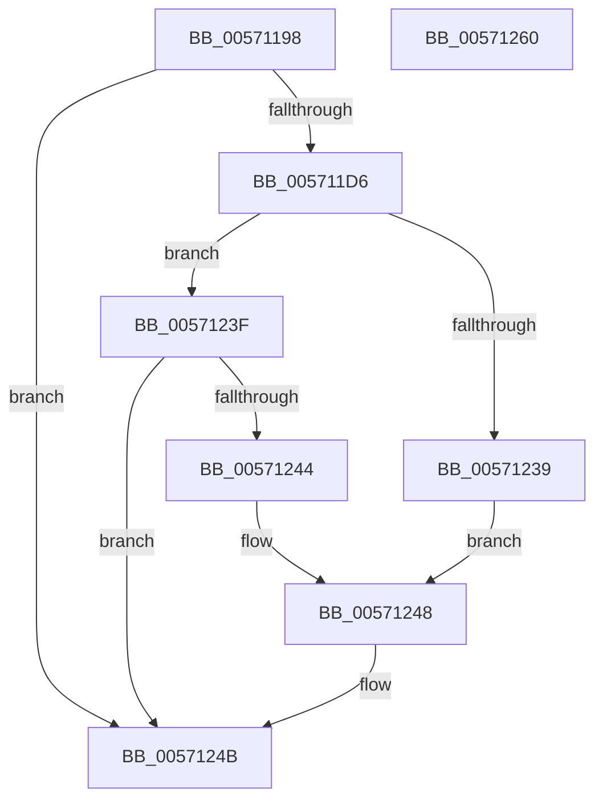

# IvtLegacyBuildScalableModeContextEntry

- RVA: `0x00571198`–`0x00571261` (길이 `201` bytes)
- VA: `0x0000000140571198`
- 실행 섹션: `.text`
- PDB 이름 있음: `예`; PDB Function 태그: `아니요`
- unwind 정보 RVA: `0x0005C954`
- 디코드: `56`개 명령, `201/201` bytes 표시
- 미해석 바이트: `0` (있으면 어셈블리에 `.byte`로 보존)

> 이 문서는 커널 이미지의 기계어와 PDB 기호를 분석해 생성했습니다. 4번과 5번은 함수 원형과 자료형을 바이너리 사용 방식에서 추정한 C 해석이며 원본 소스 복구 결과는 아닙니다.

## 1. Dependencies

- 직접 호출 지점: **1**; 고유 호출 대상: **1**
- 직접 호출자로 확인된 함수: **2**
- RIP 상대 이미지 참조: **0**

### Outgoing calls
- `0x005711E1` → [MmGetPhysicalAddress](../23/MmGetPhysicalAddress_function_0023A500.md) (function, `0x0023A500`)

### Direct callers
- [IvtLegacyUpdateScalableModeContextEntry](IvtLegacyUpdateScalableModeContextEntry_function_005721B8.md) at `0x005722E5`
- [IvtInitializeIommu](../../pagelk/B6/IvtInitializeIommu_function_00B61FE0.md) at `0x00B623B1`

### Static image references
- 디코드된 RIP-relative 메모리 참조가 없습니다.

## 2. Other-region calls and transfers

- 다른 실행 섹션으로 향하는 call: **0**
- 별도 외부 분기/꼬리 이동을 확인하지 못했습니다.

## 3. Assembly (complete function range)

```asm
00571198  48 8B C4                        mov rax, rsp
0057119B  48 89 58 08                     mov qword ptr [rax + 8], rbx
0057119F  48 89 68 10                     mov qword ptr [rax + 0x10], rbp
005711A3  48 89 70 18                     mov qword ptr [rax + 0x18], rsi
005711A7  57                              push rdi
005711A8  48 83 EC 20                     sub rsp, 0x20
005711AC  48 8B 5C 24 58                  mov rbx, qword ptr [rsp + 0x58]
005711B1  41 8A E9                        mov bpl, r9b
005711B4  83 60 28 00                     and dword ptr [rax + 0x28], 0
005711B8  41 8A F0                        mov sil, r8b
005711BB  48 8B FA                        mov rdi, rdx
005711BE  48 83 63 08 00                  and qword ptr [rbx + 8], 0
005711C3  48 83 63 10 00                  and qword ptr [rbx + 0x10], 0
005711C8  48 83 63 18 00                  and qword ptr [rbx + 0x18], 0
005711CD  48 83 23 00                     and qword ptr [rbx], 0
005711D1  48 85 D2                        test rdx, rdx
005711D4  74 75                           je 0x14057124b
005711D6  48 C7 03 01 00 00 00            mov qword ptr [rbx], 1
005711DD  48 8B 4A 38                     mov rcx, qword ptr [rdx + 0x38]
005711E1  E8 1A 93 CC FF                  call 0x14023a500
005711E6  48 8B 0B                        mov rcx, qword ptr [rbx]
005711E9  48 8B D1                        mov rdx, rcx
005711EC  48 33 D0                        xor rdx, rax
005711EF  48 81 E2 00 F0 FF FF            and rdx, 0xfffffffffffff000
005711F6  48 33 D1                        xor rdx, rcx
005711F9  B9 00 02 00 00                  mov ecx, 0x200
005711FE  48 89 13                        mov qword ptr [rbx], rdx
00571201  8B 47 24                        mov eax, dword ptr [rdi + 0x24]
00571204  C1 E8 06                        shr eax, 6
00571207  25 FF 3F 00 00                  and eax, 0x3fff
0057120C  3B C1                           cmp eax, ecx
0057120E  0F 42 C1                        cmovb eax, ecx
00571211  48 81 63 08 00 00 F0 FF         and qword ptr [rbx + 8], 0xfffffffffff00000
00571219  0F BD C8                        bsr ecx, eax
0057121C  FF C1                           inc ecx
0057121E  48 C1 E1 09                     shl rcx, 9
00571222  48 8B C1                        mov rax, rcx
00571225  48 33 C2                        xor rax, rdx
00571228  48 25 FF F1 FF FF               and rax, 0xfffffffffffff1ff
0057122E  48 33 C1                        xor rax, rcx
00571231  48 89 03                        mov qword ptr [rbx], rax
00571234  40 84 ED                        test bpl, bpl
00571237  74 06                           je 0x14057123f
00571239  48 83 C8 1C                     or rax, 0x1c
0057123D  EB 09                           jmp 0x140571248
0057123F  40 84 F6                        test sil, sil
00571242  74 07                           je 0x14057124b
00571244  48 83 C8 04                     or rax, 4
00571248  48 89 03                        mov qword ptr [rbx], rax
0057124B  48 8B 5C 24 30                  mov rbx, qword ptr [rsp + 0x30]
00571250  48 8B 6C 24 38                  mov rbp, qword ptr [rsp + 0x38]
00571255  48 8B 74 24 40                  mov rsi, qword ptr [rsp + 0x40]
0057125A  48 83 C4 20                     add rsp, 0x20
0057125E  5F                              pop rdi
0057125F  C3                              ret
00571260  CC                              int3
```

## 4. C-style interpretation (structured pseudocode)

```c
__int64 __fastcall IvtLegacyBuildScalableModeContextEntry(__int64 a1, __int64 a2, unsigned __int8 a3, unsigned __int8 a4, __int64 a5, __int64 a6)
{
    __int64 result;
    __int64 v_rsp;
    unsigned __int64 v_stack_p10;
    unsigned __int64 v_stack_p18;
    unsigned __int64 v_stack_p8;

    *(unsigned __int64 *)(v_rsp + 8) = v_rbx;
    *(unsigned __int64 *)(v_rsp + 16) = v_rbp;
    *(unsigned __int64 *)(v_rsp + 24) = v_rsi;
    v_rsp = (v_rsp) - (32);
    if (a2 == 0) goto loc_0057124B;
    *(unsigned __int64 *)(a6) = 1;
    result = MmGetPhysicalAddress(*(unsigned __int64 *)(a2 + 56), a2, a3, a4);
    a2 = (*(unsigned __int64 *)(a6)) ^ (result);
    a2 = (a2) & (0xFFFFFFFFFFFFF000ULL);
    a2 = (a2) ^ (*(unsigned __int64 *)(a6));
    *(unsigned __int64 *)(a6) = a2;
    result = (unsigned int)(((unsigned int)(*(unsigned int *)(a2 + 36))) >> (6));
    result = (unsigned int)((result) & (0x3FFFULL));
    if (((unsigned int)(result)) < 512) { result = 512; }
    a1 = (unsigned int)((512) + 1);
    a1 = (a1) << (9);
    result = (a1) ^ (a2);
    result = (result) & (0xFFFFFFFFFFFFF1FFULL);
    result = (result) ^ (a1);
    *(unsigned __int64 *)(a6) = result;
    if (a4 == 0) goto loc_0057123F;
    result = (result) | (28);
    goto loc_00571248;
loc_0057123F:
    if (a3 == 0) goto loc_0057124B;
    result = (result) | (4);
loc_00571248:
    *(unsigned __int64 *)(a6) = result;
loc_0057124B:
    v_rsp = (v_rsp) + (32);
    return result;
}
```

## 5. (Beta) C Style

```c
int64_t IvtLegacyBuildScalableModeContextEntry(int64_t Arg1, void *Arg2, uint8_t Arg3, uint8_t Arg4, uint64_t Arg5, void *Arg6)
{
    uint8_t *arg2 = (uint8_t *)Arg2;
    uint8_t *arg6 = (uint8_t *)Arg6;

    int64_t result;
    int64_t local_rsp;
    uint64_t v_stack_p10;
    uint64_t v_stack_p18;
    uint64_t v_stack_p8;

    *(uint64_t *)(local_rsp + 0x8) = local_rbx;
    *(uint64_t *)(local_rsp + 0x10) = local_rbp;
    *(uint64_t *)(local_rsp + 0x18) = local_rsi;
    local_rsp = (local_rsp) - (32);
    if (Arg2 == NULL) goto loc_0057124B;
    *(uint64_t *)(arg6) = 1;
    result = MmGetPhysicalAddress(*(uint64_t *)(arg2 + 0x38), Arg2, Arg3, Arg4);
    Arg2 = (*(uint64_t *)(arg6)) ^ (result);
    Arg2 = (Arg2) & (0xFFFFFFFFFFFFF000ULL);
    Arg2 = (Arg2) ^ (*(uint64_t *)(arg6));
    *(void **)(arg6) = Arg2;
    result = (uint32_t)(((uint32_t)(*(uint32_t *)(arg2 + 0x24))) >> (6));
    result = (uint32_t)((result) & (0x3FFFULL));
    if (((uint32_t)(result)) < 512) { result = 512; }
    Arg1 = (uint32_t)((512) + 1);
    Arg1 = (Arg1) << (9);
    result = (Arg1) ^ (Arg2);
    result = (result) & (0xFFFFFFFFFFFFF1FFULL);
    result = (result) ^ (Arg1);
    *(uint64_t *)(arg6) = result;
    if (Arg4 == 0) goto loc_0057123F;
    result = (result) | (28);
    goto loc_00571248;
loc_0057123F:
    if (Arg3 == 0) goto loc_0057124B;
    result = (result) | (4);
loc_00571248:
    *(uint64_t *)(arg6) = result;
loc_0057124B:
    local_rsp = (local_rsp) + (32);
    return result;
}
```

### 관측된 메모리 오프셋

구조체 형식이 확인되지 않은 접근은 인자 기준의 오프셋으로만 기록했습니다.

| 기준 인자 | 오프셋 표현 | 폭 (bit) | 접근 |
|---|---:|---:|---|
| `Arg2` | `+ 0x24` | `32` | `R` |
| `Arg6` | `+ 0x0` | `64` | `R` |
| `Arg6` | `+ 0x0` | `64` | `R/W` |
| `Arg6` | `+ 0x0` | `64` | `W` |
| `Arg6` | `+ 0x8` | `64` | `R/W` |
| `Arg6` | `+ 0x10` | `64` | `R/W` |
| `Arg6` | `+ 0x18` | `64` | `R/W` |

## 6. Execution-region graph

[열기: 2D/3D 그래프와 함수 탐색 컨트롤 패널](../../../control-panel.html?section=text&rva=0x00571198&view=graph)

- 2D 그래프는 위에서 아래로 흐르고, 3D 그래프는 빈 공간을 드래그해 회전합니다. Shift+드래그는 이동, 휠은 확대·축소, 함수 노드 선택은 대상 보고서 이동입니다.

### Static fallback


