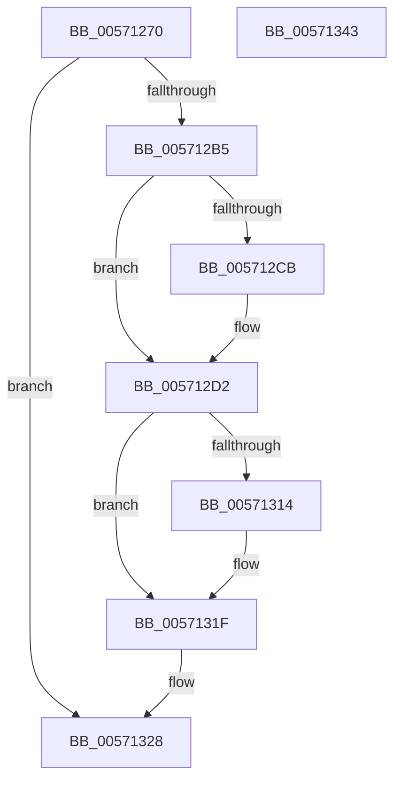

# IvtLegacyConfigureAts

- RVA: `0x00571270`–`0x00571344` (길이 `212` bytes)
- VA: `0x0000000140571270`
- 실행 섹션: `.text`
- PDB 이름 있음: `예`; PDB Function 태그: `아니요`
- unwind 정보 RVA: `0x000BF908`
- 디코드: `57`개 명령, `212/212` bytes 표시
- 미해석 바이트: `0` (있으면 어셈블리에 `.byte`로 보존)

> 이 문서는 커널 이미지의 기계어와 PDB 기호를 분석해 생성했습니다. 4번과 5번은 함수 원형과 자료형을 바이너리 사용 방식에서 추정한 C 해석이며 원본 소스 복구 결과는 아닙니다.

## 1. Dependencies

- 직접 호출 지점: **6**; 고유 호출 대상: **6**
- 직접 호출자로 확인된 함수: **0**
- RIP 상대 이미지 참조: **1**

### Outgoing calls
- `0x005712AA` → [IvtLegacyAllocateTranslationStructures](IvtLegacyAllocateTranslationStructures_function_00570E28.md) (function, `0x00570E28`)
- `0x005712CD` → [KiRaiseIrqlProcessIrqlFlags](../4F/KiRaiseIrqlProcessIrqlFlags_function_004F56FC.md) (function, `0x004F56FC`)
- `0x005712DE` → [KeAcquireInStackQueuedSpinLockAtDpcLevel](../27/KeAcquireInStackQueuedSpinLockAtDpcLevel_function_00275740.md) (function, `0x00275740`)
- `0x005712FC` → [IvtLegacyUpdateScalableModeContextEntry](IvtLegacyUpdateScalableModeContextEntry_function_005721B8.md) (function, `0x005721B8`)
- `0x00571306` → [KeReleaseInStackQueuedSpinLockFromDpcLevel](../21/KeReleaseInStackQueuedSpinLockFromDpcLevel_function_002171B0.md) (function, `0x002171B0`)
- `0x0057131A` → [KiLowerIrqlProcessIrqlFlags](../4F/KiLowerIrqlProcessIrqlFlags_function_004F5698.md) (function, `0x004F5698`)

### Direct callers
- 이 함수 시작 RVA로 연결되는 직접 call은 확인되지 않았습니다. 간접 호출은 완전히 역산할 수 없습니다.

### Static image references
- `0x005712C2` → RVA `0x00FC6D20` (`ALMOSTRO`; read)

## 2. Other-region calls and transfers

- 다른 실행 섹션으로 향하는 call: **0**
- 별도 외부 분기/꼬리 이동을 확인하지 못했습니다.

## 3. Assembly (complete function range)

```asm
00571270  4C 8B DC                        mov r11, rsp
00571273  49 89 5B 08                     mov qword ptr [r11 + 8], rbx
00571277  49 89 6B 10                     mov qword ptr [r11 + 0x10], rbp
0057127B  49 89 73 18                     mov qword ptr [r11 + 0x18], rsi
0057127F  49 89 7B 20                     mov qword ptr [r11 + 0x20], rdi
00571283  41 56                           push r14
00571285  48 83 EC 60                     sub rsp, 0x60
00571289  33 C0                           xor eax, eax
0057128B  0F 57 C0                        xorps xmm0, xmm0
0057128E  41 F6 D8                        neg r8b
00571291  48 8B F2                        mov rsi, rdx
00571294  0F 11 44 24 40                  movups xmmword ptr [rsp + 0x40], xmm0
00571299  45 1B F6                        sbb r14d, r14d
0057129C  49 89 43 E8                     mov qword ptr [r11 - 0x18], rax
005712A0  49 21 43 C0                     and qword ptr [r11 - 0x40], rax
005712A4  45 33 C0                        xor r8d, r8d
005712A7  48 8B E9                        mov rbp, rcx
005712AA  E8 79 FB FF FF                  call 0x140570e28
005712AF  8B F8                           mov edi, eax
005712B1  85 C0                           test eax, eax
005712B3  78 73                           js 0x140571328
005712B5  44 0F 20 C3                     mov rbx, cr8
005712B9  BA 0F 00 00 00                  mov edx, 0xf
005712BE  44 0F 22 C2                     mov cr8, rdx
005712C2  83 3D 57 5A A5 00 00            cmp dword ptr [rip + 0xa55a57], 0
005712C9  74 07                           je 0x1405712d2
005712CB  8A CB                           mov cl, bl
005712CD  E8 2A 44 F8 FF                  call 0x1404f56fc
005712D2  48 8D 8D D0 00 00 00            lea rcx, [rbp + 0xd0]
005712D9  48 8D 54 24 40                  lea rdx, [rsp + 0x40]
005712DE  E8 5D 44 D0 FF                  call 0x140275740
005712E3  4C 8B 46 40                     mov r8, qword ptr [rsi + 0x40]
005712E7  45 8D 4E 02                     lea r9d, [r14 + 2]
005712EB  48 8B 56 38                     mov rdx, qword ptr [rsi + 0x38]
005712EF  48 8B CD                        mov rcx, rbp
005712F2  83 64 24 38 00                  and dword ptr [rsp + 0x38], 0
005712F7  83 64 24 20 00                  and dword ptr [rsp + 0x20], 0
005712FC  E8 B7 0E 00 00                  call 0x1405721b8
00571301  48 8D 4C 24 40                  lea rcx, [rsp + 0x40]
00571306  E8 A5 5E CA FF                  call 0x1402171b0
0057130B  83 3D 0E 5A A5 00 00            cmp dword ptr [rip + 0xa55a0e], 0
00571312  74 0B                           je 0x14057131f
00571314  44 0F 20 C1                     mov rcx, cr8
00571318  8A D3                           mov dl, bl
0057131A  E8 79 43 F8 FF                  call 0x1404f5698
0057131F  0F B6 C3                        movzx eax, bl
00571322  44 0F 22 C0                     mov cr8, rax
00571326  8B C7                           mov eax, edi
00571328  4C 8D 5C 24 60                  lea r11, [rsp + 0x60]
0057132D  49 8B 5B 10                     mov rbx, qword ptr [r11 + 0x10]
00571331  49 8B 6B 18                     mov rbp, qword ptr [r11 + 0x18]
00571335  49 8B 73 20                     mov rsi, qword ptr [r11 + 0x20]
00571339  49 8B 7B 28                     mov rdi, qword ptr [r11 + 0x28]
0057133D  49 8B E3                        mov rsp, r11
00571340  41 5E                           pop r14
00571342  C3                              ret
00571343  CC                              int3
```

## 4. C-style interpretation (structured pseudocode)

```c
__int64 __fastcall IvtLegacyConfigureAts(__int64 a1, __int64 a2, unsigned __int8 a3)
{
    __int64 result;
    __int64 v_rsp;
    unsigned __int64 v_stack_m28;
    unsigned int v_stack_m30;
    unsigned int v_stack_m48;
    unsigned __int64 v_stack_m8;

    *(unsigned __int64 *)(v_rsp + 8) = v_rbx;
    *(unsigned __int64 *)(v_rsp + 16) = v_rbp;
    *(unsigned __int64 *)(v_rsp + 24) = v_rsi;
    *(unsigned __int64 *)(v_rsp + 32) = v_rdi;
    v_rsp = (v_rsp) - (96);
    result = 0;
    a3 = (unsigned __int8)(-(a3));
    v_stack_m28 = v_xmm0;
    *(unsigned __int64 *)(v_rsp - 24) = 0;
    a3 = 0;
    result = IvtLegacyAllocateTranslationStructures(a1, a2, a3, a4);
    if (sign_flag) goto loc_00571328;
    if ((*(unsigned int *)(v_rip + 10836567)) != 0) {
        a1 = (unsigned __int8)(v_cr8);
        result = KiRaiseIrqlProcessIrqlFlags(a1, 15, a3, a4);
    }
    result = KeAcquireInStackQueuedSpinLockAtDpcLevel(a1 + 208, v_stack_m28, a3, a4);
    result = IvtLegacyUpdateScalableModeContextEntry(a1, *(unsigned __int64 *)(a2 + 56), *(unsigned __int64 *)(a2 + 64), v_r14 + 2);
    result = KeReleaseInStackQueuedSpinLockFromDpcLevel(v_stack_m28, *(unsigned __int64 *)(a2 + 56), *(unsigned __int64 *)(a2 + 64), v_r14 + 2);
    if ((*(unsigned int *)(v_rip + 10836494)) != 0) {
        a1 = 15;
        a2 = (unsigned __int8)(v_cr8);
        result = KiLowerIrqlProcessIrqlFlags(a1, a2, *(unsigned __int64 *)(a2 + 64), v_r14 + 2);
    }
loc_00571328:
    return (unsigned int)((unsigned int)((unsigned int)((unsigned int)(result))));
}
```

## 5. (Beta) C Style

```c
int64_t IvtLegacyConfigureAts(void *Arg1, void *Arg2, uint8_t Arg3)
{
    uint8_t *arg1 = (uint8_t *)Arg1;
    uint8_t *arg2 = (uint8_t *)Arg2;

    int64_t result;
    int64_t local_rsp;
    uint64_t v_stack_m28;
    uint32_t v_stack_m30;
    uint32_t v_stack_m48;
    uint64_t v_stack_m8;

    *(uint64_t *)(local_rsp + 0x8) = local_rbx;
    *(uint64_t *)(local_rsp + 0x10) = local_rbp;
    *(uint64_t *)(local_rsp + 0x18) = local_rsi;
    *(uint64_t *)(local_rsp + 0x20) = local_rdi;
    local_rsp = (local_rsp) - (96);
    result = 0;
    Arg3 = (uint8_t)(-(Arg3));
    v_stack_m28 = v_xmm0;
    *(uint64_t *)(local_rsp - 0x18) = 0;
    Arg3 = 0;
    result = IvtLegacyAllocateTranslationStructures(Arg1, Arg2, Arg3, a4);
    if (sign_flag) goto loc_00571328;
    if ((*(uint32_t *)(v_rip + 0xA55A57)) != 0) {
        Arg1 = (uint8_t)(v_cr8);
        result = KiRaiseIrqlProcessIrqlFlags(Arg1, 15, Arg3, a4);
    }
    result = KeAcquireInStackQueuedSpinLockAtDpcLevel(Arg1 + 208, v_stack_m28, Arg3, a4);
    result = IvtLegacyUpdateScalableModeContextEntry(Arg1, *(uint64_t *)(arg2 + 0x38), *(uint64_t *)(arg2 + 0x40), local_r14 + 2);
    result = KeReleaseInStackQueuedSpinLockFromDpcLevel(v_stack_m28, *(uint64_t *)(arg2 + 0x38), *(uint64_t *)(arg2 + 0x40), local_r14 + 2);
    if ((*(uint32_t *)(v_rip + 0xA55A0E)) != 0) {
        Arg1 = 15;
        Arg2 = (uint8_t)(v_cr8);
        result = KiLowerIrqlProcessIrqlFlags(Arg1, Arg2, *(uint64_t *)(arg2 + 0x40), local_r14 + 2);
    }
loc_00571328:
    return (uint32_t)((uint32_t)((uint32_t)((uint32_t)(result))));
}
```

### 관측된 메모리 오프셋

구조체 형식이 확인되지 않은 접근은 인자 기준의 오프셋으로만 기록했습니다.

| 기준 인자 | 오프셋 표현 | 폭 (bit) | 접근 |
|---|---:|---:|---|
| `Arg1` | `+ 0xD0` | `64` | `R` |
| `Arg2` | `+ 0x38` | `64` | `R` |
| `Arg2` | `+ 0x40` | `64` | `R` |

## 6. Execution-region graph

[열기: 2D/3D 그래프와 함수 탐색 컨트롤 패널](../../../control-panel.html?section=text&rva=0x00571270&view=graph)

- 2D 그래프는 위에서 아래로 흐르고, 3D 그래프는 빈 공간을 드래그해 회전합니다. Shift+드래그는 이동, 휠은 확대·축소, 함수 노드 선택은 대상 보고서 이동입니다.

### Static fallback


