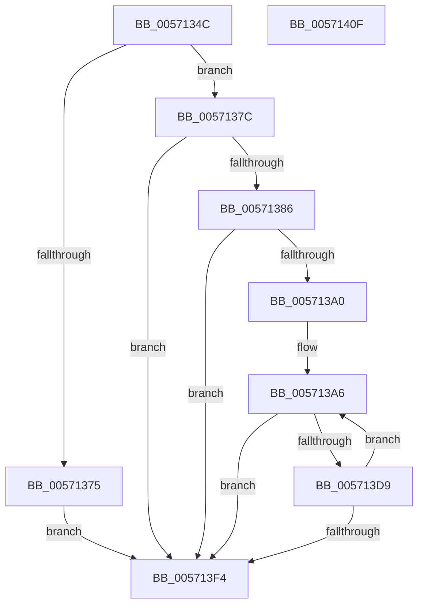

# IvtLegacyExtendScalableModePasidTables

- RVA: `0x0057134C`–`0x00571410` (길이 `196` bytes)
- VA: `0x000000014057134C`
- 실행 섹션: `.text`
- PDB 이름 있음: `예`; PDB Function 태그: `아니요`
- unwind 정보 RVA: `0x000BD20C`
- 디코드: `61`개 명령, `196/196` bytes 표시
- 미해석 바이트: `0` (있으면 어셈블리에 `.byte`로 보존)

> 이 문서는 커널 이미지의 기계어와 PDB 기호를 분석해 생성했습니다. 4번과 5번은 함수 원형과 자료형을 바이너리 사용 방식에서 추정한 C 해석이며 원본 소스 복구 결과는 아닙니다.

## 1. Dependencies

- 직접 호출 지점: **2**; 고유 호출 대상: **2**
- 직접 호출자로 확인된 함수: **2**
- RIP 상대 이미지 참조: **0**

### Outgoing calls
- `0x005713CE` → [ExtEnvAllocatePhysicalMemory](../56/ExtEnvAllocatePhysicalMemory_function_00561124.md) (function, `0x00561124`)
- `0x005713E5` → [IvtLegacyInitializeScalableModePasidTables](IvtLegacyInitializeScalableModePasidTables_function_00571DE4.md) (function, `0x00571DE4`)

### Direct callers
- [IvtLegacyAllocateScalableModePasidTables](IvtLegacyAllocateScalableModePasidTables_function_00570B20.md) at `0x00570CB2`
- [IvtLegacyGrowPasidTable](IvtLegacyGrowPasidTable_function_00571CA0.md) at `0x00571CFF`

### Static image references
- 디코드된 RIP-relative 메모리 참조가 없습니다.

## 2. Other-region calls and transfers

- 다른 실행 섹션으로 향하는 call: **0**
- 별도 외부 분기/꼬리 이동을 확인하지 못했습니다.

## 3. Assembly (complete function range)

```asm
0057134C  48 8B C4                        mov rax, rsp
0057134F  48 89 58 08                     mov qword ptr [rax + 8], rbx
00571353  48 89 68 18                     mov qword ptr [rax + 0x18], rbp
00571357  48 89 70 20                     mov qword ptr [rax + 0x20], rsi
0057135B  57                              push rdi
0057135C  41 56                           push r14
0057135E  41 57                           push r15
00571360  48 83 EC 30                     sub rsp, 0x30
00571364  48 83 60 10 00                  and qword ptr [rax + 0x10], 0
00571369  48 8B F2                        mov rsi, rdx
0057136C  4C 8B F9                        mov r15, rcx
0057136F  44 3B 42 24                     cmp r8d, dword ptr [rdx + 0x24]
00571373  72 07                           jb 0x14057137c
00571375  BF 01 00 00 C0                  mov edi, 0xc0000001
0057137A  EB 78                           jmp 0x1405713f4
0057137C  8B 5A 20                        mov ebx, dword ptr [rdx + 0x20]
0057137F  33 FF                           xor edi, edi
00571381  41 3B D8                        cmp ebx, r8d
00571384  77 6E                           ja 0x1405713f4
00571386  B8 FF 3F 00 00                  mov eax, 0x3fff
0057138B  C1 EB 06                        shr ebx, 6
0057138E  45 8D 70 40                     lea r14d, [r8 + 0x40]
00571392  23 D8                           and ebx, eax
00571394  41 C1 EE 06                     shr r14d, 6
00571398  44 23 F0                        and r14d, eax
0057139B  41 3B DE                        cmp ebx, r14d
0057139E  73 54                           jae 0x1405713f4
005713A0  8D 6B 01                        lea ebp, [rbx + 1]
005713A3  C1 E5 06                        shl ebp, 6
005713A6  45 8B 8F 10 01 00 00            mov r9d, dword ptr [r15 + 0x110]
005713AD  BA 00 10 00 00                  mov edx, 0x1000
005713B2  8B C3                           mov eax, ebx
005713B4  44 8B C2                        mov r8d, edx
005713B7  48 83 C0 08                     add rax, 8
005713BB  48 8D 0C C6                     lea rcx, [rsi + rax*8]
005713BF  48 8D 44 24 58                  lea rax, [rsp + 0x58]
005713C4  48 89 4C 24 28                  mov qword ptr [rsp + 0x28], rcx
005713C9  48 89 44 24 20                  mov qword ptr [rsp + 0x20], rax
005713CE  E8 51 FD FE FF                  call 0x140561124
005713D3  8B F8                           mov edi, eax
005713D5  85 C0                           test eax, eax
005713D7  78 1B                           js 0x1405713f4
005713D9  44 8B C3                        mov r8d, ebx
005713DC  89 6E 20                        mov dword ptr [rsi + 0x20], ebp
005713DF  48 8B D6                        mov rdx, rsi
005713E2  49 8B CF                        mov rcx, r15
005713E5  E8 FA 09 00 00                  call 0x140571de4
005713EA  FF C3                           inc ebx
005713EC  83 C5 40                        add ebp, 0x40
005713EF  41 3B DE                        cmp ebx, r14d
005713F2  72 B2                           jb 0x1405713a6
005713F4  48 8B 5C 24 50                  mov rbx, qword ptr [rsp + 0x50]
005713F9  8B C7                           mov eax, edi
005713FB  48 8B 6C 24 60                  mov rbp, qword ptr [rsp + 0x60]
00571400  48 8B 74 24 68                  mov rsi, qword ptr [rsp + 0x68]
00571405  48 83 C4 30                     add rsp, 0x30
00571409  41 5F                           pop r15
0057140B  41 5E                           pop r14
0057140D  5F                              pop rdi
0057140E  C3                              ret
0057140F  CC                              int3
```

## 4. C-style interpretation (structured pseudocode)

```c
__int64 __fastcall IvtLegacyExtendScalableModePasidTables(__int64 a1, __int64 a2, __int64 a3)
{
    __int64 result;
    __int64 v_r14;
    __int64 v_rbp;
    __int64 v_rbx;
    __int64 v_rdi;
    __int64 v_rsp;
    unsigned __int64 v_stack_m20;
    unsigned __int64 v_stack_m28;
    unsigned __int64 v_stack_p10;
    unsigned __int64 v_stack_p18;
    unsigned __int64 v_stack_p20;
    unsigned __int64 v_stack_p8;

    *(unsigned __int64 *)(v_rsp + 8) = v_rbx;
    *(unsigned __int64 *)(v_rsp + 24) = v_rbp;
    *(unsigned __int64 *)(v_rsp + 32) = v_rsi;
    v_rsp = (v_rsp) - (48);
    if (((unsigned int)(a3)) < (*(unsigned int *)(a2 + 36))) goto loc_0057137C;
    goto loc_005713F4;
loc_0057137C:
    v_rdi = 0;
    if (((unsigned int)((unsigned int)(*(unsigned int *)(a2 + 32)))) > ((unsigned int)(a3))) goto loc_005713F4;
    v_rbx = (unsigned int)(((unsigned int)(*(unsigned int *)(a2 + 32))) >> (6));
    v_rbx = (unsigned int)((v_rbx) & ((unsigned int)((unsigned int)(0x3FFFULL))));
    v_r14 = (unsigned int)((a3 + 64) >> (6));
    v_r14 = (unsigned int)((v_r14) & ((unsigned int)((unsigned int)(0x3FFFULL))));
    if (((unsigned int)(v_rbx)) >= ((unsigned int)(v_r14))) goto loc_005713F4;
    v_rbp = (unsigned int)((v_rbx + 1) << (6));
loc_005713A6:
    result = ((unsigned int)((unsigned int)(v_rbx))) + (8);
    v_stack_m20 = a2 + result * 8;
    v_stack_m28 = v_stack_p10;
    result = ExtEnvAllocatePhysicalMemory(a2 + result * 8, (unsigned int)(0x1000ULL), (unsigned int)((unsigned int)((unsigned int)(0x1000ULL))), (unsigned int)(*(unsigned int *)(a1 + 272)));
    if (sign_flag) goto loc_005713F4;
    *(unsigned int *)(a2 + 32) = (unsigned int)(v_rbp);
    result = IvtLegacyInitializeScalableModePasidTables(a1, a2, (unsigned int)((unsigned int)(v_rbx)), (unsigned int)(*(unsigned int *)(a1 + 272)));
    v_rbx = (unsigned int)((v_rbx) + 1);
    v_rbp = (unsigned int)((v_rbp) + (64));
    if (((unsigned int)(v_rbx)) < ((unsigned int)(v_r14))) goto loc_005713A6;
loc_005713F4:
    v_rsp = (v_rsp) + (48);
    return (unsigned int)((unsigned int)((unsigned int)((unsigned int)(result))));
}
```

## 5. (Beta) C Style

```c
int64_t IvtLegacyExtendScalableModePasidTables(void *Arg1, void *Arg2, int64_t Arg3)
{
    uint8_t *arg1 = (uint8_t *)Arg1;
    uint8_t *arg2 = (uint8_t *)Arg2;

    int64_t result;
    int64_t local_r14;
    int64_t local_rbp;
    int64_t local_rbx;
    int64_t local_rdi;
    int64_t local_rsp;
    uint64_t v_stack_m20;
    uint64_t v_stack_m28;
    uint64_t v_stack_p10;
    uint64_t v_stack_p18;
    uint64_t v_stack_p20;
    uint64_t v_stack_p8;

    *(uint64_t *)(local_rsp + 0x8) = local_rbx;
    *(uint64_t *)(local_rsp + 0x18) = local_rbp;
    *(uint64_t *)(local_rsp + 0x20) = local_rsi;
    local_rsp = (local_rsp) - (48);
    if (((uint32_t)(Arg3)) < (*(uint32_t *)(arg2 + 0x24))) goto loc_0057137C;
    goto loc_005713F4;
loc_0057137C:
    local_rdi = 0;
    if (((uint32_t)((uint32_t)(*(uint32_t *)(arg2 + 0x20)))) > ((uint32_t)(Arg3))) goto loc_005713F4;
    local_rbx = (uint32_t)(((uint32_t)(*(uint32_t *)(arg2 + 0x20))) >> (6));
    local_rbx = (uint32_t)((local_rbx) & ((uint32_t)((uint32_t)(0x3FFFULL))));
    local_r14 = (uint32_t)((Arg3 + 64) >> (6));
    local_r14 = (uint32_t)((local_r14) & ((uint32_t)((uint32_t)(0x3FFFULL))));
    if (((uint32_t)(local_rbx)) >= ((uint32_t)(local_r14))) goto loc_005713F4;
    local_rbp = (uint32_t)((local_rbx + 1) << (6));
loc_005713A6:
    result = ((uint32_t)((uint32_t)(local_rbx))) + (8);
    v_stack_m20 = Arg2 + result * 8;
    v_stack_m28 = v_stack_p10;
    result = ExtEnvAllocatePhysicalMemory(Arg2 + result * 8, (uint32_t)(0x1000ULL), (uint32_t)((uint32_t)((uint32_t)(0x1000ULL))), (uint32_t)(*(uint32_t *)(arg1 + 0x110)));
    if (sign_flag) goto loc_005713F4;
    *(uint32_t *)(arg2 + 0x20) = (uint32_t)(local_rbp);
    result = IvtLegacyInitializeScalableModePasidTables(Arg1, Arg2, (uint32_t)((uint32_t)(local_rbx)), (uint32_t)(*(uint32_t *)(arg1 + 0x110)));
    local_rbx = (uint32_t)((local_rbx) + 1);
    local_rbp = (uint32_t)((local_rbp) + (64));
    if (((uint32_t)(local_rbx)) < ((uint32_t)(local_r14))) goto loc_005713A6;
loc_005713F4:
    local_rsp = (local_rsp) + (48);
    return (uint32_t)((uint32_t)((uint32_t)((uint32_t)(result))));
}
```

### 관측된 메모리 오프셋

구조체 형식이 확인되지 않은 접근은 인자 기준의 오프셋으로만 기록했습니다.

| 기준 인자 | 오프셋 표현 | 폭 (bit) | 접근 |
|---|---:|---:|---|
| `Arg1` | `+ 0x110` | `32` | `R` |
| `Arg2` | `+ 0x0 + rax*8` | `64` | `R` |
| `Arg2` | `+ 0x20` | `32` | `R` |
| `Arg2` | `+ 0x20` | `32` | `W` |
| `Arg2` | `+ 0x24` | `32` | `R` |

## 6. Execution-region graph

[열기: 2D/3D 그래프와 함수 탐색 컨트롤 패널](../../../control-panel.html?section=text&rva=0x0057134C&view=graph)

- 2D 그래프는 위에서 아래로 흐르고, 3D 그래프는 빈 공간을 드래그해 회전합니다. Shift+드래그는 이동, 휠은 확대·축소, 함수 노드 선택은 대상 보고서 이동입니다.

### Static fallback


