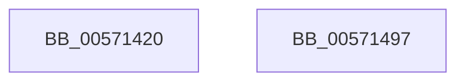

# IvtLegacyFlushDomainTb

- RVA: `0x00571420`–`0x00571498` (길이 `120` bytes)
- VA: `0x0000000140571420`
- 실행 섹션: `.text`
- PDB 이름 있음: `예`; PDB Function 태그: `아니요`
- unwind 정보 RVA: `0x0007D3C0`
- 디코드: `32`개 명령, `120/120` bytes 표시
- 미해석 바이트: `0` (있으면 어셈블리에 `.byte`로 보존)

> 이 문서는 커널 이미지의 기계어와 PDB 기호를 분석해 생성했습니다. 4번과 5번은 함수 원형과 자료형을 바이너리 사용 방식에서 추정한 C 해석이며 원본 소스 복구 결과는 아닙니다.

## 1. Dependencies

- 직접 호출 지점: **3**; 고유 호출 대상: **3**
- 직접 호출자로 확인된 함수: **0**
- RIP 상대 이미지 참조: **0**

### Outgoing calls
- `0x00571441` → [HalpAcquireHighLevelLock](../2D/HalpAcquireHighLevelLock_function_002D2390.md) (function, `0x002D2390`)
- `0x00571471` → [IvtLegacyFlushTbInternal](IvtLegacyFlushTbInternal_function_005714E8.md) (function, `0x005714E8`)
- `0x0057147D` → [HalpReleaseHighLevelLock](../2D/HalpReleaseHighLevelLock_function_002D1C58.md) (function, `0x002D1C58`)

### Direct callers
- 이 함수 시작 RVA로 연결되는 직접 call은 확인되지 않았습니다. 간접 호출은 완전히 역산할 수 없습니다.

### Static image references
- 디코드된 RIP-relative 메모리 참조가 없습니다.

## 2. Other-region calls and transfers

- 다른 실행 섹션으로 향하는 call: **0**
- 별도 외부 분기/꼬리 이동을 확인하지 못했습니다.

## 3. Assembly (complete function range)

```asm
00571420  48 89 5C 24 08                  mov qword ptr [rsp + 8], rbx
00571425  48 89 6C 24 10                  mov qword ptr [rsp + 0x10], rbp
0057142A  48 89 74 24 18                  mov qword ptr [rsp + 0x18], rsi
0057142F  57                              push rdi
00571430  48 83 EC 40                     sub rsp, 0x40
00571434  48 8B F9                        mov rdi, rcx
00571437  41 8B D9                        mov ebx, r9d
0057143A  48 8D 4A 58                     lea rcx, [rdx + 0x58]
0057143E  48 8B EA                        mov rbp, rdx
00571441  E8 4A 0F D6 FF                  call 0x1402d2390
00571446  88 45 60                        mov byte ptr [rbp + 0x60], al
00571449  4C 8D 45 38                     lea r8, [rbp + 0x38]
0057144D  48 8B 44 24 70                  mov rax, qword ptr [rsp + 0x70]
00571452  41 B1 01                        mov r9b, 1
00571455  48 89 44 24 38                  mov qword ptr [rsp + 0x38], rax
0057145A  33 D2                           xor edx, edx
0057145C  89 5C 24 30                     mov dword ptr [rsp + 0x30], ebx
00571460  48 8B CF                        mov rcx, rdi
00571463  4C 89 44 24 28                  mov qword ptr [rsp + 0x28], r8
00571468  4C 8B C5                        mov r8, rbp
0057146B  48 83 64 24 20 00               and qword ptr [rsp + 0x20], 0
00571471  E8 72 00 00 00                  call 0x1405714e8
00571476  8A 55 60                        mov dl, byte ptr [rbp + 0x60]
00571479  48 8D 4D 58                     lea rcx, [rbp + 0x58]
0057147D  E8 D6 07 D6 FF                  call 0x1402d1c58
00571482  48 8B 5C 24 50                  mov rbx, qword ptr [rsp + 0x50]
00571487  48 8B 6C 24 58                  mov rbp, qword ptr [rsp + 0x58]
0057148C  48 8B 74 24 60                  mov rsi, qword ptr [rsp + 0x60]
00571491  48 83 C4 40                     add rsp, 0x40
00571495  5F                              pop rdi
00571496  C3                              ret
00571497  CC                              int3
```

## 4. C-style interpretation (structured pseudocode)

```c
__int64 __fastcall IvtLegacyFlushDomainTb(__int64 a1, __int64 a2, __int64 a3, int a4, __int64 a5)
{
    __int64 result;
    __int64 v_rsp;
    unsigned __int64 v_stack_m10;
    unsigned int v_stack_m18;
    unsigned __int64 v_stack_m20;
    unsigned __int64 v_stack_m28;
    unsigned __int64 v_stack_p10;
    unsigned __int64 v_stack_p18;
    unsigned __int64 v_stack_p8;

    v_stack_p8 = v_rbx;
    v_stack_p10 = v_rbp;
    v_stack_p18 = v_rsi;
    v_rsp = (v_rsp) - (64);
    result = HalpAcquireHighLevelLock(a2 + 88, a2, a3, a4);
    *(unsigned __int8 *)(a2 + 96) = (unsigned __int8)(result);
    v_stack_m10 = a5;
    a2 = 0;
    v_stack_m18 = (unsigned int)((unsigned int)(a4));
    v_stack_m20 = a2 + 56;
    result = IvtLegacyFlushTbInternal(a1, a2, 0, 1);
    result = HalpReleaseHighLevelLock(a2 + 88, *(unsigned __int8 *)(a2 + 96), 0, 1);
    v_rsp = (v_rsp) + (64);
    return result;
}
```

## 5. (Beta) C Style

```c
int64_t IvtLegacyFlushDomainTb(int64_t Arg1, void *Arg2, int64_t Arg3, int32_t Arg4, int64_t Arg5)
{
    uint8_t *arg2 = (uint8_t *)Arg2;

    int64_t result;
    int64_t local_rsp;
    uint64_t v_stack_m10;
    uint32_t v_stack_m18;
    uint64_t v_stack_m20;
    uint64_t v_stack_m28;
    uint64_t v_stack_p10;
    uint64_t v_stack_p18;
    uint64_t v_stack_p8;

    v_stack_p8 = local_rbx;
    v_stack_p10 = local_rbp;
    v_stack_p18 = local_rsi;
    local_rsp = (local_rsp) - (64);
    result = HalpAcquireHighLevelLock(Arg2 + 88, Arg2, Arg3, Arg4);
    *(uint8_t *)(arg2 + 0x60) = (uint8_t)(result);
    v_stack_m10 = Arg5;
    Arg2 = 0;
    v_stack_m18 = (uint32_t)((uint32_t)(Arg4));
    v_stack_m20 = Arg2 + 56;
    result = IvtLegacyFlushTbInternal(Arg1, Arg2, 0, 1);
    result = HalpReleaseHighLevelLock(Arg2 + 88, *(uint8_t *)(arg2 + 0x60), 0, 1);
    local_rsp = (local_rsp) + (64);
    return result;
}
```

### 관측된 메모리 오프셋

구조체 형식이 확인되지 않은 접근은 인자 기준의 오프셋으로만 기록했습니다.

| 기준 인자 | 오프셋 표현 | 폭 (bit) | 접근 |
|---|---:|---:|---|
| `Arg2` | `+ 0x38` | `64` | `R` |
| `Arg2` | `+ 0x58` | `64` | `R` |
| `Arg2` | `+ 0x60` | `8` | `R` |
| `Arg2` | `+ 0x60` | `8` | `W` |

## 6. Execution-region graph

[열기: 2D/3D 그래프와 함수 탐색 컨트롤 패널](../../../control-panel.html?section=text&rva=0x00571420&view=graph)

- 2D 그래프는 위에서 아래로 흐르고, 3D 그래프는 빈 공간을 드래그해 회전합니다. Shift+드래그는 이동, 휠은 확대·축소, 함수 노드 선택은 대상 보고서 이동입니다.

### Static fallback


