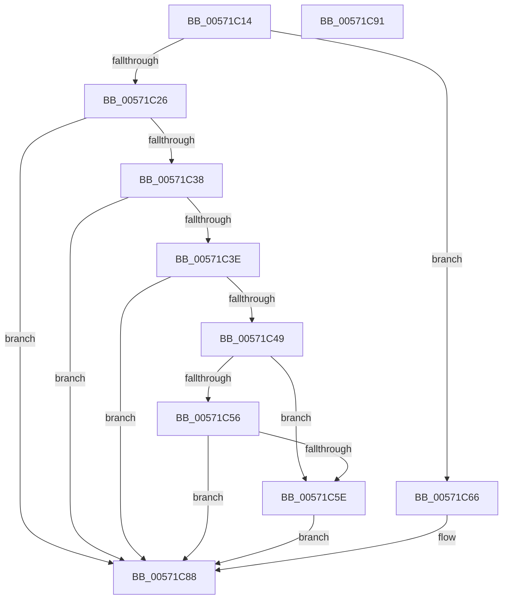

# IvtLegacyGetDomainId

- RVA: `0x00571C14`–`0x00571C92` (길이 `126` bytes)
- VA: `0x0000000140571C14`
- 실행 섹션: `.text`
- PDB 이름 있음: `예`; PDB Function 태그: `아니요`
- unwind 정보 RVA: `0x0005CF00`
- 디코드: `39`개 명령, `126/126` bytes 표시
- 미해석 바이트: `0` (있으면 어셈블리에 `.byte`로 보존)

> 이 문서는 커널 이미지의 기계어와 PDB 기호를 분석해 생성했습니다. 4번과 5번은 함수 원형과 자료형을 바이너리 사용 방식에서 추정한 C 해석이며 원본 소스 복구 결과는 아닙니다.

## 1. Dependencies

- 직접 호출 지점: **1**; 고유 호출 대상: **1**
- 직접 호출자로 확인된 함수: **3**
- RIP 상대 이미지 참조: **0**

### Outgoing calls
- `0x00571C2E` → [IvtGetScalableModePasidTables](../56/IvtGetScalableModePasidTables_function_0056FD5C.md) (function, `0x0056FD5C`)

### Direct callers
- [IvtLegacyAllocateTranslationStructures](IvtLegacyAllocateTranslationStructures_function_00570E28.md) at `0x00570E6A`
- [IvtLegacyAttachDeviceDomainInternal](IvtLegacyAttachDeviceDomainInternal_function_00570EDC.md) at `0x00570F9F`
- [IvtLegacyUpdateScalableModeContextEntry](IvtLegacyUpdateScalableModeContextEntry_function_005721B8.md) at `0x00572333`

### Static image references
- 디코드된 RIP-relative 메모리 참조가 없습니다.

## 2. Other-region calls and transfers

- 다른 실행 섹션으로 향하는 call: **0**
- 별도 외부 분기/꼬리 이동을 확인하지 못했습니다.

## 3. Assembly (complete function range)

```asm
00571C14  40 53                           push rbx
00571C16  48 83 EC 20                     sub rsp, 0x20
00571C1A  80 B9 40 01 00 00 00            cmp byte ptr [rcx + 0x140], 0
00571C21  44 8B CA                        mov r9d, edx
00571C24  74 40                           je 0x140571c66
00571C26  41 8B D1                        mov edx, r9d
00571C29  BB 00 00 01 00                  mov ebx, 0x10000
00571C2E  E8 29 E1 FF FF                  call 0x14056fd5c
00571C33  48 85 C0                        test rax, rax
00571C36  74 50                           je 0x140571c88
00571C38  83 78 20 00                     cmp dword ptr [rax + 0x20], 0
00571C3C  76 4A                           jbe 0x140571c88
00571C3E  48 8B 48 40                     mov rcx, qword ptr [rax + 0x40]
00571C42  48 8B 01                        mov rax, qword ptr [rcx]
00571C45  A8 01                           test al, 1
00571C47  74 3F                           je 0x140571c88
00571C49  25 C0 01 00 00                  and eax, 0x1c0
00571C4E  48 3D 80 00 00 00               cmp rax, 0x80
00571C54  74 08                           je 0x140571c5e
00571C56  48 3D 00 01 00 00               cmp rax, 0x100
00571C5C  75 2A                           jne 0x140571c88
00571C5E  8B 41 08                        mov eax, dword ptr [rcx + 8]
00571C61  0F B7 D8                        movzx ebx, ax
00571C64  EB 22                           jmp 0x140571c88
00571C66  48 8B 51 20                     mov rdx, qword ptr [rcx + 0x20]
00571C6A  41 8B C1                        mov eax, r9d
00571C6D  C1 E8 08                        shr eax, 8
00571C70  03 C0                           add eax, eax
00571C72  41 0F B6 C9                     movzx ecx, r9b
00571C76  48 03 C9                        add rcx, rcx
00571C79  48 8B 04 C2                     mov rax, qword ptr [rdx + rax*8]
00571C7D  8B 4C C8 08                     mov ecx, dword ptr [rax + rcx*8 + 8]
00571C81  48 C1 E9 08                     shr rcx, 8
00571C85  0F B7 D9                        movzx ebx, cx
00571C88  48 8B C3                        mov rax, rbx
00571C8B  48 83 C4 20                     add rsp, 0x20
00571C8F  5B                              pop rbx
00571C90  C3                              ret
00571C91  CC                              int3
```

## 4. C-style interpretation (structured pseudocode)

```c
__int64 __fastcall IvtLegacyGetDomainId(__int64 a1, int a2)
{
    __int64 result;
    __int64 v_rsp;

    v_rsp = (v_rsp) - (32);
    if ((*(unsigned __int8 *)(a1 + 320)) == 0) goto loc_00571C66;
    result = IvtGetScalableModePasidTables(a1, (unsigned int)((unsigned int)((unsigned int)(a2))), a3, (unsigned int)(a2));
    if (result == 0) goto loc_00571C88;
    if ((*(unsigned int *)(result + 32)) <= 0) goto loc_00571C88;
    if ((((unsigned __int8)(*(unsigned __int64 *)(*(unsigned __int64 *)(result + 64)))) & (1)) == 0) goto loc_00571C88;
    result = (unsigned int)((*(unsigned __int64 *)(*(unsigned __int64 *)(result + 64))) & (448));
    if (result == 128) goto loc_00571C5E;
    if (result != 256) goto loc_00571C88;
loc_00571C5E:
    goto loc_00571C88;
loc_00571C66:
    result = (unsigned int)(((unsigned int)((unsigned int)((unsigned int)(a2)))) >> (8));
    result = (unsigned int)((result) + ((unsigned int)(result)));
    a1 = ((unsigned __int8)((unsigned int)(a2))) + ((unsigned __int8)((unsigned int)(a2)));
    a1 = ((unsigned int)(*(unsigned int *)(*(unsigned __int64 *)(*(unsigned __int64 *)(*(unsigned __int64 *)(result + 64) + 32) + result * 8) + a1 * 8 + 8))) >> (8);
loc_00571C88:
    v_rsp = (v_rsp) + (32);
    return (unsigned __int16)(a1);
}
```

## 5. (Beta) C Style

```c
int64_t IvtLegacyGetDomainId(void *Arg1, int32_t Arg2)
{
    uint8_t *arg1 = (uint8_t *)Arg1;

    int64_t result;
    int64_t local_rsp;

    local_rsp = (local_rsp) - (32);
    if ((*(uint8_t *)(arg1 + 0x140)) == 0) goto loc_00571C66;
    result = IvtGetScalableModePasidTables(Arg1, (uint32_t)((uint32_t)((uint32_t)(Arg2))), a3, (uint32_t)(Arg2));
    if (result == 0) goto loc_00571C88;
    if ((*(uint32_t *)(result + 0x20)) <= 0) goto loc_00571C88;
    if ((((uint8_t)(*(uint64_t *)(*(uint64_t *)(result + 0x40)))) & (1)) == 0) goto loc_00571C88;
    result = (uint32_t)((*(uint64_t *)(*(uint64_t *)(result + 0x40))) & (448));
    if (result == 128) goto loc_00571C5E;
    if (result != 256) goto loc_00571C88;
loc_00571C5E:
    goto loc_00571C88;
loc_00571C66:
    result = (uint32_t)(((uint32_t)((uint32_t)((uint32_t)(Arg2)))) >> (8));
    result = (uint32_t)((result) + ((uint32_t)(result)));
    Arg1 = ((uint8_t)((uint32_t)(Arg2))) + ((uint8_t)((uint32_t)(Arg2)));
    Arg1 = ((uint32_t)(*(uint32_t *)(*(uint64_t *)(*(uint64_t *)(*(uint64_t *)(result + 0x40) + 0x20) + result * 8) + arg1 * 8 + 0x8))) >> (8);
loc_00571C88:
    local_rsp = (local_rsp) + (32);
    return (uint16_t)(Arg1);
}
```

### 관측된 메모리 오프셋

구조체 형식이 확인되지 않은 접근은 인자 기준의 오프셋으로만 기록했습니다.

| 기준 인자 | 오프셋 표현 | 폭 (bit) | 접근 |
|---|---:|---:|---|
| `Arg1` | `+ 0x20` | `64` | `R` |
| `Arg1` | `+ 0x140` | `8` | `R` |

## 6. Execution-region graph

[열기: 2D/3D 그래프와 함수 탐색 컨트롤 패널](../../../control-panel.html?section=text&rva=0x00571C14&view=graph)

- 2D 그래프는 위에서 아래로 흐르고, 3D 그래프는 빈 공간을 드래그해 회전합니다. Shift+드래그는 이동, 휠은 확대·축소, 함수 노드 선택은 대상 보고서 이동입니다.

### Static fallback


