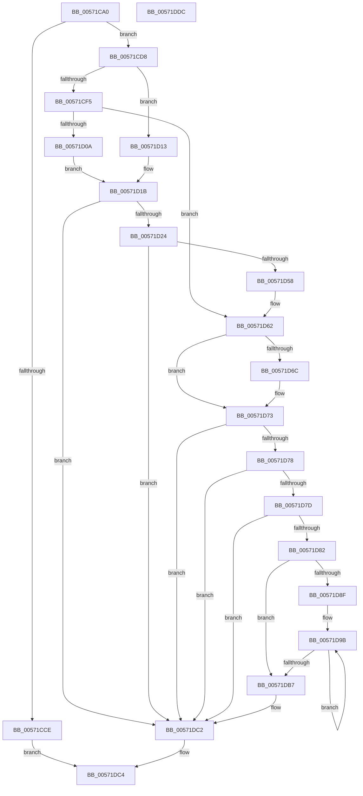

# IvtLegacyGrowPasidTable

- RVA: `0x00571CA0`–`0x00571DDD` (길이 `317` bytes)
- VA: `0x0000000140571CA0`
- 실행 섹션: `.text`
- PDB 이름 있음: `예`; PDB Function 태그: `아니요`
- unwind 정보 RVA: `0x000C5390`
- 디코드: `94`개 명령, `317/317` bytes 표시
- 미해석 바이트: `0` (있으면 어셈블리에 `.byte`로 보존)

> 이 문서는 커널 이미지의 기계어와 PDB 기호를 분석해 생성했습니다. 4번과 5번은 함수 원형과 자료형을 바이너리 사용 방식에서 추정한 C 해석이며 원본 소스 복구 결과는 아닙니다.

## 1. Dependencies

- 직접 호출 지점: **4**; 고유 호출 대상: **4**
- 직접 호출자로 확인된 함수: **0**
- RIP 상대 이미지 참조: **0**

### Outgoing calls
- `0x00571CFF` → [IvtLegacyExtendScalableModePasidTables](IvtLegacyExtendScalableModePasidTables_function_0057134C.md) (function, `0x0057134C`)
- `0x00571D4D` → [IvtLegacyAllocateScalableModePasidTables](IvtLegacyAllocateScalableModePasidTables_function_00570B20.md) (function, `0x00570B20`)
- `0x00571DA8` → [memcpy](../6C/memcpy_function_006C6840.md) (function, `0x006C6840`)
- `0x00571DBD` → [IvtFreeScalableModePasidTables](../56/IvtFreeScalableModePasidTables_function_0056F980.md) (function, `0x0056F980`)

### Direct callers
- 이 함수 시작 RVA로 연결되는 직접 call은 확인되지 않았습니다. 간접 호출은 완전히 역산할 수 없습니다.

### Static image references
- 디코드된 RIP-relative 메모리 참조가 없습니다.

## 2. Other-region calls and transfers

- 다른 실행 섹션으로 향하는 call: **0**
- 별도 외부 분기/꼬리 이동을 확인하지 못했습니다.

## 3. Assembly (complete function range)

```asm
00571CA0  48 89 5C 24 08                  mov qword ptr [rsp + 8], rbx
00571CA5  44 89 44 24 18                  mov dword ptr [rsp + 0x18], r8d
00571CAA  55                              push rbp
00571CAB  56                              push rsi
00571CAC  57                              push rdi
00571CAD  41 54                           push r12
00571CAF  41 55                           push r13
00571CB1  41 56                           push r14
00571CB3  41 57                           push r15
00571CB5  48 83 EC 50                     sub rsp, 0x50
00571CB9  41 8B F1                        mov esi, r9d
00571CBC  41 8B C0                        mov eax, r8d
00571CBF  4C 8B F2                        mov r14, rdx
00571CC2  4C 8B E1                        mov r12, rcx
00571CC5  41 81 F9 00 00 10 00            cmp r9d, 0x100000
00571CCC  72 0A                           jb 0x140571cd8
00571CCE  B8 0D 00 00 C0                  mov eax, 0xc000000d
00571CD3  E9 EC 00 00 00                  jmp 0x140571dc4
00571CD8  48 8B 5A 40                     mov rbx, qword ptr [rdx + 0x40]
00571CDC  33 FF                           xor edi, edi
00571CDE  44 8B AC 24 B0 00 00 00         mov r13d, dword ptr [rsp + 0xb0]
00571CE6  48 89 7C 24 40                  mov qword ptr [rsp + 0x40], rdi
00571CEB  48 89 5C 24 48                  mov qword ptr [rsp + 0x48], rbx
00571CF0  48 85 DB                        test rbx, rbx
00571CF3  74 1E                           je 0x140571d13
00571CF5  44 8B 7B 24                     mov r15d, dword ptr [rbx + 0x24]
00571CF9  44 8B C6                        mov r8d, esi
00571CFC  48 8B D3                        mov rdx, rbx
00571CFF  E8 48 F6 FF FF                  call 0x14057134c
00571D04  8B E8                           mov ebp, eax
00571D06  85 C0                           test eax, eax
00571D08  79 58                           jns 0x140571d62
00571D0A  8B 84 24 A0 00 00 00            mov eax, dword ptr [rsp + 0xa0]
00571D11  EB 08                           jmp 0x140571d1b
00571D13  45 33 FF                        xor r15d, r15d
00571D16  BD 01 00 00 C0                  mov ebp, 0xc0000001
00571D1B  41 3B F7                        cmp esi, r15d
00571D1E  0F 82 9E 00 00 00               jb 0x140571dc2
00571D24  48 8D 4C 24 48                  lea rcx, [rsp + 0x48]
00571D29  44 8B CE                        mov r9d, esi
00571D2C  48 89 4C 24 38                  mov qword ptr [rsp + 0x38], rcx
00571D31  44 8B C0                        mov r8d, eax
00571D34  48 8D 4C 24 40                  lea rcx, [rsp + 0x40]
00571D39  49 8B D6                        mov rdx, r14
00571D3C  48 89 4C 24 30                  mov qword ptr [rsp + 0x30], rcx
00571D41  49 8B CC                        mov rcx, r12
00571D44  44 89 6C 24 28                  mov dword ptr [rsp + 0x28], r13d
00571D49  89 74 24 20                     mov dword ptr [rsp + 0x20], esi
00571D4D  E8 CE ED FF FF                  call 0x140570b20
00571D52  8B E8                           mov ebp, eax
00571D54  85 C0                           test eax, eax
00571D56  78 6A                           js 0x140571dc2
00571D58  48 8B 7C 24 40                  mov rdi, qword ptr [rsp + 0x40]
00571D5D  48 8B 5C 24 48                  mov rbx, qword ptr [rsp + 0x48]
00571D62  49 8B 46 40                     mov rax, qword ptr [r14 + 0x40]
00571D66  44 3B 68 30                     cmp r13d, dword ptr [rax + 0x30]
00571D6A  74 07                           je 0x140571d73
00571D6C  C7 40 30 01 00 00 00            mov dword ptr [rax + 0x30], 1
00571D73  48 85 FF                        test rdi, rdi
00571D76  74 4A                           je 0x140571dc2
00571D78  48 85 DB                        test rbx, rbx
00571D7B  74 45                           je 0x140571dc2
00571D7D  48 3B FB                        cmp rdi, rbx
00571D80  74 40                           je 0x140571dc2
00571D82  8B 43 20                        mov eax, dword ptr [rbx + 0x20]
00571D85  C1 E8 06                        shr eax, 6
00571D88  25 FF 3F 00 00                  and eax, 0x3fff
00571D8D  76 28                           jbe 0x140571db7
00571D8F  4C 8B F3                        mov r14, rbx
00571D92  48 8D 77 40                     lea rsi, [rdi + 0x40]
00571D96  4C 2B F7                        sub r14, rdi
00571D99  8B F8                           mov edi, eax
00571D9B  49 8B 14 36                     mov rdx, qword ptr [r14 + rsi]
00571D9F  41 B8 00 10 00 00               mov r8d, 0x1000
00571DA5  48 8B 0E                        mov rcx, qword ptr [rsi]
00571DA8  E8 93 4A 15 00                  call 0x1406c6840
00571DAD  48 8D 76 08                     lea rsi, [rsi + 8]
00571DB1  48 83 EF 01                     sub rdi, 1
00571DB5  75 E4                           jne 0x140571d9b
00571DB7  48 8B D3                        mov rdx, rbx
00571DBA  49 8B CC                        mov rcx, r12
00571DBD  E8 BE DB FF FF                  call 0x14056f980
00571DC2  8B C5                           mov eax, ebp
00571DC4  48 8B 9C 24 90 00 00 00         mov rbx, qword ptr [rsp + 0x90]
00571DCC  48 83 C4 50                     add rsp, 0x50
00571DD0  41 5F                           pop r15
00571DD2  41 5E                           pop r14
00571DD4  41 5D                           pop r13
00571DD6  41 5C                           pop r12
00571DD8  5F                              pop rdi
00571DD9  5E                              pop rsi
00571DDA  5D                              pop rbp
00571DDB  C3                              ret
00571DDC  CC                              int3
```

## 4. C-style interpretation (structured pseudocode)

```c
__int64 __fastcall IvtLegacyGrowPasidTable(__int64 a1, __int64 a2, int a3, int a4, unsigned int a5)
{
    __int64 result;
    __int64 v_r14;
    __int64 v_r15;
    __int64 v_rdi;
    __int64 v_rsp;
    unsigned __int64 v_stack_m40;
    unsigned __int64 v_stack_m48;
    unsigned __int64 v_stack_m50;
    unsigned __int64 v_stack_m58;
    unsigned int v_stack_m60;
    unsigned int v_stack_m68;
    unsigned int v_stack_p18;
    unsigned __int64 v_stack_p8;

    v_stack_p8 = v_rbx;
    v_stack_p18 = a3;
    v_rsp = (v_rsp) - (80);
    if (a4 < 0x100000ULL) goto loc_00571CD8;
    goto loc_00571DC4;
loc_00571CD8:
    v_rdi = 0;
    v_stack_m48 = 0;
    v_stack_m40 = *(unsigned __int64 *)(a2 + 64);
    if (*(unsigned __int64 *)(a2 + 64) == 0) goto loc_00571D13;
    result = IvtLegacyExtendScalableModePasidTables(a1, *(unsigned __int64 *)(a2 + 64), (unsigned int)((unsigned int)((unsigned int)(a4))), a4);
    if (!sign_flag) goto loc_00571D62;
    goto loc_00571D1B;
loc_00571D13:
    v_r15 = 0;
loc_00571D1B:
    if (((unsigned int)((unsigned int)(a4))) < 0) goto loc_00571DC2;
    v_stack_m50 = v_stack_m40;
    v_stack_m58 = v_stack_m48;
    v_stack_m60 = (unsigned int)((unsigned int)(a5));
    v_stack_m68 = (unsigned int)((unsigned int)(a4));
    result = IvtLegacyAllocateScalableModePasidTables(a1, a2, (unsigned int)((unsigned int)((unsigned int)(v_stack_p18))), (unsigned int)((unsigned int)((unsigned int)(a4))));
    if (sign_flag) goto loc_00571DC2;
loc_00571D62:
    if (((unsigned int)((unsigned int)(a5))) != (*(unsigned int *)(*(unsigned __int64 *)(a2 + 64) + 48))) {
        *(unsigned int *)(*(unsigned __int64 *)(a2 + 64) + 48) = 1;
    }
    if (v_stack_m48 == 0) goto loc_00571DC2;
    if (v_stack_m40 == 0) goto loc_00571DC2;
    if (v_stack_m48 == v_stack_m40) goto loc_00571DC2;
    result = (unsigned int)(((unsigned int)(*(unsigned int *)(v_stack_m40 + 32))) >> (6));
    result = (unsigned int)((result) & (0x3FFFULL));
    if (condition_is_below_or_equal) goto loc_00571DB7;
    v_r14 = (v_stack_m40) - (v_stack_m48);
loc_00571D9B:
    result = memcpy(*(unsigned __int64 *)(v_stack_m48 + 64), *(unsigned __int64 *)(v_r14 + v_stack_m48 + 64 * 1), (unsigned int)(0x1000ULL), (unsigned int)((unsigned int)((unsigned int)(a4))));
    v_rdi = ((unsigned int)((unsigned int)(result))) - (1);
    if (condition_is_not_equal) goto loc_00571D9B;
loc_00571DB7:
    result = IvtFreeScalableModePasidTables(a1, v_stack_m40, (unsigned int)(0x1000ULL), (unsigned int)((unsigned int)((unsigned int)(a4))));
loc_00571DC2:
loc_00571DC4:
    v_rsp = (v_rsp) + (80);
    return (unsigned int)((unsigned int)((unsigned int)((unsigned int)(result))));
}
```

## 5. (Beta) C Style

```c
int64_t IvtLegacyGrowPasidTable(int64_t Arg1, void *Arg2, int32_t Arg3, int32_t Arg4, uint32_t Arg5)
{
    uint8_t *arg2 = (uint8_t *)Arg2;

    int64_t result;
    int64_t local_r14;
    int64_t local_r15;
    int64_t local_rdi;
    int64_t local_rsp;
    uint64_t v_stack_m40;
    uint64_t v_stack_m48;
    uint64_t v_stack_m50;
    uint64_t v_stack_m58;
    uint32_t v_stack_m60;
    uint32_t v_stack_m68;
    uint32_t v_stack_p18;
    uint64_t v_stack_p8;

    v_stack_p8 = local_rbx;
    v_stack_p18 = Arg3;
    local_rsp = (local_rsp) - (80);
    if (Arg4 < 0x100000ULL) goto loc_00571CD8;
    goto loc_00571DC4;
loc_00571CD8:
    local_rdi = 0;
    v_stack_m48 = 0;
    v_stack_m40 = *(uint64_t *)(arg2 + 0x40);
    if (*(uint64_t *)(arg2 + 0x40) == 0) goto loc_00571D13;
    result = IvtLegacyExtendScalableModePasidTables(Arg1, *(uint64_t *)(arg2 + 0x40), (uint32_t)((uint32_t)((uint32_t)(Arg4))), Arg4);
    if (!sign_flag) goto loc_00571D62;
    goto loc_00571D1B;
loc_00571D13:
    local_r15 = 0;
loc_00571D1B:
    if (((uint32_t)((uint32_t)(Arg4))) < 0) goto loc_00571DC2;
    v_stack_m50 = v_stack_m40;
    v_stack_m58 = v_stack_m48;
    v_stack_m60 = (uint32_t)((uint32_t)(Arg5));
    v_stack_m68 = (uint32_t)((uint32_t)(Arg4));
    result = IvtLegacyAllocateScalableModePasidTables(Arg1, Arg2, (uint32_t)((uint32_t)((uint32_t)(v_stack_p18))), (uint32_t)((uint32_t)((uint32_t)(Arg4))));
    if (sign_flag) goto loc_00571DC2;
loc_00571D62:
    if (((uint32_t)((uint32_t)(Arg5))) != (*(uint32_t *)(*(uint64_t *)(arg2 + 0x40) + 0x30))) {
        *(uint32_t *)(*(uint64_t *)(arg2 + 0x40) + 0x30) = 1;
    }
    if (v_stack_m48 == 0) goto loc_00571DC2;
    if (v_stack_m40 == 0) goto loc_00571DC2;
    if (v_stack_m48 == v_stack_m40) goto loc_00571DC2;
    result = (uint32_t)(((uint32_t)(*(uint32_t *)(v_stack_m40 + 0x20))) >> (6));
    result = (uint32_t)((result) & (0x3FFFULL));
    if (condition_is_below_or_equal) goto loc_00571DB7;
    local_r14 = (v_stack_m40) - (v_stack_m48);
loc_00571D9B:
    result = memcpy(*(uint64_t *)(v_stack_m48 + 0x40), *(uint64_t *)(local_r14 + v_stack_m48 + 0x40 * 1), (uint32_t)(0x1000ULL), (uint32_t)((uint32_t)((uint32_t)(Arg4))));
    local_rdi = ((uint32_t)((uint32_t)(result))) - (1);
    if (condition_is_not_equal) goto loc_00571D9B;
loc_00571DB7:
    result = IvtFreeScalableModePasidTables(Arg1, v_stack_m40, (uint32_t)(0x1000ULL), (uint32_t)((uint32_t)((uint32_t)(Arg4))));
loc_00571DC2:
loc_00571DC4:
    local_rsp = (local_rsp) + (80);
    return (uint32_t)((uint32_t)((uint32_t)((uint32_t)(result))));
}
```

### 관측된 메모리 오프셋

구조체 형식이 확인되지 않은 접근은 인자 기준의 오프셋으로만 기록했습니다.

| 기준 인자 | 오프셋 표현 | 폭 (bit) | 접근 |
|---|---:|---:|---|
| `Arg2` | `+ 0x40` | `64` | `R` |

## 6. Execution-region graph

[열기: 2D/3D 그래프와 함수 탐색 컨트롤 패널](../../../control-panel.html?section=text&rva=0x00571CA0&view=graph)

- 2D 그래프는 위에서 아래로 흐르고, 3D 그래프는 빈 공간을 드래그해 회전합니다. Shift+드래그는 이동, 휠은 확대·축소, 함수 노드 선택은 대상 보고서 이동입니다.

### Static fallback


