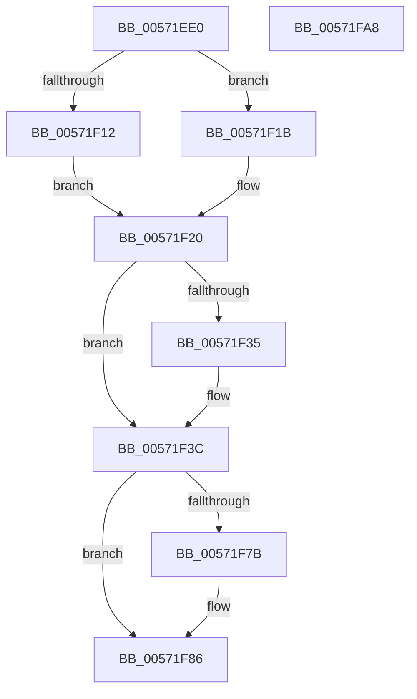

# IvtLegacySetDevicePasidTable

- RVA: `0x00571EE0`–`0x00571FA9` (길이 `201` bytes)
- VA: `0x0000000140571EE0`
- 실행 섹션: `.text`
- PDB 이름 있음: `예`; PDB Function 태그: `아니요`
- unwind 정보 RVA: `0x000BF908`
- 디코드: `55`개 명령, `201/201` bytes 표시
- 미해석 바이트: `0` (있으면 어셈블리에 `.byte`로 보존)

> 이 문서는 커널 이미지의 기계어와 PDB 기호를 분석해 생성했습니다. 4번과 5번은 함수 원형과 자료형을 바이너리 사용 방식에서 추정한 C 해석이며 원본 소스 복구 결과는 아닙니다.

## 1. Dependencies

- 직접 호출 지점: **5**; 고유 호출 대상: **5**
- 직접 호출자로 확인된 함수: **0**
- RIP 상대 이미지 참조: **1**

### Outgoing calls
- `0x00571F37` → [KiRaiseIrqlProcessIrqlFlags](../4F/KiRaiseIrqlProcessIrqlFlags_function_004F56FC.md) (function, `0x004F56FC`)
- `0x00571F48` → [KeAcquireInStackQueuedSpinLockAtDpcLevel](../27/KeAcquireInStackQueuedSpinLockAtDpcLevel_function_00275740.md) (function, `0x00275740`)
- `0x00571F63` → [IvtLegacyUpdateScalableModeContextEntry](IvtLegacyUpdateScalableModeContextEntry_function_005721B8.md) (function, `0x005721B8`)
- `0x00571F6D` → [KeReleaseInStackQueuedSpinLockFromDpcLevel](../21/KeReleaseInStackQueuedSpinLockFromDpcLevel_function_002171B0.md) (function, `0x002171B0`)
- `0x00571F81` → [KiLowerIrqlProcessIrqlFlags](../4F/KiLowerIrqlProcessIrqlFlags_function_004F5698.md) (function, `0x004F5698`)

### Direct callers
- 이 함수 시작 RVA로 연결되는 직접 call은 확인되지 않았습니다. 간접 호출은 완전히 역산할 수 없습니다.

### Static image references
- `0x00571F2D` → RVA `0x00FC6D20` (`ALMOSTRO`; read)

## 2. Other-region calls and transfers

- 다른 실행 섹션으로 향하는 call: **0**
- 별도 외부 분기/꼬리 이동을 확인하지 못했습니다.

## 3. Assembly (complete function range)

```asm
00571EE0  4C 8B DC                        mov r11, rsp
00571EE3  49 89 5B 08                     mov qword ptr [r11 + 8], rbx
00571EE7  49 89 6B 10                     mov qword ptr [r11 + 0x10], rbp
00571EEB  49 89 73 18                     mov qword ptr [r11 + 0x18], rsi
00571EEF  49 89 7B 20                     mov qword ptr [r11 + 0x20], rdi
00571EF3  41 56                           push r14
00571EF5  48 83 EC 60                     sub rsp, 0x60
00571EF9  33 C0                           xor eax, eax
00571EFB  0F 57 C0                        xorps xmm0, xmm0
00571EFE  48 8B EA                        mov rbp, rdx
00571F01  4C 8B F1                        mov r14, rcx
00571F04  0F 11 44 24 40                  movups xmmword ptr [rsp + 0x40], xmm0
00571F09  49 89 43 E8                     mov qword ptr [r11 - 0x18], rax
00571F0D  45 84 C0                        test r8b, r8b
00571F10  75 09                           jne 0x140571f1b
00571F12  48 8B 7A 40                     mov rdi, qword ptr [rdx + 0x40]
00571F16  8B 77 30                        mov esi, dword ptr [rdi + 0x30]
00571F19  EB 05                           jmp 0x140571f20
00571F1B  33 FF                           xor edi, edi
00571F1D  8D 77 04                        lea esi, [rdi + 4]
00571F20  44 0F 20 C3                     mov rbx, cr8
00571F24  BA 0F 00 00 00                  mov edx, 0xf
00571F29  44 0F 22 C2                     mov cr8, rdx
00571F2D  39 05 ED 4D A5 00               cmp dword ptr [rip + 0xa54ded], eax
00571F33  74 07                           je 0x140571f3c
00571F35  8A CB                           mov cl, bl
00571F37  E8 C0 37 F8 FF                  call 0x1404f56fc
00571F3C  49 8D 8E D0 00 00 00            lea rcx, [r14 + 0xd0]
00571F43  48 8D 54 24 40                  lea rdx, [rsp + 0x40]
00571F48  E8 F3 37 D0 FF                  call 0x140275740
00571F4D  48 8B 55 38                     mov rdx, qword ptr [rbp + 0x38]
00571F51  45 33 C9                        xor r9d, r9d
00571F54  83 64 24 38 00                  and dword ptr [rsp + 0x38], 0
00571F59  4C 8B C7                        mov r8, rdi
00571F5C  49 8B CE                        mov rcx, r14
00571F5F  89 74 24 20                     mov dword ptr [rsp + 0x20], esi
00571F63  E8 50 02 00 00                  call 0x1405721b8
00571F68  48 8D 4C 24 40                  lea rcx, [rsp + 0x40]
00571F6D  E8 3E 52 CA FF                  call 0x1402171b0
00571F72  83 3D A7 4D A5 00 00            cmp dword ptr [rip + 0xa54da7], 0
00571F79  74 0B                           je 0x140571f86
00571F7B  44 0F 20 C1                     mov rcx, cr8
00571F7F  8A D3                           mov dl, bl
00571F81  E8 12 37 F8 FF                  call 0x1404f5698
00571F86  0F B6 C3                        movzx eax, bl
00571F89  44 0F 22 C0                     mov cr8, rax
00571F8D  4C 8D 5C 24 60                  lea r11, [rsp + 0x60]
00571F92  49 8B 5B 10                     mov rbx, qword ptr [r11 + 0x10]
00571F96  49 8B 6B 18                     mov rbp, qword ptr [r11 + 0x18]
00571F9A  49 8B 73 20                     mov rsi, qword ptr [r11 + 0x20]
00571F9E  49 8B 7B 28                     mov rdi, qword ptr [r11 + 0x28]
00571FA2  49 8B E3                        mov rsp, r11
00571FA5  41 5E                           pop r14
00571FA7  C3                              ret
00571FA8  CC                              int3
```

## 4. C-style interpretation (structured pseudocode)

```c
__int64 __fastcall IvtLegacySetDevicePasidTable(__int64 a1, __int64 a2, unsigned __int8 a3, int a4)
{
    __int64 result;
    __int64 v_rdi;
    __int64 v_rsp;
    unsigned __int64 v_stack_m28;
    unsigned int v_stack_m30;
    unsigned int v_stack_m48;
    unsigned __int64 v_stack_m8;

    *(unsigned __int64 *)(v_rsp + 8) = v_rbx;
    *(unsigned __int64 *)(v_rsp + 16) = v_rbp;
    *(unsigned __int64 *)(v_rsp + 24) = v_rsi;
    *(unsigned __int64 *)(v_rsp + 32) = v_rdi;
    v_rsp = (v_rsp) - (96);
    result = 0;
    v_stack_m28 = v_xmm0;
    *(unsigned __int64 *)(v_rsp - 24) = 0;
    if (a3 != 0) goto loc_00571F1B;
    goto loc_00571F20;
loc_00571F1B:
    v_rdi = 0;
loc_00571F20:
    if ((*(unsigned int *)(v_rip + 10833389)) != 0) {
        a1 = (unsigned __int8)(v_cr8);
        result = KiRaiseIrqlProcessIrqlFlags(a1, 15, a3, a4);
    }
    result = KeAcquireInStackQueuedSpinLockAtDpcLevel(a1 + 208, v_stack_m28, a3, a4);
    a4 = 0;
    v_stack_m48 = (unsigned int)(v_rdi + 4);
    result = IvtLegacyUpdateScalableModeContextEntry(a1, *(unsigned __int64 *)(a2 + 56), 0, a4);
    result = KeReleaseInStackQueuedSpinLockFromDpcLevel(v_stack_m28, *(unsigned __int64 *)(a2 + 56), 0, a4);
    if ((*(unsigned int *)(v_rip + 10833319)) != 0) {
        a1 = 15;
        a2 = (unsigned __int8)(v_cr8);
        result = KiLowerIrqlProcessIrqlFlags(a1, a2, 0, a4);
    }
    return (unsigned __int8)(v_cr8);
}
```

## 5. (Beta) C Style

```c
int64_t IvtLegacySetDevicePasidTable(void *Arg1, void *Arg2, uint8_t Arg3, int32_t Arg4)
{
    uint8_t *arg1 = (uint8_t *)Arg1;
    uint8_t *arg2 = (uint8_t *)Arg2;

    int64_t result;
    int64_t local_rdi;
    int64_t local_rsp;
    uint64_t v_stack_m28;
    uint32_t v_stack_m30;
    uint32_t v_stack_m48;
    uint64_t v_stack_m8;

    *(uint64_t *)(local_rsp + 0x8) = local_rbx;
    *(uint64_t *)(local_rsp + 0x10) = local_rbp;
    *(uint64_t *)(local_rsp + 0x18) = local_rsi;
    *(uint64_t *)(local_rsp + 0x20) = local_rdi;
    local_rsp = (local_rsp) - (96);
    result = 0;
    v_stack_m28 = v_xmm0;
    *(uint64_t *)(local_rsp - 0x18) = 0;
    if (Arg3 != 0) goto loc_00571F1B;
    goto loc_00571F20;
loc_00571F1B:
    local_rdi = 0;
loc_00571F20:
    if ((*(uint32_t *)(v_rip + 0xA54DED)) != 0) {
        Arg1 = (uint8_t)(v_cr8);
        result = KiRaiseIrqlProcessIrqlFlags(Arg1, 15, Arg3, Arg4);
    }
    result = KeAcquireInStackQueuedSpinLockAtDpcLevel(Arg1 + 208, v_stack_m28, Arg3, Arg4);
    Arg4 = 0;
    v_stack_m48 = (uint32_t)(local_rdi + 4);
    result = IvtLegacyUpdateScalableModeContextEntry(Arg1, *(uint64_t *)(arg2 + 0x38), 0, Arg4);
    result = KeReleaseInStackQueuedSpinLockFromDpcLevel(v_stack_m28, *(uint64_t *)(arg2 + 0x38), 0, Arg4);
    if ((*(uint32_t *)(v_rip + 0xA54DA7)) != 0) {
        Arg1 = 15;
        Arg2 = (uint8_t)(v_cr8);
        result = KiLowerIrqlProcessIrqlFlags(Arg1, Arg2, 0, Arg4);
    }
    return (uint8_t)(v_cr8);
}
```

### 관측된 메모리 오프셋

구조체 형식이 확인되지 않은 접근은 인자 기준의 오프셋으로만 기록했습니다.

| 기준 인자 | 오프셋 표현 | 폭 (bit) | 접근 |
|---|---:|---:|---|
| `Arg1` | `+ 0xD0` | `64` | `R` |
| `Arg2` | `+ 0x38` | `64` | `R` |
| `Arg2` | `+ 0x40` | `64` | `R` |

## 6. Execution-region graph

[열기: 2D/3D 그래프와 함수 탐색 컨트롤 패널](../../../control-panel.html?section=text&rva=0x00571EE0&view=graph)

- 2D 그래프는 위에서 아래로 흐르고, 3D 그래프는 빈 공간을 드래그해 회전합니다. Shift+드래그는 이동, 휠은 확대·축소, 함수 노드 선택은 대상 보고서 이동입니다.

### Static fallback


