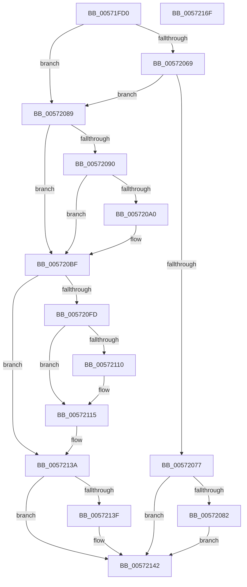

# IvtLegacySetPasidAddressSpace

- RVA: `0x00571FD0`–`0x00572170` (길이 `416` bytes)
- VA: `0x0000000140571FD0`
- 실행 섹션: `.text`
- PDB 이름 있음: `예`; PDB Function 태그: `아니요`
- unwind 정보 RVA: `0x0008611C`
- 디코드: `112`개 명령, `416/416` bytes 표시
- 미해석 바이트: `0` (있으면 어셈블리에 `.byte`로 보존)

> 이 문서는 커널 이미지의 기계어와 PDB 기호를 분석해 생성했습니다. 4번과 5번은 함수 원형과 자료형을 바이너리 사용 방식에서 추정한 C 해석이며 원본 소스 복구 결과는 아닙니다.

## 1. Dependencies

- 직접 호출 지점: **7**; 고유 호출 대상: **7**
- 직접 호출자로 확인된 함수: **0**
- RIP 상대 이미지 참조: **1**

### Outgoing calls
- `0x00572020` → [memset](../6C/memset_function_006C6C40.md) (function, `0x006C6C40`)
- `0x00572096` → [IvtEnsureNoPendingFaults](../56/IvtEnsureNoPendingFaults_function_0056F60C.md) (function, `0x0056F60C`)
- `0x005720B9` → [KeBugCheckEx](../4F/KeBugCheckEx_function_004FD660.md) (function, `0x004FD660`)
- `0x005720E0` → [IvtBuildScalableModePasidTableS1Entry](../4F/IvtBuildScalableModePasidTableS1Entry_function_004F6644.md) (function, `0x004F6644`)
- `0x005720F3` → [IvtLegacySetScalableModePasidTableEntry](../4C/IvtLegacySetScalableModePasidTableEntry_function_004CD7CC.md) (function, `0x004CD7CC`)
- `0x00572135` → [IvtInvalidateScalableModePasidCache](IvtInvalidateScalableModePasidCache_function_005709B8.md) (function, `0x005709B8`)
- `0x0057214F` → [_security_check_cookie](../6A/_security_check_cookie_function_006AC640.md) (function, `0x006AC640`)

### Direct callers
- 이 함수 시작 RVA로 연결되는 직접 call은 확인되지 않았습니다. 간접 호출은 완전히 역산할 수 없습니다.

### Static image references
- `0x00571FE7` → RVA `0x00E0A740` (`.data`; read)

## 2. Other-region calls and transfers

- 다른 실행 섹션으로 향하는 call: **0**
- 별도 외부 분기/꼬리 이동을 확인하지 못했습니다.

## 3. Assembly (complete function range)

```asm
00571FD0  48 89 5C 24 20                  mov qword ptr [rsp + 0x20], rbx
00571FD5  55                              push rbp
00571FD6  56                              push rsi
00571FD7  57                              push rdi
00571FD8  41 54                           push r12
00571FDA  41 55                           push r13
00571FDC  41 56                           push r14
00571FDE  41 57                           push r15
00571FE0  48 81 EC E0 00 00 00            sub rsp, 0xe0
00571FE7  48 8B 05 52 87 89 00            mov rax, qword ptr [rip + 0x898752]
00571FEE  48 33 C4                        xor rax, rsp
00571FF1  48 89 84 24 D0 00 00 00         mov qword ptr [rsp + 0xd0], rax
00571FF9  48 8B B4 24 40 01 00 00         mov rsi, qword ptr [rsp + 0x140]
00572001  48 8B DA                        mov rbx, rdx
00572004  48 89 54 24 40                  mov qword ptr [rsp + 0x40], rdx
00572009  4C 8B F9                        mov r15, rcx
0057200C  33 D2                           xor edx, edx
0057200E  45 8B F0                        mov r14d, r8d
00572011  48 8D 8C 24 90 00 00 00         lea rcx, [rsp + 0x90]
00572019  49 8B E9                        mov rbp, r9
0057201C  44 8D 42 40                     lea r8d, [rdx + 0x40]
00572020  E8 1B 4C 15 00                  call 0x1406c6c40
00572025  4C 8B 6B 40                     mov r13, qword ptr [rbx + 0x40]
00572029  41 8B D6                        mov edx, r14d
0057202C  83 E2 3F                        and edx, 0x3f
0057202F  48 C1 ED 0C                     shr rbp, 0xc
00572033  48 C1 E2 06                     shl rdx, 6
00572037  41 8B C6                        mov eax, r14d
0057203A  48 C1 E8 06                     shr rax, 6
0057203E  25 FF 3F 00 00                  and eax, 0x3fff
00572043  49 8B 4C C5 40                  mov rcx, qword ptr [r13 + rax*8 + 0x40]
00572048  0F 10 14 11                     movups xmm2, xmmword ptr [rcx + rdx]
0057204C  0F 10 44 11 10                  movups xmm0, xmmword ptr [rcx + rdx + 0x10]
00572051  66 48 0F 7E D7                  movq rdi, xmm2
00572056  0F 29 54 24 50                  movaps xmmword ptr [rsp + 0x50], xmm2
0057205B  4C 8B E7                        mov r12, rdi
0057205E  0F 29 44 24 60                  movaps xmmword ptr [rsp + 0x60], xmm0
00572063  41 83 E4 01                     and r12d, 1
00572067  74 20                           je 0x140572089
00572069  48 8B 44 24 60                  mov rax, qword ptr [rsp + 0x60]
0057206E  48 C1 E8 0C                     shr rax, 0xc
00572072  48 3B C5                        cmp rax, rbp
00572075  75 12                           jne 0x140572089
00572077  33 DB                           xor ebx, ebx
00572079  48 85 F6                        test rsi, rsi
0057207C  0F 84 C0 00 00 00               je 0x140572142
00572082  88 1E                           mov byte ptr [rsi], bl
00572084  E9 B9 00 00 00                  jmp 0x140572142
00572089  33 DB                           xor ebx, ebx
0057208B  48 85 ED                        test rbp, rbp
0057208E  75 2F                           jne 0x1405720bf
00572090  41 8B D6                        mov edx, r14d
00572093  49 8B CF                        mov rcx, r15
00572096  E8 71 D5 FF FF                  call 0x14056f60c
0057209B  48 85 C0                        test rax, rax
0057209E  74 1F                           je 0x1405720bf
005720A0  48 8B 48 08                     mov rcx, qword ptr [rax + 8]
005720A4  4C 8B C0                        mov r8, rax
005720A7  4C 8B 08                        mov r9, qword ptr [rax]
005720AA  BA 00 10 00 00                  mov edx, 0x1000
005720AF  48 89 4C 24 20                  mov qword ptr [rsp + 0x20], rcx
005720B4  B9 59 01 00 00                  mov ecx, 0x159
005720B9  E8 A2 B5 F8 FF                  call 0x1404fd660
005720BE  CC                              int3
005720BF  48 8D 84 24 90 00 00 00         lea rax, [rsp + 0x90]
005720C7  4C 8B C5                        mov r8, rbp
005720CA  48 89 44 24 30                  mov qword ptr [rsp + 0x30], rax
005720CF  BA 01 00 00 00                  mov edx, 1
005720D4  48 89 5C 24 28                  mov qword ptr [rsp + 0x28], rbx
005720D9  49 8B CF                        mov rcx, r15
005720DC  88 5C 24 20                     mov byte ptr [rsp + 0x20], bl
005720E0  E8 5F 45 F8 FF                  call 0x1404f6644
005720E5  4C 8D 8C 24 90 00 00 00         lea r9, [rsp + 0x90]
005720ED  45 8B C6                        mov r8d, r14d
005720F0  49 8B D5                        mov rdx, r13
005720F3  E8 D4 B6 F5 FF                  call 0x1404cd7cc
005720F8  4D 85 E4                        test r12, r12
005720FB  74 3D                           je 0x14057213a
005720FD  0F B7 44 24 58                  movzx eax, word ptr [rsp + 0x58]
00572102  48 C1 EF 06                     shr rdi, 6
00572106  40 80 E7 07                     and dil, 7
0057210A  40 80 FF 02                     cmp dil, 2
0057210E  74 05                           je 0x140572115
00572110  B8 00 00 01 00                  mov eax, 0x10000
00572115  48 8B 54 24 40                  mov rdx, qword ptr [rsp + 0x40]
0057211A  45 8B CE                        mov r9d, r14d
0057211D  88 5C 24 30                     mov byte ptr [rsp + 0x30], bl
00572121  49 8B CF                        mov rcx, r15
00572124  44 8B C0                        mov r8d, eax
00572127  88 5C 24 28                     mov byte ptr [rsp + 0x28], bl
0057212B  48 8B 52 38                     mov rdx, qword ptr [rdx + 0x38]
0057212F  89 5C 24 20                     mov dword ptr [rsp + 0x20], ebx
00572133  8B 12                           mov edx, dword ptr [rdx]
00572135  E8 7E E8 FF FF                  call 0x1405709b8
0057213A  48 85 F6                        test rsi, rsi
0057213D  74 03                           je 0x140572142
0057213F  C6 06 01                        mov byte ptr [rsi], 1
00572142  33 C0                           xor eax, eax
00572144  48 8B 8C 24 D0 00 00 00         mov rcx, qword ptr [rsp + 0xd0]
0057214C  48 33 CC                        xor rcx, rsp
0057214F  E8 EC A4 13 00                  call 0x1406ac640
00572154  48 8B 9C 24 38 01 00 00         mov rbx, qword ptr [rsp + 0x138]
0057215C  48 81 C4 E0 00 00 00            add rsp, 0xe0
00572163  41 5F                           pop r15
00572165  41 5E                           pop r14
00572167  41 5D                           pop r13
00572169  41 5C                           pop r12
0057216B  5F                              pop rdi
0057216C  5E                              pop rsi
0057216D  5D                              pop rbp
0057216E  C3                              ret
0057216F  CC                              int3
```

## 4. C-style interpretation (structured pseudocode)

```c
__int64 __fastcall IvtLegacySetPasidAddressSpace(__int64 a1, __int64 a2, int a3, __int64 a4, __int64 a5)
{
    __int64 result;
    __int64 v_r12;
    __int64 v_rbp;
    __int64 v_rbx;
    __int64 v_rdi;
    __int64 v_rsp;
    unsigned __int64 v_stack_m48;
    unsigned __int64 v_stack_m88;
    unsigned __int64 v_stack_mB8;
    unsigned __int16 v_stack_mC0;
    unsigned __int64 v_stack_mC8;
    unsigned __int64 v_stack_mD8;
    unsigned __int64 v_stack_mE8;
    unsigned __int64 v_stack_mF0;
    unsigned __int64 v_stack_mF8;
    unsigned __int64 v_stack_p20;

    v_stack_p20 = v_rbx;
    v_rsp = (v_rsp) - (224);
    result = (*(unsigned __int64 *)(v_rip + 9013074)) ^ (v_rsp);
    v_stack_m48 = result;
    v_stack_mD8 = a2;
    a2 = 0;
    result = memset(v_stack_m88, a2, a2 + 64, a4);
    a2 = (unsigned int)(((unsigned int)((unsigned int)((unsigned int)(a3)))) & (63));
    v_rbp = (a4) >> (12);
    a2 = (a2) << (6);
    result = ((unsigned int)((unsigned int)((unsigned int)(a3)))) >> (6);
    result = (unsigned int)((result) & (0x3FFFULL));
    v_stack_mC8 = v_xmm2;
    v_stack_mB8 = v_xmm0;
    v_r12 = (unsigned int)((v_rdi) & (1));
    if (condition_is_equal) goto loc_00572089;
    result = (v_stack_mB8) >> (12);
    if (result != v_rbp) goto loc_00572089;
    v_rbx = 0;
    if (a5 == 0) goto loc_00572142;
    *(unsigned __int8 *)(a5) = 0;
    goto loc_00572142;
loc_00572089:
    v_rbx = 0;
    if (v_rbp != 0) goto loc_005720BF;
    result = IvtEnsureNoPendingFaults(a1, (unsigned int)((unsigned int)((unsigned int)(a3))), a2 + 64, a4);
    if (result != 0) {
        a1 = *(unsigned __int64 *)(result + 8);
        a3 = result;
        a4 = *(unsigned __int64 *)(result);
        a2 = 0x1000ULL;
        v_stack_mF8 = a1;
        a1 = 345;
        result = KeBugCheckEx(a1, a2, a3, a4);
    }
    v_stack_mE8 = v_stack_m88;
    v_stack_mF0 = 0;
    v_stack_mF8 = 0;
    result = IvtBuildScalableModePasidTableS1Entry(a1, 1, v_rbp, a4);
    result = IvtLegacySetScalableModePasidTableEntry(a1, *(unsigned __int64 *)(a2 + 64), (unsigned int)((unsigned int)((unsigned int)(a3))), v_stack_m88);
    if (v_r12 == 0) goto loc_0057213A;
    v_rdi = (v_rdi) >> (6);
    v_rdi = (unsigned __int8)((v_rdi) & (7));
    result = v_stack_mC0;
    if (((unsigned __int8)(v_rdi)) != 2) {
        result = 0x10000ULL;
    }
    v_stack_mE8 = 0;
    v_stack_mF0 = 0;
    v_stack_mF8 = 0;
    result = IvtInvalidateScalableModePasidCache(a1, (unsigned int)(*(unsigned int *)(*(unsigned __int64 *)(v_stack_mD8 + 56))), (unsigned int)((unsigned int)(result)), (unsigned int)((unsigned int)((unsigned int)(a3))));
loc_0057213A:
    if (a5 != 0) {
        *(unsigned __int8 *)(a5) = 1;
    }
    result = 0;
    a1 = (v_stack_m48) ^ (v_rsp);
    result = _security_check_cookie(a1, (unsigned int)(*(unsigned int *)(*(unsigned __int64 *)(v_stack_mD8 + 56))), (unsigned int)((unsigned int)(result)), (unsigned int)((unsigned int)((unsigned int)(a3))));
    v_rsp = (v_rsp) + (224);
    return result;
}
```

## 5. (Beta) C Style

```c
int64_t IvtLegacySetPasidAddressSpace(int64_t Arg1, void *Arg2, int32_t Arg3, int64_t Arg4, int64_t Arg5)
{
    uint8_t *arg2 = (uint8_t *)Arg2;

    int64_t result;
    int64_t local_r12;
    int64_t local_rbp;
    int64_t local_rbx;
    int64_t local_rdi;
    int64_t local_rsp;
    uint64_t v_stack_m48;
    uint64_t v_stack_m88;
    uint64_t v_stack_mB8;
    uint16_t v_stack_mC0;
    uint64_t v_stack_mC8;
    uint64_t v_stack_mD8;
    uint64_t v_stack_mE8;
    uint64_t v_stack_mF0;
    uint64_t v_stack_mF8;
    uint64_t v_stack_p20;

    v_stack_p20 = local_rbx;
    local_rsp = (local_rsp) - (224);
    result = (*(uint64_t *)(v_rip + 0x898752)) ^ (local_rsp);
    v_stack_m48 = result;
    v_stack_mD8 = Arg2;
    Arg2 = 0;
    result = memset(v_stack_m88, Arg2, Arg2 + 64, Arg4);
    Arg2 = (uint32_t)(((uint32_t)((uint32_t)((uint32_t)(Arg3)))) & (63));
    local_rbp = (Arg4) >> (12);
    Arg2 = (Arg2) << (6);
    result = ((uint32_t)((uint32_t)((uint32_t)(Arg3)))) >> (6);
    result = (uint32_t)((result) & (0x3FFFULL));
    v_stack_mC8 = v_xmm2;
    v_stack_mB8 = v_xmm0;
    local_r12 = (uint32_t)((local_rdi) & (1));
    if (condition_is_equal) goto loc_00572089;
    result = (v_stack_mB8) >> (12);
    if (result != local_rbp) goto loc_00572089;
    local_rbx = 0;
    if (Arg5 == 0) goto loc_00572142;
    *(uint8_t *)(Arg5) = 0;
    goto loc_00572142;
loc_00572089:
    local_rbx = 0;
    if (local_rbp != 0) goto loc_005720BF;
    result = IvtEnsureNoPendingFaults(Arg1, (uint32_t)((uint32_t)((uint32_t)(Arg3))), Arg2 + 64, Arg4);
    if (result != 0) {
        Arg1 = *(uint64_t *)(result + 0x8);
        Arg3 = result;
        Arg4 = *(uint64_t *)(result);
        Arg2 = 0x1000ULL;
        v_stack_mF8 = Arg1;
        Arg1 = 345;
        result = KeBugCheckEx(Arg1, Arg2, Arg3, Arg4);
    }
    v_stack_mE8 = v_stack_m88;
    v_stack_mF0 = 0;
    v_stack_mF8 = 0;
    result = IvtBuildScalableModePasidTableS1Entry(Arg1, 1, local_rbp, Arg4);
    result = IvtLegacySetScalableModePasidTableEntry(Arg1, *(uint64_t *)(arg2 + 0x40), (uint32_t)((uint32_t)((uint32_t)(Arg3))), v_stack_m88);
    if (local_r12 == 0) goto loc_0057213A;
    local_rdi = (local_rdi) >> (6);
    local_rdi = (uint8_t)((local_rdi) & (7));
    result = v_stack_mC0;
    if (((uint8_t)(local_rdi)) != 2) {
        result = 0x10000ULL;
    }
    v_stack_mE8 = 0;
    v_stack_mF0 = 0;
    v_stack_mF8 = 0;
    result = IvtInvalidateScalableModePasidCache(Arg1, (uint32_t)(*(uint32_t *)(*(uint64_t *)(v_stack_mD8 + 0x38))), (uint32_t)((uint32_t)(result)), (uint32_t)((uint32_t)((uint32_t)(Arg3))));
loc_0057213A:
    if (Arg5 != 0) {
        *(uint8_t *)(Arg5) = 1;
    }
    result = 0;
    Arg1 = (v_stack_m48) ^ (local_rsp);
    result = _security_check_cookie(Arg1, (uint32_t)(*(uint32_t *)(*(uint64_t *)(v_stack_mD8 + 0x38))), (uint32_t)((uint32_t)(result)), (uint32_t)((uint32_t)((uint32_t)(Arg3))));
    local_rsp = (local_rsp) + (224);
    return result;
}
```

### 관측된 메모리 오프셋

구조체 형식이 확인되지 않은 접근은 인자 기준의 오프셋으로만 기록했습니다.

| 기준 인자 | 오프셋 표현 | 폭 (bit) | 접근 |
|---|---:|---:|---|
| `Arg2` | `+ 0x40` | `64` | `R` |

## 6. Execution-region graph

[열기: 2D/3D 그래프와 함수 탐색 컨트롤 패널](../../../control-panel.html?section=text&rva=0x00571FD0&view=graph)

- 2D 그래프는 위에서 아래로 흐르고, 3D 그래프는 빈 공간을 드래그해 회전합니다. Shift+드래그는 이동, 휠은 확대·축소, 함수 노드 선택은 대상 보고서 이동입니다.

### Static fallback


