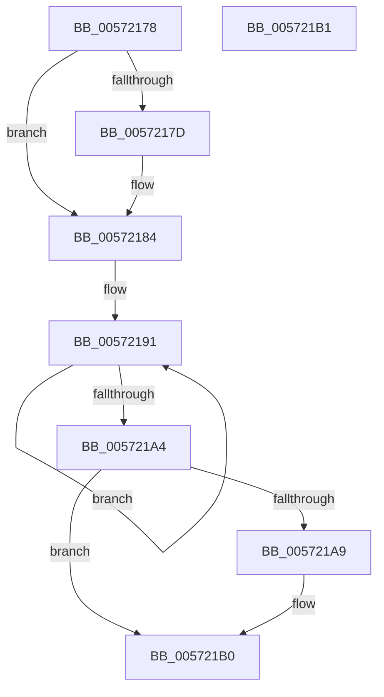

# IvtLegacySetScalableModeContextEntry

- RVA: `0x00572178`–`0x005721B2` (길이 `58` bytes)
- VA: `0x0000000140572178`
- 실행 섹션: `.text`
- PDB 이름 있음: `예`; PDB Function 태그: `아니요`
- unwind 정보 RVA: `0x000DB714`
- 디코드: `21`개 명령, `58/58` bytes 표시
- 미해석 바이트: `0` (있으면 어셈블리에 `.byte`로 보존)

> 이 문서는 커널 이미지의 기계어와 PDB 기호를 분석해 생성했습니다. 4번과 5번은 함수 원형과 자료형을 바이너리 사용 방식에서 추정한 C 해석이며 원본 소스 복구 결과는 아닙니다.

## 1. Dependencies

- 직접 호출 지점: **0**; 고유 호출 대상: **0**
- 직접 호출자로 확인된 함수: **2**
- RIP 상대 이미지 참조: **0**

### Outgoing calls
- 직접 디코드된 call 명령이 없습니다.

### Direct callers
- [IvtLegacyUpdateScalableModeContextEntry](IvtLegacyUpdateScalableModeContextEntry_function_005721B8.md) at `0x0057231A`
- [IvtInitializeIommu](../../pagelk/B6/IvtInitializeIommu_function_00B61FE0.md) at `0x00B623FA`

### Static image references
- 디코드된 RIP-relative 메모리 참조가 없습니다.

## 2. Other-region calls and transfers

- 다른 실행 섹션으로 향하는 call: **0**
- 별도 외부 분기/꼬리 이동을 확인하지 못했습니다.

## 3. Assembly (complete function range)

```asm
00572178  F6 02 01                        test byte ptr [rdx], 1
0057217B  75 07                           jne 0x140572184
0057217D  48 8B 02                        mov rax, qword ptr [rdx]
00572180  49 89 00                        mov qword ptr [r8], rax
00572183  90                              nop
00572184  B9 03 00 00 00                  mov ecx, 3
00572189  4C 8D 4A 18                     lea r9, [rdx + 0x18]
0057218D  4D 8D 50 18                     lea r10, [r8 + 0x18]
00572191  49 8B 01                        mov rax, qword ptr [r9]
00572194  4D 8D 49 F8                     lea r9, [r9 - 8]
00572198  49 89 02                        mov qword ptr [r10], rax
0057219B  4D 8D 52 F8                     lea r10, [r10 - 8]
0057219F  83 C1 FF                        add ecx, -1
005721A2  75 ED                           jne 0x140572191
005721A4  F6 02 01                        test byte ptr [rdx], 1
005721A7  74 07                           je 0x1405721b0
005721A9  90                              nop
005721AA  48 8B 02                        mov rax, qword ptr [rdx]
005721AD  49 89 00                        mov qword ptr [r8], rax
005721B0  C3                              ret
005721B1  CC                              int3
```

## 4. C-style interpretation (structured pseudocode)

```c
__int64 __fastcall IvtLegacySetScalableModeContextEntry(__int64 a1, __int64 a2, __int64 a3)
{
    __int64 result;

    if (((*(unsigned __int8 *)(a2)) & (1)) == 0) {
        result = *(unsigned __int64 *)(a2);
        *(unsigned __int64 *)(a3) = result;
    }
loc_00572191:
    *(unsigned __int64 *)(a3 + 24) = *(unsigned __int64 *)(a2 + 24);
    a1 = (unsigned int)((3) + (-1));
    if (condition_is_not_equal) goto loc_00572191;
    result = *(unsigned __int64 *)(a2 + 24);
    if (((*(unsigned __int8 *)(a2)) & (1)) != 0) {
        result = *(unsigned __int64 *)(a2);
        *(unsigned __int64 *)(a3) = result;
    }
    return result;
}
```

## 5. (Beta) C Style

```c
int64_t IvtLegacySetScalableModeContextEntry(int64_t Arg1, void *Arg2, void *Arg3)
{
    uint8_t *arg2 = (uint8_t *)Arg2;
    uint8_t *arg3 = (uint8_t *)Arg3;

    int64_t result;

    if (((*(uint8_t *)(arg2)) & (1)) == 0) {
        result = *(uint64_t *)(arg2);
        *(uint64_t *)(arg3) = result;
    }
loc_00572191:
    *(uint64_t *)(arg3 + 0x18) = *(uint64_t *)(arg2 + 0x18);
    Arg1 = (uint32_t)((3) + (-1));
    if (condition_is_not_equal) goto loc_00572191;
    result = *(uint64_t *)(arg2 + 0x18);
    if (((*(uint8_t *)(arg2)) & (1)) != 0) {
        result = *(uint64_t *)(arg2);
        *(uint64_t *)(arg3) = result;
    }
    return result;
}
```

### 관측된 메모리 오프셋

구조체 형식이 확인되지 않은 접근은 인자 기준의 오프셋으로만 기록했습니다.

| 기준 인자 | 오프셋 표현 | 폭 (bit) | 접근 |
|---|---:|---:|---|
| `Arg2` | `- 0x8` | `64` | `R` |
| `Arg2` | `+ 0x0` | `8` | `R` |
| `Arg2` | `+ 0x0` | `64` | `R` |
| `Arg2` | `+ 0x18` | `64` | `R` |
| `Arg3` | `- 0x8` | `64` | `R` |
| `Arg3` | `+ 0x0` | `64` | `W` |
| `Arg3` | `+ 0x18` | `64` | `R` |

## 6. Execution-region graph

[열기: 2D/3D 그래프와 함수 탐색 컨트롤 패널](../../../control-panel.html?section=text&rva=0x00572178&view=graph)

- 2D 그래프는 위에서 아래로 흐르고, 3D 그래프는 빈 공간을 드래그해 회전합니다. Shift+드래그는 이동, 휠은 확대·축소, 함수 노드 선택은 대상 보고서 이동입니다.

### Static fallback


