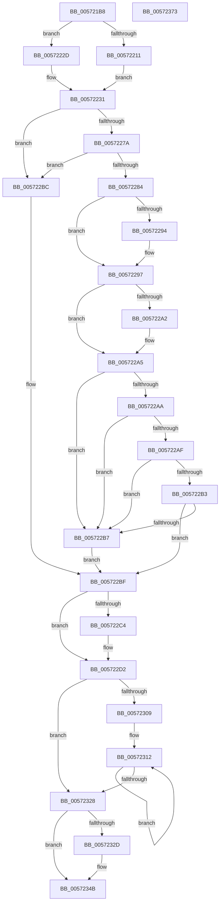

# IvtLegacyUpdateScalableModeContextEntry

- RVA: `0x005721B8`–`0x00572374` (길이 `444` bytes)
- VA: `0x00000001405721B8`
- 실행 섹션: `.text`
- PDB 이름 있음: `예`; PDB Function 태그: `아니요`
- unwind 정보 RVA: `0x000C5124`
- 디코드: `137`개 명령, `444/444` bytes 표시
- 미해석 바이트: `0` (있으면 어셈블리에 `.byte`로 보존)

> 이 문서는 커널 이미지의 기계어와 PDB 기호를 분석해 생성했습니다. 4번과 5번은 함수 원형과 자료형을 바이너리 사용 방식에서 추정한 C 해석이며 원본 소스 복구 결과는 아닙니다.

## 1. Dependencies

- 직접 호출 지점: **6**; 고유 호출 대상: **6**
- 직접 호출자로 확인된 함수: **3**
- RIP 상대 이미지 참조: **1**

### Outgoing calls
- `0x005722CA` → [IvtGetScalableModePasidTables](../56/IvtGetScalableModePasidTables_function_0056FD5C.md) (function, `0x0056FD5C`)
- `0x005722E5` → [IvtLegacyBuildScalableModeContextEntry](IvtLegacyBuildScalableModeContextEntry_function_00571198.md) (function, `0x00571198`)
- `0x0057231A` → [IvtLegacySetScalableModeContextEntry](IvtLegacySetScalableModeContextEntry_function_00572178.md) (function, `0x00572178`)
- `0x00572333` → [IvtLegacyGetDomainId](IvtLegacyGetDomainId_function_00571C14.md) (function, `0x00571C14`)
- `0x00572346` → [IvtInvalidateScalableModeContextEntry](IvtInvalidateScalableModeContextEntry_function_00570940.md) (function, `0x00570940`)
- `0x00572353` → [_security_check_cookie](../6A/_security_check_cookie_function_006AC640.md) (function, `0x006AC640`)

### Direct callers
- [IvtLegacyConfigureAts](IvtLegacyConfigureAts_function_00571270.md) at `0x005712FC`
- [IvtLegacySetDevicePasidTable](IvtLegacySetDevicePasidTable_function_00571EE0.md) at `0x00571F63`
- [IvtLegacyUpdateScalableModeTranslationStructures](IvtLegacyUpdateScalableModeTranslationStructures_function_0057237C.md) at `0x0057243A`

### Static image references
- `0x005721CF` → RVA `0x00E0A740` (`.data`; read)

## 2. Other-region calls and transfers

- 다른 실행 섹션으로 향하는 call: **0**
- 별도 외부 분기/꼬리 이동을 확인하지 못했습니다.

## 3. Assembly (complete function range)

```asm
005721B8  48 89 5C 24 20                  mov qword ptr [rsp + 0x20], rbx
005721BD  55                              push rbp
005721BE  56                              push rsi
005721BF  57                              push rdi
005721C0  41 54                           push r12
005721C2  41 55                           push r13
005721C4  41 56                           push r14
005721C6  41 57                           push r15
005721C8  48 81 EC 80 00 00 00            sub rsp, 0x80
005721CF  48 8B 05 6A 85 89 00            mov rax, qword ptr [rip + 0x89856a]
005721D6  48 33 C4                        xor rax, rsp
005721D9  48 89 44 24 70                  mov qword ptr [rsp + 0x70], rax
005721DE  44 8B 12                        mov r10d, dword ptr [rdx]
005721E1  0F 57 C0                        xorps xmm0, xmm0
005721E4  41 8B C2                        mov eax, r10d
005721E7  45 33 ED                        xor r13d, r13d
005721EA  C1 E8 08                        shr eax, 8
005721ED  4D 8B D8                        mov r11, r8
005721F0  4C 8B 41 20                     mov r8, qword ptr [rcx + 0x20]
005721F4  03 C0                           add eax, eax
005721F6  4C 8B F2                        mov r14, rdx
005721F9  48 8B F1                        mov rsi, rcx
005721FC  0F 11 44 24 50                  movups xmmword ptr [rsp + 0x50], xmm0
00572201  8B D0                           mov edx, eax
00572203  0F 11 44 24 60                  movups xmmword ptr [rsp + 0x60], xmm0
00572208  44 38 A9 40 01 00 00            cmp byte ptr [rcx + 0x140], r13b
0057220F  74 1C                           je 0x14057222d
00572211  41 8B CD                        mov ecx, r13d
00572214  41 8B C2                        mov eax, r10d
00572217  25 F8 00 00 00                  and eax, 0xf8
0057221C  3D 80 00 00 00                  cmp eax, 0x80
00572221  0F 93 C1                        setae cl
00572224  48 03 CA                        add rcx, rdx
00572227  49 8D 14 C8                     lea rdx, [r8 + rcx*8]
0057222B  EB 04                           jmp 0x140572231
0057222D  49 8D 14 C0                     lea rdx, [r8 + rax*8]
00572231  44 8B 84 24 E0 00 00 00         mov r8d, dword ptr [rsp + 0xe0]
00572239  B9 01 00 00 00                  mov ecx, 1
0057223E  44 3B C9                        cmp r9d, ecx
00572241  41 0F B6 ED                     movzx ebp, r13b
00572245  41 8B DA                        mov ebx, r10d
00572248  45 8A E5                        mov r12b, r13b
0057224B  40 0F 94 C7                     sete dil
0057224F  41 8D 40 FF                     lea eax, [r8 - 1]
00572253  3B C1                           cmp eax, ecx
00572255  41 0F B7 C2                     movzx eax, r10w
00572259  0F 46 E9                        cmovbe ebp, ecx
0057225C  C1 EB 03                        shr ebx, 3
0057225F  83 E3 0F                        and ebx, 0xf
00572262  83 E0 07                        and eax, 7
00572265  48 C1 E3 03                     shl rbx, 3
00572269  48 0B D8                        or rbx, rax
0057226C  48 C1 E3 05                     shl rbx, 5
00572270  48 03 1A                        add rbx, qword ptr [rdx]
00572273  48 8B 03                        mov rax, qword ptr [rbx]
00572276  84 C1                           test cl, al
00572278  74 42                           je 0x1405722bc
0057227A  44 39 AC 24 F8 00 00 00         cmp dword ptr [rsp + 0xf8], r13d
00572282  75 38                           jne 0x1405722bc
00572284  44 8A F9                        mov r15b, cl
00572287  8A C8                           mov cl, al
00572289  C0 E9 02                        shr cl, 2
0057228C  41 22 CF                        and cl, r15b
0057228F  45 85 C9                        test r9d, r9d
00572292  75 03                           jne 0x140572297
00572294  40 8A F9                        mov dil, cl
00572297  C0 E8 03                        shr al, 3
0057229A  41 22 C7                        and al, r15b
0057229D  45 85 C0                        test r8d, r8d
005722A0  75 03                           jne 0x1405722a5
005722A2  40 8A E8                        mov bpl, al
005722A5  40 3A F9                        cmp dil, cl
005722A8  75 0D                           jne 0x1405722b7
005722AA  40 3A E8                        cmp bpl, al
005722AD  75 08                           jne 0x1405722b7
005722AF  84 C9                           test cl, cl
005722B1  75 04                           jne 0x1405722b7
005722B3  84 C0                           test al, al
005722B5  74 08                           je 0x1405722bf
005722B7  45 8A E7                        mov r12b, r15b
005722BA  EB 03                           jmp 0x1405722bf
005722BC  45 8A FD                        mov r15b, r13b
005722BF  4D 85 DB                        test r11, r11
005722C2  75 0E                           jne 0x1405722d2
005722C4  41 8B D2                        mov edx, r10d
005722C7  48 8B CE                        mov rcx, rsi
005722CA  E8 8D DA FF FF                  call 0x14056fd5c
005722CF  4C 8B D8                        mov r11, rax
005722D2  48 8D 44 24 50                  lea rax, [rsp + 0x50]
005722D7  44 8A CD                        mov r9b, bpl
005722DA  44 8A C7                        mov r8b, dil
005722DD  48 89 44 24 28                  mov qword ptr [rsp + 0x28], rax
005722E2  49 8B D3                        mov rdx, r11
005722E5  E8 AE EE FF FF                  call 0x140571198
005722EA  41 8B 46 04                     mov eax, dword ptr [r14 + 4]
005722EE  BA 01 00 00 00                  mov edx, 1
005722F3  8B C8                           mov ecx, eax
005722F5  D3 E2                           shl edx, cl
005722F7  B9 03 00 00 00                  mov ecx, 3
005722FC  2B C8                           sub ecx, eax
005722FE  B8 01 00 00 00                  mov eax, 1
00572303  D3 E0                           shl eax, cl
00572305  85 D2                           test edx, edx
00572307  74 1F                           je 0x140572328
00572309  44 8B D8                        mov r11d, eax
0057230C  49 C1 E3 05                     shl r11, 5
00572310  8B FA                           mov edi, edx
00572312  4C 8B C3                        mov r8, rbx
00572315  48 8D 54 24 50                  lea rdx, [rsp + 0x50]
0057231A  E8 59 FE FF FF                  call 0x140572178
0057231F  49 03 DB                        add rbx, r11
00572322  48 83 EF 01                     sub rdi, 1
00572326  75 EA                           jne 0x140572312
00572328  45 84 FF                        test r15b, r15b
0057232B  74 1E                           je 0x14057234b
0057232D  41 8B 16                        mov edx, dword ptr [r14]
00572330  48 8B CE                        mov rcx, rsi
00572333  E8 DC F8 FF FF                  call 0x140571c14
00572338  4C 8B C0                        mov r8, rax
0057233B  44 88 64 24 20                  mov byte ptr [rsp + 0x20], r12b
00572340  49 8B D6                        mov rdx, r14
00572343  48 8B CE                        mov rcx, rsi
00572346  E8 F5 E5 FF FF                  call 0x140570940
0057234B  48 8B 4C 24 70                  mov rcx, qword ptr [rsp + 0x70]
00572350  48 33 CC                        xor rcx, rsp
00572353  E8 E8 A2 13 00                  call 0x1406ac640
00572358  48 8B 9C 24 D8 00 00 00         mov rbx, qword ptr [rsp + 0xd8]
00572360  48 81 C4 80 00 00 00            add rsp, 0x80
00572367  41 5F                           pop r15
00572369  41 5E                           pop r14
0057236B  41 5D                           pop r13
0057236D  41 5C                           pop r12
0057236F  5F                              pop rdi
00572370  5E                              pop rsi
00572371  5D                              pop rbp
00572372  C3                              ret
00572373  CC                              int3
```

## 4. C-style interpretation (structured pseudocode)

```c
__int64 __fastcall IvtLegacyUpdateScalableModeContextEntry(__int64 a1, __int64 a2, __int64 a3, int a4, unsigned int a5, __int64 a6, __int64 a7, unsigned int a8)
{
    __int64 result;
    __int64 v_r11;
    __int64 v_r13;
    __int64 v_rbp;
    __int64 v_rbx;
    __int64 v_rdi;
    __int64 v_rsp;
    unsigned __int64 v_stack_m48;
    unsigned __int64 v_stack_m58;
    unsigned __int64 v_stack_m68;
    unsigned __int64 v_stack_m90;
    unsigned __int8 v_stack_m98;
    unsigned __int64 v_stack_p20;

    v_stack_p20 = v_rbx;
    v_rsp = (v_rsp) - (128);
    result = (*(unsigned __int64 *)(v_rip + 9012586)) ^ (v_rsp);
    v_stack_m48 = result;
    v_r13 = 0;
    result = (unsigned int)(((unsigned int)((unsigned int)((unsigned int)(*(unsigned int *)(a2))))) >> (8));
    result = (unsigned int)((result) + ((unsigned int)(result)));
    v_stack_m68 = v_xmm0;
    v_stack_m58 = v_xmm0;
    if ((*(unsigned __int8 *)(a1 + 320)) == 0) goto loc_0057222D;
    result = (unsigned int)(((unsigned int)((unsigned int)((unsigned int)(*(unsigned int *)(a2))))) & (248));
    a1 = (((unsigned int)(result)) >= 128) ? 1 : 0;
    a1 = (a1) + ((unsigned int)((unsigned int)(result)));
    goto loc_00572231;
loc_0057222D:
loc_00572231:
    v_rdi = (a4 == 1) ? 1 : 0;
    v_rbp = 0;
    if (((unsigned int)((unsigned int)(a5) - 1)) <= 1) { v_rbp = 1; }
    v_rbx = (unsigned int)(((unsigned int)((unsigned int)((unsigned int)(*(unsigned int *)(a2))))) >> (3));
    v_rbx = (unsigned int)((v_rbx) & (15));
    result = (unsigned int)(((unsigned __int16)((unsigned int)(*(unsigned int *)(a2)))) & (7));
    v_rbx = (v_rbx) << (3);
    v_rbx = (v_rbx) | (result);
    v_rbx = (v_rbx) << (5);
    v_rbx = (v_rbx) + (*(unsigned __int64 *)(*(unsigned __int64 *)(a1 + 32) + result * 8));
    if (((1) & ((unsigned __int8)(*(unsigned __int64 *)(v_rbx)))) == 0) goto loc_005722BC;
    if (a8 != 0) goto loc_005722BC;
    a1 = (unsigned __int8)(((unsigned __int8)(*(unsigned __int64 *)(v_rbx))) >> (2));
    a1 = (unsigned __int8)((a1) & (1));
    if (a4 == 0) {
        v_rdi = (unsigned __int8)(a1);
    }
    result = (unsigned __int8)((*(unsigned __int64 *)(v_rbx)) >> (3));
    result = (unsigned __int8)((result) & (1));
    if ((unsigned int)((unsigned int)(a5)) == 0) {
        v_rbp = (unsigned __int8)(result);
    }
    if (((unsigned __int8)(v_rdi)) != ((unsigned __int8)(a1))) goto loc_005722B7;
    if (((unsigned __int8)(v_rbp)) != ((unsigned __int8)(result))) goto loc_005722B7;
    if ((unsigned __int8)(a1) != 0) goto loc_005722B7;
    if ((unsigned __int8)(result) == 0) goto loc_005722BF;
loc_005722B7:
    goto loc_005722BF;
loc_005722BC:
loc_005722BF:
    v_r11 = a3;
    if (a3 == 0) {
        a2 = (unsigned int)((unsigned int)(*(unsigned int *)(a2)));
        a1 = a1;
        result = IvtGetScalableModePasidTables(a1, a2, (unsigned int)(a5), a4);
        v_r11 = result;
    }
    v_stack_m90 = v_stack_m68;
    result = IvtLegacyBuildScalableModeContextEntry(a1, v_r11, (unsigned __int8)(v_rdi), (unsigned __int8)(v_rbp));
    a2 = (unsigned int)((1) << ((unsigned __int8)((unsigned int)((unsigned int)((unsigned int)(*(unsigned int *)(a2 + 4)))))));
    a1 = (unsigned int)((3) - ((unsigned int)((unsigned int)(*(unsigned int *)(a2 + 4)))));
    result = (unsigned int)((1) << ((unsigned __int8)(a1)));
    if ((unsigned int)(a2) == 0) goto loc_00572328;
    v_r11 = ((unsigned int)((unsigned int)(result))) << (5);
loc_00572312:
    result = IvtLegacySetScalableModeContextEntry(a1, v_stack_m68, v_rbx, (unsigned __int8)(v_rbp));
    v_rbx = (v_rbx) + (v_r11);
    v_rdi = ((unsigned int)((unsigned int)(a2))) - (1);
    if (condition_is_not_equal) goto loc_00572312;
loc_00572328:
    if (0 != 0) {
        a2 = *(unsigned int *)(a2);
        a1 = a1;
        result = IvtLegacyGetDomainId(a1, a2, v_rbx, (unsigned __int8)(v_rbp));
        a3 = result;
        v_stack_m98 = 1;
        a2 = a2;
        a1 = a1;
        result = IvtInvalidateScalableModeContextEntry(a1, a2, a3, (unsigned __int8)(v_rbp));
    }
    a1 = (v_stack_m48) ^ (v_rsp);
    result = _security_check_cookie(a1, a2, a3, (unsigned __int8)(v_rbp));
    v_rsp = (v_rsp) + (128);
    return result;
}
```

## 5. (Beta) C Style

```c
int64_t IvtLegacyUpdateScalableModeContextEntry(void *Arg1, void *Arg2, int64_t Arg3, int32_t Arg4, void *Arg5, uint64_t Arg6, uint64_t Arg7, uint32_t Arg8)
{
    uint8_t *arg1 = (uint8_t *)Arg1;
    uint8_t *arg2 = (uint8_t *)Arg2;
    uint8_t *arg5 = (uint8_t *)Arg5;

    int64_t result;
    int64_t local_r11;
    int64_t local_r13;
    int64_t local_rbp;
    int64_t local_rbx;
    int64_t local_rdi;
    int64_t local_rsp;
    uint64_t v_stack_m48;
    uint64_t v_stack_m58;
    uint64_t v_stack_m68;
    uint64_t v_stack_m90;
    uint8_t v_stack_m98;
    uint64_t v_stack_p20;

    v_stack_p20 = local_rbx;
    local_rsp = (local_rsp) - (128);
    result = (*(uint64_t *)(v_rip + 0x89856A)) ^ (local_rsp);
    v_stack_m48 = result;
    local_r13 = 0;
    result = (uint32_t)(((uint32_t)((uint32_t)((uint32_t)(*(uint32_t *)(arg2))))) >> (8));
    result = (uint32_t)((result) + ((uint32_t)(result)));
    v_stack_m68 = v_xmm0;
    v_stack_m58 = v_xmm0;
    if ((*(uint8_t *)(arg1 + 0x140)) == 0) goto loc_0057222D;
    result = (uint32_t)(((uint32_t)((uint32_t)((uint32_t)(*(uint32_t *)(arg2))))) & (248));
    Arg1 = (((uint32_t)(result)) >= 128) ? 1 : 0;
    Arg1 = (Arg1) + ((uint32_t)((uint32_t)(result)));
    goto loc_00572231;
loc_0057222D:
loc_00572231:
    local_rdi = (Arg4 == 1) ? 1 : 0;
    local_rbp = 0;
    if (((uint32_t)((uint32_t)(Arg5) - 1)) <= 1) { local_rbp = 1; }
    local_rbx = (uint32_t)(((uint32_t)((uint32_t)((uint32_t)(*(uint32_t *)(arg2))))) >> (3));
    local_rbx = (uint32_t)((local_rbx) & (15));
    result = (uint32_t)(((uint16_t)((uint32_t)(*(uint32_t *)(arg2)))) & (7));
    local_rbx = (local_rbx) << (3);
    local_rbx = (local_rbx) | (result);
    local_rbx = (local_rbx) << (5);
    local_rbx = (local_rbx) + (*(uint64_t *)(*(uint64_t *)(arg1 + 0x20) + result * 8));
    if (((1) & ((uint8_t)(*(uint64_t *)(local_rbx)))) == 0) goto loc_005722BC;
    if (Arg8 != 0) goto loc_005722BC;
    Arg1 = (uint8_t)(((uint8_t)(*(uint64_t *)(local_rbx))) >> (2));
    Arg1 = (uint8_t)((Arg1) & (1));
    if (Arg4 == 0) {
        local_rdi = (uint8_t)(Arg1);
    }
    result = (uint8_t)((*(uint64_t *)(local_rbx)) >> (3));
    result = (uint8_t)((result) & (1));
    if ((uint32_t)((uint32_t)(Arg5)) == 0) {
        local_rbp = (uint8_t)(result);
    }
    if (((uint8_t)(local_rdi)) != ((uint8_t)(Arg1))) goto loc_005722B7;
    if (((uint8_t)(local_rbp)) != ((uint8_t)(result))) goto loc_005722B7;
    if ((uint8_t)(Arg1) != 0) goto loc_005722B7;
    if ((uint8_t)(result) == 0) goto loc_005722BF;
loc_005722B7:
    goto loc_005722BF;
loc_005722BC:
loc_005722BF:
    local_r11 = Arg3;
    if (Arg3 == 0) {
        Arg2 = (uint32_t)((uint32_t)(*(uint32_t *)(arg2)));
        Arg1 = Arg1;
        result = IvtGetScalableModePasidTables(Arg1, Arg2, (uint32_t)(Arg5), Arg4);
        local_r11 = result;
    }
    v_stack_m90 = v_stack_m68;
    result = IvtLegacyBuildScalableModeContextEntry(Arg1, local_r11, (uint8_t)(local_rdi), (uint8_t)(local_rbp));
    Arg2 = (uint32_t)((1) << ((uint8_t)((uint32_t)((uint32_t)((uint32_t)(*(uint32_t *)(arg2 + 0x4)))))));
    Arg1 = (uint32_t)((3) - ((uint32_t)((uint32_t)(*(uint32_t *)(arg2 + 0x4)))));
    result = (uint32_t)((1) << ((uint8_t)(Arg1)));
    if ((uint32_t)(Arg2) == 0) goto loc_00572328;
    local_r11 = ((uint32_t)((uint32_t)(result))) << (5);
loc_00572312:
    result = IvtLegacySetScalableModeContextEntry(Arg1, v_stack_m68, local_rbx, (uint8_t)(local_rbp));
    local_rbx = (local_rbx) + (local_r11);
    local_rdi = ((uint32_t)((uint32_t)(Arg2))) - (1);
    if (condition_is_not_equal) goto loc_00572312;
loc_00572328:
    if (0 != 0) {
        Arg2 = *(uint32_t *)(arg2);
        Arg1 = Arg1;
        result = IvtLegacyGetDomainId(Arg1, Arg2, local_rbx, (uint8_t)(local_rbp));
        Arg3 = result;
        v_stack_m98 = 1;
        Arg2 = Arg2;
        Arg1 = Arg1;
        result = IvtInvalidateScalableModeContextEntry(Arg1, Arg2, Arg3, (uint8_t)(local_rbp));
    }
    Arg1 = (v_stack_m48) ^ (local_rsp);
    result = _security_check_cookie(Arg1, Arg2, Arg3, (uint8_t)(local_rbp));
    local_rsp = (local_rsp) + (128);
    return result;
}
```

### 관측된 메모리 오프셋

구조체 형식이 확인되지 않은 접근은 인자 기준의 오프셋으로만 기록했습니다.

| 기준 인자 | 오프셋 표현 | 폭 (bit) | 접근 |
|---|---:|---:|---|
| `Arg1` | `+ 0x20` | `64` | `R` |
| `Arg1` | `+ 0x140` | `8` | `R` |
| `Arg2` | `+ 0x0` | `32` | `R` |
| `Arg2` | `+ 0x4` | `32` | `R` |
| `Arg5` | `- 0x1` | `32` | `R` |

## 6. Execution-region graph

[열기: 2D/3D 그래프와 함수 탐색 컨트롤 패널](../../../control-panel.html?section=text&rva=0x005721B8&view=graph)

- 2D 그래프는 위에서 아래로 흐르고, 3D 그래프는 빈 공간을 드래그해 회전합니다. Shift+드래그는 이동, 휠은 확대·축소, 함수 노드 선택은 대상 보고서 이동입니다.

### Static fallback


